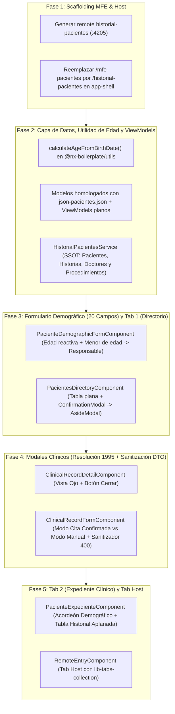

# Auditoría Técnica y Contrapropuesta de Implementación: MFE `historial-pacientes`

> **Ficha Técnica del Documento**  
> * **Ubicación:** `docs/Contrapropuesta-Frontend-MFE-Historial-Pacientes.md`  
> * **Documento Auditado:** [`docs/Planeacion-Frontend-MFE-Historial-Pacientes.md`](./Planeacion-Frontend-MFE-Historial-Pacientes.md)  
> * **Módulos Contrastados en el Monorepo:** `app-shell`, `libs/shared/layouts` (`DataTableComponent`, `AsideModalComponent`, `TabsCollectionComponent`), `libs/shared/dtos`, `libs/shared/api-interfaces`, `docs/json-pacientes.json`  
> * **Veredicto General:** **85% Aplicable Directamente / 15% Requiere Ajustes Técnicos Críticos** antes de iniciar la Fase 1 para evitar errores `400 Bad Request`, pérdida de datos en formularios y fallos de búsqueda/ordenamiento en tablas.

---

## 1. Diagnóstico General de Aplicabilidad

La arquitectura propuesta en [`Planeacion-Frontend-MFE-Historial-Pacientes.md`](./Planeacion-Frontend-MFE-Historial-Pacientes.md) **sí es aplicable** y respeta el estándar visual y estructural del monorepo (`Tab Host` con `lib-tabs-collection`, uso de `lib-data-table`, confirmaciones con `ConfirmationModalComponent` y paneles deslizantes con `AsideModalService`).

Sin embargo, al cotejar cada fase del plan contra **el código fuente real** de `@nx-boilerplate/layouts`, los validadores estrictos de `@nx-boilerplate/shared-dtos` y los datos reales en [`docs/json-pacientes.json`](./json-pacientes.json), se detectaron **7 casos de mejora indispensables** que debemos incorporar al proceso.

---

## 2. Los 7 Casos de Mejora Detectados (Cotejo contra el Monorepo)

### Caso 1: Arquitectura de Acciones en `AsideModalComponent` (Peligro de Cierre Prematuro sin Validar)
* **Qué plantea el documento original (§3.2.4 y Fase 3/4):**
  * Propone usar las acciones del `AsideModal` (*Botón Secundario "Cancelar" y Botón Primario "Guardar y Completar Atención"*) al abrir `PacienteDemographicFormComponent` y `ClinicalRecordFormComponent`.
* **Qué ocurre realmente en el código ([`aside-modal.component.html`](file:///Users/usuario/Desktop/nx-boilerplate/libs/shared/layouts/src/lib/modals/aside-modal/aside-modal.component.html)):**
  * El pie nativo `<mat-dialog-actions>` de `AsideModalComponent` ejecuta directamente `this.dialogRef.close(true)` sin tener referencia al `FormGroup` del componente hijo instanciado vía `*ngComponentOutlet` ni esperar la respuesta asíncrona de la petición HTTP (`POST` / `PATCH`).
* **Consecuencia si no se corrige:**
  * Al hacer clic en "Guardar", el modal se cerrará inmediatamente aunque el formulario sea inválido o el backend devuelva un error `400`/`409`.
* **Contrapropuesta Técnica:**
  * Invocar siempre `AsideModalService.open(..., { showActions: false, showCloseIcon: true })` para los formularios y el visor de detalle.
  * Colocar la barra de botones (`Cancelar` y `Guardar`) **dentro del template del propio componente hijo** (`PacienteDemographicFormComponent` y `ClinicalRecordFormComponent`), inyectando `private readonly dialogRef = inject(MatDialogRef, { optional: true })` (mismo patrón probado en [`ProfesionalDetailComponent`](file:///Users/usuario/Desktop/nx-boilerplate/apps/lista-profesionales/src/app/components/profesional-detail/profesional-detail.component.ts)). Así el modal solo se cierra cuando el `Observable` de guardado responde con éxito.

---

### Caso 2: Discrepancia entre los Selectores del Plan y los Datos Reales en MongoDB (`json-pacientes.json`)
* **Qué plantea el documento original (§3.1):**
  * Define opciones en mayúsculas abreviadas:
    * `sexo`: `'M' | 'F' | 'OTRO'`
    * `estado_civil`: `'SOLTERO' | 'CASADO' | 'UNION_LIBRE' | 'DIVORCIADO' | 'VIUDO'`
    * `tipo_vinculacion`: `'CONTRIBUTIVO' | 'SUBSIDIADO' | 'PARTICULAR' | 'PREPAGADA'`
* **Qué hay realmente en la base de datos ([`docs/json-pacientes.json`](./json-pacientes.json)):**
  * Los pacientes almacenados en MongoDB Atlas tienen valores como:
    * `sexo`: `"Femenino"`, `"Masculino"`
    * `estado_civil`: `"Soltera"`, `"Soltero"`, `"Casada"`, `"Casado"`, `"Unión Libre"`
    * `tipo_vinculacion`: `"Cotizante"`, `"Beneficiario"`, `"Subsidiado"`, `"Particular"`
* **Consecuencia si no se corrige:**
  * Al abrir el expediente de un paciente existente en la Tab 2, los `<mat-select>` de Sexo, Estado Civil y Tipo de Vinculación aparecerán **vacíos** porque el valor en base de datos (`"Femenino"`, `"Cotizante"`) no hace match con las opciones del selector (`"F"`, `"CONTRIBUTIVO"`).
* **Contrapropuesta Técnica:**
  * Estandarizar los catálogos en el modelo del MFE para coincidir con los datos reales de la clínica e incluir un normalizador al hacer `patchValue` para soportar tanto valores históricos como nuevos:
    * **Sexo:** `'Femenino' | 'Masculino' | 'Otro'` (mapeando `'F' -> 'Femenino'` y `'M' -> 'Masculino'` si existieran).
    * **Estado Civil:** `'Soltero(a)' | 'Casado(a)' | 'Unión Libre' | 'Divorciado(a)' | 'Viudo(a)'` (normalizando `'Soltera'/'Soltero' -> 'Soltero(a)'`).
    * **Tipo de Vinculación:** `'Cotizante' | 'Beneficiario' | 'Contributivo' | 'Subsidiado' | 'Particular' | 'Prepagada'`.

---

### Caso 3: Prevención de Error `400 Bad Request` por Reglas de `ValidationPipe` en `ClinicalRecordDto`
* **Qué plantea el documento original (§3.2.2 y §3.2.3):**
  * Deja `procedimientos_previos` sin valor por defecto y `descargable_consentimiento` como un campo de texto libre que podría enviarse vacío (`""`).
* **Qué exige el Backend ([`clinical-record.dto.ts`](file:///Users/usuario/Desktop/nx-boilerplate/libs/shared/dtos/src/lib/clinical-record.dto.ts)):**
  * En `AntecedentesMedicosDto`, **los 4 campos** (`patologicos`, `alergicos`, `farmacologicos`, `procedimientos_previos`) están decorados con `@IsString()` y **`@IsNotEmpty()`**.
  * En `SoporteDocumentalDto`, `descargable_consentimiento` también tiene **`@IsNotEmpty()`**.
  * Además, en el borrador creado por el evento `appointment.confirmed`, estos campos nacen en MongoDB con `""` (string vacío).
* **Consecuencia si no se corrige:**
  * Si el médico deja en blanco *"Procedimientos previos"* o el *"Enlace del consentimiento informado"*, el `ValidationPipe` del API Gateway rechazará el `PATCH /api/clinical-records/:id` con **`400 Bad Request`**.
* **Contrapropuesta Técnica:**
  1. Al precargar el formulario (`ClinicalRecordFormComponent`), si cualquiera de los 4 campos de `antecedentes_medicos` viene vacío (`""`), inicializarlo en el formulario con `'Ninguno'`.
  2. En el mapeador de envío (`onSubmit`), aplicar un sanitizador:
     * Si algún antecedente quedó vacío tras `trim()`, enviar `'No refiere'`.
     * En `soporte_documental`: si `descargable_consentimiento.trim()` está vacío, enviar `'Pendiente de adjunto físico/digital'`.

---

### Caso 4: Limitación de `DataTableComponent` con Propiedades Anidadas y `rowKey` en `ICitaMedica`
* **Qué plantea el documento original (Fase 3 y Fase 5):**
  * Pasar `ICitaMedica[]` directamente a `<lib-data-table>` en la Tab 2 con columnas `fecha` (`medico_tratante[0]?.fecha_atencion`), `procedimiento` (`registro_clinico.procedimiento_realizado`) y `medico`.
* **Qué ocurre realmente en [`DataTableComponent`](file:///Users/usuario/Desktop/nx-boilerplate/libs/shared/layouts/src/lib/data-table/data-table.component.ts):**
  1. **Identificador de fila (`rowKey`):** Por defecto `lib-data-table` usa `rowKey = 'id'`. Los documentos `ICitaMedica` usan `_id` (y `appointmentId`), no `id`. Si no se define una clave única por fila, la selección/expansión y el tracking fallan.
  2. **Buscador y Ordenamiento (`MatTableDataSource`):** El filtro de búsqueda y el `MatSort` nativos de `lib-data-table` solo evalúan **propiedades planas de primer nivel** (`row[col.field]`). Si los datos están anidados dentro de `row.registro_clinico.procedimiento_realizado` o `row.medico_tratante[0].fecha_atencion`, **el buscador no encontrará procedimientos ni médicos, y el ordenamiento por fecha o procedimiento no funcionará**.
* **Contrapropuesta Técnica:**
  * No modificar `lib-data-table` (respetando la regla de oro de no romper otros MFEs).
  * Crear en el servicio o componente dos señales computadas (`computed()`) que proyecten **ViewModels planos** para las tablas:
    * **`PatientDirectoryRow` (Tab 1):** Incluye los campos de `IPatientHistory` más `nombreCompleto: string` y `estadoFicha: 'COMPLETA' | 'INCOMPLETA'`. Permite buscar por nombre y apellido combinados y ordenar por estado de ficha.
    * **`ClinicalRecordRow` (Tab 2):** Aplana `id: record._id || record.appointmentId`, `fechaAtencion: string`, `procedimientoRealizado: string`, `medicoNombre: string`, `estadoRegistro: ClinicalRecordStatus` y conserva `raw: ICitaMedica`. Con `rowKey="id"`, el buscador, el ordenamiento por columnas y las acciones (`visibility` / `edit`) funcionarán al 100%.

---

### Caso 5: Soporte Completo para "Atención Manual (Sin Cita Previa)" en `ClinicalRecordFormComponent`
* **Qué plantea el documento original (§3.2.1 y Fase 5):**
  * En la Fase 5 menciona un botón `"+ Nueva Atención Manual"` para crear una consulta sin cita previa (`POST /api/clinical-records`), pero en §3.2.1 diseña el bloque del Médico Tratante únicamente como un **banner de solo lectura** tomado de `record().medico_tratante[0]`.
* **Consecuencia si no se corrige:**
  * Cuando se abre el modal para una **Nueva Atención Manual** (`record === null`), no existe `record().medico_tratante[0]` ni procedimiento agendado. El médico no tendría cómo seleccionar qué profesional atiende la consulta, y el `POST /api/clinical-records` fallaría porque `medico_tratante` es un arreglo requerido por `CreateClinicalRecordDto`.
* **Contrapropuesta Técnica:**
  * Hacer que la cabecera de `ClinicalRecordFormComponent` opere en **modo contextual**:
    * **Modo Cita Agendada (`record() !== null`):** Muestra el banner informativo precargado (Médico, Fecha de cita, `appointmentId`) y precarga `procedimiento_realizado`.
    * **Modo Atención Manual (`record() === null`):** Muestra un selector `<mat-select formControlName="cedula_profesional">` alimentado por `service.doctors()` (solo médicos activos) y un selector/autocompletado de procedimiento alimentado por `service.procedures()`, armando automáticamente el payload `medico_tratante: [{ cedula_profesional, nombre_profesional, fecha_atencion: new Date().toISOString() }]`.

---

### Caso 6: Limpieza de la Ruta Placeholder `/mfe-pacientes` en `app-shell`
* **Qué plantea el documento original (Fase 1.4):**
  * *"Añadir el ítem en el Sidenav (`app-shell/src/app/app.ts`): `{ path: '/historial-pacientes', ... }`"*.
* **Qué existe hoy en [`app-shell/src/app/app.ts`](file:///Users/usuario/Desktop/nx-boilerplate/app-shell/src/app/app.ts#L48):**
  * En la línea 48 ya existe un ítem placeholder: `{ path: '/mfe-pacientes', label: 'Pacientes', icon: 'person' }`.
* **Contrapropuesta Técnica:**
  * **Reemplazar** ese ítem placeholder en `app.ts` por `{ path: '/historial-pacientes', label: 'Historial de Pacientes', icon: 'clinical_notes' }` (para no dejar un botón roto en el menú) y añadir en `app.routes.ts` una redirección `{ path: 'mfe-pacientes', redirectTo: 'historial-pacientes' }` por retrocompatibilidad.

---

### Caso 7: Uso de `<ng-template>` para Celdas Enriquecidas (Chips MD3) en `lib-data-table`
* **Qué plantea el documento original (Fase 3 y Fase 5):**
  * Mostrar chips tonales MD3 para el estado de la ficha demográfica (*Completa* vs *Incompleta*) y el estado de la historia clínica (*Pendiente de Atención* vs *Completada*), además de las acciones de fila.
* **Cómo lo soporta [`DataTableComponent`](file:///Users/usuario/Desktop/nx-boilerplate/libs/shared/layouts/src/lib/data-table/data-table.component.html#L112-L145):**
  * `TableColumnDef` soporta la propiedad `cellTemplate?: TemplateRef<{ $implicit: T; field?: string }>` y `DataTableComponent` soporta el input `[actions]="tableActions"` con `(actionClick)="onAction($event)"`.
* **Contrapropuesta Técnica:**
  * Utilizar `viewChild<TemplateRef<unknown>>` + `computed<TableColumnDef[]>()` para inyectar las plantillas de los chips MD3 en las columnas `estadoFicha` y `estadoRegistro`, y usar el input declarativo `[actions]` de `lib-data-table` con `{ id: 'view', icon: 'visibility', label: 'Ver detalle' }` y `{ id: 'edit', icon: 'edit', label: 'Diligenciar / Editar historia', color: 'primary' }`.

---

## 3. Contrapropuesta de Planificación Fase por Fase (Versión Optimizada)

A continuación se presenta el flujo corregido en **5 fases sin fricciones**, incorporando los 7 casos de mejora:

---

### Detalle de Ajustes por Fase en la Contrapropuesta

#### Fase 1: Scaffolding del MFE `historial-pacientes` e Integración Limpia en `app-shell`
1. Generar el remote en `apps/historial-pacientes` configurado en puerto **`4205`** (`serve`) y **`4215`** (`serve-static`).
2. Configurar `module-federation.config.ts` exponiendo `./Routes`, sin duplicar `@angular/material` ni `@angular/cdk` (provistos por el Host).
3. En `app-shell`:
   * Registrar `"historial-pacientes": "http://localhost:4205/mf-manifest.json"`.
   * En `app.routes.ts`: agregar ruta lazy `historial-pacientes` y redirect `mfe-pacientes -> historial-pacientes`.
   * En `app.ts`: **reemplazar** `{ path: '/mfe-pacientes', ... }` por `{ path: '/historial-pacientes', label: 'Historial de Pacientes', icon: 'clinical_notes' }`.

#### Fase 2: Utilidad de Edad, ViewModels Planos y `HistorialPacientesService` (SSOT)
1. **En `libs/shared/utils/src/lib/date.utils.ts`:**
   * Implementar `calculateAgeFromBirthDate(birthDate: string | Date | null | undefined, referenceDate?: Date): number | null`.
2. **En `apps/historial-pacientes/src/app/models/historial-pacientes.models.ts`:**
   * Catálogos homologados con `json-pacientes.json` (`TIPOS_DOCUMENTO`, `SEXOS_PACIENTE`, `ESTADOS_CIVILES`, `TIPOS_VINCULACION`).
   * Interfaces aplanadas `IPatientDirectoryRow` e `IClinicalRecordRow` para garantizar que la búsqueda y el ordenamiento de `lib-data-table` funcionen sobre campos anidados.
   * Función `normalizePatientForForm(patient: IPatientHistory)` (traduce valores históricos como `'Soltera'`/`'Soltero'` o `'F'`/`'Femenino'`).
3. **En `HistorialPacientesService`:**
   * Además de `loadPatients()` y `loadDoctors()`, incluir `loadProcedures()` (`GET /api/procedures`) para alimentar el selector de procedimientos cuando se cree una atención clínica manual o se edite una existente.
   * Señales computadas `directoryRows = computed<IPatientDirectoryRow[]>(...)` y `clinicalRecordRows = computed<IClinicalRecordRow[]>(...)`.

#### Fase 3: `PacienteDemographicFormComponent` (20 Campos) y `PacientesDirectoryComponent` (Tab 1)
1. **`PacienteDemographicFormComponent`:**
   * Suscripción reactiva a `fecha_nacimiento.valueChanges` (`takeUntilDestroyed`) que calcula `edad`, actualiza el control `edad` y marca automáticamente `es_menor_de_edad = (edad !== null && edad < 18)`.
   * Suscripción reactiva a `es_menor_de_edad.valueChanges` que aplica o remueve dinámicamente `Validators.required` sobre `persona_responsable.controls.nombre`, `telefono` y `parentesco`, llamando a `updateValueAndValidity()`.
   * Si se abre dentro del `AsideModal` (`mode = 'create'`), renderiza su propio pie de acciones (`Cancelar` / `Registrar Paciente`) e invoca `dialogRef?.close(true)` únicamente tras el éxito de `POST /api/patients`.
2. **`PacientesDirectoryComponent`:**
   * Usa `<lib-data-table [dataTable]="service.directoryRows()" rowKey="cedula" [searchable]="true" [actions]="directoryActions" (actionClick)="onTableAction($event)">`.
   * Botón `"Agregar Paciente"` en `[table-header]` $\rightarrow$ abre `ConfirmationModalComponent` (*"Está creando un nuevo historial de paciente sin cita previa. ¿Desea continuar?"*) $\rightarrow$ al confirmar, abre `AsideModalService.open` con `showActions: false` y `width: '680px'`.

#### Fase 4: Modales Clínicos (`ClinicalRecordDetailComponent` y `ClinicalRecordFormComponent`)
1. **`ClinicalRecordDetailComponent` (Acción Ojo `visibility`):**
   * Abierto vía `AsideModalService.open` con `showActions: false` y `width: '560px'`.
   * Muestra todos los bloques de la Resolución 1995 y pie con botón secundario `<button mat-stroked-button (click)="close()">Cerrar</button>`.
2. **`ClinicalRecordFormComponent` (Acción Lápiz `edit` o Botón `+ Nueva Atención Manual`):**
   * Abierto vía `AsideModalService.open` con `showActions: false` y `width: '680px'`.
   * Soporta tanto el diligenciamiento de una cita confirmada (`record !== null`, mostrando el banner con los datos precargados del paciente y médico del agendamiento) como la creación manual (`record === null`, mostrando el `<mat-select>` de médico tratante).
   * Incluye el **Sanitizador de Payload** para asegurar que ningún campo requerido por `AntecedentesMedicosDto` o `SoporteDocumentalDto` viaje como string vacío `""`, evitando errores `400 Bad Request` y enviando `estado_registro: 'COMPLETADA'`.

#### Fase 5: `PacienteExpedienteComponent` (Tab 2) y `RemoteEntryComponent` (Tab Host)
1. **`PacienteExpedienteComponent`:**
   * Cabecera del paciente con badges de `ultimosProcedimientos` y última recomendación médica.
   * `MatExpansionPanel` con `<app-paciente-demographic-form [patient]="selectedPatient()" mode="edit" />` (se despliega abierto por defecto si `isDemographicComplete(patient)` es `false`).
   * `<lib-data-table [dataTable]="service.clinicalRecordRows()" rowKey="id" [searchable]="true" [actions]="recordActions">` con acciones Ojo (`visibility`) y Lápiz (`edit`).
2. **`RemoteEntryComponent`:**
   * Orquesta las 2 pestañas con `<lib-tabs-collection [preserveContent]="true">`.

---

## 4. Resumen Comparativo: Plan Original vs. Contrapropuesta

| Aspecto | Plan Original (`Planeacion-Frontend-MFE-Historial-Pacientes.md`) | Contrapropuesta (`Contrapropuesta-Frontend-MFE-Historial-Pacientes.md`) | Beneficio |
|---|---|---|---|
| **Botones en `AsideModal` de Formularios** | Usa los botones del `AsideModal` (`showActions: true`) | Usa `showActions: false` y botones dentro del `<form>` del componente hijo | Evita que el modal se cierre sin validar el formulario o si falla la petición HTTP. |
| **Catálogos (`sexo`, `estado_civil`, `tipo_vinculacion`)** | Códigos nuevos (`'M'`, `'F'`, `'CONTRIBUTIVO'`) | Homologados con `json-pacientes.json` (`'Femenino'`, `'Cotizante'`, etc.) + normalizador | Los pacientes actuales de MongoDB cargan sus selectores correctamente sin perder datos. |
| **Campos vacíos en `antecedentes_medicos` y `soporte_documental`** | Permite strings vacíos `""` | Sanitizador con defaults (`'Ninguno'`, `'No refiere'`) antes del `PATCH`/`POST` | Evita errores `400 Bad Request` del `ValidationPipe` (`@IsNotEmpty()`). |
| **Datos en `<lib-data-table>`** | Pasa `ICitaMedica[]` crudo (con objetos anidados y `_id`) | Pasa ViewModels planos computados (`ClinicalRecordRow` con `rowKey="id"`) | Funcionan el buscador, el ordenamiento por columnas y el tracking sin tocar `libs/shared/layouts`. |
| **Atención Manual (`record === null`)** | Médico tratante solo como texto fijo | Selector `<mat-select>` de médico tratante cuando es atención manual | Permite cumplir `CreateClinicalRecordDto` (`medico_tratante` obligatorio) en consultas sin cita previa. |
| **Ruta en `app-shell`** | Agrega `/historial-pacientes` dejando `/mfe-pacientes` | Reemplaza `/mfe-pacientes` en Sidenav y crea redirect en `app.routes.ts` | Menú lateral limpio y sin enlaces rotos. |

