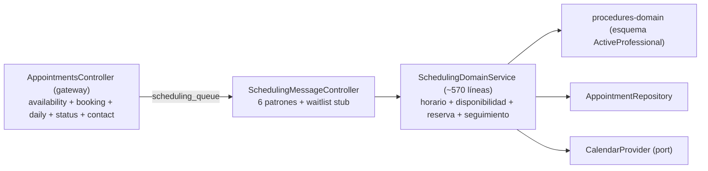
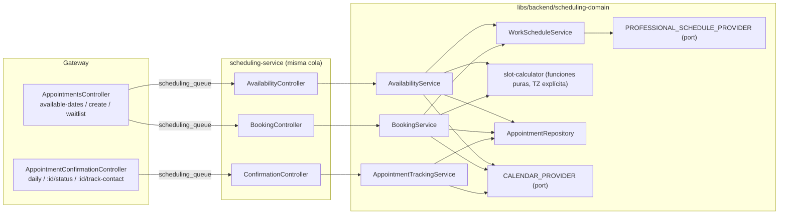

# Plan Recomendado: Separación de Responsabilidades del Microservicio de Agendamiento

> **Estado:** Completado y Verificado (Fases 0 a 5 ejecutadas con éxito).
> **Reemplaza / corrige:** [Plan-Implementacion-confirmacion-citas.md](./Plan-Implementacion-confirmacion-citas.md)
> **Skills gobernantes:** `nest-microservices` (backend), `angular-data-expert` y `angular-ui-expert` (frontend), `doc-architect` (documentación).

---

## 1. Veredicto

**No estoy de acuerdo con el plan en su estado actual.** Los motivos, ordenados por peso:

1. **No cubre lo que se quiere hacer.** El plan describe solo la pestaña Tab 3 (frontend). No contiene ninguna fase de backend, y la "separación de responsabilidades" está en `scheduling-service` / `scheduling-domain`.
2. **Está desactualizado.** Sus Fases 1–4 ya existen en el código (`ConfirmacionCitasService`, `ConfirmacionCitasComponent`, `filtros-confirmacion/`, `tabla-citas/`). Usarlo como guía de trabajo futuro llevaría a rehacer lo ya hecho.
3. **Viola el orden full-stack de `AGENTS.md`** (contrato → DTO → dominio → transporte → UI) y ubica un DTO en `api-interfaces` (los DTOs con `class-validator` van en `shared-dtos`).
4. **Contiene supuestos que ya fallaron en la práctica** (`ngOnInit` para reiniciar la fecha, `cita.id`, fetch por estado desde el servidor).
5. **No tiene puertas de verificación**, y hoy la línea base tiene una prueba rota (hallazgo H1).

> [!IMPORTANT]
> **Supuesto de alcance que debes confirmar:** interpreto "separación de responsabilidades" como dividir el contexto de **confirmación/seguimiento diario** (`get-daily`, `update-status`, `contact-tracked`) del contexto de **disponibilidad y reserva**, que hoy conviven en un único `SchedulingDomainService` y un único controlador. Ver §5 para la decisión librería vs. ejecutable.

---

## 2. Hallazgos verificados

Cada hallazgo se contrastó contra el código o contra la ejecución.

| # | Severidad | Hallazgo | Evidencia |
|---|---|---|---|
| H1 | **Alta** | `nx test scheduling-domain` **falla** (1 de 6). Es una regresión mía de la última entrega (commit `ffd17d7`). | El spec instancia `new SchedulingDomainService(calendar, repo)` con 2 argumentos; el servicio ahora exige un tercero. El test de reserva cae en "fuera de la jornada laboral". |
| H2 | **Alta** | **Dependencia de zona horaria.** Los slots y la validación usan `setHours()` en hora local del proceso, pero los clientes envían ISO en UTC. | El mismo test pasa o falla según la TZ de la máquina. En un contenedor en UTC, "07:00" sería 02:00 en Colombia. |
| H3 | **Alta** | **Fallback silencioso** a `DEFAULT_SCHEDULE` (Lun–Sáb, 07–19) si el profesional no se encuentra. Una reserva para un médico mal escrito se acepta con un horario inventado. | `resolveProfessionalSchedule` captura el error y retorna el default. |
| H4 | Media | El email se interpola sin escapar en un `RegExp`. Correos con `+` no coinciden y activan el fallback de H3. | `new RegExp(\`^${doctorEmail}$\`, 'i')` en `scheduling-domain.service.ts`. |
| H5 | Media | **Acoplamiento entre dominios:** `scheduling-domain` importa `@nx-boilerplate/backend/procedures-domain` (esquema `ActiveProfessional`). Pasa el lint porque `enforce-module-boundaries` está en `'*' → ['*']`. | `eslint.config.mjs` (`depConstraints`) y `scheduling-domain.module.ts`. |
| H6 | Media | **God service:** `SchedulingDomainService` (~570 líneas) mezcla 4 responsabilidades: horario del profesional, disponibilidad, reserva y seguimiento (daily/status/contact). El controlador mezcla además `waitlist` (stub) y los DTOs de payload viven en `services/` en vez de `shared-dtos`. | Métodos listados en el servicio; `scheduling-message.controller.ts`. |
| H7 | Media | **Deriva de DTOs duplicados:** `GetAvailableDatesQueryDto` (gateway) y `GetAvailableDatesPayloadDto` (service) duplican campos. `doctorCedula` existía en uno y no en el otro. Con `forbidNonWhitelisted`, esa diferencia produce 400 en runtime, no error de compilación. | `appointment-gateway.dto.ts` vs `get-available-dates-payload.dto.ts`. |
| H8 | Media | `ConfirmacionCitasService`: (a) el `effect` depende de `selectedStatus` pero el fetch no envía `status` → **una llamada HTTP redundante por cada chip**; (b) el fetch no cancela la petición previa → **condición de carrera** al cambiar de fecha rápido. | Líneas 109–119 y 158–187 del servicio. |
| H9 | Baja | Naming engañoso: `AGENDADOR_TABS.PROFESSIONALS` ahora abre Confirmación de Citas. `ListaProfesionalesComponent` quedó huérfano (genera warning de build). | `confirmacion-citas.component.ts:29`; warning en `nx build agendador-citas`. |
| H10 | Baja | Alias duplicado en `tsconfig.base.json`: `@nx-boilerplate/utils` y `@nx-boilerplate/shared/utils` apuntan al mismo `index.ts`. Backend usa uno, frontend el otro. | `tsconfig.base.json` líneas 38–39. |
| H11 | Baja | La lógica de "próximos días hábiles" quedó dentro de un método privado del componente en vez de una función pura en `libs/shared/utils` (como pedía el plan). No es testeable ni reutilizable. | `filtros-confirmacion.component.ts:87`. |
| H12 | **Seguridad** | `app.module.ts` de `scheduling-service` y `procedures-service` incluye como *fallback* una URI de MongoDB Atlas **con usuario y contraseña**. Está en el historial de git. Un servicio nuevo copiado del scaffolding la replicaría. | `services/*/src/app.module.ts`. |
| H13 | Info | `AGENTS.md` exige `--no-interactive` en todo comando Nx, pero los targets `build` de `services/*` usan `nx:run-commands` + `webpack-cli`, que **rechaza** ese flag (`Unknown option '--no-interactive'`). | Ejecución real de `nx build scheduling-service`. |

> [!WARNING]
> H1–H4 provienen de mi última entrega. Recomiendo corregirlos primero (Fase 0) antes de cualquier refactor, porque un refactor sobre una línea base roja oculta regresiones.

---

## 3. Arquitectura objetivo

### 3.1 Antes



### 3.2 Después (recomendado)



**Principios:**

- **URLs HTTP y patrones RMQ no cambian** → el frontend y la colección de APIs quedan intactos.
- La lógica de horario es **pura** (sin Mongo, sin `Date.now()` implícito, sin TZ del proceso) y por tanto testeable.
- `scheduling-domain` **no importa** otro dominio: lee el horario a través de un puerto con un adaptador propio (modelo de lectura mínimo de la colección `profesionalesActivos`).
- Cada controlador de transporte queda delgado (solo valida y delega), conforme a la skill `nest-microservices`.

---

## 4. Plan por fases

Cada fase termina con una **puerta de salida**: no se avanza si no está verde.

### Fase 0 — Línea base verde (hotfix) · `nest-microservices`

| Acción | Detalle |
|---|---|
| Corregir H1 | Reemplazar el `new SchedulingDomainService(...)` del spec por una fábrica `createService(overrides)` con mock del proveedor de horario. Añadir casos: día no laborable, sin receso, reserva fuera de jornada, reserva en receso. |
| Corregir H3 | Si el profesional no existe, **lanzar `RpcException`** (404) en reserva. Permitir fallback solo en consulta de disponibilidad, con `logger.warn` explícito. |
| Corregir H4 | Escapar el email (`escapeRegExp`) o normalizar a minúsculas y comparar por igualdad. |
| Resolver H2 (mínimo) | Construir los instantes con offset fijo `-05:00` (Colombia no tiene DST): `new Date(\`${fecha}T${hh}:${mm}:00-05:00\`)`. Elimina `setHours()` local. |
| H12 | Quitar el *fallback* con credenciales de `app.module.ts`, exigir `MONGODB_URI` y **rotar la credencial expuesta**. |

**Puerta:** `npx nx test scheduling-domain` ✅ · `npx nx build scheduling-service` ✅ · `npx nx build api-gateway` ✅.
*(No añadir `--no-interactive` a los `build` de servicios, ver H13.)*

### Fase 1 — Contratos y DTOs · `nest-microservices`

1. `@nx-boilerplate/api-interfaces`: añadir `isWorkingDay: boolean` a `IDayAvailability`. Hoy el frontend infiere "día no laborable" de `slots.length === 0`, lo cual es ambiguo.
2. `@nx-boilerplate/shared-dtos`: mover y **unificar** `GetAvailableDatesDto`, `CreateAppointmentDto`, `CreateWaitlistDto`. El gateway y el servicio importan **la misma clase** (resuelve H7).
3. Eliminar los DTOs duplicados de `services/api-gateway/src/dtos/` y `services/scheduling-service/src/dtos/`.

**Puerta:** build de `api-gateway`, `scheduling-service`, `agendador-citas` ✅.

### Fase 2 — Núcleo puro y puerto de horario · `nest-microservices`

Ubicación: `libs/backend/scheduling-domain/src/lib/`

```text
utils/slot-calculator.ts                         # buildWorkWindow, buildLunchWindow, generateSlots, isWithinSchedule
ports/professional-schedule-provider.port.ts     # PROFESSIONAL_SCHEDULE_PROVIDER
adapters/mongo-professional-schedule.adapter.ts  # lee `profesionalesActivos` con un read-model propio
schemas/professional-schedule.read-model.ts      # solo campos de lectura; sin import de procedures-domain
```

- Elimina la dependencia a `procedures-domain` (H5).
- Alternativa descartada por ahora: RPC a `procedures-service` (`doctors.get-schedule`). Añade latencia y un punto de fallo extra por cada consulta de calendario.
- Opcional recomendado: restringir `enforce-module-boundaries` para que `type:domain-lib` no dependa de otro `type:domain-lib`.

**Puerta:** tests unitarios de `slot-calculator` (sin Nest, sin Mongo) y del adaptador con modelo simulado ✅.

### Fase 3 — Descomposición del servicio de dominio · `nest-microservices`

Estrategia *strangler*: se crean los servicios nuevos y `SchedulingDomainService` queda como **fachada delegante** hasta que los controladores migren. Así nunca se rompe la compilación.

| Servicio nuevo | Métodos que absorbe |
|---|---|
| `WorkScheduleService` | `resolveProfessionalSchedule` |
| `AvailabilityService` | `getAvailableSlots`, `getAvailableSlotsForRange` |
| `BookingService` | `bookAppointment` (+ validación de jornada) |
| `AppointmentTrackingService` | `getDailyAppointments`, `updateAppointmentStatus`, `incrementContactCount` |

- `Appointment` y `AppointmentRepository` **permanecen compartidos** dentro de la librería (ver §5).
- Los servicios se prueban con `Test.createTestingModule`, no con `new` posicional.

**Puerta:** `npx nx test scheduling-domain` ✅ y suite previa sin cambios de aserciones.

### Fase 4 — Transporte: controladores y gateway · `nest-microservices`

- `services/scheduling-service/src/controllers/`: dividir en `availability.controller.ts`, `booking.controller.ts`, `confirmation.controller.ts`. Mover `waitlist.create` (stub sin dominio) a su propio controlador o marcarlo explícitamente como pendiente.
- `services/api-gateway/src/controllers/`: dividir `appointments.controller.ts` en `appointments.controller.ts` y `appointment-confirmation.controller.ts`, **ambos con prefijo `appointments`**. Mismas rutas y mismos patrones RMQ.
- Retirar la fachada `SchedulingDomainService` cuando no quede ningún consumidor.

**Puerta:** colección Postman (`agendador-citas.collection.json`) ejecutada de punta a punta sin cambios ✅.

### Fase 5 — Frontend alineado con el plan original · `angular-data-expert` + `angular-ui-expert`

| Tarea | Resuelve |
|---|---|
| `ConfirmacionCitasService`: quitar `selectedStatus` de las dependencias del `effect` (el filtro por estado ya es local). | H8a |
| Sustituir `effect` + `subscribe` por `rxResource` o por `Subject` + `switchMap` (patrón ya usado en `AppointmentLogicService`) para cancelar peticiones obsoletas. | H8b |
| Extraer `getNextWorkingDays(n)` a `libs/shared/utils` con prueba unitaria. | H11 |
| Renombrar `AGENDADOR_TABS.PROFESSIONALS` → `CONFIRMATION` y eliminar `ListaProfesionalesComponent` (+ spec). | H9 |
| Unificar el alias a `@nx-boilerplate/shared/utils` (o `@nx-boilerplate/utils`) en un solo valor. | H10 |
| Reemplazar `(apt as any)._id` por un tipo de contrato. | Calidad |
| Si `isWorkingDay` existe, usarlo en `#mapToCalendarDays` en lugar de `slots.length > 0`. | Fase 1 |

**Puerta:** `npx nx build agendador-citas` sin warnings nuevos ✅ y `npx nx test agendador-citas` ✅.

### Fase 6 — Opcional: extracción a un ejecutable `confirmation-service`

Solo si se cumple al menos uno de estos criterios (ver §5):

- Escalado independiente (el dashboard recibe mucho más tráfico que la reserva).
- Equipo o ciclo de despliegue distinto.
- Aislamiento de fallos (la confirmación no debe caerse si falla Google Calendar en la reserva).

**Checklist de scaffolding** (verificado contra `scheduling-service`):

- [ ] `npx nx g @nx/nest:application services/confirmation-service --no-interactive` (los generadores sí aceptan el flag).
- [ ] `project.json` con tags `["scope:backend", "type:service"]`, `webpack.config.js`, `tsconfig.json`, `tsconfig.app.json`.
- [ ] `main.ts` con **cola propia** `RABBITMQ_CONFIRMATION_QUEUE` y `ValidationPipe` global estricto.
- [ ] `ClientsModule.register` en `services/api-gateway/src/app.module.ts` con un nuevo `CONFIRMATION_SERVICE`.
- [ ] Variable en `.env` y `.env.example`.
- [ ] Añadir el servicio al script `serve:backend` de `package.json` (la lista está escrita a mano).
- [ ] `MONGODB_URI` obligatoria, sin credenciales en el código (H12).
- [ ] Actualizar `docs/api-gateway.md` y documentar el servicio nuevo con `documentar confirmation-service`.

**Orden de despliegue RabbitMQ (crítico):**

> [!CAUTION]
> Nunca dos servicios distintos deben consumir la **misma cola**. RabbitMQ reparte en round-robin y un mensaje puede llegar al servicio que no tiene ese `@MessagePattern`; la petición queda colgada hasta el timeout del gateway (5 000 ms en `get-daily`).

1. Desplegar `confirmation-service` con su cola nueva (los handlers duplicados conviven un momento).
2. Cambiar el gateway para que los patrones de confirmación usen el nuevo `ClientProxy`.
3. Verificar tráfico y recién entonces borrar los handlers de `scheduling-service`.

### Fase 7 — Documentación y cierre

- `documentar scheduling-service` y `documentar scheduling-domain` (`doc-architect`).
- Actualizar `docs/api-gateway.md`, `docs/documentacion-front/agendador-citas.md` y la colección de APIs.
- Marcar `Plan-Implementacion-confirmacion-citas.md` como **ejecutado/obsoleto** con enlace a este documento.

---

## 5. Decisión: ¿librería o ejecutable?

| Criterio | Separar en librería (Fases 0–5) | Separar en ejecutable (Fase 6) |
|---|---|---|
| Datos | Misma colección `appointments`, un único dueño lógico | **Base de datos compartida entre servicios** (anti-patrón) o duplicación de datos |
| Calendario | Un solo `CALENDAR_PROVIDER` | `updateEventStatus` exige el mismo adaptador de Google → credenciales y config duplicadas |
| Riesgo de migración | Bajo (URLs y patrones estables) | Medio-alto (colas, orden de despliegue) |
| Beneficio de SRP | Alto (servicios pequeños, testeables) | Igual que la opción anterior, más aislamiento de despliegue |
| Costo operativo | Ninguno | Un proceso más, otra cola, otro healthcheck |

**Recomendación:** hacer **las Fases 0–5 ahora** y dejar la Fase 6 condicionada a un requisito real de escalado o aislamiento. Con la separación por librería ya hecha, extraer el ejecutable después es mecánico: solo se mueven controladores y se agrega una cola.

---

## 6. Riesgos y mitigaciones

| Riesgo | Mitigación |
|---|---|
| Refactor sobre línea base roja | Fase 0 obligatoria como puerta de entrada. |
| Rotura silenciosa por `forbidNonWhitelisted` al mover DTOs | Fase 1 unifica las clases; prueba de contrato del gateway contra el servicio. |
| Reserva aceptada fuera de horario por diferencia de TZ | Offset fijo `-05:00` y pruebas con TZ forzada (`TZ=UTC` y `TZ=America/Bogota`). |
| Mensajes RMQ perdidos o colgados al separar colas | Orden de despliegue de la Fase 6; nunca compartir cola. |
| Dependencias circulares entre dominios | Puerto + read-model propio; restringir `depConstraints`. |
| Credenciales expuestas en git | Rotar la contraseña de Atlas; retirar el *fallback*; considerar limpiar el historial. |

---

## 7. Comandos de verificación por fase

```bash
npx nx test scheduling-domain
npx nx build scheduling-service      # sin --no-interactive (H13)
npx nx build api-gateway
npx nx build agendador-citas
npx nx lint scheduling-domain
npx nx graph                          # confirmar que scheduling-domain ya no depende de procedures-domain
TZ=UTC npx nx test scheduling-domain --skip-nx-cache   # verificar independencia de zona horaria
```

---

## 8. Decisiones abiertas (requieren tu confirmación)

1. **Alcance:** ¿separación por librería (recomendada, Fases 0–5) o también extracción a ejecutable (Fase 6)?
2. **Fase 0:** ¿autorizas corregir ahora H1–H4 y H12? Son regresiones y riesgos de mi entrega anterior y conviene resolverlos antes de refactorizar.
3. **Contrato:** ¿aceptas añadir `isWorkingDay` a `IDayAvailability`? Es un cambio aditivo y retrocompatible.
4. **Credenciales:** ¿rotas la contraseña de Atlas expuesta y apruebas exigir `MONGODB_URI` por variable de entorno?
