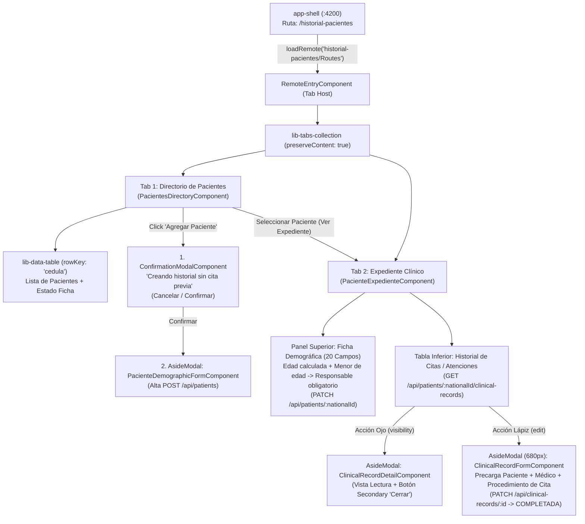

# Plan de Implementación Frontend: MFE `historial-pacientes`

> **Ficha Técnica del Módulo**
> * **Ubicación en Monorepo:** `apps/historial-pacientes` (Nuevo Remote MFE)
> * **Puertos de Desarrollo:** `4205` (`serve`) y `4215` (`serve-static`)
> * **Ruta en `app-shell`:** `/historial-pacientes` (Sidenav CTA: `"Historial de Pacientes"`, icono `folder_shared` o `clinical_notes`)
> * **Normativa Clínica:** Resolución 1995 de 1999 (Ficha Demográfica de 20 campos + Historia Clínica Electrónica)
> * **Referencia Backend:** `docs/historias-clinicas-back.md`, `00-api-gateway.md`, `01-patients-clinical-service.md` (Commit `3cd5c88`)
> * **Skills Gobernantes:** `angular-data-expert`, `angular-ui-expert`, `md3-architecture`

---

## 1. Arquitectura de Navegación y Flujo de Usuario



---

## 2. Decisiones Arquitectónicas y Reglas de Negocio

| # | Regla / Decisión | Implementación en Angular 20+ |
|---|---|---|
| **R1** | **Navegación Homologada (Opción A — 2 Pestañas):** Tab 1 = *Directorio de Pacientes*, Tab 2 = *Expediente Clínico*. | Gobernado por `HistorialPacientesService.activeTab`. Si aún no hay un paciente activo seleccionado (`selectedPatient() === null`), la Tab 2 muestra un estado vacío guiado con botón para volver al Directorio o buscador directo por cédula. |
| **R2** | **Alta de Paciente sin Cita Previa (Doble Paso en Tab 1):** Botón *"Agregar Paciente"* en la cabecera del Directorio. | 1) Abre `ConfirmationModalComponent` advirtiendo que se creará un historial sin cita previa (*Cancelar* / *Confirmar*). 2) Si confirma (`true`), abre `AsideModalService` con `PacienteDemographicFormComponent` en modo Creación (`POST /api/patients`). Al guardar, selecciona automáticamente al paciente y navega a la Tab 2. |
| **R3** | **Cálculo Automático de Edad y Regla de Menor de Edad (Resolución 1995):** Basado en `fecha_nacimiento`. | Una función pura `calculateAgeFromBirthDate(birthDate)` calcula la `edad` exacta en años. Un flujo reactivo (`valueChanges` con `takeUntilDestroyed`) actualiza el control `edad` (solo lectura) y `es_menor_de_edad` (`edad < 18`). Si `es_menor_de_edad === true`, muestra el bloque `persona_responsable` (`nombre`, `telefono`, `parentesco`) y aplica `Validators.required` dinámicamente (`updateValueAndValidity()`). |
| **R4** | **Hidratación de Médico y Paciente al Editar Historia (`edit`):** Los borradores nacidos de citas confirmadas (`PENDIENTE_ATENCION`) traen `cedula_profesional`, `fecha_atencion` y `procedimiento_realizado`. | `HistorialPacientesService` precarga el catálogo de doctores (`GET /api/doctors?includeInactive=true`) para resolver `nombre_profesional` a partir de `cedula_profesional` si el borrador solo trae la cédula. El `AsideModal` de edición (`ClinicalRecordFormComponent`) muestra en cabecera de solo lectura los datos del Paciente y del Médico tratante precargados desde el agendamiento. |
| **R5** | **Visualización de Consulta (`visibility`):** Ícono de ojo en la tabla de historial de citas. | Abre `AsideModalService` (`width: '540px'`, `showActions: false`) proyectando `ClinicalRecordDetailComponent` con todos los bloques de la Resolución 1995 y un único botón secundario (`mat-stroked-button`) con label **"Cerrar"**. |

---

## 3. Anatomía de los Formularios Reactivos

### 3.1 Formulario Demográfico de 20 Campos (`PacienteDemographicFormComponent`)
Organizado en 4 bloques visuales claros (usizable tanto dentro del `AsideModal` para crear un paciente nuevo desde el Directorio, como en el panel del Expediente en la Tab 2 para actualizar con `PATCH /api/patients/:nationalId`):

1. **Bloque 1 — Identificación y Contacto Básico (5 campos base + Tipo Doc):**
   * `tipo_documento`: `'CC' | 'TI' | 'CE' | 'PA' | 'RC'` (default `'CC'`, requerido).
   * `cedula`: `string` (requerido, deshabilitado en modo edición).
   * `nombre`: `string` (requerido).
   * `apellidos`: `string` (requerido).
   * `correo`: `string` (requerido, `Validators.email`).
   * `celular`: `string` (requerido).
2. **Bloque 2 — Datos Demográficos y Cálculo de Edad:**
   * `fecha_nacimiento`: `string` (`type="date"`). Al cambiar, calcula `edad` y evalúa `es_menor_de_edad = edad < 18`.
   * `edad`: `number | null` (calculado automáticamente, `readonly`).
   * `es_menor_de_edad`: `boolean` (`MatSlideToggle`, sincronizado automáticamente con `edad < 18`, pero editable manualmente si no se conoce fecha exacta).
   * `sexo`: `'M' | 'F' | 'OTRO' | null`.
   * `estado_civil`: `'SOLTERO' | 'CASADO' | 'UNION_LIBRE' | 'DIVORCIADO' | 'VIUDO' | null`.
   * `ocupacion`: `string | null`.
   * `direccion_residencia`: `string | null`.
3. **Bloque 3 — Aseguramiento en Salud:**
   * `aseguradora`: `string | null` (EPS / Prepagada / Particular).
   * `tipo_vinculacion`: `'CONTRIBUTIVO' | 'SUBSIDIADO' | 'PARTICULAR' | 'PREPAGADA' | null`.
4. **Bloque 4 — Acompañante y Persona Responsable (Condicional por Menor de Edad):**
   * `acompanante`: `FormGroup` (`nombre`, `telefono` — opcionales).
   * `persona_responsable`: `FormGroup` (`nombre`, `telefono`, `parentesco`).
     * **Regla dinámica:** Cuando `es_menor_de_edad === true`, se despliega visualmente con énfasis y sus 3 controles reciben `Validators.required`. Cuando es `false`, se limpian sus validadores requeridos.

---

### 3.2 Formulario de Historia Clínica por Cita (`ClinicalRecordFormComponent` — En `AsideModal` con ícono Lápiz)
Se abre al pulsar el botón **Editar (`edit`)** en una fila de la tabla de Historial de Citas (o al crear una atención manual para el paciente):

1. **Banner Informativo Pre-cargado (Solo Lectura — Contexto del Agendamiento):**
   * **Paciente:** `{{ patient().nombre }} {{ patient().apellidos }}` (`{{ patient().tipo_documento }} {{ patient().cedula }}`) — Edad: `{{ patient().edad ?? 'S/D' }}`.
   * **Médico Tratante:** `{{ resolvedDoctorName() }}` (Cédula: `{{ record().medico_tratante[0]?.cedula_profesional }}`).
   * **Fecha de Cita / Atención:** `{{ record().medico_tratante[0]?.fecha_atencion | date:'medium' }}`.
   * **Código de Cita:** `{{ record().appointmentId || 'Atención Directa (Sin cita previa)' }}`.
2. **Grupo `registro_clinico`:**
   * `procedimiento_realizado`: `<input matInput>` o `<mat-select>` (precargado con el procedimiento de la cita confirmada, requerido).
   * `lote_producto`: `<input matInput>` (ej. lote de toxina/ácido aplicado, opcional).
   * `motivo_consulta`: `<textarea matInput rows="2">` (requerido).
   * `enfermedad_actual`: `<textarea matInput rows="2">` (requerido).
   * **Sub-grupo `antecedentes_medicos` (Grid $2 \times 2$):**
     * `patologicos`: `<textarea matInput rows="2">` (default `'Ninguno'`).
     * `alergicos`: `<textarea matInput rows="2">` (default `'Ninguno'`).
     * `farmacologicos`: `<textarea matInput rows="2">` (default `'Ninguno'`).
     * `procedimientos_previos`: `<textarea matInput rows="2">`.
   * `examen_fisico`: `<textarea matInput rows="3">` (requerido).
   * `recomendaciones`: `<textarea matInput rows="3">` (requerido — recuerda que este campo hidratará el Paso 2 del agendador en futuras citas).
3. **Grupo `soporte_documental`:**
   * `consentimiento_informado`: `<mat-checkbox>` (*"El paciente firmó el consentimiento informado"*).
   * `descargable_consentimiento`: `<input matInput placeholder="URL o referencia del documento firmado">`.
4. **Acciones del `AsideModal`:**
   * **Botón Secundario:** `"Cancelar"` (cierra el modal).
   * **Botón Primario:** `"Guardar y Completar Atención"` $\rightarrow$ Envía `PATCH /api/clinical-records/:id` con `estado_registro: 'COMPLETADA'`, recarga el historial del paciente y los antecedentes hidratados.

---

## 4. Plan de Ejecución por Fases

### Fase 1: Scaffolding del MFE `historial-pacientes` e Integración en `app-shell`
**Skill:** `angular-ui-expert`
1. Generar el remote con `@nx/angular:remote` (nombre inicial `historialPacientes` $\rightarrow$ renombrar a `historial-pacientes` en `project.json`, `module-federation.config.ts`, `tsconfig.base.json` y `app-shell/public/module-federation.manifest.json`, igual que en `lista-profesionales` y `procedimientos-medicos`).
2. Configurar puertos: `serve` en **`4205`** (`publicHost: http://localhost:4205`) y `serve-static` en **`4215`**.
3. Configurar Vitest (`vite.config.mts`, `src/test-setup.ts`, `tsconfig.spec.json`) y `app.config.ts` con `provideZonelessChangeDetection()` y `provideHttpClient(withInterceptors([loaderInterceptor]))`.
4. En `app-shell`:
   * Registrar `"historial-pacientes": "http://localhost:4205/mf-manifest.json"` en `module-federation.manifest.json`.
   * Añadir la ruta lazy `path: 'historial-pacientes'` en `app-shell/src/app/app.routes.ts`.
   * Añadir el ítem en el Sidenav (`app-shell/src/app/app.ts`): `{ path: '/historial-pacientes', label: 'Historial de Pacientes', icon: 'clinical_notes' }`.
* **Puerta de Verificación:** `npx nx build historial-pacientes` y `npx nx build app-shell` en verde.

---

### Fase 2: Servicio SSOT (`HistorialPacientesService`) y Utilidad de Edad
**Skill:** `angular-data-expert`
1. **Función Pura de Edad (`libs/shared/utils/src/lib/date.utils.ts`):**
   * Crear y exportar `calculateAgeFromBirthDate(birthDate: string | Date | null | undefined, referenceDate?: Date): number | null` con su spec unitario en Vitest.
2. **Modelos de Navegación (`apps/historial-pacientes/src/app/models/historial-pacientes.models.ts`):**
   * `HISTORIAL_TABS = { DIRECTORY: 1, EXPEDIENTE: 2 } as const`.
   * Helper `isDemographicComplete(p: IPatientHistory): boolean` (verifica si campos clave de la Resolución 1995 como `fecha_nacimiento`, `sexo`, `direccion_residencia`, `aseguradora` están diligenciados, y si `es_menor_de_edad === true`, que `persona_responsable?.nombre` exista).
3. **Servicio `HistorialPacientesService` (`apps/historial-pacientes/src/app/services/historial-pacientes.service.ts`):**
   * **Signals de Estado:**
     * `#patientsList = signal<IPatientHistory[]>([])`
     * `#selectedPatient = signal<IPatientHistory | null>(null)`
     * `#clinicalRecords = signal<ICitaMedica[]>([])`
     * `#doctors = signal<IActiveProfessional[]>([])` (para resolver nombres de médicos tratantes por cédula).
     * `#activeTab = signal<HistorialTabId>(HISTORIAL_TABS.DIRECTORY)`
     * `#isLoadingPatients`, `#isLoadingExpediente`, `#isSavingPatient`, `#isSavingRecord`, `#error`, `#saveError`.
   * **Métodos HTTP (vía `ApiClientService`):**
     * `loadPatients()`: `GET /api/patients`.
     * `loadDoctors()`: `GET /api/doctors?includeInactive=true`.
     * `selectAndLoadPatientExpediente(cedula: string)`: ejecuta en paralelo (`forkJoin`) `GET /api/patients/:cedula` y `GET /api/patients/:cedula/clinical-records`, actualiza `#selectedPatient`, `#clinicalRecords` y cambia `#activeTab` a `EXPEDIENTE`.
     * `createPatient(payload: ICreatePatientRequest)`: `POST /api/patients` $\rightarrow$ recarga lista, selecciona al nuevo paciente y navega a `EXPEDIENTE`.
     * `updatePatient(cedula: string, payload: IUpdatePatientRequest)`: `PATCH /api/patients/:cedula` $\rightarrow$ actualiza `#selectedPatient` y el ítem en `#patientsList`.
     * `createClinicalRecord(payload: ICreateClinicalRecordRequest)`: `POST /api/clinical-records` $\rightarrow$ recarga historial del paciente.
     * `updateClinicalRecord(id: string, payload: IUpdateClinicalRecordRequest)`: `PATCH /api/clinical-records/:id` $\rightarrow$ recarga historial del paciente y refresca `#selectedPatient` (para actualizar `ultimosProcedimientos` y `recomendaciones`).
     * `resolveDoctorName(cedula: string | undefined, fallbackName?: string)`: busca en `#doctors()` o retorna `fallbackName ?? cedula`.
* **Puerta de Verificación:** `npx nx test historial-pacientes` (pruebas unitarias del servicio y de `calculateAgeFromBirthDate`).

---

### Fase 3: Formulario Demográfico (20 Campos) y Tab 1 (`PacientesDirectoryComponent`)
**Skill:** `angular-ui-expert`
1. **Componente `PacienteDemographicFormComponent` (`components/paciente-demographic-form/`):**
   * Construye el `FormGroup` de 20 campos con `NonNullableFormBuilder`.
   * Conecta el cálculo automático `fecha_nacimiento` $\rightarrow$ `edad` $\rightarrow$ `es_menor_de_edad` y la validación obligatoria dinámica sobre `persona_responsable` cuando `es_menor_de_edad === true`.
   * Soporta uso dual: dentro del `AsideModal` (para crear paciente nuevo desde Tab 1) o incrustado en el panel del Expediente (Tab 2, para editar los 20 campos).
2. **Componente `PacientesDirectoryComponent` (`components/pacientes-directory/`):**
   * Consume `<lib-data-table>` con `rowKey="cedula"`, `[searchable]="true"`, `searchPlaceholder="Buscar paciente por cédula, nombre o correo..."`.
   * **Columnas:**
     * `cedula` (*Documento*, mostrando `{{ row.tipo_documento || 'CC' }} {{ row.cedula }}`).
     * `nombreCompleto` (*Paciente*, `{{ row.nombre }} {{ row.apellidos }}`, clickeable para ir al expediente).
     * `celular` (*Celular*).
     * `correo` (*Correo*).
     * `estadoFicha` (*Ficha Demográfica*, chip MD3: **Completa** en tono `success` vs. **Incompleta** en tono `warning`).
     * **Acciones:** Botón *"Ver Expediente"* (`folder_open` / `visibility`) que invoca `service.selectAndLoadPatientExpediente(row.cedula)`.
   * **Botón Superior `"Agregar Paciente"` (Slot `[table-header]`):**
     * Abre primero `ConfirmationModalComponent` (`MatDialog`) con el mensaje de advertencia: *"Está creando un nuevo historial de paciente sin cita previa. ¿Desea continuar?"* y acciones **Cancelar** / **Confirmar**.
     * Si el usuario confirma, abre `AsideModalService.open({ title: 'Nuevo Paciente (Sin Cita Previa)', component: PacienteDemographicFormComponent, ... }, { width: '640px' })`.
* **Puerta de Verificación:** Specs de `PacienteDemographicFormComponent` (cálculo automático de edad, obligatoriedad de `persona_responsable` en menor de edad) y `PacientesDirectoryComponent` (flujo de confirmación previo al `AsideModal`).

---

### Fase 4: Componentes de `AsideModal` para Historia Clínica (Vista Ojo y Edición Lápiz)
**Skill:** `angular-ui-expert`
1. **Modal de Lectura (`ClinicalRecordDetailComponent` — Disparado por ícono Ojo `visibility`):**
   * Inputs: `record = input.required<ICitaMedica>()`, `patient = input.required<IPatientHistory>()`, `doctorName = input<string>('')`.
   * Muestra de forma estructurada (con chips y tarjetas MD3):
     * Estado de la atención (`PENDIENTE_ATENCION` vs `COMPLETADA`), Fecha, Código de Cita (`appointmentId`) y Médico Tratante.
     * Procedimiento realizado y Lote del producto.
     * Motivo de consulta y Enfermedad actual.
     * Antecedentes Médicos (Patológicos, Alérgicos, Farmacológicos, Procedimientos previos).
     * Examen físico y Recomendaciones.
     * Estado del Consentimiento Informado (Sí/No + enlace/referencia).
   * Pie con botón secundario único: `<button mat-stroked-button type="button" (click)="onClose()">Cerrar</button>`.
2. **Modal de Diligenciamiento/Edición (`ClinicalRecordFormComponent` — Disparado por ícono Lápiz `edit`):**
   * Inputs: `record = input<ICitaMedica | null>(null)` (si es `null`, crea una historia manual nueva; si trae un registro `PENDIENTE_ATENCION` o `COMPLETADA`, precarga sus datos), `patient = input.required<IPatientHistory>()`, `doctorName = input<string>('')`.
   * Muestra en la parte superior el **Resumen Precargado del Agendamiento** (Nombre y documento del paciente, Nombre y cédula del Médico Tratante, Fecha de la cita y Procedimiento agendado).
   * Renderiza el formulario reactivo de la Resolución 1995 (`registro_clinico`, `antecedentes_medicos`, `soporte_documental`).
   * Al guardar, ejecuta `service.updateClinicalRecord(recordId, { ...payload, estado_registro: 'COMPLETADA' })` (o `createClinicalRecord` si era manual sin cita previa) y cierra el `AsideModal` al completar con éxito.
* **Puerta de Verificación:** Specs unitarios de `ClinicalRecordDetailComponent` y `ClinicalRecordFormComponent` verificando la precarga de datos del paciente/médico y el envío de `estado_registro: 'COMPLETADA'`.

---

### Fase 5: Tab 2 (`PacienteExpedienteComponent`) y Conexión del Tab Host (`RemoteEntryComponent`)
**Skill:** `angular-ui-expert`
1. **Componente `PacienteExpedienteComponent` (`components/paciente-expediente/`):**
   * Si `service.selectedPatient()` es `null`, muestra un estado vacío con ícono `person_search` e invitación a seleccionar un paciente desde el Directorio.
   * Cuando hay un paciente seleccionado:
     * **Cabecera del Expediente:** Nombre completo del paciente, documento, edad, chips de `ultimosProcedimientos` hidratados y botón para volver al Directorio.
     * **Sección 1 (Acordeón `MatExpansionPanel`):** Aloja `<app-paciente-demographic-form [patient]="selectedPatient()" />` para consultar o completar los 20 campos demográficos y guardar cambios con `PATCH /api/patients/:cedula`. (Se abre automáticamente si la ficha demográfica está incompleta).
     * **Sección 2 (Tabla de Historial de Citas / Atenciones):** `<lib-data-table>` alimentada por `service.clinicalRecords()`, con columnas:
       * `fecha` (*Fecha Atención*, `medico_tratante[0]?.fecha_atencion`).
       * `procedimiento` (*Procedimiento*, `registro_clinico.procedimiento_realizado`).
       * `medico` (*Médico Tratante*, resuelto con `service.resolveDoctorName(...)`).
       * `estado_registro` (*Estado*, chip: **Pendiente de Atención** en tono `warning` vs **Completada** en tono `success`).
       * **Acciones:**
         * Botón **Ojo (`visibility`)**: abre `AsideModal` con `ClinicalRecordDetailComponent`.
         * Botón **Lápiz (`edit`)**: abre `AsideModal` (`width: '680px'`) con `ClinicalRecordFormComponent` y los datos precargados.
     * Incluye además en el `[table-header]` de la tabla clínica un botón secundario *"+ Nueva Atención Manual"* (por si se requiere registrar una consulta sin cita previa para ese paciente, pasando primero por el modal de confirmación).
2. **Orquestador `RemoteEntryComponent` (`remote-entry/`):**
   * Configura `<lib-tabs-collection [tabs]="tabs()" [preserveContent]="true" [activeTabId]="service.activeTab()" (activeTabIdChange)="onTabChange($event)">`.
   * **Tab 1:** `"Directorio de Pacientes"` (icono `groups`).
   * **Tab 2:** Label dinámico: si hay paciente seleccionado muestra `"Expediente: {{ patient.nombre }} {{ patient.apellidos }}"` (icono `folder_shared`), de lo contrario `"Expediente Clínico"`.
   * En el `constructor`, dispara `service.loadPatients()` y `service.loadDoctors()`.
* **Puerta de Verificación Final:**
  ```bash
  npx nx test utils
  npx nx test historial-pacientes
  npx nx lint historial-pacientes
  npx nx run-many -t build -p app-shell agendador-citas lista-profesionales procedimientos-medicos historial-pacientes
  ```