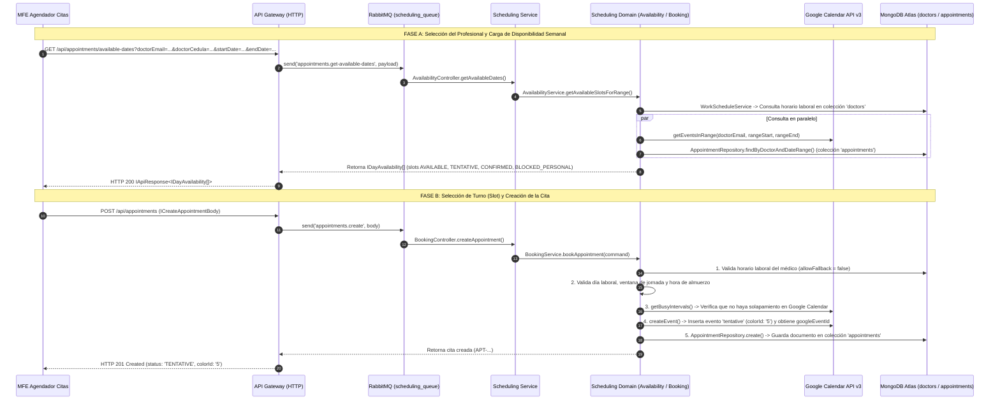

# Análisis Técnico Backend (Versión 1) — Flujo de Agendamiento de Citas

Este documento describe de extremo a extremo todo lo que ocurre en el **Backend** desde el instante en que el usuario selecciona al profesional médico en el Paso 3 del formulario del MFE (`agendador-citas`) hasta que la cita queda persistida en MongoDB Atlas.

---

## 1. Diagrama de Secuencia del Flujo Completo



---

## 2. Fase A: Cuando el usuario selecciona el profesional ("Ver Calendario")

1. **Disparo desde el MFE (`AgendarCitaComponent.onViewCalendar()` → `AppointmentLogicService.startBookingFlow()`):**
   * Archivo origen: `apps/agendador-citas/src/app/components/agendar-cita/agendar-cita.component.ts` y `apps/agendador-citas/src/app/services/appointment-logic.service.ts`.
   * Se guarda en memoria reactiva (`#bookingContext`) el objeto compuesto por: `{ patient, procedure, doctor }`.
   * Se selecciona al profesional activo (`selectProfessional(doctor)`), se cambia automáticamente a la pestaña del Calendario y se emite un evento en `#calendarFetch$` con el `doctorEmail`, `doctorCedula` y el rango de la semana actual (`startDate` y `endDate`).

2. **Entrada al API Gateway (`AppointmentsController.getAvailableDates()`):**
   * Archivo: `services/api-gateway/src/controllers/appointments.controller.ts`.
   * Recibe `GET /api/appointments/available-dates` validado por `GetAvailableDatesQueryDto` (`libs/shared/dtos/src/lib/appointment.dto.ts`).
   * Si no vienen fechas en el query string, calcula la ventana de la semana actual (`getWeekWindow(0)`).
   * Publica el mensaje RPC `'appointments.get-available-dates'` hacia RabbitMQ (`SCHEDULING_SERVICE`).

3. **Recepción en Microservicio (`AvailabilityController.getAvailableDates()`):**
   * Archivo: `services/scheduling-service/src/controllers/availability.controller.ts`.
   * Extrae `doctorEmail`, `doctorCedula`, `startDate` y `endDate`.
   * Define una duración fija de bloque de **45 minutos** (`durationMinutes = 45`, actualmente hardcodeada en el controlador) e invoca a `AvailabilityService.getAvailableSlotsForRange()`.

4. **Cálculo de Disponibilidad en Dominio (`AvailabilityService`):**
   * Archivo: `libs/backend/scheduling-domain/src/lib/services/availability.service.ts`.
   * **Paso 1 (Horario del Médico):** Llama a `WorkScheduleService.resolveProfessionalSchedule()`, el cual usa `MongoProfessionalScheduleAdapter` (`libs/backend/scheduling-domain/src/lib/adapters/mongo-professional-schedule.adapter.ts`) para buscar en la colección **`doctors`** de MongoDB por `cedula` o `email` y obtener su objeto `horarioTrabajo` (`diasLaborales`, `horaInicio`, `horaFin`, `incluyeAlmuerzo`, `horaInicioAlmuerzo`, `horaFinAlmuerzo`).
   * **Paso 2 (Cruce en paralelo Google Calendar + MongoDB):** Ejecuta un `Promise.all` consultando:
     1. `GoogleCalendarAdapter.getEventsInRange()`: Obtiene los eventos de Google Calendar del correo del médico en esa semana.
     2. `AppointmentRepository.findByDoctorAndDateRange()`: Consulta en la colección **`appointments`** de MongoDB todas las citas del médico en ese rango cuyo estado no sea `CANCELLED`.
   * **Paso 3 (Generación de Slots de 45 min):** Recorre día por día y bloque por bloque clasificando cada turno como:
     * `'AVAILABLE'` (`isBookable: true`) si está libre y en el futuro.
     * `'TENTATIVE'` o `'CONFIRMED'` (`isBookable: false`) si cruza con una cita en Google Calendar o MongoDB (adjuntando los datos básicos del paciente si existe en Mongo).
     * `'BLOCKED_PERSONAL'` (`isBookable: false`) si es hora de almuerzo, evento personal en Google Calendar o un horario ya transcurrido.

---

## 3. Fase B: Cuando el usuario confirma un turno y se guarda en Base de Datos

1. **Disparo desde el MFE (`AppointmentLogicService.bookSlot()`):**
   * Archivo: `apps/agendador-citas/src/app/services/appointment-logic.service.ts`.
   * Cuando el usuario hace clic en un bloque disponible en el calendario y confirma en el modal (`AgendarModalComponent`), `bookSlot()` toma los datos de `#bookingContext` y `#activeProfessional` y arma el payload `ICreateAppointmentBody` (`libs/shared/api-interfaces/src/lib/appointment.interface.ts`):
     ```typescript
     {
       doctorEmail: doctor.email,
       doctorCedula: doctor.cedula,
       patientNationalId: ctx.patient.cedula,
       patientFullName: `${ctx.patient.nombre} ${ctx.patient.apellidos}`.trim(),
       patientEmail: ctx.patient.correo,
       patientPhone: ctx.patient.celular,
       procedureId: ctx.procedure.idProcedimiento,
       procedureName: ctx.procedure.nombreProcedimiento,
       startTime: slot.startTime, // ISO string
       endTime: slot.endTime,     // ISO string
       notes: notes               // Opcional
     }
     ```
   * Envía `POST /api/appointments` al API Gateway.

2. **Validación en API Gateway (`AppointmentsController.createAppointment()`):**
   * Archivo: `services/api-gateway/src/controllers/appointments.controller.ts`.
   * El body es validado en runtime por `CreateAppointmentBodyDto` (`libs/shared/dtos/src/lib/appointment.dto.ts`).
   * Envía el mensaje RPC `'appointments.create'` por RabbitMQ al microservicio `scheduling-service`.

3. **Normalización en Microservicio (`BookingController.createAppointment()`):**
   * Archivo: `services/scheduling-service/src/controllers/booking.controller.ts`.
   * Convierte `startTime` y `endTime` a instancias `Date`.
   * Construye el comando `IBookAppointmentCommand` e invoca a `BookingService.bookAppointment()`.

4. **Reglas de Negocio, Google Calendar y Persistencia en MongoDB (`BookingService.bookAppointment()`):**
   * Archivo: `libs/backend/scheduling-domain/src/lib/services/booking.service.ts`.
   * **Validación 1 (Existencia y horario del médico):** Consulta el horario del médico en la colección `doctors` con `allowFallback = false` (si el profesional no existe en BD, lanza `RpcException`).
   * **Validación 2 (Jornada y Almuerzo):** Verifica que el día corresponda a `diasLaborales`, que el turno esté dentro de `horaInicio` y `horaFin`, y que no se cruce con la ventana de almuerzo (`buildLunchWindow`).
   * **Validación 3 (Doble chequeo en Google Calendar):** Llama a `calendarProvider.getBusyIntervals(doctorEmail, start, end)`. Si alguien ocupó ese espacio hace un segundo, lanza `RpcException('El horario seleccionado ya no se encuentra disponible en Google Calendar')`.
   * **Acción Externa (Creación en Google Calendar):** Llama a `GoogleCalendarAdapter.createEvent()` (`libs/backend/scheduling-domain/src/lib/adapters/google-calendar.adapter.ts`), el cual inserta el evento en el calendario del doctor con:
     * `summary`: `"Cita Médica: <procedureName> - <patientFullName>"`
     * `status`: `'tentative'`
     * `colorId`: `'5'` (amarillo/banana para citas pendientes de confirmación)
     * `extendedProperties.private`: metadatos del paciente y procedimiento.
     * Retorna el `googleEventId` generado por Google.
   * **Persistencia en Base de Datos (`AppointmentRepository.create()`):**
     * Archivo: `libs/backend/scheduling-domain/src/lib/repositories/appointment.repository.ts`.
     * Genera un identificador único de negocio con formato `APT-${Date.now()}-${Math.floor(Math.random() * 1000)}`.
     * Inserta el documento en la colección **`appointments`** de MongoDB Atlas regido por `AppointmentSchema` (`libs/backend/scheduling-domain/src/lib/schemas/appointment.schema.ts`).

---

## 4. Estructura Exacta que se Guarda en la Colección `appointments` (MongoDB)

Cuando `AppointmentRepository.create()` ejecuta `created.save()`, el documento que queda almacenado en la colección **`appointments`** tiene la siguiente estructura:

```json
{
  "_id": "67225f8a...",
  "appointmentId": "APT-1761844800000-482",
  "doctorEmail": "profesional@clinica.com",
  "doctorCedula": "1018432109",
  "patientNationalId": "1017187698",
  "patientFullName": "Mariana Giraldo Giraldo",
  "patientEmail": "marianbotero1991@gmail.com",
  "patientPhone": "+573014489527",
  "procedureId": "PROC-001",
  "procedureName": "Toxina Botulínica",
  "startTime": "2026-10-31T14:00:00.000Z",
  "endTime": "2026-10-31T14:45:00.000Z",
  "status": "TENTATIVE",
  "patientResponseStatus": "needsAction",
  "colorId": "5",
  "googleCalendarEventId": "gcal_event_id_xyz",
  "notes": "Nota opcional ingresada en el modal",
  "contactCount": 0,
  "createdAt": "2026-10-30T17:20:00.000Z",
  "updatedAt": "2026-10-30T17:20:00.000Z",
  "__v": 0
}
```

---

## 5. Observaciones Arquitectónicas de la Versión 1

> [!NOTE]
> **Puntos clave del comportamiento actual:**
> 1. **Desacoplamiento entre `patients` y `appointments`:** Al guardar la cita en `appointments`, **no se modifica el documento del paciente** en la colección `patients`; la cita guarda una copia desnormalizada de los datos de contacto del paciente (`patientNationalId`, `patientFullName`, `patientEmail`, `patientPhone`).
> 2. **Duración fija en consulta de disponibilidad:** En `AvailabilityController` (`services/scheduling-service/src/controllers/availability.controller.ts`) la duración de los bloques está fija en `45` minutos (`const durationMinutes = 45`), sin usar aún la duración específica configurada en el procedimiento (`duracionMinutos`).
> 3. **Doble validación en `BookingService`:** En `BookingService.bookAppointment()` (`libs/backend/scheduling-domain/src/lib/services/booking.service.ts`) se valida solapamiento contra Google Calendar (`getBusyIntervals`), pero no hace una segunda consulta de solapamiento contra `appointmentRepository.findByDoctorAndDateRange()` justo antes de insertar (en caso de que Google Calendar esté en modo fallback o desconectado).

