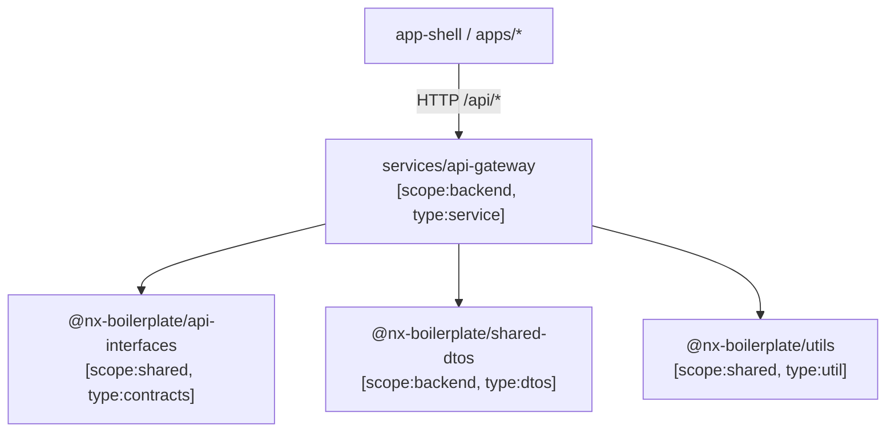

# API Gateway

> **Ficha Técnica del Módulo**  
> * **Ubicación en Monorepo:** `services/api-gateway`  
> * **Tipo de Módulo:** Microservicio NestJS 11+ — API Gateway HTTP / Reverse Proxy  
> * **Tags Nx (`project.json`):** `["scope:backend", "type:service"]`  
> * **Puerto de Desarrollo:** `3000` (Prefijo global: `/api`)  
> * **Estado:** Activo  

---

## 1. Propósito y Alcance de Negocio

El **API Gateway** es la puerta de enlace única y centralizada para todas las aplicaciones cliente del ecosistema (el Host `app-shell` y los Microfrontends Angular `agendador-citas`, `procedimientos-medicos` y `lista-profesionales`). Su propósito fundamental es:

1. **Punto Único de Entrada (Single Entry Point):** Proteger la topología interna del backend evitando que los clientes web conozcan o se conecten directamente a las bases de datos en MongoDB Atlas o a las colas de mensajería.
2. **Traductor de Protocolos (HTTP ↔ AMQP/RabbitMQ):** Recibir peticiones HTTP tipo REST (JSON), validarlas en tiempo de ejecución y transformarlas en mensajes serializados hacia colas de RabbitMQ (`Transport.RMQ`).
3. **Estandarizador de Contratos:** Garantizar que todas las respuestas salientes cumplan el sobre canónico `IApiResponse<T>` y que cualquier fallo en los microservicios se traduzca a códigos de estado HTTP semánticos (`400`, `404`, `409`, `504`, `500`).

---

## 2. Refuerzo Académico: Conceptos Clave para un Desarrollador Junior

> [!TIP]
> Esta sección explica **el por qué** de las decisiones arquitectónicas tomadas en este servicio.

### A. ¿Por qué usar un API Gateway en lugar de exponer los microservicios por HTTP?
En arquitecturas distribuidas, si cada microservicio (`patients-service`, `scheduling-service`, `procedures-service`) expusiera un puerto HTTP público:
- El frontend tendría que lidiar con múltiples URLs, autenticaciones cruzadas y problemas complejos de CORS.
- Si se refactoriza o divide un microservicio interno, el frontend se rompería inmediatamente.
- Con el **API Gateway**, el frontend solo conoce `http://localhost:3000/api`. El Gateway actúa como fachada desacoplada; los microservicios pueden cambiar de lenguaje, base de datos o cola sin alterar la API que consume el cliente.

### B. ¿Cómo viaja la información? (RPC vs. Event-Driven en RabbitMQ)
NestJS provee un cliente de mensajería llamado `ClientProxy`. En este Gateway usamos dos métodos de despacho:

1. **`client.send<T>(pattern, data)` (RPC / Request-Response):**
   - Se utiliza para consultas y mutaciones donde el cliente espera una respuesta inmediata (ej. `appointments.get-daily`, `patients.find-by-national-id`, `procedures.update`, `doctors.create`).
   - Retorna un `Observable` al que se le encadena `.pipe(timeout(ms))` (o se convierte con `firstValueFrom()`) para establecer un tiempo límite de espera (5s a 10s) y evitar solicitudes colgadas.
2. **`client.emit(pattern, data)` (Event-Driven / Fire-and-Forget):**
   - Se utiliza cuando la acción no requiere esperar una respuesta síncrona o confirmación del procesamiento (ej. `appointments.contact-tracked` al registrar un intento de contacto por WhatsApp).
   - El Gateway responde inmediatamente un código `202 Accepted` al navegador, liberando la conexión HTTP mientras RabbitMQ procesa el evento en segundo plano.

### C. La Tríada de Seguridad y Calidad en NestJS
El Gateway implementa tres capas globales en `main.ts`:

1. **`ValidationPipe` con `whitelist: true`, `forbidNonWhitelisted: true` y `transform: true`:**
   - Si un usuario malintencionado o un cliente envía propiedades adicionales en el JSON que no están declaradas en el DTO (ej. `{ role: "ADMIN" }`), la petición es rechazada de inmediato con un error `400 Bad Request`.
   - Gracias a `transform: true` y decoradores `@Transform()`, los parámetros de query como `?includeInactive=true` se convierten de forma segura a booleanos nativos antes de llegar al controlador.
2. **`TransformInterceptor`:**
   - Cualquier objeto o array retornado por un controlador es interceptado automáticamente y envuelto en `{ success: true, statusCode, message, data }`. Los controladores nunca construyen este sobre a mano.
3. **`RpcExceptionFilter`:**
   - Cuando un microservicio lanza un `RpcException` (por ejemplo, conflicto `409` al registrar una cédula duplicada, `404` cuando un paciente no existe o reglas de negocio de horarios) o si RabbitMQ supera el tiempo configurado (`TimeoutError`), este filtro atrapa la excepción y la convierte en una respuesta HTTP limpia (`400`, `404`, `409` o `504 Gateway Timeout`), asegurando que el cliente nunca reciba trazas de pila internas del servidor.

---

## 3. Diagrama de Arquitectura y Flujo de Información

```mermaid
graph TD
    Client["Clientes Web / MFEs\n(app-shell, agendador-citas,\nprocedimientos-medicos, lista-profesionales)"] -->|HTTP REST /api/*| GW["API Gateway\n(NestJS :3000)"]
    
    subgraph Gateway_Pipes_Interceptors ["Infraestructura Global del Gateway"]
        VP["ValidationPipe\n(class-validator whitelist + transform)"]
        TI["TransformInterceptor\n(IApiResponse<T>)"]
        EF["RpcExceptionFilter\n(HTTP Status Mapper)"]
    end

    GW --> VP
    VP --> Controllers["Controladores HTTP\n(Appointments, Confirmation, Patients,\nClinicalRecords, Procedures, Doctors, AreaCodes, Health)"]
    
    subgraph Message_Broker ["Transporte RabbitMQ (AMQP :5672)"]
        Q1["patients_queue"]
        Q2["scheduling_queue"]
        Q3["procedures_queue"]
    end

    Controllers -->|RPC send() / emit()| Message_Broker
    
    Q1 --> MS1["patients-service"]
    Q2 --> MS2["scheduling-service"]
    Q3 --> MS3["procedures-service"]

    MS1 & MS2 & MS3 -.->|RpcException / Resultado| EF
    Controllers -.-> TI
    TI -->|200 / 201 / 202 JSON| Client
    EF -->|400 / 404 / 409 / 504 JSON| Client
```

---

## 4. Contratos de Datos e Interfaces

### A. Interfaces de Contrato (`@nx-boilerplate/api-interfaces`)

| Interfaz | Archivo Origen | Propósito |
|---|---|---|
| `IApiResponse<T>` | `api-response.interface.ts` | Sobre genérico estándar para todas las respuestas HTTP (`success`, `statusCode`, `message`, `data`). |
| `IPatientHistory` (`IPatient`) | `patient.interface.ts` | Modelo canónico del paciente de 20 campos: datos de identificación, demográficos (`fecha_nacimiento`, `edad`, `sexo`, `estado_civil`, `ocupacion`, `direccion_residencia`), afiliación (`aseguradora`, `tipo_vinculacion`, `es_menor_de_edad`), sub-objetos `acompanante` y `persona_responsable`, y campos opcionales de historial enriquecidos desde `historialMedico`. |
| `IPatientCompanion`, `IPatientResponsible` | `patient.interface.ts` | Sub-estructuras para acompañante (`nombre`, `telefono`) y persona responsable (`nombre`, `telefono`, `parentesco`). |
| `ICreatePatientRequest` | `patient.interface.ts` | Payload de creación de paciente (5 campos obligatorios de contacto rápido y campos demográficos opcionales). |
| `IUpdatePatientRequest` | `patient.interface.ts` | Payload parcial para actualización de datos demográficos del paciente (`Partial<Omit<ICreatePatientRequest, 'cedula'>>`). |
| `ICitaMedica` (`IClinicalRecord`) | `clinical-record.interface.ts` | Modelo canónico de registro clínico acorde a Resolución 1995 de 1999 (`appointmentId`, `cedula_paciente`, `estado_registro`, `medico_tratante`, `registro_clinico`, `soporte_documental`). |
| `IAppointmentConfirmedEvent` | `clinical-record.interface.ts` | Contrato de evento asíncrono para inicializar borrador clínico tras confirmación de cita en Gateway (`appointmentId`, `patientNationalId`, `doctorCedula`, etc.). |
| `ICreateClinicalRecordRequest`, `IUpdateClinicalRecordRequest` | `clinical-record.interface.ts` | Contratos para registro y actualización asistencial de historias clínicas. |
| `IDayAvailability`, `ISlotDisplay` | `appointment.interface.ts` | Agrupación diaria de turnos con banderas `isCalendarSynced`, `isWorkingDay` y estados (`AVAILABLE`, `TENTATIVE`, `CONFIRMED`, `BLOCKED_PERSONAL`). |
| `IAppointmentDashboard` | `appointment.interface.ts` | Modelo completo de cita para el dashboard de confirmación (incluye datos del paciente, estado en Google Calendar y contador de contactos). |
| `IProcedure`, `IProcedureLaboratory` | `procedure.interface.ts` | Procedimiento médico con `idProcedimiento`, `nombreProcedimiento`, `valorStandar`, `duracionStandar`, `laboratorios` y bandera `isActive`. |
| `IProcedureSoftDeleteResponse` | `procedure.interface.ts` | Respuesta estandarizada tras inactivar lógicamente un procedimiento. |
| `IActiveProfessional`, `IProfessionalSummary` | `procedure.interface.ts` | Entidad completa y resumen de especialista médico (`cedula`, `nombres`, `apellidos`, `email`, `profesion`, `procedimientosRelacionados`, `horarioTrabajo`, `horariosExcepcionales`, `isActive`). |
| `IWorkSchedule`, `IExceptionSchedule` | `procedure.interface.ts` | Configuración de jornada laboral (`diasLaborales`, `horaInicio`, `horaFin`, `recesoAlmuerzo`) y excepciones (`EXTRA_SHIFT`, `DAY_OFF`). |
| `IAreaCode` | `area-code.interface.ts` | Catálogo internacional de países, banderas, códigos (`+57`) y expresiones regulares de validación. |

### B. DTOs y Validación Runtime (`@nx-boilerplate/shared-dtos`)

> [!NOTE]
> Todos los DTOs están centralizados en `@nx-boilerplate/shared-dtos`. Ningún microservicio ni el Gateway define DTOs locales para garantizar consistencia total de validación en tiempo de ejecución.

| DTO | Campos Validados | Decoradores Clave | Propósito |
|---|---|---|---|
| `FindPatientByNationalIdDto` | `nationalId` | `@IsString()`, `@Length(5, 20)`, `@Matches(/^[a-zA-Z0-9]+$/)` | Búsqueda segura de paciente por documento de identidad. |
| `CreatePatientDto` | `cedula`, `nombre`, `apellidos`, `correo`, `celular` + campos demográficos opcionales (`tipo_documento?`, `fecha_nacimiento?`, `edad?`, `sexo?`, `estado_civil?`, `ocupacion?`, `direccion_residencia?`, `aseguradora?`, `tipo_vinculacion?`, `es_menor_de_edad?`, `acompanante?`, `persona_responsable?`) | `@IsNotEmpty()`, `@IsEmail()`, `@IsOptional()`, `@ValidateNested()`, `@Type()` | Registro de paciente admitiendo tanto creación rápida en agendamiento (con defaults `null` en BD) como registro demográfico completo. |
| `UpdatePatientDto` | Propiedades demográficas opcionales del paciente | `@IsOptional()`, `@IsEmail()`, `@IsString()`, `@ValidateNested()` | Modificación parcial de cualquiera de los 20 campos demográficos de un paciente existente. |
| `AppointmentConfirmedEventDto` | `appointmentId`, `patientNationalId`, `doctorCedula`, `procedureId`, `procedureName`, `appointmentDate` | `@IsNotEmpty()`, `@IsString()`, `@IsISO8601()`, `@IsOptional()`, `@IsEmail()` | Payload de validación del evento emitido hacia RabbitMQ al confirmar una cita médica. |
| `FindClinicalRecordByIdDto` | `id` | `@IsNotEmpty()`, `@IsString()` | Búsqueda de historia clínica por su ID único o ID de cita. |
| `CreateClinicalRecordDto` | `cedula_paciente`, `medico_tratante`, `registro_clinico`, `soporte_documental` | `@IsNotEmpty()`, `@IsString()`, `@IsArray()`, `@ValidateNested()`, `@Type()` | Creación manual de un registro clínico en modo borrador o completo. |
| `UpdateClinicalRecordDto` | `estado_registro?`, `medico_tratante?`, `registro_clinico?`, `soporte_documental?` | `@IsOptional()`, `@IsEnum()`, `@ValidateNested()`, `@Type()` | Diligenciamiento y cierre asistencial de una historia clínica (cambia a `COMPLETADA`). |
| `GetAvailableDatesQueryDto` | `doctorEmail?`, `doctorCedula?`, `procedureId?`, `startDate?`, `endDate?`, `targetDate?` | `@IsOptional()`, `@IsEmail()`, `@IsDateString()` | Consulta de turnos disponibles en ventana semanal o día específico. |
| `CreateAppointmentBodyDto` | `doctorEmail`, `doctorCedula`, `patientNationalId`, `patientFullName`, `patientEmail`, `patientPhone?`, `procedureId`, `procedureName`, `startTime`, `endTime`, `notes?` | `@IsNotEmpty()`, `@IsEmail()`, `@IsISO8601()`, `@IsOptional()` | Creación estricta de cita médica sincronizada con Google Calendar y MongoDB en estado `TENTATIVE`. |
| `CreateWaitlistBodyDto` | `cedula`/`patientNationalId`, `nombre`, `apellidos`, `correo`, `celular`, `procedimientoId` | `@IsNotEmpty()`, `@IsEmail()`, `@IsString()` | Inscripción en lista de espera cuando no hay cupos inmediatos. |
| `GetDailyAppointmentsQueryDto` | `date`, `doctorEmail?`, `status?` | `@IsDateString()`, `@IsNotEmpty()`, `@IsEnum(['TENTATIVE', 'CONFIRMED', 'CANCELLED'])` | Filtro de citas para el dashboard clínico diario. |
| `UpdateAppointmentStatusDto` | `status`, `appointmentId?` | `@IsEnum(['CONFIRMED', 'CANCELLED'])` | Cambio de estado de la cita (aprobada o cancelada). |
| `FilterProceduresQueryDto` | `doctorCedula?`, `includeInactive?` | `@IsOptional()`, `@Transform()`, `@IsBoolean()` | Filtrado de procedimientos por médico o inclusión de inactivos para administración. |
| `CreateProcedureDto` | `nombreProcedimiento`, `valorStandar`, `duracionStandar`, `laboratorios?` | `@IsNotEmpty()`, `@IsNumber()`, `@Min(5)`, `@Max(480)`, `@ValidateNested()` | Creación de un procedimiento médico y su lista de laboratorios (`ProcedureLaboratoryDto`). |
| `UpdateProcedureDto` | `nombreProcedimiento?`, `valorStandar?`, `duracionStandar?`, `laboratorios?`, `isActive?` | `@IsOptional()`, `@IsNumber()`, `@IsBoolean()`, `@ValidateNested()` | Actualización parcial de datos, precios, laboratorios o estado activo/inactivo del procedimiento. |
| `FindProcedureParamDto` | `idProcedimiento` | `@IsString()`, `@IsNotEmpty()` | Validación de parámetro de ruta `:idProcedimiento`. |
| `GetDoctorsFilterDto` | `includeInactive?` | `@IsOptional()`, `@Transform()`, `@IsBoolean()` | Consulta de especialistas activos o inclusión de inactivos en el módulo administrativo. |
| `CreateProfessionalDto` | `cedula`, `nombres`, `apellidos`, `email`, `profesion`, `procedimientosRelacionados?`, `horarioTrabajo` | `@IsNotEmpty()`, `@IsEmail()`, `@ValidateNested()`, `@Type(() => WorkScheduleDto)` | Registro de nuevo profesional médico con su configuración de jornada y almuerzo (`LunchBreakDto`). |
| `UpdateProfessionalDto` | `cedula?`, `nombres?`, `apellidos?`, `email?`, `profesion?`, `procedimientosRelacionados?`, `horarioTrabajo?`, `isActive?` | `@IsOptional()`, `@ValidateNested()`, `@IsBoolean()` | Actualización parcial de datos del especialista, asignación de procedimientos, horario o estado `isActive`. |
| `UpdateScheduleExceptionsDto` | `horariosExcepcionales?`, `exceptions?` | `@IsOptional()`, `@IsArray()`, `@ValidateNested()` | Actualización de turnos extra (`EXTRA_SHIFT`) o días libres (`DAY_OFF`) del profesional. |

---

## 5. Controladores y Puntos de Entrada (API Endpoints)

El Gateway organiza sus controladores bajo el principio de **Responsabilidad Única (SRP)**:

### 5.1 `AppointmentsController` (`/api/appointments`)
Responsable del flujo de disponibilidad semanal, reserva de citas y lista de espera.

* **`GET /api/appointments/available-dates`**
  - **Parámetros Query:** `GetAvailableDatesQueryDto`
  - **Lógica Inteligente:** Si el cliente no envía `startDate` o `endDate`, el Gateway calcula automáticamente los límites de la semana actual usando `getWeekWindow(0)` de `@nx-boilerplate/utils`.
  - **Patrón RMQ:** `appointments.get-available-dates` (`scheduling_queue`, timeout: 10s).
* **`POST /api/appointments`**
  - **Estado HTTP:** `201 Created`
  - **Body:** `CreateAppointmentBodyDto`
  - **Patrón RMQ:** `appointments.create` (`scheduling_queue`, timeout: 10s).
  - **Resultado:** Valida horario del médico en BD, verifica disponibilidad en Google Calendar, crea el evento tentativo (`colorId: '5'`) y persiste la cita en la colección `appointments` con identificador `APT-...`.
* **`POST /api/appointments/waitlist`**
  - **Estado HTTP:** `201 Created`
  - **Body:** `CreateWaitlistBodyDto`
  - **Patrón RMQ:** `waitlist.create` (`scheduling_queue`, timeout: 5s).

### 5.2 `AppointmentConfirmationController` (`/api/appointments`)
Responsable de la operación clínica diaria (CRM de recepción, confirmaciones y seguimiento de contactos).

* **`GET /api/appointments/daily`**
  - **Parámetros Query:** `GetDailyAppointmentsQueryDto` (`date=YYYY-MM-DD`, `doctorEmail?`, `status?`).
  - **Patrón RMQ:** `appointments.get-daily` (`scheduling_queue`, timeout: 5s).
  - **Resultado:** Array con las citas programadas para esa jornada, incluyendo el estado de sincronización y el contador `contactCount`.
* **`PATCH /api/appointments/:id/status`**
  - **Parámetros:** `:id` (ID de la cita) en URL, `{ status: 'CONFIRMED' | 'CANCELLED' }` en el Body (`UpdateAppointmentStatusDto`).
  - **Patrón RMQ:** `appointments.update-status` (`scheduling_queue`, timeout: 10s).
  - **Efecto:** Actualiza sincrónicamente MongoDB Atlas y el evento en Google Calendar (color verde `10` o cancelación).
  - **Disparo Asíncrono de Historia Clínica:** Si la cita se confirma (`status === 'CONFIRMED'`), el Gateway emite inmediatamente el evento `appointment.confirmed` (`AppointmentConfirmedEventDto`) hacia `patients_queue` (`this.patientsClient.emit(...)`) para pre-crear idempotentemente el borrador de atención médica en la colección `historialMedico` sin retrasar la respuesta al cliente.
* **`POST /api/appointments/:id/track-contact`**
  - **Estado HTTP:** `202 Accepted` (Operación Asíncrona)
  - **Parámetros:** `:id` (ID de la cita) en URL.
  - **Patrón RMQ:** `appointments.contact-tracked` vía `client.emit()`.
  - **Efecto:** Incrementa atómicamente el contador de intentos de contacto en la base de datos sin bloquear al usuario en el frontend.

### 5.3 `PatientsController` (`/api/patients`)
Responsable de la consulta, actualización e inscripción de pacientes con soporte para la estructura estandarizada de 20 campos e historial clínico.

* **`GET /api/patients`**
  - **Patrón RMQ:** `patients.find-all` (`patients_queue`, timeout: 5s).
  - **Resultado:** Retorna el listado completo de pacientes registrados en la colección `patients` ordenados por fecha de creación descendente (utilizado por el directorio del MFE Historial Pacientes).
* **`GET /api/patients/:nationalId`**
  - **Parámetros:** `FindPatientByNationalIdDto` (`:nationalId`).
  - **Patrón RMQ:** `patients.find-by-national-id` (`patients_queue`, timeout: 5s).
  - **Resultado:** Retorna el objeto `IPatientHistory` completo desde MongoDB Atlas. Además, hidrata automáticamente en paralelo (`Promise.all`) los últimos procedimientos y la última recomendación médica consultados desde la colección `historialMedico`.
* **`POST /api/patients`**
  - **Estado HTTP:** `201 Created`
  - **Body:** `CreatePatientDto`
  - **Patrón RMQ:** `patients.create` (`patients_queue`, timeout: 5s).
  - **Efecto:** Valida unicidad de `cedula` (`409 Conflict` si ya existe) y persiste el paciente inicializando automáticamente con valores por defecto (`null`, `'CC'`, `false`) los campos demográficos no enviados durante el registro rápido.
* **`PATCH /api/patients/:nationalId`**
  - **Parámetros:** `:nationalId` en URL, Body: `UpdatePatientDto`.
  - **Patrón RMQ:** `patients.update` (`patients_queue`, timeout: 5s).
  - **Efecto:** Actualiza atómicamente los campos demográficos (`fecha_nacimiento`, `edad`, `sexo`, `estado_civil`, `ocupacion`, `direccion_residencia`, `aseguradora`, `tipo_vinculacion`, `acompanante`, `persona_responsable`) en la colección `patients`.
* **`GET /api/patients/:nationalId/clinical-records`**
  - **Parámetros:** `:nationalId` en URL.
  - **Patrón RMQ:** `clinical-records.find-by-patient` (`patients_queue`, timeout: 5s).
  - **Resultado:** Retorna todas las atenciones médicas y borradores (`ICitaMedica[]`) del paciente ordenadas cronológicamente de la más reciente a la más antigua.

### 5.4 `ClinicalRecordsController` (`/api/clinical-records`)
Responsable del ciclo de vida de los registros clínicos asistenciales conforme a la Resolución 1995 de 1999 (antecedentes, motivo de consulta, examen físico, lote de insumos y consentimientos informados).

* **`GET /api/clinical-records/:id`**
  - **Parámetros:** `:id` (puede ser el `_id` de MongoDB o el `appointmentId` de la cita origen).
  - **Patrón RMQ:** `clinical-records.find-by-id` (`patients_queue`, timeout: 5s).
  - **Resultado:** Retorna el detalle completo de la atención médica (`ICitaMedica`).
* **`POST /api/clinical-records`**
  - **Estado HTTP:** `201 Created`
  - **Body:** `CreateClinicalRecordDto`
  - **Patrón RMQ:** `clinical-records.create` (`patients_queue`, timeout: 5s).
  - **Resultado:** Crea un registro clínico asistencial manual sin cita previa asociada.
* **`PATCH /api/clinical-records/:id`**
  - **Parámetros:** `:id` en URL, Body: `UpdateClinicalRecordDto`.
  - **Patrón RMQ:** `clinical-records.update` (`patients_queue`, timeout: 5s).
  - **Efecto:** Permite al médico tratante diligenciar el examen físico, antecedentes, lote de producto, recomendaciones y soporte documental, finalizando la atención y cambiando el estado a `'COMPLETADA'`.

### 5.5 `ProceduresController` (`/api/procedures`)
Responsable de la consulta pública y la administración CRUD de procedimientos médicos y laboratorios.

* **`GET /api/procedures`**
  - **Parámetros Query:** `FilterProceduresQueryDto` (`doctorCedula?`, `includeInactive?`).
  - **Patrones RMQ (`procedures_queue`, timeout: 5s):**
    - Si se envía `doctorCedula`: despacha `procedures.find-by-doctor`.
    - En caso contrario: despacha `procedures.get-all` con `{ includeInactive }`.
* **`POST /api/procedures`**
  - **Body:** `CreateProcedureDto`
  - **Patrón RMQ:** `procedures.create` (`procedures_queue`, timeout: 5s).
* **`PATCH /api/procedures/:idProcedimiento`**
  - **Parámetros:** `FindProcedureParamDto` (`:idProcedimiento`), Body: `UpdateProcedureDto`.
  - **Patrón RMQ:** `procedures.update` (`procedures_queue`, timeout: 10s).
* **`DELETE /api/procedures/:idProcedimiento`**
  - **Parámetros:** `FindProcedureParamDto` (`:idProcedimiento`).
  - **Patrón RMQ:** `procedures.soft-delete` (`procedures_queue`, timeout: 5s). Realiza inactivación lógica (`isActive: false`).
* **`GET /api/procedures/:idProcedimiento`**
  - **Parámetros:** `FindProcedureParamDto`.
  - **Patrón RMQ:** `procedures.find-by-id` (`procedures_queue`, timeout: 5s).
* **`GET /api/procedures/:idProcedimiento/doctors`**
  - **Parámetros:** `FindProcedureParamDto`.
  - **Patrón RMQ:** `procedures.get-doctors-by-procedure` (`procedures_queue`, timeout: 5s). Lista los especialistas activos que realizan dicho procedimiento.

### 5.6 `DoctorsController` (`/api/doctors`)
Responsable del catálogo de profesionales médicos, horarios de atención, excepciones de agenda e inactivación lógica.

* **`GET /api/doctors`**
  - **Parámetros Query:** `GetDoctorsFilterDto` (`includeInactive?`).
  - **Patrón RMQ:** `doctors.get-all` (`procedures_queue`, timeout: 5s).
* **`POST /api/doctors`**
  - **Body:** `CreateProfessionalDto`
  - **Patrón RMQ:** `doctors.create` (`procedures_queue`, timeout: 5s).
* **`PATCH /api/doctors/:cedula`**
  - **Parámetros:** `:cedula`, Body: `UpdateProfessionalDto`.
  - **Patrón RMQ:** `doctors.update` (`procedures_queue`, timeout: 10s). Permite actualizar datos personales, procedimientos asignados, horario laboral o activar/inactivar (`isActive`).
* **`PATCH /api/doctors/:cedula/schedule`**
  - **Parámetros:** `:cedula`, Body: `UpdateScheduleExceptionsDto`.
  - **Patrón RMQ:** `doctors.update-schedule` (`procedures_queue`, timeout: 5s).
* **`DELETE /api/doctors/:cedula`**
  - **Parámetros:** `:cedula`.
  - **Patrón RMQ:** `doctors.soft-delete` (`procedures_queue`, timeout: 5s). Inactiva lógicamente al profesional.

### 5.7 `AreaCodesController` (`/api/area-codes`)
* **`GET /api/area-codes`:** Retorna el catálogo maestro de indicativos telefónicos mundiales para validar el número celular en el frontend.

### 5.8 `HealthController` (`/api/health`)
* **`GET /api/health`:** Monitoreo y comprobación de liveness (`{ status: 'ok', uptime, timestamp }`).

---

## 6. Variables de Entorno Requeridas

Configuradas en el archivo `.env` en la raíz del workspace:

```bash
PORT=3000                                   # Puerto HTTP del API Gateway
RABBITMQ_URI=amqp://localhost:5672         # Conexión al broker RabbitMQ
RABBITMQ_PATIENTS_QUEUE=patients_queue     # Cola para microservicio de pacientes
RABBITMQ_SCHEDULING_QUEUE=scheduling_queue # Cola para microservicio de agendamiento
RABBITMQ_PROCEDURES_QUEUE=procedures_queue # Cola para microservicio de procedimientos y doctores
```

---

## 7. Dependencias y Límites Arquitectónicos



- **Consume estrictamente:** Interfaces puras (`@nx-boilerplate/api-interfaces`), DTOs de validación runtime (`@nx-boilerplate/shared-dtos`) y utilidades puras de fecha (`@nx-boilerplate/utils`).
- **Prohibido:** El API Gateway **nunca** debe importar librerías de dominio (`*-domain`) ni conectarse a bases de datos directamente (`MongooseModule`, etc.). Su única vía hacia los datos son los microservicios RabbitMQ.

---

## 8. Guía de Verificación y Comandos (Nx)

```bash
# 1. Servir el API Gateway en desarrollo (hot-reload en puerto 3000)
npx nx serve api-gateway

# 2. Compilar el bundle de producción con Webpack
npx nx build api-gateway

# 3. Validar sintaxis y reglas de ESLint
npx nx lint api-gateway

# 4. Probar endpoints vía cURL
# Probar Healthcheck
curl http://localhost:3000/api/health

# Consultar paciente por cédula (retorna estructura de 20 campos y resumen clínico)
curl http://localhost:3000/api/patients/1017187698

# Listar todos los pacientes registrados (MFE Historial Pacientes)
curl http://localhost:3000/api/patients

# Consultar historial completo de registros clínicos de un paciente
curl http://localhost:3000/api/patients/1017187698/clinical-records

# Consultar detalle de una historia clínica por ID o appointmentId
curl http://localhost:3000/api/clinical-records/APT-123456

# Consultar procedimientos (incluyendo inactivos para administración)
curl "http://localhost:3000/api/procedures?includeInactive=true"

# Consultar profesionales médicos (incluyendo inactivos)
curl "http://localhost:3000/api/doctors?includeInactive=true"

# Consultar disponibilidad semanal de un médico
curl "http://localhost:3000/api/appointments/available-dates?doctorEmail=drmoralesheano@gmail.com"

# Consultar citas diarias del CRM
curl "http://localhost:3000/api/appointments/daily?date=2026-10-15"
```
