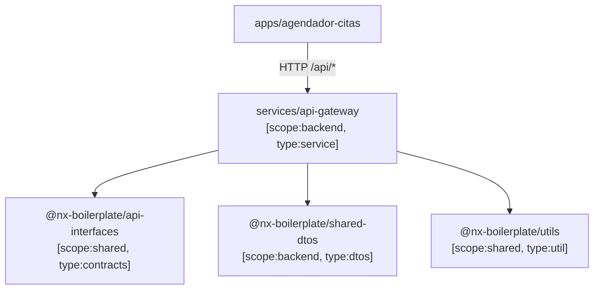

# API Gateway

> **Ficha Técnica del Módulo**  
> * **Ubicación en Monorepo:** `services/api-gateway`  
> * **Tipo de Módulo:** Microservicio NestJS 11+ — API Gateway HTTP / Reverse Proxy  
> * **Tags Nx (`project.json`):** `["scope:backend", "type:service"]`  
> * **Puerto de Desarrollo:** `3000` (Prefijo global: `/api`)  
> * **Estado:** Activo  

---

## 1. Propósito y Alcance de Negocio

El **API Gateway** es la puerta de enlace única y centralizada para todas las aplicaciones cliente (los Microfrontends Angular `agendador-citas` y `app-shell`). Su propósito fundamental es:

1. **Punto Único de Entrada (Single Entry Point):** Proteger la topología interna del backend evitando que los clientes web conozcan o se conecten directamente a las bases de datos o colas de mensajería.
2. **Traductor de Protocolos (HTTP ↔ AMQP/RabbitMQ):** Recibir peticiones HTTP tipo REST (JSON), validarlas y transformarlas en mensajes serializados hacia colas de RabbitMQ (`Transport.RMQ`).
3. **Estandarizador de Contratos:** Garantizar que todas las respuestas salientes cumplan el sobre canónico `IApiResponse<T>` y que cualquier fallo en los microservicios se traduzca a códigos de estado HTTP semánticos (`400`, `404`, `504`, `500`).

---

## 2. Refuerzo Académico: Conceptos Clave para un Desarrollador Junior

> [!TIP]
> Esta sección explica **el por qué** de las decisiones arquitectónicas tomadas en este servicio.

### A. ¿Por qué usar un API Gateway en lugar de exponer los microservicios por HTTP?
En arquitecturas distribuidas, si cada microservicio (`patients`, `scheduling`, `procedures`) expusiera un puerto HTTP público:
- El frontend tendría que lidiar con múltiples URLs, autenticaciones cruzadas y problemas complejos de CORS.
- Si se refactoriza o divide un microservicio interno, el frontend se rompería inmediatamente.
- Con el **API Gateway**, el frontend solo conoce `http://localhost:3000/api`. El Gateway actúa como fachada desacoplada; los microservicios pueden cambiar de lenguaje, base de datos o cola sin alterar la API que consume el cliente.

### B. ¿Cómo viaja la información? (RPC vs. Event-Driven en RabbitMQ)
NestJS provee un cliente de mensajería llamado `ClientProxy`. En este Gateway usamos dos métodos de despacho:

1. **`client.send<T>(pattern, data)` (RPC / Request-Response):**
   - Se utiliza para consultas y operaciones donde el cliente espera una respuesta inmediata (ej. `appointments.get-daily`, `patients.find-by-national-id`, `appointments.create`).
   - Retorna un `Observable`. Usamos `firstValueFrom(observable.pipe(timeout(ms)))` para convertirlo en una `Promise` asíncrona estándar con un tiempo límite de espera para evitar solicitudes colgadas.
2. **`client.emit(pattern, data)` (Event-Driven / Fire-and-Forget):**
   - Se utiliza cuando la acción no requiere esperar una respuesta síncrona o confirmación del procesamiento (ej. `appointments.contact-tracked` al enviar un WhatsApp).
   - El Gateway responde inmediatamente un código `202 Accepted` al navegador, liberando la conexión HTTP mientras RabbitMQ procesa el evento en segundo plano.

### C. La Tríada de Seguridad y Calidad en NestJS
El Gateway implementa tres capas globales en `main.ts`:

1. **`ValidationPipe` con `whitelist: true` y `forbidNonWhitelisted: true`:**
   - Si un usuario malintencionado o un cliente envía propiedades adicionales en el JSON que no están declaradas en el DTO (ej. `{ role: "ADMIN" }`), la petición es rechazada de inmediato con un error `400 Bad Request`.
2. **`TransformInterceptor`:**
   - Cualquier objeto o array retornado por un controlador es interceptado automáticamente y envuelto en `{ success: true, statusCode, message, data }`. Los controladores nunca construyen este sobre a mano.
3. **`RpcExceptionFilter`:**
   - Cuando un microservicio lanza un `RpcException('El médico no atiende los días lunes')` o si RabbitMQ se demora más del tiempo configurado (`TimeoutError`), este filtro atrapa la excepción y la convierte en una respuesta HTTP adecuada (`400 Bad Request` o `504 Gateway Timeout`), asegurando que el cliente nunca reciba trazas de pila internas del servidor.

---

## 3. Diagrama de Arquitectura y Flujo de Información

```mermaid
graph TD
    Client["Cliente Web / MFE\n(agendador-citas :4201)"] -->|HTTP REST /api/*| GW["API Gateway\n(NestJS :3000)"]
    
    subgraph Gateway_Pipes_Interceptors ["Infraestructura del Gateway"]
        VP["ValidationPipe\n(class-validator whitelist)"]
        TI["TransformInterceptor\n(IApiResponse<T>)"]
        EF["RpcExceptionFilter\n(HTTP Status Mapper)"]
    end

    GW --> VP
    VP --> Controllers["Controladores HTTP\n(Appointments, Confirmation, Patients, Procedures)"]
    
    subgraph Message_Broker ["Transporte RabbitMQ (AMQP :5672)"]
        Q1["patients_queue"]
        Q2["scheduling_queue"]
        Q3["procedures_queue"]
    end

    Controllers -->|RPC send() / emit()| Message_Broker
    
    Q1 --> MS1["patients-service"]
    Q2 --> MS2["scheduling-service"]
    Q3 --> MS3["procedures-service"]

    MS2 -.->|RpcException / Resultado| EF
    Controllers -.-> TI
    TI -->|200 / 201 / 202 JSON| Client
    EF -->|400 / 404 / 504 JSON| Client
```

---

## 4. Contratos de Datos e Interfaces

### A. Interfaces de Contrato (`@nx-boilerplate/api-interfaces`)

| Interfaz | Archivo Origen | Propósito Académico |
|---|---|---|
| `IApiResponse<T>` | `api-response.interface.ts` | Sobre genérico estándar para todas las respuestas HTTP (`success`, `statusCode`, `message`, `data`). |
| `IDayAvailability` | `appointment.interface.ts` | Agrupación diaria de turnos con banderas `isCalendarSynced` y `isWorkingDay`. |
| `ISlotDisplay` | `appointment.interface.ts` | Detalle del turno: hora inicio, hora fin, estado (`AVAILABLE`, `TENTATIVE`, `CONFIRMED`), color y bloqueo. |
| `IAppointmentDashboard` | `appointment.interface.ts` | Modelo completo de cita para el dashboard de confirmación (incluye datos del paciente y contador de contactos). |
| `IPatientHistory` | `patient.interface.ts` | Historial médico, cédula, nombres y citas previas del paciente. |
| `IProcedure` | `procedure.interface.ts` | Procedimiento médico con duración estimada, especialidad y precio. |
| `IProfessionalSummary` | `procedure.interface.ts` | Información resumida del médico especialista (cédula, nombres, email). |
| `IAreaCode` | `patient.interface.ts` | Catálogo internacional de países, banderas, códigos (`+57`) y expresiones regulares. |

### B. DTOs y Validación Runtime (`@nx-boilerplate/shared-dtos`)

> [!NOTE]
> Todos los DTOs están centralizados en `@nx-boilerplate/shared-dtos`. Ningún microservicio ni el Gateway define DTOs locales para evitar discrepancias de validación en tiempo de ejecución.

| DTO | Campos Validados | Decoradores Clave | Propósito |
|---|---|---|---|
| `GetAvailableDatesQueryDto` | `doctorEmail?`, `doctorCedula?`, `procedureId?`, `startDate?`, `endDate?` | `@IsOptional()`, `@IsEmail()`, `@IsDateString()` | Consulta de turnos disponibles en una ventana semanal. |
| `CreateAppointmentBodyDto` | `doctorEmail`, `doctorCedula`, `patientNationalId`, `patientFullName`, `patientEmail`, `patientPhone`, `procedureId`, `procedureName`, `startTime`, `endTime`, `notes?` | `@IsNotEmpty()`, `@IsEmail()`, `@IsISO8601()`, `@IsOptional()` | Creación estricta de una cita médica en estado inicial `TENTATIVE`. |
| `CreateWaitlistBodyDto` | `patientNationalId`, `patientFullName`, `patientEmail`, `patientPhone`, `procedureId`, `preferredDoctorEmail?` | `@IsNotEmpty()`, `@IsEmail()`, `@IsString()` | Inscripción voluntaria en lista de espera cuando no hay cupos inmediatos. |
| `GetDailyAppointmentsDto` | `date`, `doctorEmail?`, `status?` | `@IsDateString()`, `@IsNotEmpty()`, `@IsEnum(['TENTATIVE', 'CONFIRMED', 'CANCELLED'])` | Filtro de citas para el dashboard clínico diario. |
| `UpdateAppointmentStatusDto` | `status`, `appointmentId?` | `@IsEnum(['CONFIRMED', 'CANCELLED'])` | Cambio de estado de la cita (aprobada o cancelada). |
| `TrackContactDto` | `appointmentId` | `@IsString()`, `@IsNotEmpty()` | Notificación de contacto al paciente. |
| `FindPatientByNationalIdDto` | `nationalId` | `@IsString()`, `@Length(5, 20)`, `@Matches(/^[a-zA-Z0-9]+$/)` | Búsqueda segura de paciente por documento. |
| `CreatePatientDto` | `cedula`, `nombre`, `apellidos`, `correo`, `celular` | `@IsNotEmpty()`, `@IsEmail()`, `@Length()` | Registro de nuevo paciente en el sistema. |
| `FilterProceduresQueryDto` | `doctorCedula?` | `@IsOptional()`, `@IsString()` | Filtrado de procedimientos asignados a un especialista. |

---

## 5. Controladores y Puntos de Entrada (API Endpoints)

El Gateway organiza sus controladores bajo el principio de **Responsabilidad Única (SRP)**:

### 5.1 `AppointmentsController` (`/api/appointments`)
Responsable exclusivamente del flujo de disponibilidad, agendamiento inicial y lista de espera.

* **`GET /api/appointments/available-dates`**
  - **Parámetros Query:** `GetAvailableDatesQueryDto`
  - **Lógica Inteligente:** Si el cliente no envía `startDate` o `endDate`, el Gateway calcula automáticamente los límites de la semana actual en Colombia usando `getWeekWindow(0)` de `@nx-boilerplate/utils`.
  - **Patrón RMQ:** `appointments.get-available-dates` (`scheduling_queue`, timeout: 10s).
* **`POST /api/appointments`**
  - **Estado HTTP:** `201 Created`
  - **Body:** `CreateAppointmentBodyDto`
  - **Patrón RMQ:** `appointments.create` (`scheduling_queue`, timeout: 10s).
  - **Resultado:** Retorna la cita agendada asignando inicialmente `status: 'TENTATIVE'` y color amarillo (`5`) para Google Calendar.
* **`POST /api/appointments/waitlist`**
  - **Estado HTTP:** `201 Created`
  - **Body:** `CreateWaitlistBodyDto`
  - **Patrón RMQ:** `waitlist.create` (`scheduling_queue`, timeout: 5s).

### 5.2 `AppointmentConfirmationController` (`/api/appointments`)
Responsable de la operación clínica diaria (CRM de recepción, confirmaciones y llamadas).

* **`GET /api/appointments/daily`**
  - **Parámetros Query:** `GetDailyAppointmentsDto` (`date=YYYY-MM-DD`, `doctorEmail?`, `status?`).
  - **Patrón RMQ:** `appointments.get-daily` (`scheduling_queue`, timeout: 5s).
  - **Resultado:** Array con las citas programadas para esa jornada, indicando si el paciente ya fue contactado y el estado de Google Calendar.
* **`PATCH /api/appointments/:id/status`**
  - **Parámetros:** `:id` (ID de la cita) en URL, `{ status: 'CONFIRMED' | 'CANCELLED' }` en el Body.
  - **Patrón RMQ:** `appointments.update-status` (`scheduling_queue`, timeout: 10s).
  - **Efecto:** Actualiza sincrónicamente MongoDB Atlas y el evento en Google Calendar (color verde `10` o rojo `11`).
* **`POST /api/appointments/:id/track-contact`**
  - **Estado HTTP:** `202 Accepted` (Operación Asíncrona)
  - **Parámetros:** `:id` (ID de la cita) en URL.
  - **Patrón RMQ:** `appointments.contact-tracked` vía `client.emit()`.
  - **Efecto:** Incrementa atómicamente el contador de intentos de contacto en la base de datos sin bloquear al usuario en el frontend.

### 5.3 `PatientsController` (`/api/patients`)
* **`GET /api/patients/:nationalId`:** Consulta el paciente por cédula. Patrón RMQ: `patients.find-by-national-id`.
* **`POST /api/patients`:** Registra un nuevo paciente (`201 Created`). Patrón RMQ: `patients.create`.

### 5.4 `ProceduresController` (`/api/procedures`)
* **`GET /api/procedures`:** Lista procedimientos médicos. Acepta `?doctorCedula=` para filtrar.
* **`GET /api/procedures/:idProcedimiento`:** Retorna el detalle de un procedimiento.
* **`GET /api/procedures/:idProcedimiento/doctors`:** Lista los especialistas habilitados para ese procedimiento.

### 5.5 `DoctorsController` (`/api/doctors`)
* **`GET /api/doctors`:** Lista todos los especialistas médicos activos en el sistema.

### 5.6 `AreaCodesController` (`/api/area-codes`)
* **`GET /api/area-codes`:** Retorna el catálogo maestro de indicativos telefónicos mundiales para validar el número celular en el frontend.

### 5.7 `HealthController` (`/api/health`)
* **`GET /api/health`:** Monitoreo y comprobación de liveness (`{ status: 'ok', uptime, timestamp }`).

---

## 6. Variables de Entorno Requeridas

Configuradas en el archivo `.env` en la raíz del workspace:

```bash
PORT=3000                                 # Puerto HTTP del API Gateway
RABBITMQ_URI=amqp://localhost:5672       # Conexión al broker RabbitMQ
RABBITMQ_PATIENTS_QUEUE=patients_queue   # Cola para microservicio de pacientes
RABBITMQ_SCHEDULING_QUEUE=scheduling_queue # Cola para microservicio de agendamiento
RABBITMQ_PROCEDURES_QUEUE=procedures_queue # Cola para microservicio de procedimientos
```

---

## 7. Dependencias y Límites Arquitectónicos



- **Consume estrictamente:** Interfaces puras (`@nx-boilerplate/api-interfaces`), DTOs de validación runtime (`@nx-boilerplate/shared-dtos`) y utilidades puras de fecha (`@nx-boilerplate/utils`).
- **Prohibido:** El API Gateway **nunca** debe importar librerías de dominio (`*-domain`) ni conectarse a bases de datos directamente (`MongooseModule`, etc.). Su única vía hacia los datos son los microservicios RabbitMQ.

---

## 8. Guía de Verificación y Comandos (Nx)

```bash
# 1. Servir el API Gateway en desarrollo (hot-reload en puerto 3000)
npx nx serve api-gateway

# 2. Compilar el bundle de producción con Webpack
npx nx build api-gateway

# 3. Validar sintaxis y reglas de ESLint
npx nx lint api-gateway

# 4. Probar endpoints vía cURL
# Probar Healthcheck
curl http://localhost:3000/api/health

# Consultar disponibilidad semanal de un médico
curl "http://localhost:3000/api/appointments/available-dates?doctorEmail=drmoralesheano@gmail.com"

# Consultar citas diarias del CRM
curl "http://localhost:3000/api/appointments/daily?date=2026-10-15"
```
