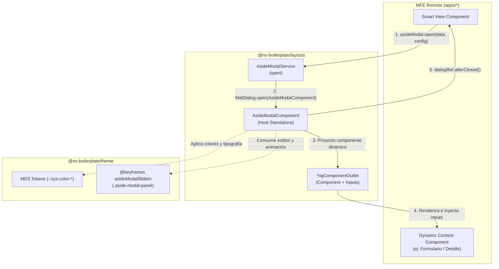

# Aside Modal (Modal Lateral / Slide-in Drawer)

> **Ficha Técnica del Módulo**  
> * **Ubicación en Monorepo:** `libs/shared/layouts/src/lib/modals/aside-modal/`  
> * **Tipo de Módulo:** Librería UI Compartida / Dumb Component Standalone & Service  
> * **Tags Nx (`project.json`):** `["scope:shared", "type:ui"]`  
> * **Estado:** Activo  

---

## 1. Propósito y Alcance de Negocio

El **Aside Modal** es un componente de presentación reutilizable diseñado para desplegar paneles laterales superpuestos (drawers o side-sheets) con animación deslizante de derecha a izquierda (`slide-in`). 

Su responsabilidad principal es desacoplar las vistas de edición, formularios complejos, visualización de detalles o wizards contextuales dentro de los Microfrontends (MFEs) sin obligar al usuario a abandonar la pantalla principal, optimizando el flujo de trabajo y respetando el sistema de diseño corporativo Material Design 3 (MD3).

---

## 2. Diagrama de Arquitectura y Flujo de Información



---

## 3. Contratos de Datos e Interfaces

### A. Interfaz de Datos: `AsideModalData<TComponent, TInputs>`

Definida en `@nx-boilerplate/layouts` (`libs/shared/layouts/src/lib/modals/models/aside-modal.models.ts`):

| Propiedad | Tipo | Obligatorio | Valor por Defecto | Descripción |
|---|---|---|---|---|
| `component` | `Type<TComponent>` | **Sí** | — | Clase del componente Standalone a renderizar dentro del modal. |
| `title` | `string` | No | `undefined` | Título que se muestra en el encabezado (`mat-dialog-title`). Si no se pasa, no se renderiza la cabecera. |
| `inputs` | `TInputs` (`Record<string, unknown>`) | No | `undefined` | Objeto clave-valor con los inputs requeridos por el componente hijo (`[ngComponentOutletInputs]`). |
| `cancelText` | `string` | No | `'Cancelar'` | Texto del botón secundario/descartar. |
| `confirmText` | `string` | No | `'Confirmar'` | Texto del botón principal de confirmación. |
| `showActions` | `boolean` | No | `true` | Determina si la barra inferior de botones (`mat-dialog-actions`) es visible. Si es `false`, el componente proyectado puede manejar sus propias acciones. |
| `showCloseIcon` | `boolean` | No | `true` | Muestra u oculta el botón de cerrar (`X`) en la esquina superior derecha del encabezado. |

### B. Configuración de Apertura: `MatDialogConfig`

Adicional a `AsideModalData`, el método `open()` acepta configuraciones estándar de Angular Material:

| Parámetro | Tipo | Valor Predeterminado en `AsideModalService` | Descripción |
|---|---|---|---|
| `width` | `string` | `'480px'` | Ancho del panel lateral (ej. `'560px'`, `'40vw'`). |
| `maxWidth` | `string` | `'100vw'` | Ancho máximo permitido en pantallas pequeñas. |
| `height` | `string` | `'100vh'` | Altura total de la pantalla. |
| `position` | `DialogPosition` | `{ right: '0', top: '0', bottom: '0' }` | Fija el modal alineado al extremo derecho. |
| `panelClass` | `string \| string[]` | `['aside-modal-panel']` | Aplica la animación `@keyframes asideModalSlideIn` y resetea bordes. |
| `disableClose` | `boolean` | `false` | Si es `true`, impide el cierre haciendo clic en el backdrop o con la tecla `Escape`. |

---

## 4. Puntos de Entrada y Acciones Disponibles

### Acciones del Diálogo

1. **Confirmación (`confirm()`):**
   - Disparado al hacer clic en el botón con directiva `mat-flat-button` (por defecto texto `"Confirmar"`).
   - Emite el valor booleano `true` a través de `dialogRef.close(true)`.

2. **Cancelación / Cierre (`close()`):**
   - Disparado al hacer clic en el botón con directiva `mat-button` (`"Cancelar"`), el botón de cruz (`X`) o el backdrop oscuro.
   - Emite el valor booleano `false` a través de `dialogRef.close(false)`.

3. **Cierre Programático desde el Componente Hijo:**
   - Si el componente proyectado inyecta `MatDialogRef<AsideModalComponent>`, puede invocar directamente `dialogRef.close(resultadoPersonalizado)` enviando cualquier payload de retorno.

---

## 5. Dependencias y Límites Arquitectónicos

* **Librerías que consume:**
  * `@nx-boilerplate/theme`: Tokens CSS de color (`--sys-color-*`), tipografía y mixin `@keyframes asideModalSlideIn`.
  * `@angular/material/dialog`, `@angular/material/button`, `@angular/material/icon`.
* **Módulos que lo consumen:**
  * `app-shell` y cualquier Microfrontend remoto en `apps/*` (`agendador-citas`, `lista-profesionales`, `procedimientos-medicos`, etc.).
* **Límites de Módulo Nx:**
  * Pertenece al tag `["scope:shared", "type:ui"]`. Puede ser importado por aplicaciones de `apps/*` o `app-shell` sin violar las reglas de `enforce-module-boundaries`.

---

## 6. Guía de Uso desde un Microfrontend (MFE)

### Paso 1: Importar en el Componente del MFE

En cualquier vista o componente Smart de tu Microfrontend, importa `AsideModalService` y el modelo `AsideModalData` desde `@nx-boilerplate/layouts`:

```typescript
import { Component, inject } from '@angular/core';
import { MatButtonModule } from '@angular/material/button';
import { AsideModalService, AsideModalData } from '@nx-boilerplate/layouts';
import { DetallePacienteComponent } from './components/detalle-paciente/detalle-paciente.component';
```

### Paso 2: Crear el Componente de Contenido Dinámico (Hijo)

El componente proyectado debe ser Standalone y declarar sus propiedades de entrada mediante **Signals** (`input()`):

```typescript
// apps/<tu-mfe>/src/app/components/detalle-paciente/detalle-paciente.component.ts
import { Component, input } from '@angular/core';

@Component({
  selector: 'mfe-detalle-paciente',
  standalone: true,
  template: `
    <div class="patient-details">
      <p><strong>ID Paciente:</strong> {{ pacienteId() }}</p>
      <p><strong>Modo Edición:</strong> {{ modoEdicion() ? 'Sí' : 'Solo Lectura' }}</p>
    </div>
  `,
})
export class DetallePacienteComponent {
  // Inputs reactivos basados en Signals que recibirán los valores de data.inputs
  pacienteId = input.required<string>();
  modoEdicion = input<boolean>(false);
}
```

### Paso 3: Abrir el Modal Lateral

Inyecta `AsideModalService` mediante `inject()` y utiliza el método `open()`:

```typescript
// apps/<tu-mfe>/src/app/components/pacientes-list/pacientes-list.component.ts
import { Component, inject } from '@angular/core';
import { MatButtonModule } from '@angular/material/button';
import { AsideModalService } from '@nx-boilerplate/layouts';
import { DetallePacienteComponent } from '../detalle-paciente/detalle-paciente.component';

@Component({
  selector: 'mfe-pacientes-list',
  standalone: true,
  imports: [MatButtonModule],
  template: `
    <button mat-flat-button color="primary" (click)="abrirFichaPaciente('PAC-9821')">
      Ver Ficha Lateral
    </button>
  `,
})
export class PacientesListComponent {
  private readonly asideModal = inject(AsideModalService);

  abrirFichaPaciente(id: string): void {
    const dialogRef = this.asideModal.open({
      title: 'Ficha Clínica del Paciente',
      component: DetallePacienteComponent,
      inputs: {
        pacienteId: id,
        modoEdicion: true,
      },
      confirmText: 'Guardar Ficha',
      cancelText: 'Cerrar',
      showCloseIcon: true,
      showActions: true, // Cambia a false si el componente hijo tiene sus propios botones
    }, {
      width: '540px', // Ancho personalizado del drawer lateral
      disableClose: false,
    });

    dialogRef.afterClosed().subscribe((confirmado: boolean | undefined) => {
      if (confirmado) {
        console.log('El usuario confirmó la acción en el aside modal');
        // Ejecutar recarga de datos o llamada a servicio
      } else {
        console.log('El modal fue descartado o cerrado');
      }
    });
  }
}
```

### Paso 4: Caso de Uso sin Botones de Acción (Formulario Autónomo)

Si tu componente hijo ya gestiona sus propios botones de envío (por ejemplo, con validación de formularios reactivos o estados de carga), desactiva `showActions`:

```typescript
this.asideModal.open({
  title: 'Nuevo Registro',
  component: FormularioAutonomoComponent,
  inputs: { categoria: 'Odontología' },
  showActions: false, // Oculta mat-dialog-actions inferior
}, {
  width: '600px',
});
```

---

## 7. Comandos de Verificación (Nx)

Para verificar la integridad del código y que los límites arquitectónicos se mantengan en el monorepo:

```bash
# Validar linting de la librería compartida
npx nx lint layouts

# Ejecutar pruebas unitarias de layouts
npx nx test layouts

# Verificar la integración en el Host MFE
npx nx build app-shell

# Servir el Host en desarrollo
npx nx serve app-shell
```
