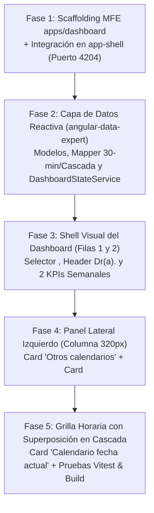

# Contrapropuesta de Planeación por Fases — MFE `apps/dashboard` (Etapa 1: Visual + Datos Reactivos)

> **Fecha:** Noviembre 2026  
> **Documento Analizado:** [`docs/planeacion-front-dashboard.md`](./planeacion-front-dashboard.md)  
> **Planeación de Servicios Asociada:** [`docs/planeacion-front-services-dashboard.md`](./planeacion-front-services-dashboard.md)  
> **Skills Gobernantes:** [`angular-ui-expert`](../.agents/skills/angular-ui-expert/SKILL.md), [`angular-data-expert`](../.agents/skills/angular-data-expert/SKILL.md), [`md3-architecture`](../.agents/skills/md3-architecture/SKILL.md)  
> **Alcance de esta Entrega:** **Etapa 1 (Visual + Lectura Reactiva de Datos).** Una vez completada y validada visualmente esta etapa, se iniciará la **Etapa 2 (Fase de Eventos y Acciones Granulares)**.

---

## 1. Diagnóstico del Plan Original (`planeacion-front-dashboard.md`) y Puntos de Mejora

El documento [`docs/planeacion-front-dashboard.md`](./planeacion-front-dashboard.md) define con gran claridad la maqueta visual (inspirada en el wireframe de la imagen adjunta), la distribución en 3 filas y el algoritmo visual de superposición en cascada (`100%` $\rightarrow$ `65%` $\rightarrow$ `50%` $\rightarrow$ `35%`).

Sin embargo, al cotejarlo con la arquitectura real del monorepo Nx (`@nx-boilerplate/source`) y los microservicios NestJS existentes, identificamos **6 casos de mejora concretos** que optimizan su implementación:

| # | Punto en Plan Original (`planeacion-front-dashboard.md`) | Caso de Mejora Propuesto (Contrapropuesta) | Beneficio Arquitectónico |
| :---: | :--- | :--- | :--- |
| **M1** | **Datos Mockeados en Fase 3:** El plan original asume que solo se consumirá `GET /api/doctors` y que las agendas de los médicos se generarán con un mock estático local. | **Conexión Real a `GET /api/appointments/available-dates` con Fallback Resiliente:** Nuestro cotejo demostró que el backend ya expone `IDayAvailability[]` por rango semanal. Conectaremos la data real mediante `DashboardStateService` (`forkJoin` + caché semanal) manteniendo un normalizador determinista de respaldo si el backend está apagado. | Los 2 KPIs semanales y la grilla diaria reflejan citas reales del `scheduling-service` desde la Etapa 1 sin sacrificar la visualización offline. |
| **M2** | **Desfase de Intervalos (`45 min` Backend vs. `30 min` UI):** El plan original pide filas de 30 minutos (`08:00`, `08:30`...), pero el `AvailabilityController` del backend devuelve bloques de 45 minutos (`08:00 - 08:45`). | **Adaptador de Proyección Temporal (`buildTimeGridRows`):** Crear una función pura en la capa `angular-data-expert` que proyecte cualquier intervalo `[startTime, endTime]` y el `recesoAlmuerzo` de `horarioTrabajo` sobre los 20 bloques canónicos de 30 minutos (`08:00` a `17:30`). | Desacopla por completo la grilla visual de 30 min de la duración configurada en el backend (45 min, 30 min o 60 min). |
| **M3** | **Tarjetas KPI creadas desde cero:** La Fase 5 original plantea maquetar las 2 tarjetas de métricas semanales manualmente. | **Reutilización y Homologación con `<lib-metric-card>` (`@nx-boilerplate/layouts`):** El monorepo ya cuenta con `MetricCardComponent` en [`libs/shared/layouts`](../libs/shared/layouts/src/lib/metric-card/metric-card.component.ts) (`title`, `value`, `subtitle`, `icon`, `variant`). Podemos reutilizarlo o envolverlo limpiamente para los 2 KPIs semanales. | Cumple la regla *DRY* de `angular-ui-expert`, reduce CSS duplicado y mantiene consistencia con el resto del monorepo. |
| **M4** | **Monolito en `RemoteEntry` / Fase 5:** El plan original concentra casi toda la UI en una sola vista extensa durante las Fases 4 y 5. | **Descomposición Atómica en 3 Componentes Presentacionales (Dumb) + 1 Smart View:** Separar `OtherCalendarsCardComponent`, `DailyCascadeCalendarComponent` y `DashboardViewComponent`. | Componentes pequeños (<150 líneas), `ChangeDetectionStrategy.OnPush`, fáciles de probar unitariamente con Vitest y listos para recibir eventos en la Etapa 2. |
| **M5** | **Asignación de Colores de Médicos en Cascada:** El plan original menciona una "barra lateral de color identificativo del médico", pero no especifica de dónde provienen los tokens para no violar `md3-architecture`. | **Paleta Categórica Determinista basada en Design Tokens (`--chart-1` a `--chart-5` y `--sys-color-*`):** Asignar a cada médico un token semántico de `@nx-boilerplate/theme` compartido entre el badge de *"Otros calendarios"*, la leyenda superior del calendario diario y el borde izquierdo de cada bloque superpuesto. | Cero colores hexadecimales hardcodeados, soporte automático para Dark/Light Mode y trazabilidad visual inmediata entre el checkbox y la columna superpuesta. |
| **M6** | **Sincronización entre Médico Principal y "Otros calendarios":** ¿Qué ocurre si el Médico B está marcado en *"Otros calendarios"* y el usuario hace clic sobre el Médico B en el `<lib-carousel variant="pill-bar">` superior? | **Saneamiento Reactivo con `linkedSignal`:** Cuando `selectedDoctorCedula` cambia al Médico B, `comparedDoctorCedulas` remueve automáticamente al Médico B de la lista de secundarios y conserva el resto, evitando que un médico se superponga consigo mismo. | Evita bugs de estado duplicado en la cascada sin usar `ngOnChanges` ni efectos imperativos. |

---

## 2. Separación Clara: Etapa 1 (Actual) vs. Etapa 2 (Futura Fase de Eventos)

Atendiendo tu recomendación, dividimos el ciclo de vida del MFE `apps/dashboard` en dos grandes etapas para no mezclar complejidad transaccional con la construcción visual y de lectura:

| Dimensión | Etapa 1: Visual + Lectura Reactiva (Alcance de este Plan) | Etapa 2: Fase de Eventos Granulares (Siguiente Iteración) |
| :--- | :--- | :--- |
| **Propósito** | Maquetación MD3 fiel al wireframe, conexión de lectura (`GET /api/doctors` y `GET /api/appointments/available-dates`), selección reactiva de médico/fecha y renderizado de superposición en cascada (`100%` $\rightarrow$ `65%` $\rightarrow$ `50%` $\rightarrow$ `35%`). | Acciones de mutación y flujos interactivos profundos sobre cada bloque o tarjeta del Dashboard. |
| **Interacciones Incluidas** | - Cambio de médico activo en `<lib-carousel variant="pill-bar">`. - Selección/deselección de hasta 3 médicos adicionales en *"Otros calendarios"*. - Selección de día en `<mat-calendar>` y botones `<` `Hoy` `>`. - Recálculo automático de los 2 KPIs semanales y de las capas de la grilla. | - Clic en slot `'AVAILABLE'` para abrir modal de agendamiento rápido o navegar a `/agendador-citas` pre-filtrado. - Clic en slot `'SCHEDULED'` (`TENTATIVE`) para confirmar/cancelar cita in-situ. - Clic en slot `'CONFIRMED'` para abrir `AsideModalService` con el detalle clínico del paciente. - Creación de bloqueos personales desde la grilla. |
| **Preparación Técnica** | Los componentes Dumb de la Etapa 1 ya dejarán declarados los `output<IDashboardDoctorCell>()` (`slotSelected`) para que en la Etapa 2 solo conectemos los manejadores sin refactorizar el HTML/SCSS. | Conexión de los `output()` con `AsideModalService`, `Router` y endpoints `POST`/`PATCH`. |

---

## 3. Propuesta de Implementación por Fases (Etapa 1: 5 Fases Modulares)

A continuación se detalla la ruta crítica dividida en **5 fases incrementales**, cada una verificable de forma aislada antes de pasar a la siguiente.

---

### Fase 1: Scaffolding del Remote `apps/dashboard` e Integración con `app-shell`
**Objetivo:** Reemplazar el placeholder inline actual de `/dashboard` en `app-shell` por el nuevo Microfrontend federado en el puerto `4204`.

1. **Generación del MFE con Nx (`--no-interactive`):**
   - Crear `apps/dashboard` con `@nx/angular:remote` (puerto `4204`, estilos SCSS, Standalone, Zoneless).
   - Asignar tags `"scope:frontend"`, `"type:app"` en `apps/dashboard/project.json`.
   - Configurar `proxyConfig: "app-shell/proxy.conf.json"` en el target `serve` de `apps/dashboard/project.json`.
2. **Configuración de Estilos y Providers:**
   - Importar `@use 'theme/material-theme'` en `apps/dashboard/src/styles.scss`.
   - Configurar `provideZonelessChangeDetection()`, `provideHttpClient(withFetch())`, `provideNativeDateAdapter()` y `LOCALE_ID: 'es-CO'` en `apps/dashboard/src/app/app.config.ts` y `remote-entry/entry.routes.ts`.
3. **Federación en `app-shell`:**
   - Registrar `'dashboard'` en `app-shell/module-federation.config.ts` y `app-shell/src/decl.d.ts`.
   - Actualizar la ruta `path: 'dashboard'` en [`app-shell/src/app/app.routes.ts`](../app-shell/src/app/app.routes.ts) usando `loadChildren: () => import('dashboard/Routes').then(m => m.remoteRoutes)` con el metadato `{ title: 'Dashboard General', icon: 'dashboard', showInNavbar: true }` en primera posición.
   - Actualizar el script `"start:all"` en [`package.json`](../package.json) incluyendo `dashboard` en `--projects=...`.

---

### Fase 2: Capa de Datos Reactiva y Motor de Geometría (`angular-data-expert`)
**Objetivo:** Construir el motor de estado y transformación descrito en [`docs/planeacion-front-services-dashboard.md`](./planeacion-front-services-dashboard.md) con cobertura completa de tests unitarios.

1. **Modelos (`apps/dashboard/src/app/models/dashboard.models.ts`):**
   - Definir `IDashboardDoctor`, `IOverlayGeometry`, `IDashboardDoctorCell`, `IDashboardTimeRow` e `IDashboardWeeklyKpis`.
2. **Mappers y Funciones Puras (`apps/dashboard/src/app/utils/dashboard-calendar.mapper.ts`):**
   - `calculateOverlayGeometry(layerIndex, totalLayers)` $\rightarrow$ cálculo exacto de `widthPercent` (`100`, `65`, `50`, `35`), `leftPercent` (`0`, `35`, `50`, `65`) y `zIndex` (`10`, `20`, `30`, `40`).
   - `buildTimeGridRows(date, activeLayers, availabilityMap)` $\rightarrow$ proyección de intervalos de 45 min del backend y `recesoAlmuerzo` sobre las 20 filas de 30 min (`08:00` – `17:30`).
   - `computeWeeklyKpis(availabilityDays)` $\rightarrow$ sumatoria de citas `'CONFIRMED'` y `'TENTATIVE'` de la semana activa.
3. **Servicio de Estado (`apps/dashboard/src/app/services/dashboard-state.service.ts`):**
   - Conectar `GET /api/doctors` y `GET /api/appointments/available-dates` vía `ApiClientService` con `forkJoin`, caché semanal en memoria y fallback determinista.
4. **Tests Unitarios (`dashboard-calendar.mapper.spec.ts` y `dashboard-state.service.spec.ts`):**
   - Validar el algoritmo de cascada, el mapeo de 30 minutos y las transiciones de Signals con Vitest.

---

### Fase 3: Estructura Base del Dashboard — Filas 1 y 2 (Selector de Médicos, Header y 2 KPIs Semanales)
**Objetivo:** Implementar la cabecera interactiva del Dashboard y las 2 tarjetas de indicadores semanales siguiendo [`angular-ui-expert`](../.agents/skills/angular-ui-expert/SKILL.md) y [`md3-architecture`](../.agents/skills/md3-architecture/SKILL.md).

1. **Fila 1 — Selector Superior de Médicos y Bienvenida Contextual:**
   - Integrar `<lib-carousel variant="pill-bar" [items]="state.doctorPillItems()" [activeId]="state.activeDoctor()?.cedula" (itemSelected)="onDoctorSelected($event)" />` de `@nx-boilerplate/ui-carousel`.
   - Renderizar el banner/header contextual con el nombre completo del profesional activo (`Dr(a). Nombres Apellidos`), su especialidad (`profesion`) y su chip de color identificativo.
2. **Fila 2 — Las 2 Tarjetas de KPIs Semanales:**
   - Grid CSS `grid-template-columns: repeat(2, 1fr)` (colapsable a `1fr` en móvil).
   - **KPI 1:** *"Citas de la Semana Confirmadas"* (vinculado a `state.weeklyKpis().confirmedCount`, icono `check_circle`, acento semántico `--app-color-success` / `primary`).
   - **KPI 2:** *"Citas de la Semana Agendadas"* (vinculado a `state.weeklyKpis().scheduledCount`, icono `event_available`, acento semántico `--sys-color-primary`).

---

### Fase 4: Columna Izquierda del Panel Inferior (Card 1 *"Otros calendarios"* + Card 2 `<mat-calendar>`)
**Objetivo:** Construir el panel lateral de control (ancho fijo `320px` en desktop, `100%` en móvil) que gobierna qué médicos se superponen y qué fecha se visualiza.

1. **Componente Presentacional `OtherCalendarsCardComponent` (`components/other-calendars-card/`):**
   - Recibe `doctors = input.required<readonly IDashboardDoctor[]>()` (que ya excluye al médico activo) y `selectedCedulas = input.required<readonly string[]>()`.
   - Emite `toggleDoctor = output<string>()` y `clearAll = output<void>()`.
   - Muestra cada profesional con su `<mat-checkbox>`, un indicador circular con su token cromático (`doctor.colorTheme.cssVar`), su especialidad y un badge informativo cuando se alcanza el tope recomendado de comparación (3 médicos adicionales = 4 capas totales).
2. **Card 2 — Calendario Mensual Compacto (`<mat-calendar>`):**
   - Ubicada justo debajo de *"Otros calendarios"*.
   - Sincronizada de forma bidireccional con `state.selectedDate()` (`[selected]="state.selectedDate()" (selectedChange)="state.selectDate($event)"`).
   - Al cambiar a un día de otra semana, `DashboardStateService` dispara automáticamente la carga de disponibilidad de la nueva semana para los médicos activos.

---

### Fase 5: Card 3 *"Calendario fecha actual"* con Superposición en Cascada + Verificación Integral
**Objetivo:** Implementar el componente estrella del Dashboard (`DailyCascadeCalendarComponent`) con la grilla horaria de 30 minutos y el apilamiento visual de agendas.

1. **Componente Presentacional `DailyCascadeCalendarComponent` (`components/daily-cascade-calendar/`):**
   - **Header de la Card:**
     - Título *"Calendario fecha actual"* + subtítulo con la fecha formateada en español (`EEEE, d 'de' MMMM 'de' yyyy`).
     - Controles rápidos de navegación diaria (`<` Día anterior, botón `Hoy`, Día siguiente `>`).
     - **Leyenda de Capas Activas (Chips de Médicos Superpuestos):** Muestra en orden de capa (`Capa 1: 100%`, `Capa 2: 65%`, `Capa 3: 50%`, `Capa 4: 35%`) qué médicos están visibles en la grilla con su respectivo color identificativo.
   - **Cuerpo de la Grilla (`08:00` a `17:30`):**
     - Columna izquierda fija (`72px`) con la etiqueta de hora (`08:00`, `08:30`, ..., `17:30`).
     - Pista derecha (`position: relative; min-height: 52px`) donde se iteran con `@for (cell of row.layers; track cell.doctorCedula)` las capas superpuestas:
       - Aplican `[style.width.%]="cell.geometry.widthPercent"`, `[style.left.%]="cell.geometry.leftPercent"` y `[style.z-index]="cell.geometry.zIndex"`.
       - Borde izquierdo sólido de `4px` con `[style.border-left-color]="cell.colorCssVar"` y sombra sutil `var(--sys-elevation-level1)` en las capas `layerIndex > 0` para garantizar legibilidad perfecta en el solapamiento.
       - Variantes visuales por estado (`CONFIRMED`, `SCHEDULED`, `BLOCKED`, `LUNCH`, `AVAILABLE`) consumiendo únicamente tokens de `@nx-boilerplate/theme`.
     - Deja preparado el `readonly slotClick = output<IDashboardDoctorCell>()` para la futura **Etapa 2 (Fase de Eventos)**.
2. **Pruebas Unitarias y Compilación Producción:**
   - Pruebas unitarias de `OtherCalendarsCardComponent`, `DailyCascadeCalendarComponent` y `DashboardViewComponent`.
   - Verificación de compilación limpia de `npx nx build dashboard` y `npx nx build app-shell`.

