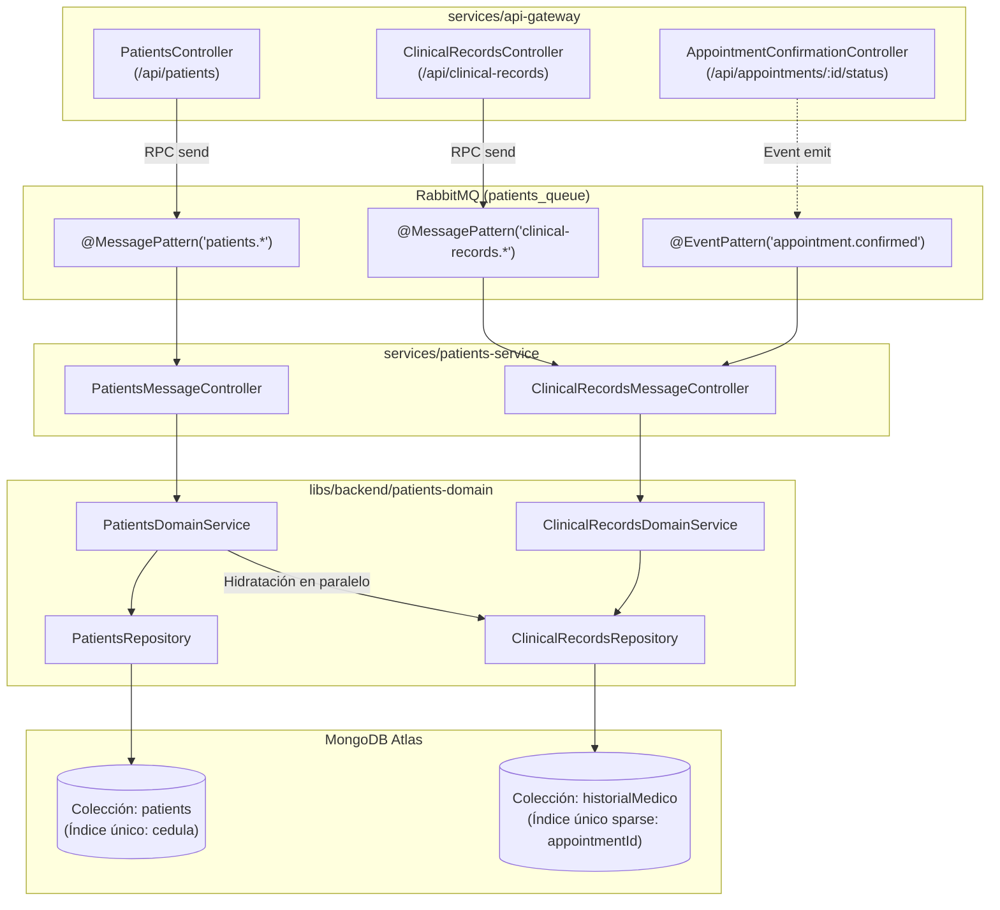

# 01 — Microservicio y Dominio de Pacientes e Historias Clínicas

> **Ficha Técnica del Dominio**  
> * **Microservicio Ejecutable:** `services/patients-service` (`["scope:backend", "type:service"]`)  
> * **Librería de Dominio:** `libs/backend/patients-domain` (`["scope:backend", "type:domain-lib"]`)  
> * **Cola RabbitMQ:** `patients_queue` (`Transport.RMQ`)  
> * **Colecciones MongoDB Atlas:** `patients`, `historialMedico`  
> * **Normativa Aplicada:** Resolución 1995 de 1999 (Ministerio de Salud de Colombia)  
> * **Nexo Padre:** [Volver a `00-api-gateway.md`](./00-api-gateway.md)

---

## 1. Propósito y Responsabilidad de Negocio

Este módulo agrupa cohesivamente dos agregados fundamentales centrados en el paciente:

1. **Gestión Demográfica del Paciente (`patients`):**
   * Administra la ficha estandarizada de **20 campos demográficos** (identificación, contacto, estado civil, ocupación, aseguradora, acompañante y persona responsable).
   * Soporta un **modo dual de registro**: creación rápida con solo 5 datos básicos durante el agendamiento de citas (inicializando los 15 restantes con valores por defecto seguros: `null`, `'CC'`, `false`), y actualización completa posterior desde el expediente clínico.
2. **Gestión de Historias Clínicas Electrónicas (`historialMedico`):**
   * Administra los registros clínicos asistenciales bajo la estructura exigida por la **Resolución 1995 de 1999** (médico tratante, motivo de consulta, enfermedad actual, antecedentes patológicos/alérgicos/farmacológicos, examen físico, lote de insumos, recomendaciones y consentimiento informado).
   * Crea borradores clínicos (`PENDIENTE_ATENCION`) de forma **100% reactiva e idempotente** al escuchar el evento `appointment.confirmed` emitido cuando una cita médica es confirmada.

---

## 2. Diagrama de Arquitectura Interna y Flujo de Datos



---

## 3. Modelo de Persistencia en MongoDB Atlas

### 3.1 Colección `patients` ([`patient.schema.ts`](file:///Users/usuario/Desktop/nx-boilerplate/libs/backend/patients-domain/src/lib/schemas/patient.schema.ts))
Almacena la ficha única del paciente.

* **Índice Único:** `cedula` (`{ unique: true, index: true }`).
* **Sub-esquemas (`_id: false`):**
  * `CompanionSchema` (`acompanante`): `{ nombre: string | null, telefono: string | null }`
  * `ResponsibleSchema` (`persona_responsable`): `{ nombre: string | null, telefono: string | null, parentesco: string | null }`
* **Estructura de 20 Campos:**
  * **Obligatorios en creación rápida:** `cedula`, `nombre`, `apellidos`, `correo`, `celular`.
  * **Con valor por defecto si no se envían:** `tipo_documento` (`'CC'`), `es_menor_de_edad` (`false`), `fecha_nacimiento` (`null`), `edad` (`null`), `sexo` (`null`), `estado_civil` (`null`), `ocupacion` (`null`), `direccion_residencia` (`null`), `aseguradora` (`null`), `tipo_vinculacion` (`null`), `acompanante` (`{ nombre: null, telefono: null }`), `persona_responsable` (`{ nombre: null, telefono: null, parentesco: null }`).

### 3.2 Colección `historialMedico` ([`clinical-record.schema.ts`](file:///Users/usuario/Desktop/nx-boilerplate/libs/backend/patients-domain/src/lib/schemas/clinical-record.schema.ts))
Almacena cada atención médica o borrador clínico del paciente.

* **Índices Configurados:**
  1. `cedula_paciente`: `{ index: true }` para ordenar y recuperar rápidamente el historial cronológico de un paciente.
  2. `appointmentId`: `{ type: String, default: null, unique: true, sparse: true }`.
     > **Por qué un índice `unique` + `sparse`:** Garantiza **idempotencia a nivel de motor de base de datos**. Si el evento `appointment.confirmed` se entrega más de una vez para la cita `APT-123`, MongoDB impide crear un segundo borrador duplicado. A la vez, al ser `sparse`, permite múltiples historias clínicas creadas manualmente con `appointmentId: null`.
* **Ciclo de Vida (`estado_registro`):**
  * `'PENDIENTE_ATENCION'`: Estado inicial cuando se pre-crea por confirmación de cita o borrador manual.
  * `'COMPLETADA'`: Estado final una vez el médico tratante diligencia el examen físico, antecedentes, lote y cierra la consulta.

---

## 4. Casos de Uso y Reglas de Dominio (`libs/backend/patients-domain`)

### 4.1 Hidratación Transparente en `PatientsDomainService.findByNationalId()`
Archivo: [`patients-domain.service.ts`](file:///Users/usuario/Desktop/nx-boilerplate/libs/backend/patients-domain/src/lib/services/patients-domain.service.ts)

Cuando se consulta un paciente por su cédula (`patients.find-by-national-id`):
1. Ejecuta en paralelo (`Promise.all`) la consulta demográfica en `patients` y el historial de atenciones en `historialMedico`:
   ```typescript
   const [patient, clinicalRecords] = await Promise.all([
     this.patientsRepository.findByCedula(normalizedId),
     this.clinicalRecordsRepository.findByPatientCedula(normalizedId),
   ]);
   ```
2. Si el paciente no existe en `patients`, lanza `RpcException({ statusCode: 404, message: '...' })`.
3. Si existen registros en `historialMedico`, extrae los procedimientos realizados (`ultimosProcedimientos`) y la recomendación médica más reciente (`recomendaciones`) y los inyecta en el contrato `IPatientHistory`.
4. **Beneficio:** El Paso 2 del MFE `agendador-citas` muestra automáticamente los antecedentes reales del paciente sin hacer peticiones adicionales.

### 4.2 Inicialización Idempotente de Borrador Clínico (`createDraftFromAppointment`)
Archivo: [`clinical-records.repository.ts`](file:///Users/usuario/Desktop/nx-boilerplate/libs/backend/patients-domain/src/lib/repositories/clinical-records.repository.ts)

Cuando se confirma una cita en recepción, `ClinicalRecordsDomainService.initializeDraftFromConfirmedAppointment()` ejecuta un `findOneAndUpdate` atómico con `$setOnInsert` y `upsert: true`:
* Si ya existía un borrador para ese `appointmentId`, no sobrescribe ningún dato que el médico ya haya empezado a escribir.
* Si no existía, crea el documento en `historialMedico` precargando:
  * `cedula_paciente`: Cédula del paciente de la cita.
  * `estado_registro`: `'PENDIENTE_ATENCION'`.
  * `medico_tratante`: `[{ cedula_profesional: event.doctorCedula, fecha_atencion: event.appointmentDate }]`.
  * `registro_clinico.procedimiento_realizado`: Nombre del procedimiento agendado.

---

## 5. Contratos y DTOs del Dominio

### A. Interfaces (`@nx-boilerplate/api-interfaces`)
* **[`patient.interface.ts`](file:///Users/usuario/Desktop/nx-boilerplate/libs/shared/api-interfaces/src/lib/patient.interface.ts):** `IPatientHistory`, `IPatientCompanion`, `IPatientResponsible`, `ICreatePatientRequest`, `IUpdatePatientRequest`.
* **[`clinical-record.interface.ts`](file:///Users/usuario/Desktop/nx-boilerplate/libs/shared/api-interfaces/src/lib/clinical-record.interface.ts):** `ICitaMedica` (`IClinicalRecord`), `ClinicalRecordStatus`, `IMedicoTratante`, `IAntecedentesMedicos`, `IRegistroClinico`, `ISoporteDocumental`, `IAppointmentConfirmedEvent`, `ICreateClinicalRecordRequest`, `IUpdateClinicalRecordRequest`.

### B. DTOs (`@nx-boilerplate/shared-dtos`)
* **[`find-patient.dto.ts`](file:///Users/usuario/Desktop/nx-boilerplate/libs/shared/dtos/src/lib/find-patient.dto.ts):** `FindPatientByNationalIdDto`.
* **[`create-patient.dto.ts`](file:///Users/usuario/Desktop/nx-boilerplate/libs/shared/dtos/src/lib/create-patient.dto.ts):** `CreatePatientDto`, `PatientCompanionDto`, `PatientResponsibleDto`.
* **[`update-patient.dto.ts`](file:///Users/usuario/Desktop/nx-boilerplate/libs/shared/dtos/src/lib/update-patient.dto.ts):** `UpdatePatientDto`, `UpdatePatientMessageDto`.
* **[`clinical-record.dto.ts`](file:///Users/usuario/Desktop/nx-boilerplate/libs/shared/dtos/src/lib/clinical-record.dto.ts):** `AppointmentConfirmedEventDto`, `MedicoTratanteDto`, `AntecedentesMedicosDto`, `RegistroClinicoDto`, `SoporteDocumentalDto`, `CreateClinicalRecordDto`, `UpdateClinicalRecordDto`, `UpdateClinicalRecordMessageDto`, `FindClinicalRecordByIdDto`.

---

## 6. Catálogo de Patrones RabbitMQ (`patients_queue`)

### [`PatientsMessageController`](file:///Users/usuario/Desktop/nx-boilerplate/services/patients-service/src/controllers/patients-message.controller.ts)
| Tipo | Patrón | Payload DTO | Método de Dominio | Respuesta |
|---|---|---|---|---|
| `@MessagePattern` | `patients.find-all` | — | `findAllPatients()` | `IPatientHistory[]` |
| `@MessagePattern` | `patients.find-by-national-id` | `FindPatientByNationalIdDto` | `findByNationalId()` | `IPatientHistory` (hidratado) |
| `@MessagePattern` | `patients.create` | `CreatePatientDto` | `createPatient()` | `IPatientHistory` |
| `@MessagePattern` | `patients.update` | `UpdatePatientMessageDto` | `updatePatient()` | `IPatientHistory` |

### [`ClinicalRecordsMessageController`](file:///Users/usuario/Desktop/nx-boilerplate/services/patients-service/src/controllers/clinical-records-message.controller.ts)
| Tipo | Patrón | Payload DTO | Método de Dominio | Respuesta |
|---|---|---|---|---|
| `@EventPattern` | `appointment.confirmed` | `AppointmentConfirmedEventDto` | `initializeDraftFromConfirmedAppointment()` | `void` (Asíncrono) |
| `@MessagePattern` | `clinical-records.find-by-patient` | `FindPatientByNationalIdDto` | `getPatientClinicalHistory()` | `ICitaMedica[]` |
| `@MessagePattern` | `clinical-records.find-by-id` | `FindClinicalRecordByIdDto` | `getClinicalRecordById()` | `ICitaMedica` |
| `@MessagePattern` | `clinical-records.create` | `CreateClinicalRecordDto` | `createClinicalRecord()` | `ICitaMedica` |
| `@MessagePattern` | `clinical-records.update` | `UpdateClinicalRecordMessageDto` | `updateClinicalRecord()` | `ICitaMedica` |

---

## 7. Pruebas Unitarias y Comandos de Verificación

```bash
# Ejecutar suite de pruebas unitarias de la librería de dominio (16 tests)
./node_modules/.bin/vitest run --config libs/backend/patients-domain/vite.config.mts

# Ejecutar suite de pruebas unitarias del microservicio (11 tests)
./node_modules/.bin/vitest run --config services/patients-service/vite.config.mts

# Verificar tipado estricto TypeScript
./node_modules/.bin/tsc -p libs/backend/patients-domain/tsconfig.lib.json --noEmit
./node_modules/.bin/tsc -p services/patients-service/tsconfig.app.json --noEmit

# Levantar el microservicio en desarrollo
npx nx serve patients-service
```

