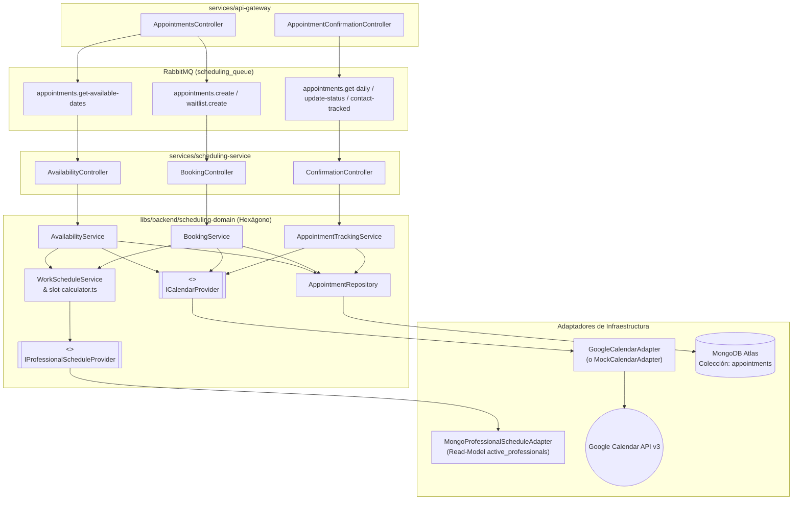

# 02 — Microservicio y Dominio de Agendamiento, Google Calendar y CRM

> **Ficha Técnica del Dominio**  
> * **Microservicio Ejecutable:** `services/scheduling-service` (`["scope:backend", "type:service"]`)  
> * **Librería de Dominio:** `libs/backend/scheduling-domain` (`["scope:backend", "type:domain-lib"]`)  
> * **Cola RabbitMQ:** `scheduling_queue` (`Transport.RMQ`)  
> * **Colecciones MongoDB Atlas:** `appointments`, `active_professionals` *(Read-Model)*  
> * **Integración Externa:** Google Calendar API v3 (`googleapis` OAuth2 / Service Account)  
> * **Nexo Padre:** [Volver a `00-api-gateway.md`](./00-api-gateway.md)

---

## 1. Propósito y Responsabilidad de Negocio

El dominio de Agendamiento (`scheduling-domain`) gestiona la inteligencia temporal de la clínica bajo una arquitectura **Hexagonal (Ports & Adapters)**:

1. **Cálculo Matemático de Disponibilidad (`AvailabilityService` + `WorkScheduleService`):**
   * Cruza en tiempo real cuatro fuentes de verdad para determinar qué bloques horarios están disponibles para un especialista:
     1. Su jornada laboral base (`horarioTrabajo` y `recesoAlmuerzo`).
     2. Sus excepciones de agenda (`EXTRA_SHIFT` para horas extra o `DAY_OFF` para bloqueos/vacaciones).
     3. Las citas ya registradas en la colección `appointments` de MongoDB (`TENTATIVE` o `CONFIRMED`).
     4. Los eventos ocupados del calendario real del médico en **Google Calendar API**.
2. **Reserva Transaccional con Compensación (`BookingService`):**
   * Valida que el turno solicitado esté dentro del horario laboral efectivo y libre de colisiones, crea el evento en Google Calendar en color amarillo (`colorId: '5'` — Tentativo) y persiste el documento en la colección `appointments` con código único `APT-...`.
3. **CRM Diario de Confirmación y Seguimiento (`AppointmentTrackingService`):**
   * Permite al personal de recepción consultar la agenda del día, registrar intentos de contacto por WhatsApp (`contactCount`) y cambiar el estado de la cita a `CONFIRMED` (cambiando el evento en Google Calendar a verde `colorId: '10'`) o `CANCELLED` (eliminando el evento del calendario para liberar el cupo).

---

## 2. Diagrama de Arquitectura Hexagonal (Ports & Adapters)



---

## 3. Modelo de Persistencia en MongoDB Atlas

### 3.1 Colección `appointments` ([`appointment.schema.ts`](file:///Users/usuario/Desktop/nx-boilerplate/libs/backend/scheduling-domain/src/lib/schemas/appointment.schema.ts))
Almacena el ciclo de vida operativo y de sincronización de cada cita médica.

* **Campos Principales:**
  * `appointmentId`: Identificador de negocio único (`APT-<timestamp>-<random>`, indexado y único).
  * `doctorEmail` y `doctorCedula`: Identificación del profesional asignado.
  * `patientNationalId`, `patientFullName`, `patientEmail`, `patientPhone`: Datos de contacto rápido del paciente.
  * `procedureId` y `procedureName`: Procedimiento médico agendado.
  * `startTime` y `endTime`: Fechas ISO exactas de inicio y fin del bloque.
  * `status`: `'TENTATIVE' | 'CONFIRMED' | 'CANCELLED'`.
  * `googleCalendarEventId`: ID del evento en Google Calendar para actualizaciones de color o eliminación posterior.
  * `colorId`: `'5'` (Amarillo/Tentativo), `'10'` (Verde/Confirmado), `'11'` (Rojo/Cancelado).
  * `isCalendarSynced`: Booleano que indica si el evento se sincronizó con Google Calendar o quedó pendiente por contingencia de red.
  * `contactCount` y `lastContactAt`: Trazabilidad de cuántos recordatorios por WhatsApp se han enviado desde el CRM.

### 3.2 Read-Model `active_professionals` ([`professional-schedule.read-model.ts`](file:///Users/usuario/Desktop/nx-boilerplate/libs/backend/scheduling-domain/src/lib/schemas/professional-schedule.read-model.ts))
Para mantener el bajo acoplamiento sin hacer llamadas RPC síncronas entre microservicios en cada cálculo de slots, `scheduling-domain` implementa el puerto [`IProfessionalScheduleProvider`](file:///Users/usuario/Desktop/nx-boilerplate/libs/backend/scheduling-domain/src/lib/ports/professional-schedule-provider.port.ts) mediante un *Read-Model* de solo lectura sobre la colección `active_professionals`, leyendo `horarioTrabajo` y `horariosExcepcionales`.

---

## 4. Casos de Uso y Algoritmos Clave (`libs/backend/scheduling-domain`)

### 4.1 Algoritmo de Disponibilidad Semanal (`AvailabilityService.getAvailableSlotsForRange`)
Archivos: [`availability.service.ts`](file:///Users/usuario/Desktop/nx-boilerplate/libs/backend/scheduling-domain/src/lib/services/availability.service.ts), [`work-schedule.service.ts`](file:///Users/usuario/Desktop/nx-boilerplate/libs/backend/scheduling-domain/src/lib/services/work-schedule.service.ts), [`slot-calculator.ts`](file:///Users/usuario/Desktop/nx-boilerplate/libs/backend/scheduling-domain/src/lib/utils/slot-calculator.ts)

1. **Obtención de Ventana Laboral Efectiva (`WorkScheduleService.getEffectiveWorkingWindows`):**
   * Verifica si la fecha corresponde a un día laboral del médico (`diasLaborales`, ej. Lunes a Viernes).
   * Resta automáticamente el bloque de almuerzo (`recesoAlmuerzo.inicio` a `recesoAlmuerzo.fin`), dividiendo el día en dos ventanas (mañana y tarde).
   * Aplica las excepciones (`horariosExcepcionales`):
     * `DAY_OFF`: Si es de día completo, anula toda la disponibilidad de ese día; si es parcial, recorta los bloques afectados.
     * `EXTRA_SHIFT`: Abre bloques adicionales de atención incluso en días no laborales (ej. un sábado especial).
2. **Cruce con Citas Locales y Google Calendar:**
   * Consulta las citas activas en MongoDB (`status !== 'CANCELLED'`) y los bloques ocupados en Google Calendar.
   * Clasifica cada turno en `ISlotDisplay` con estados detallados (`AVAILABLE`, `TENTATIVE`, `CONFIRMED`, `BLOCKED_PERSONAL`) para que el frontend renderice el calendario semanal con precisión visual.

### 4.2 Reserva de Cita y Resiliencia (`BookingService.bookAppointment`)
Archivo: [`booking.service.ts`](file:///Users/usuario/Desktop/nx-boilerplate/libs/backend/scheduling-domain/src/lib/services/booking.service.ts)

1. Valida que el rango `[startTime, endTime]` esté contenido dentro de una ventana laboral efectiva del médico; si no, lanza `RpcException(400)`.
2. Verifica en MongoDB que no exista otra cita activa solapada para el mismo médico; si existe colisión, lanza `RpcException(409 Conflict)`.
3. Intenta agendar el evento en Google Calendar (`colorId: '5'`, estado `tentative`):
   * Si Google Calendar responde con éxito, guarda `googleCalendarEventId` e `isCalendarSynced: true`.
   * **Modo Degradado Resiliente:** Si Google Calendar falla por caída de red o credenciales, captura el error, registra la cita en MongoDB con `isCalendarSynced: false` para no perder al paciente y alerta al recepcionista en el dashboard.

### 4.3 Confirmación de Cita y Disparo hacia Historias Clínicas (`AppointmentTrackingService.updateAppointmentStatus`)
Archivo: [`appointment-tracking.service.ts`](file:///Users/usuario/Desktop/nx-boilerplate/libs/backend/scheduling-domain/src/lib/services/appointment-tracking.service.ts)

* Cuando `status === 'CONFIRMED'`:
  1. Actualiza la cita en MongoDB a `'CONFIRMED'` y `colorId: '10'`.
  2. Actualiza el evento en Google Calendar cambiando su título a `[CONFIRMADA] ...` y su color a verde (`'10'`).
  3. Retorna el documento `Appointment` completo al API Gateway, el cual emite inmediatamente `@EventPattern('appointment.confirmed')` hacia `patients_queue` (ver [`01-patients-clinical-service.md`](./01-patients-clinical-service.md)).
* Cuando `status === 'CANCELLED'`:
  1. Marca la cita como `'CANCELLED'` en MongoDB.
  2. Elimina el evento en Google Calendar (`deleteEvent`) para liberar inmediatamente ese bloque horario.

---

## 5. Catálogo de Patrones RabbitMQ (`scheduling_queue`)

| Controlador | Tipo | Patrón | Payload DTO | Método de Dominio |
|---|---|---|---|---|
| [`AvailabilityController`](file:///Users/usuario/Desktop/nx-boilerplate/services/scheduling-service/src/controllers/availability.controller.ts) | `@MessagePattern` | `appointments.get-available-dates` | `GetAvailableDatesPayloadDto` | `availabilityService.getAvailableSlotsForRange()` |
| [`BookingController`](file:///Users/usuario/Desktop/nx-boilerplate/services/scheduling-service/src/controllers/booking.controller.ts) | `@MessagePattern` | `appointments.create` | `CreateAppointmentPayloadDto` | `bookingService.bookAppointment()` |
| [`BookingController`](file:///Users/usuario/Desktop/nx-boilerplate/services/scheduling-service/src/controllers/booking.controller.ts) | `@MessagePattern` | `waitlist.create` | `CreateWaitlistPayloadDto` | Registro de lista de espera (`WL-...`) |
| [`ConfirmationController`](file:///Users/usuario/Desktop/nx-boilerplate/services/scheduling-service/src/controllers/confirmation.controller.ts) | `@MessagePattern` | `appointments.get-daily` | `GetDailyAppointmentsDto` | `trackingService.getDailyAppointments()` |
| [`ConfirmationController`](file:///Users/usuario/Desktop/nx-boilerplate/services/scheduling-service/src/controllers/confirmation.controller.ts) | `@MessagePattern` | `appointments.update-status` | `UpdateAppointmentStatusDto` | `trackingService.updateAppointmentStatus()` |
| [`ConfirmationController`](file:///Users/usuario/Desktop/nx-boilerplate/services/scheduling-service/src/controllers/confirmation.controller.ts) | `@EventPattern` | `appointments.contact-tracked` | `TrackContactDto` | `trackingService.incrementContactCount()` |

---

## 6. Pruebas Unitarias y Comandos de Verificación

```bash
# Ejecutar suite de pruebas unitarias de scheduling-domain (Availability, Booking, WorkSchedule, SlotCalculator, Tracking)
./node_modules/.bin/vitest run --config libs/backend/scheduling-domain/vite.config.mts

# Verificar tipado estricto TypeScript
./node_modules/.bin/tsc -p libs/backend/scheduling-domain/tsconfig.lib.json --noEmit
./node_modules/.bin/tsc -p services/scheduling-service/tsconfig.app.json --noEmit

# Levantar el microservicio en desarrollo
npx nx serve scheduling-service
```

