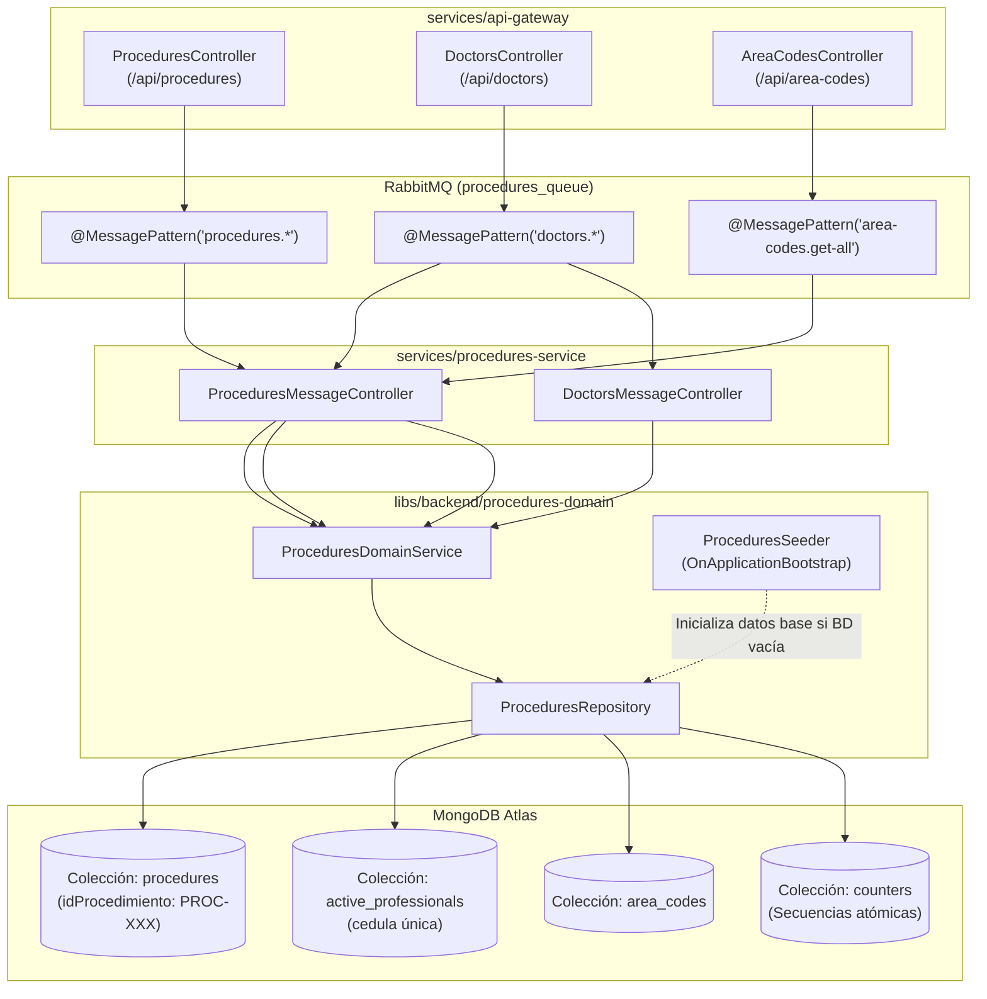

# 03 — Microservicio y Dominio de Catálogo Médico (Procedimientos, Doctores e Indicativos)

> **Ficha Técnica del Dominio**  
> * **Microservicio Ejecutable:** `services/procedures-service` (`["scope:backend", "type:service"]`)  
> * **Librería de Dominio:** `libs/backend/procedures-domain` (`["scope:backend", "type:domain-lib"]`)  
> * **Cola RabbitMQ:** `procedures_queue` (`Transport.RMQ`)  
> * **Colecciones MongoDB Atlas:** `procedures`, `active_professionals`, `area_codes`, `counters`  
> * **Nexo Padre:** [Volver a `00-api-gateway.md`](./00-api-gateway.md)

---

## 1. Propósito y Responsabilidad de Negocio

Este dominio administra los catálogos maestros que alimentan tanto la operación administrativa como el flujo de agendamiento y las historias clínicas:

1. **Catálogo de Procedimientos Médicos y Laboratorios (`procedures`):**
   * Gestiona los procedimientos ofrecidos por la clínica (`idProcedimiento` autogenerado con prefijo `PROC-XXX`, `nombreProcedimiento`, `valorStandar`, `duracionStandar` y su lista de `laboratorios` / marcas asociadas).
   * Soporta inactivación lógica (`isActive: false`) para retirar procedimientos de la oferta comercial sin romper la integridad referencial de citas o historias clínicas pasadas.
2. **Directorio de Especialistas y Configuración de Agendas (`active_professionals`):**
   * Administra el perfil de los médicos tratantes (`cedula`, `nombres`, `apellidos`, `email`, `profesion`), los códigos de procedimientos que están habilitados para realizar (`procedimientosRelacionados`), su jornada laboral base (`horarioTrabajo`) y sus excepciones puntuales (`horariosExcepcionales` de tipo `EXTRA_SHIFT` o `DAY_OFF`).
3. **Catálogo Internacional de Indicativos Telefónicos (`area_codes`):**
   * Provee los prefijos telefónicos internacionales (`+57`, `+1`, `+34`, etc.), banderas y expresiones regulares de validación para los formularios de contacto de pacientes.

---

## 2. Diagrama de Arquitectura Interna y Flujo de Datos



---

## 3. Modelo de Persistencia en MongoDB Atlas

### 3.1 Colección `procedures` ([`procedure.schema.ts`](file:///Users/usuario/Desktop/nx-boilerplate/libs/backend/procedures-domain/src/lib/schemas/procedure.schema.ts))
* `idProcedimiento`: Identificador único de negocio (`PROC-001`, `PROC-002`, etc.), generado atómicamente mediante la colección `counters`.
* `nombreProcedimiento`: Nombre comercial/clínico del tratamiento (ej. `"Toxina Botulínica"`, `"Ácido Hialurónico"`).
* `valorStandar`: Costo base en COP.
* `duracionStandar`: Duración estimada en minutos (`5` a `480`).
* `laboratorios`: Sub-documentos `{ id: string, nombre: string }` con las marcas o insumos aprobados para el procedimiento.
* `isActive`: Booleano (`default: true`) para control de estado activo/inactivo.

### 3.2 Colección `active_professionals` ([`active-professional.schema.ts`](file:///Users/usuario/Desktop/nx-boilerplate/libs/backend/procedures-domain/src/lib/schemas/active-professional.schema.ts))
* `cedula`: Documento de identidad único del profesional (`unique: true`).
* `nombres`, `apellidos`, `email`, `profesion`.
* `procedimientosRelacionados`: Array de strings (`string[]`) que almacena los `idProcedimiento` que el especialista realiza.
* `horarioTrabajo` (`WorkScheduleSchema`):
  * `diasLaborales`: Array de días (`[1, 2, 3, 4, 5]` donde `1 = Lunes`).
  * `horaInicio` y `horaFin`: Formato `"HH:mm"` (ej. `"08:00"` a `"17:00"`).
  * `recesoAlmuerzo`: `{ inicio: "12:00", fin: "13:00" }`.
* `horariosExcepcionales` (`ExceptionScheduleSchema[]`):
  * `fecha`: `"YYYY-MM-DD"`.
  * `tipo`: `'EXTRA_SHIFT'` (turno adicional) o `'DAY_OFF'` (ausencia/bloqueo).
  * `horaInicio`, `horaFin`, `motivo`.
* `isActive`: Booleano (`default: true`) para inactivación lógica del especialista.

### 3.3 Colecciones `counters` ([`counter.schema.ts`](file:///Users/usuario/Desktop/nx-boilerplate/libs/backend/procedures-domain/src/lib/schemas/counter.schema.ts)) y `area_codes` ([`area-code.schema.ts`](file:///Users/usuario/Desktop/nx-boilerplate/libs/backend/procedures-domain/src/lib/schemas/area-code.schema.ts))
* `counters`: Mantiene secuencias numéricas atómicas (`findOneAndUpdate` con `$inc: { seq: 1 }`) para garantizar que nunca se repita un código `PROC-XXX` ni un ID de laboratorio `LAB-XXX`.
* `area_codes`: Almacena `{ country, code, iso, flag, pattern, placeholder }` para validación internacional de teléfonos.

---

## 4. Casos de Uso y Reglas de Dominio (`ProceduresDomainService`)

Archivo: [`procedures-domain.service.ts`](file:///Users/usuario/Desktop/nx-boilerplate/libs/backend/procedures-domain/src/lib/services/procedures-domain.service.ts)

1. **Filtrado Inteligente Activos vs. Todos (`includeInactive`):**
   * Cuando el MFE `agendador-citas` solicita procedimientos o doctores (`includeInactive = false`), el dominio filtra estrictamente aquellos con `isActive: true`.
   * Cuando los MFEs administrativos (`procedimientos-medicos` y `lista-profesionales`) envían `?includeInactive=true`, el dominio retorna el catálogo completo para permitir su reactivación o edición.
2. **Cruce Relacional Procedimiento ↔ Especialista:**
   * `getDoctorsByProcedureId(idProcedimiento)`: Busca todos los profesionales activos cuyo array `procedimientosRelacionados` contenga el `idProcedimiento` solicitado.
   * `getByDoctor(doctorCedula)`: Recupera el profesional por su cédula y retorna los documentos completos de `procedures` que coincidan con su lista de `procedimientosRelacionados`.
3. **Inactivación Lógica Segura (`softDeleteProcedure` y `softDeleteProfessional`):**
   * En lugar de ejecutar `deleteOne` en MongoDB, actualiza `{ isActive: false }`, preservando la trazabilidad histórica para citas e historias clínicas existentes.

---

## 5. Catálogo de Patrones RabbitMQ (`procedures_queue`)

### [`ProceduresMessageController`](file:///Users/usuario/Desktop/nx-boilerplate/services/procedures-service/src/controllers/procedures-message.controller.ts)
| Tipo | Patrón | Payload DTO | Método de Dominio |
|---|---|---|---|
| `@MessagePattern` | `procedures.get-all` | `GetProceduresMessageDto` | `getAll(includeInactive)` |
| `@MessagePattern` | `procedures.find-by-id` | `FindProcedureByIdDto` | `getById(idProcedimiento)` |
| `@MessagePattern` | `procedures.find-by-doctor` | `FindProceduresByDoctorDto` | `getByDoctor(doctorCedula)` |
| `@MessagePattern` | `procedures.get-doctors-by-procedure` | `FindProcedureByIdDto` | `getDoctorsByProcedureId(idProcedimiento)` |
| `@MessagePattern` | `procedures.create` | `CreateProcedureDto` | `createProcedure(payload)` |
| `@MessagePattern` | `procedures.update` | `UpdateProcedureMessageDto` | `updateProcedure(idProcedimiento, data)` |
| `@MessagePattern` | `procedures.soft-delete` | `FindProcedureByIdDto` | `softDeleteProcedure(idProcedimiento)` |
| `@MessagePattern` | `doctors.get-all` | `GetDoctorsMessageDto` | `getAllDoctors(includeInactive)` |
| `@MessagePattern` | `area-codes.get-all` | — | `getAllAreaCodes()` |

### [`DoctorsMessageController`](file:///Users/usuario/Desktop/nx-boilerplate/services/procedures-service/src/controllers/doctors-message.controller.ts)
| Tipo | Patrón | Payload DTO | Método de Dominio |
|---|---|---|---|
| `@MessagePattern` | `doctors.create` | `CreateProfessionalDto` | `createProfessional(payload)` |
| `@MessagePattern` | `doctors.update` | `UpdateDoctorMessageDto` | `updateProfessional(cedula, data)` |
| `@MessagePattern` | `doctors.update-schedule` | `UpdateDoctorScheduleMessageDto` | `updateScheduleExceptions(cedula, exceptions)` |
| `@MessagePattern` | `doctors.soft-delete` | `DoctorCedulaPayloadDto` | `softDeleteProfessional(cedula)` |

---

## 6. Pruebas Unitarias y Comandos de Verificación

```bash
# Ejecutar suite de pruebas unitarias de procedures-domain
./node_modules/.bin/vitest run --config libs/backend/procedures-domain/vite.config.mts

# Ejecutar suite de pruebas unitarias de procedures-service
./node_modules/.bin/vitest run --config services/procedures-service/vite.config.mts

# Verificar tipado estricto TypeScript
./node_modules/.bin/tsc -p libs/backend/procedures-domain/tsconfig.lib.json --noEmit
./node_modules/.bin/tsc -p services/procedures-service/tsconfig.app.json --noEmit

# Levantar el microservicio en desarrollo
npx nx serve procedures-service
```

