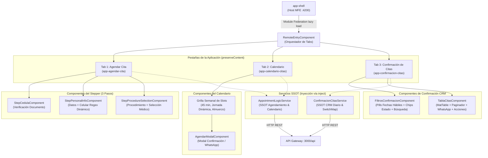
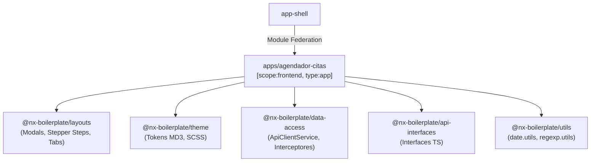

# Agendador de Citas

> **Ficha Técnica del Módulo**  
> * **Ubicación en Monorepo:** `apps/agendador-citas`  
> * **Tipo de Módulo:** Microfrontend Angular 21+ Standalone (Module Federation Remote)  
> * **Tags Nx (`project.json`):** `["scope:frontend", "type:app"]`  
> * **Puerto de Desarrollo:** `4201`  
> * **Estado:** Activo  

---

## 1. Propósito y Alcance de Negocio

El Microfrontend (MFE) **Agendador de Citas** es la aplicación cliente especializada en la gestión del ciclo de vida de citas médicas para el consultorio. Resuelve tres necesidades de negocio esenciales en una sola experiencia fluida:

1. **Agendamiento Guiado (Flujo Paciente Nuevo / Recurrente):** Un formulario por pasos (*Stepper*) que valida la identidad del paciente, captura sus datos de contacto con validación internacional y vincula el procedimiento con el especialista adecuado.
2. **Calendario Interactivo de Disponibilidad Médica:** Una grilla semanal que consulta en tiempo real la disponibilidad real de cada médico, adaptándose a su jornada laboral específica (`diasLaborales`, horario y receso de almuerzo), sincronizada con Google Calendar y MongoDB Atlas.
3. **Confirmación y Seguimiento Clínico (CRM de Recepción):** Un panel diario donde el personal administrativo visualiza las citas del día, filtra por estado, confirma o cancela con un solo clic y dispara mensajes de WhatsApp personalizados para confirmar asistencia.

---

## 2. Refuerzo Académico: Conceptos Clave para un Desarrollador Junior

> [!TIP]
> Esta sección detalla **los fundamentos modernos de Angular** que rigen este Microfrontend. Si vienes de Angular tradicional (versiones 2 a 16), presta especial atención a estos patrones.

### A. ¿Qué es un Microfrontend (MFE) y Module Federation?
En lugar de compilar un único monolito gigante en Angular, el proyecto está dividido en aplicaciones independientes:
- **`app-shell` (Host / Shell):** Es la aplicación contenedora (puerto 4200) que provee el menú principal, el tema visual global y la barra de navegación.
- **`agendador-citas` (Remote):** Es una aplicación Angular autónoma (puerto 4201). Expone su archivo de rutas (`./Routes`) a través de **Module Federation de Webpack**.
- **Ventaja para el equipo:** El equipo puede desarrollar, probar e incluso desplegar el Agendador de Citas sin tener que recompilar toda la plataforma ni reiniciar el `app-shell`.

### B. Zoneless y Reactividad Pura con Signals (Adiós `Zone.js`)
Este proyecto utiliza `provideZonelessChangeDetection()`. Angular ya no intercepta cada clic o timer del navegador para adivinar si algo cambió. En su lugar, el estado se modela mediante **Signals**:

- **`signal(valorInicial)`:** Contenedor de estado reactivo síncrono. Cuando cambia su valor vía `.set()` o `.update()`, Angular sabe **con precisión quirúrgica** qué nodo del DOM debe actualizarse.
- **`computed(() => ...)`:** Señal derivada que se recalcula automáticamente y en caché únicamente cuando alguna de sus señales dependientes cambia.
- **`asReadonly()`:** Patrón de encapsulamiento estricto. Los servicios exponen señales de solo lectura para que los componentes **puedan leerlas pero nunca modificarlas directamente**, protegiendo la integridad del estado.
- **Zero Legacy:** No usamos `@Input()` ni `@Output()` decoradores. Usamos las funciones nativas `input()`, `output()`, y `viewChild()`.

### C. Patrón Single Source of Truth (SSOT) y Separación de Servicios
Para evitar que múltiples componentes guarden copias locales desincronizadas de los datos, la lógica se divide en dos cerebros:
1. **`AppointmentLogicService`:** Gobierna el flujo de agendamiento, la verificación del paciente, el catálogo de médicos y el cálculo semanal del calendario.
2. **`ConfirmacionCitasService`:** Gobierna la operación diaria de recepción (filtros de estado, llamadas HTTP de confirmación y mutaciones optimistas).

### D. ¿Cuándo usar RxJS y cuándo Signals? (La Regla de Oro)
- **Usa RxJS (`Observable`, `Subject`, `switchMap`, `pipe`):** Para flujos asíncronos que involucran tiempo, cancelación de peticiones en vuelo, retrasos (`debounceTime`) o comunicación HTTP.
- **Usa Signals:** Para almacenar y exponer el estado final síncrono que renderiza la vista HTML (`@if`, `@for`, tablas y botones).

### E. Optimistic UI (Interfaz Optimista)
En `ConfirmacionCitasService`, cuando la recepcionista pulsa "Confirmar Cita" o "WhatsApp":
1. La interfaz **cambia inmediatamente** el estado visual en memoria (la cita pasa a `CONFIRMED` o el contador de contacto suma 1).
2. Se despacha en segundo plano la petición HTTP (`PATCH` o `POST`).
3. Si el servidor responde exitosamente, el estado se consolida.
4. Si ocurre un error de red, el servicio ejecuta un **Rollback automático**, restaurando el estado previo y mostrando un mensaje de error amigable. El usuario nunca experimenta lentitud ni parpadeos de carga.

---

## 3. Diagrama de Arquitectura y Flujo de Componentes



---

## 4. Descripción Detallada de Componentes

### 4.1 `RemoteEntryComponent` (Punto de Entrada MFE)
- **Ubicación:** `apps/agendador-citas/src/app/remote-entry/`
- **Responsabilidad:** Utiliza el componente compartido `app-tabs-collection` de `@nx-boilerplate/layouts` configurado con `preserveContent: true`. Esto garantiza que si el usuario está en el paso 2 del formulario y conmuta al calendario para revisar una fecha, **el estado del formulario no se pierde** al regresar.
- **Pestañas Gobernadas (`AGENDADOR_TABS`):**
  1. `FORM (1)`: Agendar Cita.
  2. `CALENDAR (2)`: Calendario Semanal.
  3. `CONFIRMATION (3)`: Confirmación de Citas (CRM Diario).

### 4.2 `AgendarCitaComponent` (Formulario Stepper de 3 Pasos)
- **Ubicación:** `apps/agendador-citas/src/app/components/agendar-cita/`
- **Paso 1 — Cédula:** El usuario ingresa su documento. El servicio consulta `GET /api/patients/:cedula`. Si existe, auto-completa el paso 2; si no existe, activa la bandera `isNewPatient: true`.
- **Paso 2 — Información Personal y Validación Telefónica Dinámica:**
  - Si el paciente es nuevo, captura nombres, apellidos, correo, indicativo internacional y celular.
  - **Validación Dinámica:** Al cambiar el país en el selector de indicativos (`+57`, `+1`, `+34`), un suscriptor reactivo actualiza el validador `Validators.pattern` del campo `numeroCelular` con la expresión regular exacta del país seleccionado provista por `IAreaCode`.
  - **Aislamiento de Errores:** Utiliza `PersonalInfoErrorStateMatcher` y resetea el formulario con `markAsPristine()` y `step.interacted = false` para evitar que un campo aparezca en rojo por validaciones de una cédula consultada anteriormente.
  - **Auto-Creación:** Al pulsar "Guardar y Continuar", si el paciente no existía, envía automáticamente `POST /api/patients` antes de avanzar al paso 3.
- **Paso 3 — Procedimiento y Especialista:**
  - El usuario selecciona el tratamiento médico deseado. El sistema consulta en tiempo real los médicos autorizados para dicho procedimiento (`GET /api/procedures/:id/doctors`).
  - Al pulsar "Ver Disponibilidad", empaqueta el contexto (`patient`, `procedure`, `doctor`) mediante `startBookingFlow()` y navega automáticamente a la pestaña del Calendario.

### 4.3 `CalendarioCitasComponent` (Grilla Semanal Dinámica)
- **Ubicación:** `apps/agendador-citas/src/app/components/calendario-citas/`
- **Jornada Laboral Dinámica por Médico (`horarioTrabajo`):**
  - Cada médico tiene reglas laborales independientes en base de datos (`diasLaborales`, `horaInicio`, `horaFin`, `recesoAlmuerzo`).
  - Si el médico no labora un día específico (ej. lunes), el backend devuelve `slots: []` y el frontend renderiza la tarjeta especial **"No disponible"** (`event_busy`).
  - Si el médico tiene receso de almuerzo (ej. 12:30 a 13:30), los turnos dentro de esa franja se bloquean visualmente con la etiqueta "Almuerzo" (`BLOCKED_PERSONAL`).
  - **Horarios Pasados:** Los turnos de hoy cuya hora ya transcurrió se deshabilitan automáticamente usando la función pura `isTimeSlotInPast()`.
- **Estados de Turnos:**
  - **Disponible (`AVAILABLE`):** Botón verde interactivo con ícono `+` para reservar.
  - **Tentativo (`TENTATIVE`):** Cita agendada pero aún no confirmada por recepción. Se muestra en color amarillo/ámbar con ícono de reloj y nombre del paciente.
  - **Confirmado / Bloqueado (`CONFIRMED` / `BLOCKED_PERSONAL`):** Bloques visuales reservados.
- **Detección de Contexto y Redirección:**
  - Si un usuario ingresa directamente a la pestaña Calendario sin haber pasado por el Stepper e intenta reservar un turno disponible, el modal de confirmación (`AgendarModalComponent`) detecta la ausencia del paciente y muestra el botón **"Volver a Agendar cita"**. Al pulsarlo, el sistema lo transfiere de inmediato al Paso 1 del Stepper.

### 4.4 `ConfirmacionCitasComponent` (Dashboard CRM de Recepción)
- **Ubicación:** `apps/agendador-citas/src/app/components/confirmacion-citas/`
- **`FiltrosConfirmacionComponent`:**
  - **Píldoras de Fechas Rápidas Inteligentes:** Genera botones de acceso rápido para los próximos 3 días hábiles usando `getNextWorkingDays(3)`, omitiendo automáticamente los domingos.
  - **Auto-Reinicio de Fecha:** Un `effect()` en el componente detecta cuando el usuario entra al Tab 3 y resetea automáticamente la fecha a la jornada actual (`getColombiaToday()`).
  - **Chips de Estado:** Filtra en memoria entre `Agendadas` (`TENTATIVE`), `Confirmadas` (`CONFIRMED`) y `Canceladas` (`CANCELLED`).
  - **Búsqueda Reactiva con Debounce:** Campo de texto con `debounceTime(300)` para buscar pacientes por nombre, documento o teléfono sin llamadas innecesarias al servidor.
- **`TablaCitasComponent`:**
  - Renderiza la tabla de pacientes del día con paginación de Angular Material (`MatPaginator`).
  - **Acción WhatsApp:** Abre automáticamente la API de WhatsApp (`wa.me`) con el mensaje oficial preconfigurado y despacha el evento de contacto en segundo plano (`trackContact`):
    ```text
    Hola [Nombre], te contactamos del consultorio Dras. Botero para confirmar tu cita de [Procedimiento]. ¿Confirmas tu asistencia?
    ```
  - **Acciones Directas:** Botones para Confirmar o Cancelar la cita al instante con actualización optimista de la tabla.

---

## 5. Arquitectura de Estado — Servicios Clave

### 5.1 `AppointmentLogicService` (SSOT de Agendamiento)
Gestiona el estado global de la reserva mediante Signals de solo lectura:

```typescript
// Señales públicas expuestas a los componentes
readonly activeTab = this.#activeTab.asReadonly();
readonly weekDays = this.#weekDays.asReadonly();
readonly activeProfessional = this.#activeProfessional.asReadonly();
readonly availableProfessionals = this.#availableProfessionals.asReadonly();
readonly bookingContext = this.#bookingContext.asReadonly();
readonly isBookingMode = computed(() => this.#bookingContext() !== null);
readonly isNewPatient = this.#isNewPatient.asReadonly();
readonly patientHistory = this._patientHistory.asReadonly();
readonly procedures = this._procedures.asReadonly();
readonly areaCodes = this.#areaCodes.asReadonly();
readonly currentWeekOffset = this.#currentWeekOffset.asReadonly();
readonly isLoadingCalendar = this.#isLoadingCalendar.asReadonly();
readonly calendarError = this.#calendarError.asReadonly();
```

* **Prevención de Condiciones de Carrera:** Utiliza un pipeline interno con un `Subject<CalendarFetchRequest>` y el operador `switchMap`. Si el usuario hace clic repetidamente en "Siguiente Semana", `switchMap` cancela automáticamente las peticiones previas que aún no hayan respondido, garantizando que el calendario nunca muestre semanas inconsistentes.

### 5.2 `ConfirmacionCitasService` (Cerebro del CRM Diario)
- **Pipeline de Consulta:**
  ```typescript
  // Trigger reactivo con cancelación automática
  readonly #fetchTrigger$ = new Subject<{ date: string; doctorEmail: string | null }>();
  ```
- **Filtrado Eficiente en Memoria:** El cambio de pestaña de estado (`Agendadas`, `Confirmadas`, `Canceladas`) **no genera peticiones HTTP**. Se resuelve al instante mediante la señal computada `filteredAppointments`.
- **Limpieza de Recursos:** Todas las suscripciones internas emplean `takeUntilDestroyed(this.destroyRef)` para prevenir fugas de memoria (*memory leaks*).

---

## 6. Dependencias y Límites Arquitectónicos



---

## 7. Comandos de Verificación (Nx)

```bash
# 1. Ejecutar el Remote en solitario (puerto 4201)
npx nx serve agendador-citas

# 2. Ejecutar la solución completa integrada con el host (puerto 4200)
npx nx serve app-shell

# 3. Compilar el bundle de producción para validar presupuestos y tipos
npx nx build agendador-citas

# 4. Validar linter y estilo de código
npx nx lint agendador-citas

# 5. Ejecutar suite de pruebas unitarias
npx nx test agendador-citas
```
