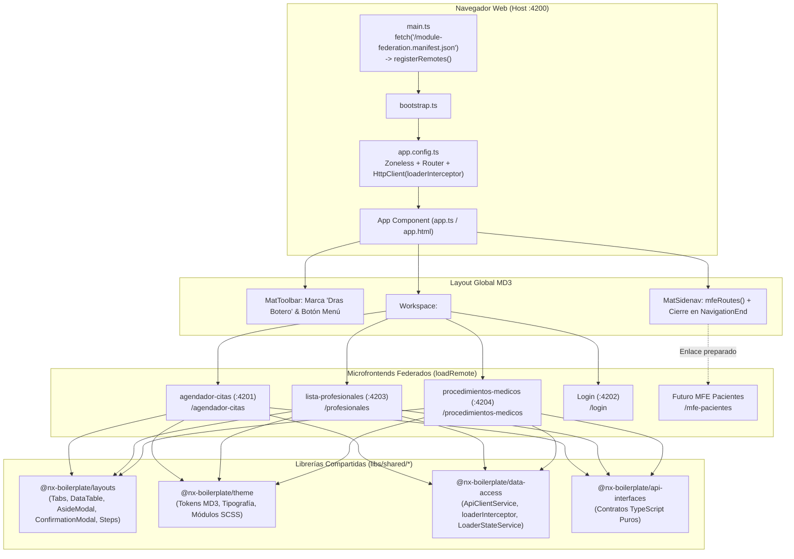

# App Shell — Host MFE y Nexo Central de Arquitectura Frontend

> **Ficha Técnica del Módulo**  
> * **Ubicación en Monorepo:** `app-shell`  
> * **Tipo de Módulo:** Host Microfrontend Angular 21+ (Dynamic Module Federation Host, Standalone + Zoneless)  
> * **Tags Nx (`project.json`):** `["scope:frontend", "type:app"]`  
> * **Puerto Dev Local:** `4200` (`http://localhost:4200`)  
> * **Remotes Federados Activos:** `agendador-citas` (:4201), `Login` (:4202), `lista-profesionales` (:4203), `procedimientos-medicos` (:4204), `historial-pacientes` (:4205)  
> * **Rol Documental:** **Documento Nexo Central** del Frontend. Conecta el contenedor principal con todos los Microfrontends remotos y las librerías compartidas.

---

## 1. Mapa de Navegación de la Documentación Frontend

El ecosistema Frontend está compuesto por el Host (`app-shell`), los Microfrontends remotos en `apps/*` y las librerías transversales en `libs/shared/*`:

| Documento | Módulo / Ubicación | Puerto | Ruta en Host | Estado y Responsabilidad |
|---|---|---|---|---|
| **[`app-shell.md`](./app-shell.md)** *(Actual)* | `app-shell` | `4200` | `/` | **Host & Nexo Central:** Layout global, Sidenav, Theming MD3, `HttpClient` con `loaderInterceptor` y carga dinámica de remotes vía manifest. |
| **[`agendador-citas.md`](./agendador-citas.md)** | `apps/agendador-citas` | `4201` | `/agendador-citas` | **Activo:** Stepper de agendamiento (3 pasos), Calendario semanal dinámico y CRM diario de confirmación de citas. |
| **[`lista-profesionales.md`](./lista-profesionales.md)** | `apps/lista-profesionales` | `4203` | `/profesionales` | **Activo:** Gestión CRUD de especialistas (Tab Host, tabla Activos/Inactivos, `AsideModal` de detalle y Stepper de 4 pasos para alta/edición). |
| **[`procedimientos-medicos.md`](./procedimientos-medicos.md)** | `apps/procedimientos-medicos` | `4204` | `/procedimientos-medicos` | **Activo:** Gestión CRUD de procedimientos y laboratorios (Tab Host, auto-recuperación de inactivos, bloqueo de baja si tiene médicos asignados). |
| **[`homologacion-navegacion.md`](./homologacion-navegacion.md)** | `libs/shared/layouts` & `apps/*` | *Transversal* | *N/A* | **Estándar Implementado:** Patrón canónico de navegación por pestañas (`lib-tabs-collection`), tablas (`lib-data-table`), modales y steppers. |
| **[`historial-pacientes`](../../apps/historial-pacientes)** | `apps/historial-pacientes` | `4205` | `/historial-pacientes` | **En Desarrollo (Fase 1 completada):** Expediente demográfico de 20 campos e Historias Clínicas (Resolución 1995 de 1999). Integrado en Host con manifest dinámico. |

> **Conexión con la Documentación Backend:**  
> Todos los Microfrontends se comunican exclusivamente con el API Gateway (`:3000/api`). Consulta el nexo de backend en [`docs/documentacion-back/00-api-gateway.md`](../documentacion-back/00-api-gateway.md).

---

## 2. Propósito y Alcance del `app-shell`

El **`app-shell`** es la aplicación anfitriona (Host) y punto de entrada único para el usuario final:

1. **Contenedor Estructural de Layout:** Centraliza la barra superior (`MatToolbar`), el menú de navegación lateral retráctil (`MatSidenav`) con auto-cierre reactivo al cambiar de ruta (`NavigationEnd`) y el área de trabajo principal (`<router-outlet>`).
2. **Gobernanza de Estilos y Theming MD3:** Inyecta globalmente los Design Tokens (`--sys-color-*`), tipografías e iconos nativos (`material-symbols-outlined`) de `@nx-boilerplate/theme`, junto con los fondos ambientales animados (*Ambient Glow Orbs*).
3. **Federación Dinámica en Runtime (`Runtime Manifest Federation`):** Descubre y registra los microfrontends en tiempo de ejecución leyendo `public/module-federation.manifest.json` mediante `registerRemotes()`, evitando acoplamiento estático y conflictos de puertos.
4. **Proveedor Global de Infraestructura (`app.config.ts`):** Como los archivos `app.config.ts` de los remotes no se ejecutan cuando son cargados dentro del Host, el `app-shell` provee globalmente `provideZonelessChangeDetection()` y `provideHttpClient(withInterceptors([loaderInterceptor]))`.

---

## 3. Diagrama de Arquitectura y Federación en Runtime



---

## 4. Configuración Real de Module Federation y Enrutamiento

### 4.1 Manifiesto Dinámico (`app-shell/public/module-federation.manifest.json`)
Archivo leído en el arranque (`main.ts`) para registrar las URLs de cada remote sin recompilar el Host:

```json
{
  "agendador-citas": "http://localhost:4201/mf-manifest.json",
  "Login": "http://localhost:4202/mf-manifest.json",
  "lista-profesionales": "http://localhost:4203/mf-manifest.json",
  "procedimientos-medicos": "http://localhost:4204/mf-manifest.json"
}
```

### 4.2 Singletons Compartidos (`app-shell/module-federation.config.ts`)
Para evitar errores de hidratación y duplicación de proveedores de Angular Material (`NG0912`), el Host comparte como singletons las librerías de UI y deja vacío el arreglo estático de `remotes`:

```typescript
import { ModuleFederationConfig, sharePackages } from '@nx/module-federation';

const config: ModuleFederationConfig = {
  name: 'app-shell',
  // Los remotes se registran dinámicamente en runtime vía main.ts -> registerRemotes()
  additionalShared: Object.entries(
    sharePackages(['@angular/animations', '@angular/cdk', '@angular/material'])
  ),
};

export default config;
```

### 4.3 Tabla de Rutas Federadas ([`app-shell/src/app/app.routes.ts`](file:///Users/usuario/Desktop/nx-boilerplate/app-shell/src/app/app.routes.ts))

| Path en Host | Acción / Redirección | Remote Resuelto (`loadRemote`) |
|---|---|---|
| `''` | `redirectTo: 'agendador-citas'` | — |
| `'agendador-citas'` | Carga perezosa | `agendador-citas/Routes` (`remoteRoutes`) |
| `'dashboard'` | `redirectTo: 'agendador-citas'` | — |
| `'login'` / `'Login'` | Carga perezosa | `Login/Routes` (`remoteRoutes`) |
| `'profesionales'` | Carga perezosa | `lista-profesionales/Routes` (`remoteRoutes`) |
| `'lista-profesionales'` | `redirectTo: 'profesionales'` | — |
| `'procedimientos-medicos'` | Carga perezosa | `procedimientos-medicos/Routes` (`remoteRoutes`) |

### 4.4 Estado Reactivo del Menú Lateral ([`app-shell/src/app/app.ts`](file:///Users/usuario/Desktop/nx-boilerplate/app-shell/src/app/app.ts))
El componente raíz `App` gestiona el menú lateral mediante Signals y cierra automáticamente el cajón de navegación tras cada transición exitosa del router:

```typescript
readonly isSidenavOpen = signal<boolean>(false);

readonly mfeRoutes = signal<MfeRoute[]>([
  { path: '/agendador-citas', label: 'Agendar Cita', icon: 'calendar_add_on' },
  { path: '/profesionales', label: 'Profesionales', icon: 'badge' },
  { path: '/procedimientos-medicos', label: 'Procedimientos Médicos', icon: 'medical_services' },
  { path: '/mfe-pacientes', label: 'Pacientes', icon: 'person' }
]);
```

---

## 5. Ecosistema de Librerías Compartidas de Frontend (`libs/shared/*`)

Todos los Microfrontends orquestados por el `app-shell` se apoyan en cuatro librerías transversales:

1. **`@nx-boilerplate/layouts` ([`libs/shared/layouts/src/index.ts`](file:///Users/usuario/Desktop/nx-boilerplate/libs/shared/layouts/src/index.ts)):**
   * **Navegación y Tablas:** `TabsCollectionComponent` (`lib-tabs-collection`), `DataTableComponent` (`lib-data-table`), `MetricCardComponent`.
   * **Modales Transversales:**
     * `AsideModalComponent` y `AsideModalService`: Panel lateral deslizante reutilizable para visualizar detalles o formularios contextuales (usado en `lista-profesionales` y disponible para `historial-pacientes`).
     * `ConfirmationModalComponent`: Diálogo estándar de confirmación y alertas de bloqueo.
     * `AgendarModalComponent`: Modal de reserva de turno en calendario.
   * **Pasos de Formularios Dumb (`forms/`):**
     * `ui-appointment-steps`: `StepCedulaComponent` (configurable con input `subject`), `StepPersonalInfoComponent`, `StepProcedureSelectionComponent`.
     * `ui-procedure-steps`: `StepProcedureNameComponent`, `StepProcedurePricingComponent`, `StepProcedureSummaryComponent`.
     * `ui-professional-steps`: `StepProfessionalInfoComponent`, `StepProfessionalScheduleComponent`, `StepProfessionalProceduresComponent`.
2. **`@nx-boilerplate/data-access` ([`libs/shared/data-access/src/index.ts`](file:///Users/usuario/Desktop/nx-boilerplate/libs/shared/data-access/src/index.ts)):**
   * `ApiClientService`: Cliente HTTP tipado que desenvuelve respuestas `IApiResponse<T>`.
   * `loaderInterceptor` y `LoaderStateService`: Interceptor funcional y estado global con Signals para indicadores de carga.
3. **`@nx-boilerplate/theme` ([`libs/shared/theme/src/lib/_theme.scss`](file:///Users/usuario/Desktop/nx-boilerplate/libs/shared/theme/src/lib/_theme.scss)):**
   * Sistema de diseño Material Design 3 con módulos SCSS dedicados (`_buttons.scss`, `_forms.scss`, `_modals.scss`, `_navigation.scss`, `_stepper.scss`, `_tabs.scss`).
4. **`@nx-boilerplate/ui-charts` ([`libs/shared/ui-charts/src/index.ts`](file:///Users/usuario/Desktop/nx-boilerplate/libs/shared/ui-charts/src/index.ts)):**
   * Componente envoltorio de Chart.js reactivo con Signals.

---

## 6. Comandos de Verificación (Nx)

```bash
# Levantar el Host en puerto 4200 junto con los remotes
npx nx serve app-shell

# Compilar el Host y todos los MFEs activos
npx nx run-many -t build -p app-shell agendador-citas lista-profesionales procedimientos-medicos

# Ejecutar pruebas unitarias del Host
./node_modules/.bin/vitest run --config app-shell/vite.config.mts
```
