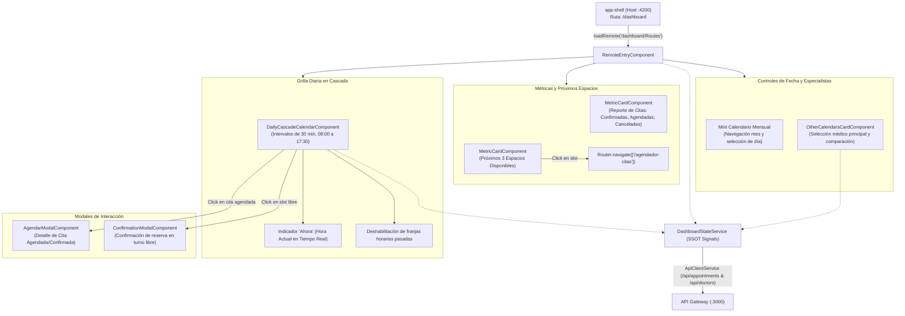

# Dashboard Ejecutivo (MFE `dashboard`)

> **Ficha Técnica del Módulo**  
> * **Ubicación en Monorepo:** `apps/dashboard`  
> * **Tipo de Módulo:** Microfrontend Angular 21+ Standalone (Module Federation Remote, Standalone + Zoneless + Signals)  
> * **Tags Nx (`project.json`):** `["scope:frontend", "type:app"]`  
> * **Puerto Dev Local:** `4206` (`serve`) y `4216` (`serve-static`)  
> * **Ruta en Host (`app-shell`):** `http://localhost:4200/dashboard` (o `/`)  
> * **Estado:** Activo / Implementado (KPIs Mensuales, Próximos Espacios Disponibles con Enrutamiento a Citas, Calendario Diario en Cascada con Indicador de Hora Actual y Modales Interactivos)  
> * **Nexo Padre:** [Volver a `app-shell.md`](./app-shell.md) | **Backend Relacionado:** [`02-scheduling-service.md`](../documentacion-back/02-scheduling-service.md) y [`03-procedures-doctors-service.md`](../documentacion-back/03-procedures-doctors-service.md)  

---

## 1. Propósito y Alcance de Negocio

El Microfrontend **Dashboard** es el centro de mando operativo y analítico para la gerencia médica y el personal de recepción de la clínica. Proporciona una vista consolidada y en tiempo real del estado de la jornada asistencial:

1. **Monitoreo de KPIs Operativos del Mes:** Resume las métricas clave de ocupación del mes en curso (citas confirmadas, citas agendadas y canceladas) con títulos dinámicos orientados a la fecha seleccionada.
2. **Visualización de Próximos Espacios Disponibles y Enrutamiento Rápido:** Identifica los próximos 3 cupos libres del mes activo (`nextAvailableDates`) mostrándolos en chips interactivos dentro de la tarjeta de métricas; al hacer clic sobre cualquiera de ellos, redirige fluidamente al MFE `agendador-citas` para iniciar el agendamiento sin pasos intermedios.
3. **Calendario Diario en Cascada (`DailyCascadeCalendarComponent`):** Proyecta la jornada laboral diaria (de 08:00 a 17:30 en bloques de 30 minutos) con soporte para comparar hasta 4 especialistas simultáneamente mediante geometría de superposición en cascada y una paleta cromática determinista.
4. **Indicador de Hora Actual y Deshabilitación de Franjas Pasadas:** Muestra una línea visual destacada que indica la hora en tiempo real sobre la grilla y desactiva las franjas horarias pasadas para prevenir interacciones sobre turnos caducados.
5. **Inspección y Gestión Interactiva de Turnos:** Al hacer clic en un slot agendado o confirmado, despliega el modal detallado de la cita (`AgendarModalComponent`) con datos del paciente, procedimiento y doctor; para turnos libres, permite confirmar la intención de reserva y transferir el flujo al agendador.

---

## 2. Diagrama de Arquitectura y Flujo de Componentes



---

## 3. Componentes y Capa de Presentación

### 3.1 `RemoteEntryComponent` (Orquestador Principal)
* **Ubicación:** [`apps/dashboard/src/app/remote-entry/remote-entry.component.ts`](file:///Users/usuario/Desktop/nx-boilerplate/apps/dashboard/src/app/remote-entry/remote-entry.component.ts)
* **Responsabilidades Clave:**
  * Carga inicial del catálogo de médicos activos (`state.loadDoctors()`).
  * **Aislamiento de Sesión y Reseteo (`resetDashboardView`):** En `ngOnInit()` y `ngOnDestroy()`, restablece las selecciones de médicos y fecha a los valores por defecto (`getColombiaToday()`) para garantizar que la vista siempre esté limpia al navegar entre remotes.
  * **Interacción con Próximos Espacios (`onAvailableSlotItemClick`):** Escucha el evento `slotClick` de la tarjeta de métricas y conmuta al módulo de agendamiento (`router.navigate(['/agendador-citas'])`).
  * **Apertura de Modales (`onSlotClick`):** Diferencia si la celda pulsada corresponde a una cita existente (`openBookedAppointmentModal`) o a un espacio libre (`openSlotConfirmationModal`), proyectando los modales estandarizados de `@nx-boilerplate/layouts`.

### 3.2 `DailyCascadeCalendarComponent` (Calendario Diario en Cascada)
* **Ubicación:** [`apps/dashboard/src/app/components/daily-cascade-calendar/daily-cascade-calendar.component.ts`](file:///Users/usuario/Desktop/nx-boilerplate/apps/dashboard/src/app/components/daily-cascade-calendar/daily-cascade-calendar.component.ts)
* **Características Técnicas:**
  * **Grilla Canónica de 30 Minutos:** Estructura filas desde las `08:00` hasta las `17:30` con marcas visuales de tiempo.
  * **Superposición en Cascada (`IOverlayGeometry`):** Calcula el ancho (`widthPercent`), desplazamiento izquierdo (`leftPercent`) y `zIndex` para presentar hasta 4 especialistas sin que las tarjetas se colapsen.
  * **Indicador en Tiempo Real de la Hora Actual:** Calcula dinámicamente la posición vertical en porcentaje sobre la grilla para la jornada en curso y refresca periódicamente la línea roja/primaria con la etiqueta "Ahora".
  * **Deshabilitación de Horas Pasadas (`isPast`):** Evalúa si la franja horaria pertenece al pasado del día actual, atenuando la opacidad visual y deshabilitando el cursor para evitar interacciones inconsistentes.
  * **Unificación de Card y Resumen:** Consolida la información del paciente, procedimiento médico, horario y badge de estado (`CONFIRMED`, `SCHEDULED`, `LUNCH`, `AVAILABLE`, `BLOCKED`).

### 3.3 `OtherCalendarsCardComponent` (Selector de Especialistas y Comparación)
* **Ubicación:** [`apps/dashboard/src/app/components/other-calendars-card/other-calendars-card.component.ts`](file:///Users/usuario/Desktop/nx-boilerplate/apps/dashboard/src/app/components/other-calendars-card/other-calendars-card.component.ts)
* **Responsabilidad:** Permite seleccionar el médico principal de la consulta y activar/desactivar checkboxes de especialistas adicionales para comparar agendas en paralelo utilizando la paleta categórica `DOCTOR_COLOR_THEMES`.

---

## 4. Modelos de Datos y Mapeo Canónico

### 4.1 Modelos del Dashboard ([`dashboard.models.ts`](file:///Users/usuario/Desktop/nx-boilerplate/apps/dashboard/src/app/models/dashboard.models.ts))
* **`DashboardSlotStatus`:** `'CONFIRMED' | 'SCHEDULED' | 'BLOCKED' | 'LUNCH' | 'AVAILABLE' | 'OUT_OF_HOURS'`.
* **`IDoctorColorTheme`:** Paleta determinista de 5 temas (Azul Corporativo, Turquesa Clínico, Pizarra Suave, Ámbar Cálido, Verde Médico).
* **`IDashboardDoctorCell`:** Proyección de un médico en una franja horaria conteniendo `doctorCedula`, `doctorName`, `specialty`, `status`, `procedureTitle`, `patient`, `geometry` y `spanRatio`.
* **`IDashboardMonthlyKpis`:** Métricas mensuales calculadas (`confirmedCount`, `scheduledCount`, `cancelledCount`, `nextAvailableDates`).

### 4.2 Utilidad de Transformación ([`dashboard-calendar.mapper.ts`](file:///Users/usuario/Desktop/nx-boilerplate/apps/dashboard/src/app/utils/dashboard-calendar.mapper.ts))
* Transforma las citas crudas de MongoDB/Google Calendar y los horarios de trabajo (`horarioTrabajo`) en filas canónicas `IDashboardTimeRow` con geometría calculada y soporte para citas que abarcan múltiples bloques de 30 minutos (`spanRatio`).

---

## 5. Servicio de Estado SSOT (`DashboardStateService`)

* **Ubicación:** [`apps/dashboard/src/app/services/dashboard-state.service.ts`](file:///Users/usuario/Desktop/nx-boilerplate/apps/dashboard/src/app/services/dashboard-state.service.ts)
* **Señales Reactivas Principales:**
  * `selectedDate`: Fecha actualmente seleccionada en el tablero.
  * `primaryDoctorCedula`: Cédula del especialista seleccionado como principal.
  * `comparedDoctorCedulas`: Conjunto de hasta 3 especialistas adicionales en comparación.
  * `monthlyKpis`: Señal computada con las métricas del mes y los 3 cupos más próximos.
  * `timeRows`: Filas horarias del día procesadas por `DashboardCalendarMapper`.
  * `isLoading`: Estado reactivo de carga HTTP.

---

## 6. Pruebas Unitarias y Comandos de Verificación

```bash
# Servir el MFE de Dashboard de forma aislada (puerto 4206)
npx nx serve dashboard

# Ejecutar suite de pruebas unitarias (Vitest)
./node_modules/.bin/vitest run --config apps/dashboard/vite.config.mts

# Verificar tipado estricto TypeScript
./node_modules/.bin/tsc -p apps/dashboard/tsconfig.app.json --noEmit

# Compilar proyecto para producción
npx nx build dashboard --no-interactive
```

