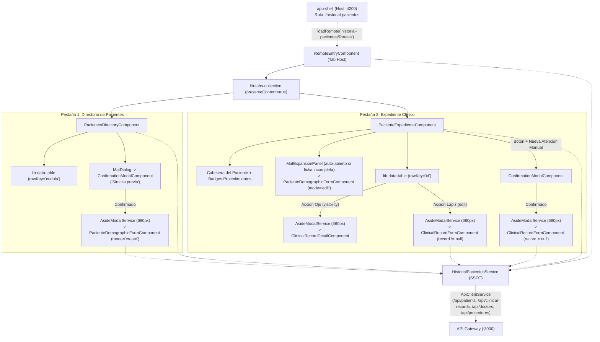

# Historial de Pacientes e Historias Clínicas (MFE `historial-pacientes`)

> **Ficha Técnica del Módulo**  
> * **Ubicación en Monorepo:** `apps/historial-pacientes`  
> * **Tipo de Módulo:** MFE Angular 21+ (Remote de Module Federation, Standalone + Zoneless + Signals)  
> * **Tags Nx (`project.json`):** `["scope:frontend", "type:app"]`  
> * **Puertos de Desarrollo:** `4205` (`serve`) y `4215` (`serve-static`)  
> * **Ruta en Host (`app-shell`):** `http://localhost:4200/historial-pacientes` (redirect desde `/mfe-pacientes`)  
> * **Estado:** Activo / Implementado (Fases 1 a 5 completadas con 45 pruebas unitarias en verde)  
> * **Nexo Padre:** [Volver a `app-shell.md`](./app-shell.md) | **Backend Relacionado:** [`01-patients-clinical-service.md`](../documentacion-back/01-patients-clinical-service.md)

---

## 1. Propósito y Alcance de Negocio

El microfrontend **`historial-pacientes`** centraliza la gestión clínica y demográfica de los pacientes del consultorio bajo el marco normativo colombiano (**Resolución 1995 de 1999** del Ministerio de Salud). Resuelve cuatro flujos operativos críticos en una interfaz reactiva de dos pestañas:

1. **Directorio General y Auditoría de Completitud Demográfica (Tab 1):** Permite buscar pacientes por documento, nombre, celular o correo electrónico y visualizar de inmediato mediante chips semánticos MD3 si su ficha demográfica de 20 campos está **Completa** o **Incompleta** según los requisitos legales.
2. **Alta de Pacientes sin Cita Previa:** Facilita la creación directa de un paciente nuevo desde el directorio, protegida por un diálogo de advertencia (`ConfirmationModalComponent`) que confirma la apertura de un expediente sin cita agendada antes de desplegar el formulario en un panel lateral (`AsideModalService`).
3. **Gestión de la Ficha Demográfica de 20 Campos:** Calcula reactivamente la edad a partir de la fecha de nacimiento (`calculateAgeFromBirthDate`), determina automáticamente la condición de menor de edad (`edad < 18`) y exige dinámicamente los datos de la **Persona Responsable** (nombre, teléfono y parentesco) cuando el paciente es menor de edad.
4. **Expediente Clínico e Historias Médicas (Tab 2):** Consolida el perfil del paciente, sus últimos procedimientos hidratados, su ficha demográfica editable en un acordeón (`MatExpansionPanel`) y la tabla histórica de atenciones clínicas (`PENDIENTE_ATENCION` generadas automáticamente al confirmar una cita en recepción y `COMPLETADA` tras el acto médico), permitiendo inspeccionar el detalle completo (acción Ojo `visibility`), diligenciar/editar la consulta (acción Lápiz `edit`) o registrar una atención clínica manual.

---

## 2. Diagrama de Arquitectura y Flujo de Componentes



---

## 3. Contratos de Datos, ViewModels y Utilidades

### 3.1 Interfaces de Contrato (`@nx-boilerplate/api-interfaces`)
Definidas en [`patient.interface.ts`](file:///Users/usuario/Desktop/nx-boilerplate/libs/shared/api-interfaces/src/lib/patient.interface.ts) y [`clinical-record.interface.ts`](file:///Users/usuario/Desktop/nx-boilerplate/libs/shared/api-interfaces/src/lib/clinical-record.interface.ts):

| Interfaz / Tipo | Propósito |
|---|---|
| `IPatientHistory` | Entidad completa del paciente con los 20 campos demográficos, `acompanante`, `persona_responsable`, `ultimosProcedimientos` y `recomendaciones`. |
| `ICreatePatientRequest` / `IUpdatePatientRequest` | Payloads para `POST /api/patients` y `PATCH /api/patients/:nationalId`. |
| `ICitaMedica` | Registro de atención clínica con `estado_registro` (`'PENDIENTE_ATENCION' \| 'COMPLETADA'`), `medico_tratante`, `registro_clinico` y `soporte_documental`. |
| `ICreateClinicalRecordRequest` / `IUpdateClinicalRecordRequest` | Payloads para `POST /api/clinical-records` y `PATCH /api/clinical-records/:id`. |

### 3.2 Modelos Locales, ViewModels Planos y Normalización
Definidos en [`apps/historial-pacientes/src/app/models/historial-pacientes.models.ts`](file:///Users/usuario/Desktop/nx-boilerplate/apps/historial-pacientes/src/app/models/historial-pacientes.models.ts):

* **IDs de Pestaña (`HISTORIAL_TABS`):** `{ DIRECTORY: 1, EXPEDIENTE: 2 } as const`.
* **Catálogos Homologados con MongoDB:**
  * `TIPOS_DOCUMENTO`: `['CC', 'TI', 'CE', 'PA', 'RC']`
  * `SEXOS_PACIENTE`: `['Femenino', 'Masculino', 'Otro']`
  * `ESTADOS_CIVILES`: `['Soltero(a)', 'Casado(a)', 'Unión Libre', 'Divorciado(a)', 'Viudo(a)']`
  * `TIPOS_VINCULACION`: `['Cotizante', 'Beneficiario', 'Contributivo', 'Subsidiado', 'Particular', 'Prepagada']`
* **ViewModels Planos para `<lib-data-table>`:**
  * `IPatientDirectoryRow`: Expone en primer nivel `cedula`, `tipo_documento`, `nombreCompleto`, `correo`, `celular`, `edad`, `estadoFicha` (`'COMPLETA' | 'INCOMPLETA'`), `estadoFichaLabel` y `raw: IPatientHistory`.
  * `IClinicalRecordRow`: Expone `id` (`_id` o `appointmentId`), `appointmentIdDisplay`, `fechaAtencion`, `procedimientoRealizado`, `medicoCedula`, `medicoNombre`, `estadoRegistro`, `estadoRegistroLabel` y `raw: ICitaMedica`. Garantiza que el buscador y el ordenamiento de `lib-data-table` funcionen sobre estructuras anidadas sin modificar la librería compartida.
* **Funciones Helper:**
  * `isDemographicComplete(patient)`: Evalúa si el paciente cumple todos los campos básicos, demográficos (`fecha_nacimiento`, `sexo`, `direccion_residencia`, `aseguradora`) y, en caso de `es_menor_de_edad === true`, los datos de `persona_responsable`.
  * `normalizePatientForForm(patient)`: Traduce valores históricos de la base de datos (ej. `'F'` $\rightarrow$ `'Femenino'`, `'Soltera'`/`'Soltero'` $\rightarrow$ `'Soltero(a)'`) para que hagan match exacto con los `<mat-select>` del formulario.

### 3.3 Utilidad Transversal de Edad (`@nx-boilerplate/utils`)
Definida en [`libs/shared/utils/src/lib/date.utils.ts`](file:///Users/usuario/Desktop/nx-boilerplate/libs/shared/utils/src/lib/date.utils.ts):
* `calculateAgeFromBirthDate(birthDate, referenceDate?)`: Calcula la edad exacta en años cumplidos evitando desfases de zona horaria UTC al parsear cadenas `YYYY-MM-DD`, ajustando si el mes/día de cumpleaños aún no ha ocurrido en el año en curso y retornando `null` ante fechas futuras o inválidas.

---

## 4. Componentes y Capa de Presentación

### 4.1 `RemoteEntryComponent` (Orquestador de Pestañas)
* **Ubicación:** [`apps/historial-pacientes/src/app/remote-entry/remote-entry.component.ts`](file:///Users/usuario/Desktop/nx-boilerplate/apps/historial-pacientes/src/app/remote-entry/remote-entry.component.ts)
* **Responsabilidad:**
  * Dispara en su inicialización `service.loadPatients()`, `service.loadDoctors()` y `service.loadProcedures()`.
  * Renderiza `<lib-tabs-collection [preserveContent]="true">` con dos pestañas:
    1. **Directorio de Pacientes** (`groups`).
    2. **Expediente Clínico** (`folder_shared`), cuyo label se actualiza reactivamente a **`Expediente: {nombre} {apellidos}`** cuando hay un paciente seleccionado en el SSOT.

### 4.2 `PacientesDirectoryComponent` (Tab 1 — Directorio General)
* **Ubicación:** [`apps/historial-pacientes/src/app/components/pacientes-directory/pacientes-directory.component.ts`](file:///Users/usuario/Desktop/nx-boilerplate/apps/historial-pacientes/src/app/components/pacientes-directory/pacientes-directory.component.ts)
* **Características Clave:**
  * Alimenta `<lib-data-table>` con `service.directoryRows()` y `rowKey="cedula"`.
  * Proyecta `#estadoFichaTpl` en la columna `estadoFichaLabel` para renderizar chips MD3 (**Completa** en tono `primary/success` vs. **Incompleta** en tono `tertiary/warning`).
  * Al hacer clic en una fila o en la acción **"Ver Expediente"** (`visibility`), invoca `service.selectAndLoadPatientExpediente(row.cedula)`, que carga concurrentemente paciente e historias clínicas (`forkJoin`) y conmuta a la Pestaña 2.
  * El botón superior **"Agregar Paciente"** abre primero `ConfirmationModalComponent` (*"Está a punto de crear un nuevo historial de paciente sin cita previa. ¿Desea continuar?"*) y, tras confirmar, abre `AsideModalService.open()` con `PacienteDemographicFormComponent` (`showActions: false`, `width: '680px'`).

### 4.3 `PacienteDemographicFormComponent` (Formulario Demográfico de 20 Campos)
* **Ubicación:** [`apps/historial-pacientes/src/app/components/paciente-demographic-form/paciente-demographic-form.component.ts`](file:///Users/usuario/Desktop/nx-boilerplate/apps/historial-pacientes/src/app/components/paciente-demographic-form/paciente-demographic-form.component.ts)
* **Arquitectura del Formulario:**
  * **Uso Dual (`mode = input<'create' | 'edit'>('create')`):** Opera tanto dentro del `AsideModal` para dar de alta pacientes nuevos (`POST /api/patients`) como incrustado dentro del `MatExpansionPanel` del expediente para actualizar los 20 campos (`PATCH /api/patients/:cedula`, bloqueando la edición de `cedula` y `tipo_documento`).
  * **Reactividad de Edad y Menor de Edad:** Suscrito con `takeUntilDestroyed` a `fecha_nacimiento.valueChanges`, calcula la edad, actualiza el control deshabilitado `edad` y marca automáticamente el toggle `es_menor_de_edad` cuando `edad < 18`.
  * **Validación Legal Dinámica:** Suscrito a `es_menor_de_edad.valueChanges`, aplica o limpia dinámicamente `Validators.required` sobre `persona_responsable.controls.nombre`, `telefono` y `parentesco`, llamando a `updateValueAndValidity()`.
  * **Control de Cierre en `AsideModal`:** Renderiza sus propios botones de acción dentro del `<form>` e inyecta opcionalmente `MatDialogRef` (`inject(MatDialogRef, { optional: true })`) para cerrar el panel lateral únicamente cuando la petición HTTP concluye con éxito.

### 4.4 `PacienteExpedienteComponent` (Tab 2 — Expediente Clínico)
* **Ubicación:** [`apps/historial-pacientes/src/app/components/paciente-expediente/paciente-expediente.component.ts`](file:///Users/usuario/Desktop/nx-boilerplate/apps/historial-pacientes/src/app/components/paciente-expediente/paciente-expediente.component.ts)
* **Estructura de la Vista:**
  * **Estado Vacío Asistido:** Si `service.selectedPatient()` es `null`, muestra una tarjeta guía con icono `person_search` y botón para regresar al Directorio.
  * **Cabecera del Paciente (`patient-hero-card`):** Muestra nombre completo, documento, edad, etiqueta de menor de edad, datos de contacto rápido, EPS/aseguradora, chip de estado de la ficha demográfica y los chips de `ultimosProcedimientos` registrados.
  * **Sección 1 — Acordeón Demográfico (`MatExpansionPanel`):** Aloja `<app-paciente-demographic-form mode="edit" />`. Su propiedad `[expanded]="!isComplete()"` despliega automáticamente el formulario si al paciente le faltan datos obligatorios de la Resolución 1995.
  * **Sección 2 — Tabla de Historial de Atenciones Clínicas:** `<lib-data-table>` alimentada por `service.clinicalRecordRows()` con acciones por fila:
    * **Ojo (`visibility`):** Abre `ClinicalRecordDetailComponent` en `AsideModal` (`width: '560px'`).
    * **Lápiz (`edit`):** Abre `ClinicalRecordFormComponent` en `AsideModal` (`width: '680px'`) con los datos precargados de la cita.
  * **Botón `+ Nueva Atención Manual`:** Previa confirmación en `ConfirmationModalComponent`, abre `ClinicalRecordFormComponent` con `record: null` para registrar una consulta sin cita previa.

### 4.5 Modales Clínicos (`ClinicalRecordDetailComponent` y `ClinicalRecordFormComponent`)
* **Lectura ([`ClinicalRecordDetailComponent`](file:///Users/usuario/Desktop/nx-boilerplate/apps/historial-pacientes/src/app/components/clinical-record-detail/clinical-record-detail.component.ts)):** Presenta en tarjetas MD3 de solo lectura el estado de la atención, fecha, código de cita, médico tratante, lote del producto, procedimiento realizado, motivo de consulta, enfermedad actual, examen físico, los 4 antecedentes médicos, recomendaciones y soporte documental del consentimiento informado.
* **Diligenciamiento y Creación ([`ClinicalRecordFormComponent`](file:///Users/usuario/Desktop/nx-boilerplate/apps/historial-pacientes/src/app/components/clinical-record-form/clinical-record-form.component.ts)):**
  * Si `record !== null` (cita confirmada), muestra el banner informativo con el médico tratante y fecha programada del agendamiento.
  * Si `record === null` (atención manual), habilita el `<mat-select>` de médico tratante (`service.doctors()`) y el selector de fecha de atención.
  * **Sanitizador de Payload:** Antes de enviar `POST /api/clinical-records` o `PATCH /api/clinical-records/:id`, aplica `sanitize()` sobre antecedentes médicos, lote de producto y referencia de consentimiento informado (`'Ninguno'`, `'N/A'`, `'Pendiente de adjunto'`), evitando errores `400 Bad Request` por los decoradores `@IsNotEmpty()` del backend y marcando el registro como `estado_registro: 'COMPLETADA'`.

---

## 5. Servicio SSOT (`HistorialPacientesService`)

* **Ubicación:** [`apps/historial-pacientes/src/app/services/historial-pacientes.service.ts`](file:///Users/usuario/Desktop/nx-boilerplate/apps/historial-pacientes/src/app/services/historial-pacientes.service.ts)
* **Señales de Estado (`asReadonly`):**
  * `patientsList`: Directorio completo de pacientes (`IPatientHistory[]`).
  * `selectedPatient` y `hasSelectedPatient`: Paciente activo en la Pestaña 2.
  * `clinicalRecords`: Historial de atenciones (`ICitaMedica[]`) del paciente activo.
  * `doctors` y `procedures`: Catálogos cargados desde `/api/doctors` y `/api/procedures`.
  * `activeTab`: Pestaña activa (`HISTORIAL_TABS.DIRECTORY` o `HISTORIAL_TABS.EXPEDIENTE`).
  * `isLoading`, `isLoadingRecords`, `isSaving`, `error`, `saveError`: Estados granulares de carga y error por operación.
* **Señales Computadas:**
  * `directoryRows`: Transforma `patientsList()` en `IPatientDirectoryRow[]` calculando edad y completitud demográfica.
  * `clinicalRecordRows`: Transforma `clinicalRecords()` en `IClinicalRecordRow[]` cruzando la cédula del médico con `resolveDoctorName()`.
* **Endpoints Consumidos en el API Gateway ([`01-patients-clinical-service.md`](../documentacion-back/01-patients-clinical-service.md)):**
  * `GET /api/patients` (`loadPatients`)
  * `GET /api/patients/:nationalId` + `GET /api/patients/:nationalId/clinical-records` (`selectAndLoadPatientExpediente` vía `forkJoin`)
  * `POST /api/patients` (`createPatient`)
  * `PATCH /api/patients/:nationalId` (`updatePatient`)
  * `POST /api/clinical-records` (`createClinicalRecord`)
  * `PATCH /api/clinical-records/:id` (`updateClinicalRecord`)
  * `GET /api/doctors?includeInactive=true` (`loadDoctors`)
  * `GET /api/procedures` (`loadProcedures`)

---

## 6. Comandos de Verificación (Nx)

```bash
# Servir el MFE de forma aislada (puerto 4205)
npx nx serve historial-pacientes

# Ejecutar suite de pruebas unitarias del MFE (45 tests en Vitest)
./node_modules/.bin/vitest run --config apps/historial-pacientes/vite.config.mts

# Ejecutar pruebas unitarias de la utilidad de edad (11 tests en Vitest)
./node_modules/.bin/vitest run --config libs/shared/utils/vite.config.mts

# Verificar tipado estricto TypeScript
./node_modules/.bin/tsc -p apps/historial-pacientes/tsconfig.app.json --noEmit

# Compilar el MFE con Webpack / Module Federation
npx nx build historial-pacientes --configuration=development
```

