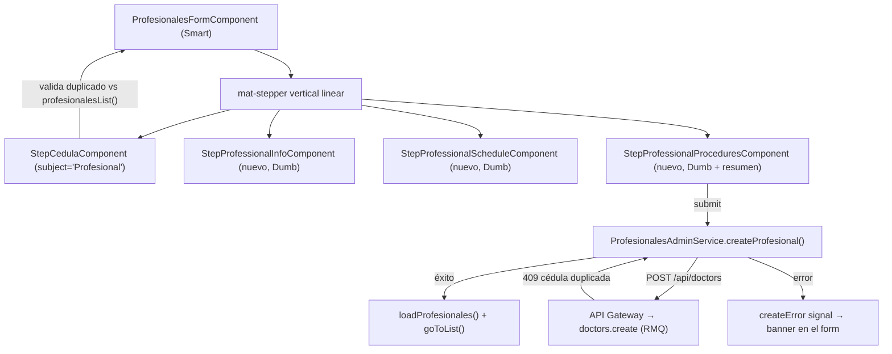
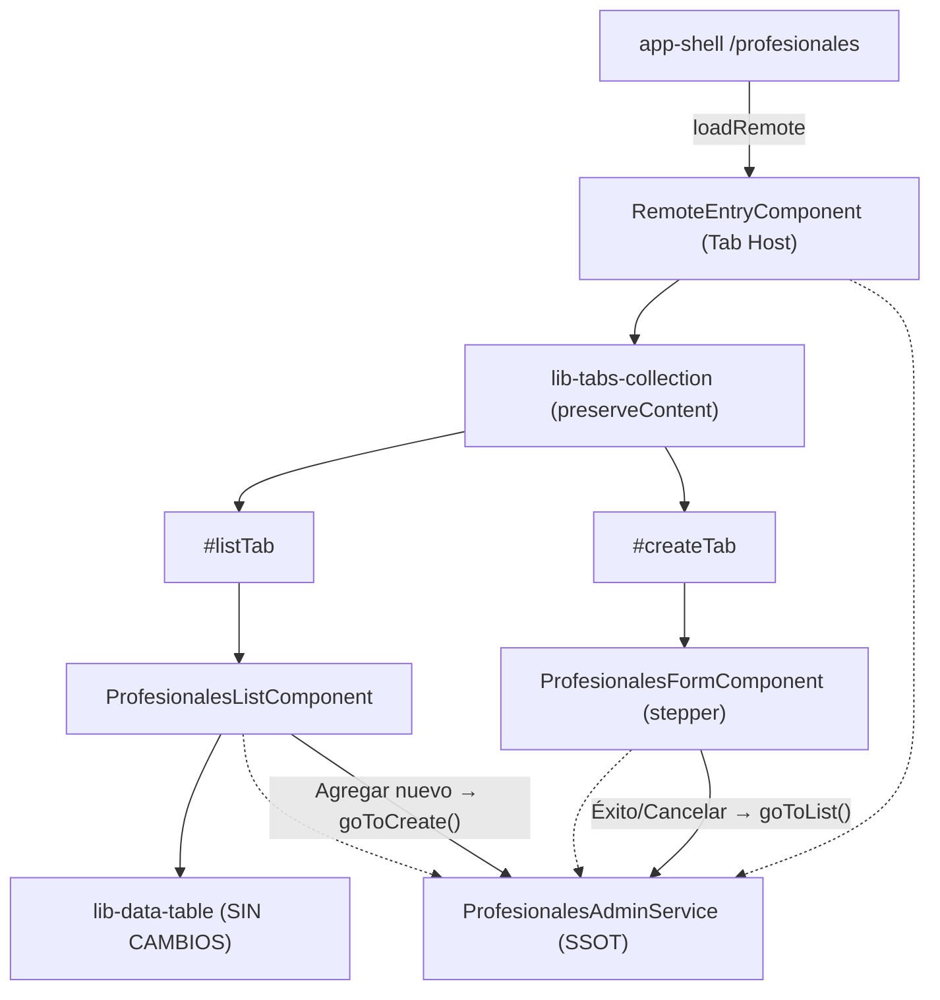

# Informe Arquitectónico: Homologación de Navegación entre Microfrontends
## Análisis Comparativo y Plan de Refactorización (`agendador-citas` vs `lista-profesionales`)

> **Ficha Técnica del Documento**  
> * **Ubicación:** `docs/documentacion-front/homologacion-navegacion.md`  
> * **Módulos Involucrados:** `apps/agendador-citas`, `apps/lista-profesionales`, `libs/shared/layouts` (`TabsCollectionComponent`, `DataTableComponent`, steps), `libs/shared/api-interfaces`  
> * **Tipo:** Especificación Técnica y Plan de Refactorización Frontend (Angular 21+ MFE Standalone / Zoneless)  
> * **Versión:** 2.0 (revisada: fases libres de conflictos, `lib-data-table` intacto y diseño del stepper de alta)  
> * **Estado:** Propuesta Técnica pendiente de confirmación (Fase 2 del protocolo)  

---

## 1. Resumen Ejecutivo

`agendador-citas` organiza su contenido en pestañas con `lib-tabs-collection` (*Agendar Cita*, *Calendario*, *Confirmación de Citas*). `lista-profesionales` es hoy una vista única monolítica (tabla + botón *"Agregar nuevo"* sin acción).

**Objetivo:** que `lista-profesionales` tenga la misma estructura de pestañas:

1. **Lista de Profesionales** → sigue usando `lib-data-table` (componente reutilizable, **sin modificaciones en la lib**).
2. **Agregar Profesional** → formulario por pasos (`mat-stepper`) que replica la estructura del stepper de *Agendar Cita* y publica en `POST /api/doctors`.

### Qué cambia respecto a la v1 de este informe

| # | Corrección | Motivo |
|---|---|---|
| 1 | Reordenar fases: el host con tabs pasa a ser la **última** fase de cableado, y cada fase deja el MFE compilando y visualmente idéntico. | La v1 movía la vista antes de tener estado y componentes listos → estados intermedios rotos. |
| 2 | Garantizar `lib-data-table` **sin cambios** y mover únicamente su *uso* a un componente hijo. | Evitar regresiones en `confirmacion-citas` (otro consumidor) y respetar el contrato Phase 0/1/2 de la tabla. |
| 3 | El paso 2 deja de ser "un formulario simple" y pasa a ser un **stepper de 4 pasos** derivado de `CreateProfessionalDto`. | Requerimiento explícito + reglas reales del DTO (horario anidado, receso opcional, procedimientos). |
| 4 | **No importar `@nx-boilerplate/shared-dtos` en el frontend**; crear `ICreateProfessionalRequest` en `@nx-boilerplate/api-interfaces`. | `shared-dtos` es `scope:backend`; importarlo viola `enforce-module-boundaries` y arrastra `class-validator` al bundle. |
| 5 | Estados de carga/error **separados** (lista vs. guardado). | `isLoading` y `error` actuales son de la lista; reutilizarlos para el POST causaría parpadeo de la tabla y banners cruzados. |
| 6 | Formato de días laborales: `LUNES…SABADO` (mayúsculas, sin tildes). | Es el formato real que consume `slot-calculator` y el seed; `Lunes` rompería el cálculo de disponibilidad. |

---

## 2. Estudio Comparativo de Navegación

| Dimensión | `agendador-citas` (canónico) | `lista-profesionales` (actual) | Acción |
|---|---|---|---|
| Rol de `RemoteEntryComponent` | Orquestador: solo `lib-tabs-collection` + 3 `ng-template` | Vista monolítica (h1, error, tabla, detalle) | Convertir en Tab Host |
| Navegación | `TabsCollectionComponent` (`tabs`, `activeTabId` two-way, `preserveContent`) | Ninguna | Integrar tabs |
| SSOT de pestaña activa | `AppointmentLogicService.activeTab` (`signal` + `asReadonly()` + `setActiveTab`) | No existe | Añadir a `ProfesionalesAdminService` |
| IDs de pestaña | `AGENDADOR_TABS = {FORM:1, CALENDAR:2, CONFIRMATION:3} as const` (numéricos) | N/A | `PROFESIONALES_TABS = {LIST:1, CREATE:2}` |
| Estructura de carpetas | `components/<feature>/` | Todo en `remote-entry/` | `components/profesionales-list/` y `components/profesionales-form/` |
| Navegación programática | Stepper → Calendario (`startBookingFlow`) | Botón sin acción | `goToCreate()` / `goToList()` |
| Estilos contenedor | `.agendador-citas-view-container` (flex column, 100%) + `.tab-pane-wrapper` (`padding:16px 0; width:100%`) | `.profesionales-container` (padding 1.5rem) | Replicar contenedor/pane del agendador |

### Hechos verificados sobre `lib-tabs-collection` que condicionan el diseño

* Cada pestaña renderiza su contenido con `matTabContent` (**lazy**) y, con `[preserveContent]="true"`, el DOM se conserva **después del primer render**. Por tanto el `lib-data-table` se instancia al primer acceso a la pestaña y no se destruye al navegar al formulario (filtros, búsqueda, página y fila expandida se mantienen).
* `activeTabId` es un `model<string | number | undefined>`; el host debe filtrar `typeof id === 'number'` (patrón ya usado en agendador).
* `tabs` computado necesita los `TemplateRef` vía `viewChild`; en el primer ciclo son `undefined` (el `@if (tab.contentTemplate)` de la lib ya lo tolera).

---

## 3. Garantía de Reutilización de `lib-data-table`

> [!IMPORTANT]
> **Regla de la refactorización:** `libs/shared/layouts/src/lib/data-table/**` **no se toca**. Ninguna fase modifica la API de la tabla.

Contrato actual que `ProfesionalesListComponent` conservará **literalmente** (movido desde `remote-entry.component.html`):

| Input/Slot | Valor actual en profesionales | Se mantiene |
|---|---|---|
| `[dataTable]` | `profesionalesService.profesionalesList()` | ✅ |
| `[dataColumn]` | `columns: TableColumnDef<IActiveProfessional>[]` | ✅ |
| `[loading]` | `profesionalesService.isLoading()` | ✅ |
| `[expandable]`, `rowKey="cedula"`, `[detailTemplate]` | `true`, `cedula`, `#detailTpl` | ✅ |
| `[searchable]`, `searchPlaceholder` | `true`, "Buscar por nombre, correo o profesión..." | ✅ |
| `emptyMessage` | "No hay profesionales registrados." | ✅ |
| Slot `[table-header]` | toggle Activos/Inactivos (disabled) + botón **Agregar nuevo** | ✅ (el botón ahora llama `goToCreate()`) |

Puntos de conflicto neutralizados:

1. **`#detailTpl`** debe declararse como hijo proyectado de `<lib-data-table>` dentro del **mismo** componente que lo referencia (`onEdit`/`onDelete`). Por eso el detalle se mueve **junto** con la tabla a `ProfesionalesListComponent`, no al host.
2. **Estilos `.detail-*`, `.profesionales-toolbar`, `.toolbar-toggle`** pertenecen al template proyectado: se mueven al SCSS de la lista (encapsulación Angular: un estilo del host no alcanzaría contenido de un hijo).
3. **Paginador/Sort** de la tabla se enlazan con `afterNextRender`; ya funciona en `confirmacion-citas` dentro de una pestaña lazy, por lo que el mismo patrón es seguro.
4. **Verificación de no regresión:** `npx nx test layouts` (22 tests) debe seguir en verde y `agendador-citas` debe compilar sin cambios.

---

## 4. Estudio del Stepper de `agendador-citas` (referencia para "Agregar Profesional")

### 4.1 Anatomía actual (`AgendarCitaComponent`)

| Aspecto | Implementación en agendador | Lección para profesionales |
|---|---|---|
| Contenedor | `<mat-stepper orientation="vertical" [linear]="true">` con `section.feature-card` + header (icono + título) | Reutilizar misma estructura visual |
| Formulario | **Un único `FormGroup` raíz** con sub-grupos `step1`, `step2`, `step3` (`FormBuilder`) | Un sub-grupo por paso |
| Vinculación | `[stepControl]="form.controls.stepN"` y `[completed]="…valid"` | Igual: `linear` solo avanza con paso válido |
| Pasos Dumb | `app-step-cedula`, `app-step-personal-info`, `app-step-procedure-selection` en `libs/shared/layouts`; reciben el **sub-grupo** vía `input.required<FormGroup>()` y emiten eventos (`verifyAndContinue`, `saveAndContinue`) | Pasos Dumb en lib, el Smart orquesta |
| Smart | `AgendarCitaComponent` valida, muta, navega (`stepper().next()`), llama servicio | `ProfesionalesFormComponent` hace lo mismo |
| Acciones | Bloque `.stepper-actions` (Anterior / Siguiente) con `[disabled]` por validez | Igual |
| Iconos | `matStepperIcon="edit"` y `"done"` con `material-symbols-outlined` | Copiar tal cual |
| Reinicio | `bookingSuccess$` → `form.reset()` + `stepper().reset()` | Reinicio local tras POST exitoso |
| Workarounds | `step.interacted = false` al resetear el paso 2 | Replicar solo si se reinicia un paso individual |
| Suscripciones | `valueChanges` + `destroyRef.onDestroy(unsubscribe)` manual | Preferir `takeUntilDestroyed()` o `computed`/`effect` |

### 4.2 ¿Se pueden reutilizar los steps existentes?

| Step existente | ¿Reutilizable? | Razón |
|---|---|---|
| `StepCedulaComponent` | ⚠️ Parcial | El control `cedula` y su sanitización (bloquea `.` y `'`) sirven, pero el texto está fijo: *"documento de identidad del **Paciente**"*. Opción A (recomendada): añadir `readonly subject = input<string>('Paciente')` (retrocompatible, no rompe agendador). Opción B: step propio. |
| `StepPersonalInfoComponent` | ❌ No | Acoplado a paciente: `history`, `isNewPatient`, `areaCodes`, indicativo/celular. |
| `StepProcedureSelectionComponent` | ❌ No | Selecciona médico/fecha para un procedimiento; semántica inversa. |

**Decisión:** crear steps Dumb **nuevos** en `libs/shared/layouts/src/lib/forms/ui-professional-steps/` (capa "Componentes UI Frontend" de AGENTS.md §3), exportados desde `index.ts`; el Smart queda en `apps/lista-profesionales`.

### 4.3 Diseño del stepper de alta (derivado de `CreateProfessionalDto`)

Contrato (`CreateProfessionalDto implements Omit<IActiveProfessional, 'isActive' | 'horariosExcepcionales'>`); el backend fija `isActive: true` y `horariosExcepcionales: []`.

| Paso | Sub-grupo | Campos → DTO | Validaciones frontend (alineadas al DTO) |
|---|---|---|---|
| **1. Identificación** | `step1` | `cedula` | requerido, `REGEX_ONLY_NUMBERS`, `minLength(7)`; **chequeo de duplicado** contra `profesionalesList()` al avanzar (UX), defensa final 409 del backend |
| **2. Datos Personales** | `step2` | `nombres`, `apellidos`, `email`, `profesion` | requeridos; `REGEX_LETTERS_ACCENTS_SPACES` en nombres/apellidos (`maxLength` ≥ 50: el 15 del paciente es insuficiente para apellidos compuestos); `Validators.email` + `REGEX_EMAIL`; `profesion` requerido (hay valores largos en seed, no limitar a 15) |
| **3. Horario Laboral** | `step3` | `horarioTrabajo.diasLaborales`, `horaInicio`, `horaFin`, `recesoAlmuerzo?` | días: ≥ 1 de `LUNES…SABADO`; horas con patrón `HH:mm`; **validador cruzado** `horaInicio < horaFin`; receso opcional: si se activa requiere `inicio` y `fin` válidos, `inicio < fin` y contenido dentro de la jornada |
| **4. Procedimientos y Confirmación** | `step4` | `procedimientosRelacionados?` | multi-select opcional alimentado por `GET /api/procedures`; resumen de solo lectura + botón **Guardar profesional** |

Reglas de mapeo a payload (evitan 400 por `forbidNonWhitelisted`):

* `recesoAlmuerzo` se envía **`undefined`** (no objeto vacío ni strings vacíos) cuando el toggle está apagado: el DTO usa `@ValidateNested()` y exige `inicio` **y** `fin` si el objeto existe.
* `procedimientosRelacionados` se envía `undefined`/`[]` si no hay selección (backend lo trata como opcional).
* No enviar campos extra (`fechaNacimiento`, `isActive`): el `ValidationPipe` global usa `forbidNonWhitelisted`.
* Normalizar `cedula`, `email` con `trim()`; días en mayúsculas sin tilde.

### 4.4 Diagrama del flujo del stepper



---

## 5. Arquitectura Objetivo



---

## 6. Plan de Refactorización por Fases (sin conflictos)

> **Principio:** cada fase termina con `npx nx build lista-profesionales` y `npx nx test layouts` en verde y **sin cambio visual hasta la Fase 6**. Se sigue el orden full-stack de AGENTS.md §3 (contrato → lógica → UI Dumb → Smart).

| Fase | Entregable | Estado visual tras la fase | Riesgo mitigado |
|---|---|---|---|
| **0. Línea base** | Ejecutar `npx nx test layouts`, `build agendador-citas lista-profesionales`; capturar estado actual | Sin cambio | Tener referencia de regresión |
| **1. Contratos** | `ICreateProfessionalRequest` en `@nx-boilerplate/api-interfaces` (= `Omit<IActiveProfessional,'isActive'\|'horariosExcepcionales'>`); `PROFESIONALES_TABS` y `ProfesionalesTabId` en `models/profesionales-nav.models.ts`; constante `DIAS_LABORALES` | Sin cambio | Boundary `scope:backend` (no importar DTOs); IDs tipados |
| **2. Estado SSOT** | En `ProfesionalesAdminService`: `activeTab`/`setActiveTab`/`goToCreate`/`goToList`; `isSaving` y `createError` **independientes**; `createProfesional(dto)` (`POST /api/doctors`) que al éxito llama `loadProfesionales()` | Sin cambio (nadie lo consume aún) | Aislar estado de guardado del de la lista |
| **3. Extraer lista** | `components/profesionales-list/` con **tabla + detalle + estilos** movidos tal cual; `RemoteEntryComponent` solo renderiza `<app-profesionales-list />` | **Idéntico al actual** | `lib-data-table` intacto; `#detailTpl` y `.detail-*` viajan juntos |
| **4. Steps Dumb** | `libs/shared/layouts/.../ui-professional-steps/` (info, horario, procedimientos+resumen) + `subject` input en `StepCedulaComponent` + exports en `index.ts` | Sin cambio (no usados aún) | Retrocompatibilidad de `agendador-citas` (default `'Paciente'`) |
| **5. Smart del formulario** | `components/profesionales-form/` con `FormGroup` raíz (`step1..step4`), validadores, mapeo a `ICreateProfessionalRequest`, manejo 409, reinicio (`form.reset()` + `stepper().reset()`), cancelar con confirmación si hay cambios | Sin cambio (aún no montado) | Probar el form en aislamiento (spec) |
| **6. Tab Host** | `RemoteEntryComponent` → `lib-tabs-collection` + `#listTab`/`#createTab`, `onActiveTabChange` (guard numérico), estilos `.profesionales-view-container`/`.tab-pane-wrapper`; botón *Agregar nuevo* → `goToCreate()` | **Cambio visible** (2 pestañas) | Único punto de integración; reversible |
| **7. Verificación** | `nx test layouts`, `nx test lista-profesionales`, `nx run-many -t build -p app-shell agendador-citas lista-profesionales`, prueba manual (flujo alta + duplicado 409) | — | Regresión cruzada |

### Conflictos identificados y su resolución

| # | Conflicto potencial | Resolución |
|---|---|---|
| C1 | `isLoading`/`error` compartidos entre lista y alta | Señales separadas `isSaving`/`createError`; la lista conserva `isLoading`/`error` |
| C2 | `ProfesionalesAdminService` es `providedIn: 'root'` y la lista se recarga en el constructor del host | Mantener `loadProfesionales()` en el host (una sola vez por montaje); tras alta, recargar explícitamente |
| C3 | `ApiClientService.post` aplica `retry(1)`: si la respuesta del primer POST se pierde pero el backend sí creó, el reintento devolverá **409** y la UI mostraría error pese a haber guardado | En `createProfesional`, ante 409 recargar la lista y verificar si la cédula ya existe antes de mostrar error; alternativa: opción `retry: false` en la lib de data-access |
| C4 | `h1` único por página (SEO/a11y) | `<h1 class="profesionales-title">` se queda en el **host**, encima de las tabs; la lista no lo repite |
| C5 | Estado preservado del form al cambiar de pestaña (`preserveContent`) | Es deseado; tras éxito/cancelar se resetea explícitamente para no dejar datos viejos |
| C6 | `MatStepper`/`MatTabs` ya están en el shell de Material compartido (usados por agendador) | Sin cambios en `module-federation.config.ts`; no declarar `@angular/material` duplicado (evita `NG0912`) |
| C7 | `AgendadorTabId` numérico vs. `string \| number` del `model` de tabs | Replicar guard `typeof id === 'number'` |
| C8 | Duplicado de cédula | Doble defensa: validación local contra `profesionalesList()` (UX) + 409 de backend (fuente de verdad) |
| C9 | Formato de días (`Lunes` vs `LUNES`) | Constante `DIAS_LABORALES` (`LUNES, MARTES, MIERCOLES, JUEVES, VIERNES, SABADO`) compartida por step y mapeo |
| C10 | Zero-Legacy | Solo `input()/output()/model()/viewChild()`, `@if/@for`, `inject()`, `OnPush`, tokens `--sys-*`; sin `!important` ni `::ng-deep` |

---

## 7. Especificación de Archivos

```text
libs/shared/api-interfaces/src/lib/procedure.interface.ts        # + ICreateProfessionalRequest
libs/shared/layouts/src/lib/forms/ui-professional-steps/
  ├── step-professional-info/        # nombres, apellidos, email, profesion
  ├── step-professional-schedule/    # días (chips), horas, receso opcional
  └── step-professional-procedures/  # multiselect + resumen
libs/shared/layouts/src/lib/forms/ui-appointment-steps/step-cedula/   # + input subject (default 'Paciente')
libs/shared/layouts/src/index.ts                                  # + exports de steps profesionales

apps/lista-profesionales/src/app/
  ├── models/profesionales-nav.models.ts          # PROFESIONALES_TABS, ProfesionalesTabId, DIAS_LABORALES
  ├── services/profesionales-admin.service.ts     # + activeTab, goTo*, createProfesional, isSaving, createError
  ├── components/profesionales-list/              # tabla + detalle (movidos)
  ├── components/profesionales-form/              # stepper Smart
  └── remote-entry/                               # Tab Host
```

### Fragmentos clave

```typescript
// models/profesionales-nav.models.ts
export const PROFESIONALES_TABS = { LIST: 1, CREATE: 2 } as const;
export type ProfesionalesTabId = (typeof PROFESIONALES_TABS)[keyof typeof PROFESIONALES_TABS];
export const DIAS_LABORALES = ['LUNES', 'MARTES', 'MIERCOLES', 'JUEVES', 'VIERNES', 'SABADO'] as const;
```

```typescript
// libs/shared/api-interfaces/.../procedure.interface.ts
export type ICreateProfessionalRequest = Omit<IActiveProfessional, 'isActive' | 'horariosExcepcionales'>;
```

```typescript
// ProfesionalesAdminService (adiciones)
readonly #activeTab = signal<ProfesionalesTabId>(PROFESIONALES_TABS.LIST);
readonly activeTab = this.#activeTab.asReadonly();
readonly #isSaving = signal(false);
readonly #createError = signal<string | null>(null);

setActiveTab(id: ProfesionalesTabId): void { this.#activeTab.set(id); }
goToCreate(): void { this.#activeTab.set(PROFESIONALES_TABS.CREATE); }
goToList(): void { this.#activeTab.set(PROFESIONALES_TABS.LIST); }

createProfesional(body: ICreateProfessionalRequest): Observable<IActiveProfessional> {
  this.#isSaving.set(true);
  this.#createError.set(null);
  return this.apiClient.post<IActiveProfessional, ICreateProfessionalRequest>('/api/doctors', body).pipe(
    map((r) => r.data as IActiveProfessional),
    tap(() => this.loadProfesionales()),
    finalize(() => this.#isSaving.set(false)),
  );
}
```

```html
<!-- profesionales-form.component.html (estructura, espejo de agendar-cita) -->
<section class="feature-card">
  <header class="feature-card__header">
    <span class="material-symbols-outlined feature-card__icon">person_add</span>
    <h2 class="feature-card__title">Registro de Profesional</h2>
  </header>

  <mat-stepper orientation="vertical" [linear]="true" #stepper class="professional-stepper">
    <ng-template matStepperIcon="edit"><mat-icon class="material-symbols-outlined">edit</mat-icon></ng-template>
    <ng-template matStepperIcon="done"><mat-icon class="material-symbols-outlined">check</mat-icon></ng-template>

    <mat-step [stepControl]="form.controls.step1" [completed]="form.controls.step1.valid" label="Identificación">…</mat-step>
    <mat-step [stepControl]="form.controls.step2" [completed]="form.controls.step2.valid" label="Datos Personales">…</mat-step>
    <mat-step [stepControl]="form.controls.step3" [completed]="form.controls.step3.valid" label="Horario Laboral">…</mat-step>
    <mat-step [stepControl]="form.controls.step4" label="Procedimientos y Confirmación">…</mat-step>
  </mat-stepper>
</section>
```

```html
<!-- remote-entry.component.html (Tab Host, Fase 6) -->
<div class="profesionales-view-container">
  <h1 class="profesionales-title">Gestión de Profesionales</h1>

  <lib-tabs-collection
    [tabs]="tabs()"
    [preserveContent]="true"
    [activeTabId]="profesionalesService.activeTab()"
    (activeTabIdChange)="onActiveTabChange($event)"
  />

  <ng-template #listTab><div class="tab-pane-wrapper"><app-profesionales-list /></div></ng-template>
  <ng-template #createTab><div class="tab-pane-wrapper"><app-profesionales-form /></div></ng-template>
</div>
```

Configuración de pestañas: `Lista de Profesionales` (icono `badge`) y `Agregar Profesional` (icono `person_add`).

---

## 8. Estrategia de Pruebas

| Fase | Pruebas |
|---|---|
| 2 | `profesionales-admin.service.spec`: `activeTab` por defecto = LIST, `goToCreate/goToList`, `createProfesional` (éxito recarga lista, error setea `createError`, `isSaving` vuelve a `false`) |
| 3 | spec de lista: renderiza `lib-data-table`, el botón *Agregar nuevo* invoca `goToCreate()` |
| 4 | specs de steps: validaciones, receso opcional, emisión de eventos |
| 5 | spec del form: payload mapeado sin campos extra, `recesoAlmuerzo` ausente si toggle off, cédula duplicada bloquea avance, reinicio tras éxito |
| 6 | spec del host: cambia de pestaña al `goToCreate()`; `preserveContent` conserva la tabla |
| 7 | `nx test layouts` (22 tests existentes en verde → prueba de que `data-table` no se alteró) |

---

## 9. Criterios de Aceptación

1. `lib-data-table` sin diffs en `libs/shared/layouts/src/lib/data-table/**`.
2. La pestaña *Lista* se ve y se comporta exactamente igual que hoy (búsqueda, expand con flecha, detalle, orden).
3. El botón *Agregar nuevo* abre la pestaña *Agregar Profesional*.
4. El stepper no permite avanzar con pasos inválidos y refleja las reglas del DTO.
5. Alta exitosa → la lista se recarga, el nuevo profesional aparece, el formulario queda limpio y se vuelve a *Lista*.
6. Cédula duplicada → mensaje claro (409) sin perder los datos del formulario.
7. `agendador-citas` compila y funciona sin cambios (incluido `StepCedulaComponent` con texto "Paciente").
8. Builds de `app-shell`, `agendador-citas` y `lista-profesionales` en verde; cero `!important`/`::ng-deep`.

---

## 10. Comandos de Verificación (Nx)

```bash
npx nx test layouts
npx nx test lista-profesionales
npx nx run-many -t build -p app-shell agendador-citas lista-profesionales
npx nx lint lista-profesionales
```
