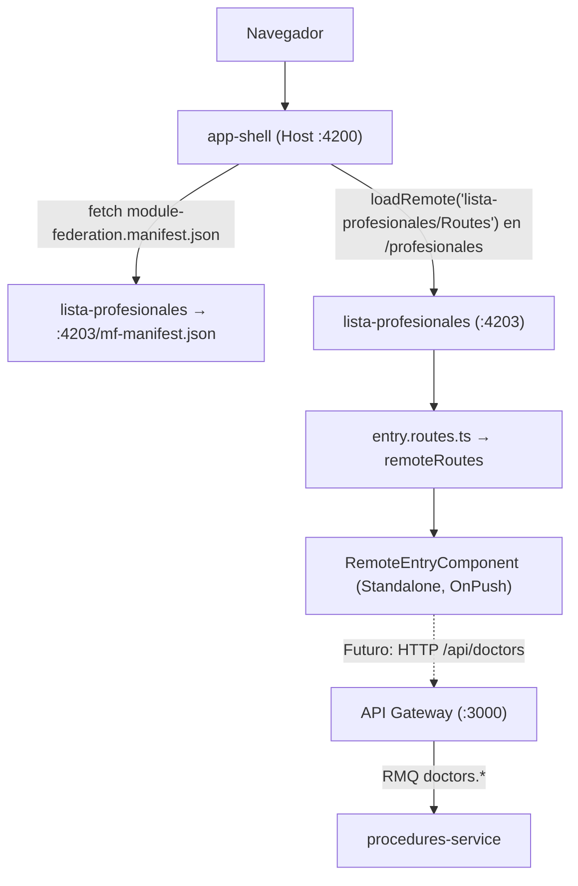
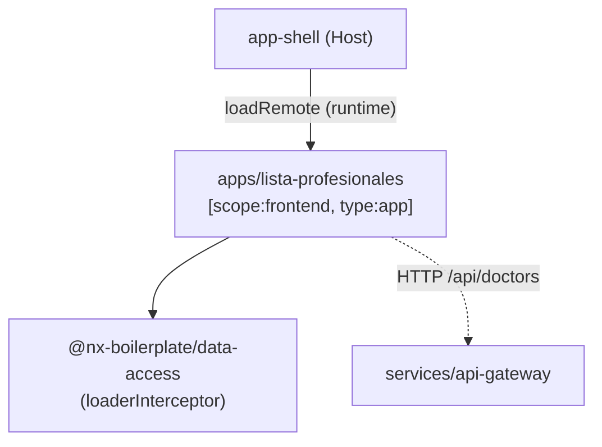

# Lista de Profesionales (MFE)

> **Ficha Técnica del Módulo**  
> * **Ubicación en Monorepo:** `apps/lista-profesionales`  
> * **Tipo de Módulo:** MFE Angular 21+ (Remote de Module Federation, Standalone + Zoneless)  
> * **Tags Nx (`project.json`):** `["scope:frontend", "type:app"]`  
> * **Puertos de Desarrollo:** `4203` (`serve`) y `4213` (`serve-static`)  
> * **Estado:** En Desarrollo (scaffolding base; vista inicial placeholder)  

---

## 1. Propósito y Alcance de Negocio

El MFE **`lista-profesionales`** será el módulo encargado de la gestión visual de los profesionales (médicos especialistas) de la clínica: listado, consulta y, en etapas posteriores, creación, edición, baja lógica y gestión de horarios excepcionales.

Actualmente existe únicamente el **scaffolding base**: el remote está generado, configurado, integrado en el `app-shell` y compila correctamente, pero su vista (`RemoteEntryComponent`) es un placeholder. Los endpoints REST que consumirá ya están expuestos por el API Gateway (`/api/doctors`).

---

## 2. Conceptos Clave

> [!TIP]
> Esta sección explica **el por qué** de las decisiones de arquitectura del remote.

### A. ¿Por qué un Remote independiente?
Cada MFE se compila, versiona y sirve de forma autónoma (puerto propio). El `app-shell` (host) lo descubre en **runtime** mediante un manifest, por lo que añadir un módulo no exige recompilar el host ni declarar remotes estáticos (evita conflictos de puertos `NG0912`/`EADDRINUSE`).

### B. ¿Por qué `lista-profesionales` y no `listaProfesionales`?
El generador `@nx/angular:remote` exige nombres de remote que cumplan `^[a-zA-Z_$][a-zA-Z_$0-9]*$` (sin guiones). Por ello se generó como `listaProfesionales` y luego se **renombró a `lista-profesionales`** en `project.json`, `module-federation.config.ts`, el alias de `tsconfig.base.json` y el manifest del host, igualando la convención de `agendador-citas`.

### C. Zoneless + Signals
`app.config.ts` usa `provideZonelessChangeDetection()`; la reactividad debe basarse en Signals (`signal`, `computed`, `input()`, `output()`) y componentes `OnPush`.

---

## 3. Diagrama de Arquitectura y Flujo de Información



---

## 4. Contratos de Datos e Interfaces

### A. Interfaces de Contrato (`@nx-boilerplate/api-interfaces`)

| Interfaz | Archivo Origen | Propósito |
|---|---|---|
| `IActiveProfessional` | `procedure.interface.ts` | Profesional activo: cédula, nombres, apellidos, email, profesión, procedimientos, horario y excepciones. |
| `IWorkSchedule` | `procedure.interface.ts` | Horario laboral base (días, hora inicio/fin, receso de almuerzo). |
| `IExceptionSchedule` | `procedure.interface.ts` | Excepción puntual (`fecha`, `horaInicio`, `horaFin`, `tipo`). |
| `ExceptionScheduleType` | `procedure.interface.ts` | `'EXTRA_SHIFT' \| 'DAY_OFF'`. |
| `IProfessionalSummary` | `procedure.interface.ts` | Resumen del profesional. |

### B. DTOs (`@nx-boilerplate/shared-dtos`) — contratos de los endpoints a consumir

| DTO | Endpoint | Propósito |
|---|---|---|
| `CreateProfessionalDto` | `POST /api/doctors` | Alta de profesional. |
| `UpdateProfessionalDto` | `PATCH /api/doctors/:cedula` | Actualización parcial. |
| `UpdateScheduleExceptionsDto` | `PATCH /api/doctors/:cedula/schedule` | Excepciones de horario (`horariosExcepcionales` o `exceptions`). |

> [!NOTE]
> Los DTOs son de validación runtime en backend. El frontend debe tipar con las interfaces puras de `@nx-boilerplate/api-interfaces`.

---

## 5. Puntos de Entrada y Comunicación

### 5.1 Module Federation
* **Nombre del remote:** `lista-profesionales`
* **Expone:** `./Routes` → `apps/lista-profesionales/src/app/remote-entry/entry.routes.ts` (exporta `remoteRoutes`).
* **Compartidos:** `@angular/cdk` y `@angular/material` los provee el host como singletons (declararlos aquí duplicaría instancias → `NG0912`).

### 5.2 Integración con el Host (`app-shell`)

| Archivo | Cambio |
|---|---|
| `app-shell/public/module-federation.manifest.json` | `"lista-profesionales": "http://localhost:4203/mf-manifest.json"` |
| `app-shell/src/app/app.routes.ts` | Ruta lazy `profesionales` vía `loadRemote`; alias `lista-profesionales` → `profesionales`. |
| `app-shell/src/app/app.ts` | Enlace `Profesionales` (icono `badge`) en el Sidenav. |
| `tsconfig.base.json` | Alias `lista-profesionales/Routes`. |

### 5.3 Endpoints HTTP a consumir (vía API Gateway, `/api/doctors`)

| Método | Ruta | Descripción |
|---|---|---|
| `GET` | `/api/doctors` | Lista de profesionales activos. |
| `POST` | `/api/doctors` | Crear profesional. |
| `PATCH` | `/api/doctors/:cedula` | Actualizar profesional. |
| `PATCH` | `/api/doctors/:cedula/schedule` | Actualizar excepciones de horario. |
| `DELETE` | `/api/doctors/:cedula` | Baja lógica (soft delete). |

> Las respuestas llegan envueltas en `IApiResponse<T>` por el `TransformInterceptor` del Gateway.

---

## 6. Estructura de Archivos

```
apps/lista-profesionales/
├── module-federation.config.ts      # Nombre y exposes del remote
├── webpack.config.ts                # withModuleFederation (dev)
├── webpack.prod.config.ts           # withModuleFederation (prod)
├── project.json                     # Targets: build, serve (4203), serve-static (4213), lint
└── src/
    ├── index.html                   # <app-lista-profesionales-entry>
    ├── main.ts                      # import('./bootstrap')
    ├── bootstrap.ts                 # bootstrapApplication(RemoteEntryComponent)
    └── app/
        ├── app.config.ts            # Zoneless + HttpClient(loaderInterceptor)
        ├── app.routes.ts            # Carga perezosa de remote-entry
        └── remote-entry/
            ├── entry.routes.ts      # remoteRoutes (expuesto)
            └── remote-entry.component.ts  # Placeholder Standalone OnPush
```

---

## 7. Dependencias y Límites Arquitectónicos



* **Consume actualmente:** `@nx-boilerplate/data-access` (`loaderInterceptor`).
* **Consumirá (planificado):** `@nx-boilerplate/api-interfaces`, `@nx-boilerplate/layouts`, `@nx-boilerplate/theme` (tokens MD3).
* **Lo consume:** `app-shell` (host) en tiempo de ejecución.
* **Prohibido:** importar librerías `scope:backend` (`*-domain`, `shared-dtos`) desde el frontend.

---

## 8. Guía de Uso y Ejemplos

Para añadir la vista inicial, agregue rutas hijas en `entry.routes.ts`:

```typescript
import { Route } from '@angular/router';
import { RemoteEntryComponent } from './remote-entry.component';

export const remoteRoutes: Route[] = [
  { path: '', component: RemoteEntryComponent },
];
```

Para consumir el endpoint de listado (patrón de `angular-data-expert`):

```typescript
import { HttpClient } from '@angular/common/http';
import { inject, Injectable } from '@angular/core';
import { IActiveProfessional, IApiResponse } from '@nx-boilerplate/api-interfaces';

@Injectable({ providedIn: 'root' })
export class ProfessionalsApiService {
  private readonly http = inject(HttpClient);

  getAll() {
    return this.http.get<IApiResponse<IActiveProfessional[]>>('/api/doctors');
  }
}
```

---

## 9. Comandos de Verificación (Nx)

```bash
# Servir el remote de forma aislada (puerto 4203)
npx nx serve lista-profesionales

# Servir el host con sus remotes
npx nx serve app-shell

# Compilar
npx nx build lista-profesionales

# Validar reglas ESLint y límites de módulos
npx nx lint lista-profesionales
```

Acceso desde el host: `http://localhost:4200/profesionales`.
