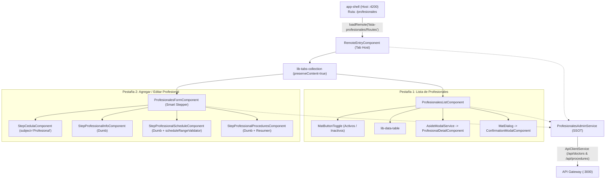

# Lista de Profesionales (MFE `lista-profesionales`)

> **Ficha Técnica del Módulo**  
> * **Ubicación en Monorepo:** `apps/lista-profesionales`  
> * **Tipo de Módulo:** MFE Angular 21+ (Remote de Module Federation, Standalone + Zoneless + Signals)  
> * **Tags Nx (`project.json`):** `["scope:frontend", "type:app"]`  
> * **Puertos de Desarrollo:** `4203` (`serve`) y `4213` (`serve-static`)  
> * **Ruta en Host (`app-shell`):** `http://localhost:4200/profesionales` (alias `/lista-profesionales`)  
> * **Estado:** Activo / Implementado (Listado Activos/Inactivos, Detalle en Aside Modal, Stepper de Alta/Edición de 4 pasos y Baja/Reactivación Lógica)  
> * **Nexo Padre:** [Volver a `app-shell.md`](./app-shell.md)

---

## 1. Propósito y Alcance de Negocio

El microfrontend **`lista-profesionales`** es el módulo administrativo encargado de gestionar el directorio de médicos especialistas de la clínica, sus horarios laborales base y los procedimientos que están habilitados para realizar:

1. **Directorio Reactivo con Filtro Activos / Inactivos:** Presenta el listado de profesionales en una tabla (`lib-data-table`) con búsqueda instantánea, ordenamiento por columnas y conmutador de estado (`Activos` vs `Inactivos`).
2. **Inspección Detallada en Panel Lateral (`AsideModalService`):** Permite abrir una vista lateral deslizante (`ProfesionalDetailComponent`) con la ficha completa del especialista, su jornada laboral, receso de almuerzo y los nombres legibles de sus procedimientos asignados.
3. **Formulario Guiado de 4 Pasos (Modo Dual Alta y Edición):** Utiliza un stepper vertical lineal (`mat-stepper`) que valida identificación (con detección local y remota de cédula duplicada), datos personales, configuración de horario laboral (`scheduleRangeValidator`) y asignación de procedimientos con resumen previo al guardado.
4. **Baja Lógica y Reactivación con Optimistic UI:** Permite desactivar o reactivar especialistas mediante modales de confirmación (`ConfirmationModalComponent`) actualizando la interfaz de inmediato y revirtiendo en caso de fallo de red.

---

## 2. Diagrama de Arquitectura y Flujo de Componentes



---

## 3. Componentes y Capa de Presentación

### 3.1 `RemoteEntryComponent` (Orquestador de Pestañas)
* **Ubicación:** [`apps/lista-profesionales/src/app/remote-entry/remote-entry.component.ts`](file:///Users/usuario/Desktop/nx-boilerplate/apps/lista-profesionales/src/app/remote-entry/remote-entry.component.ts)
* **Responsabilidad:**
  * Inicializa la carga del catálogo de profesionales (`loadProfesionales()`) y de procedimientos (`loadProcedures()`).
  * Renderiza `<lib-tabs-collection [preserveContent]="true">` alternando dinámicamente la etiqueta y el icono de la segunda pestaña según `profesionalesService.isEditMode()`:
    * Modo Alta: **`Agregar Profesional`** (`person_add`).
    * Modo Edición: **`Editar Profesional`** (`edit_note`).

### 3.2 `ProfesionalesListComponent` (Directorio y Acciones)
* **Ubicación:** [`apps/lista-profesionales/src/app/components/profesionales-list/profesionales-list.component.ts`](file:///Users/usuario/Desktop/nx-boilerplate/apps/lista-profesionales/src/app/components/profesionales-list/profesionales-list.component.ts)
* **Características Clave:**
  * **Filtro Reactivo (`viewFilter`):** Señal `'activos' | 'inactivos'` que alimenta la señal computada `displayedProfesionales`.
  * **Vista de Detalle Lateral (`onViewProfessional`):** Invoca `AsideModalService.open()` de `@nx-boilerplate/layouts` proyectando [`ProfesionalDetailComponent`](file:///Users/usuario/Desktop/nx-boilerplate/apps/lista-profesionales/src/app/components/profesional-detail/profesional-detail.component.ts) (`width: '480px'`) y resolviendo los códigos `PROC-XXX` a sus nombres comerciales mediante `resolveProcedureNames()`.
  * **Edición (`onEdit`):** Carga el profesional en el SSOT (`goToEdit(prof)`) y conmuta automáticamente a la pestaña del formulario.
  * **Desactivación y Reactivación (`onDelete` / `onReactivate`):** Abre `ConfirmationModalComponent` y ejecuta la mutación con Optimistic UI.

### 3.3 `ProfesionalesFormComponent` (Stepper Smart de 4 Pasos)
* **Ubicación:** [`apps/lista-profesionales/src/app/components/profesionales-form/profesionales-form.component.ts`](file:///Users/usuario/Desktop/nx-boilerplate/apps/lista-profesionales/src/app/components/profesionales-form/profesionales-form.component.ts)
* **Pasos del Formulario (Componentes Dumb en `@nx-boilerplate/layouts`):**
  1. **Paso 1 — Identificación (`StepCedulaComponent` con `subject="Profesional"`):**
     * En modo Alta, verifica localmente contra `profesionalesList()` que la cédula no esté duplicada antes de avanzar (`duplicateCedula`). En modo Edición, el campo cédula se deshabilita.
  2. **Paso 2 — Datos Personales (`StepProfessionalInfoComponent`):**
     * Captura `nombres`, `apellidos`, `email` y `profesion`.
  3. **Paso 3 — Horario Laboral (`StepProfessionalScheduleComponent`):**
     * Selección de días laborales (`LUNES` a `SABADO`), `horaInicio`, `horaFin` y switch opcional `tieneReceso` (`recesoAlmuerzo.inicio` y `fin`).
     * Validado por [`scheduleRangeValidator`](file:///Users/usuario/Desktop/nx-boilerplate/apps/lista-profesionales/src/app/utils/schedule.validator.ts) para garantizar que `horaInicio < horaFin` y que el receso de almuerzo esté estrictamente contenido dentro de la jornada laboral.
  4. **Paso 4 — Procedimientos y Confirmación (`StepProfessionalProceduresComponent`):**
     * Selector múltiple alimentado por el catálogo real de procedimientos (`GET /api/procedures`) y tarjeta de resumen consolidado (`ProfessionalSummaryData`).

---

## 4. Servicio SSOT (`ProfesionalesAdminService`)

* **Ubicación:** [`apps/lista-profesionales/src/app/services/profesionales-admin.service.ts`](file:///Users/usuario/Desktop/nx-boilerplate/apps/lista-profesionales/src/app/services/profesionales-admin.service.ts)
* **Señales Expuestas (`asReadonly`):**
  * `profesionalesList`: Lista completa de profesionales (`includeInactive: 'true'`).
  * `procedures`: Catálogo de procedimientos para cruce de nombres y selector del paso 4.
  * `activeTab`: Pestaña activa (`PROFESIONALES_TABS.LIST` o `PROFESIONALES_TABS.FORM`).
  * `editingProfessional` e `isEditMode`: Controlan si el formulario opera en modo creación (`POST /api/doctors`) o edición (`PATCH /api/doctors/:cedula`).
  * `isLoading`, `error` (estado de la tabla) separados de `isSaving`, `saveError` (estado del formulario).
* **Operaciones HTTP Conectadas al API Gateway ([`03-procedures-doctors-service.md`](../documentacion-back/03-procedures-doctors-service.md)):**
  * `GET /api/doctors?includeInactive=true`
  * `GET /api/procedures`
  * `POST /api/doctors` (`createProfesional`)
  * `PATCH /api/doctors/:cedula` (`updateProfesional` y `reactivateProfesional`)
  * `DELETE /api/doctors/:cedula` (`deleteProfesional`)

---

## 5. Comandos de Verificación (Nx)

```bash
# Servir el MFE de forma aislada (puerto 4203)
npx nx serve lista-profesionales

# Ejecutar suite de pruebas unitarias (Vitest)
./node_modules/.bin/vitest run --config apps/lista-profesionales/vite.config.mts

# Verificar tipado estricto TypeScript
./node_modules/.bin/tsc -p apps/lista-profesionales/tsconfig.app.json --noEmit
```
