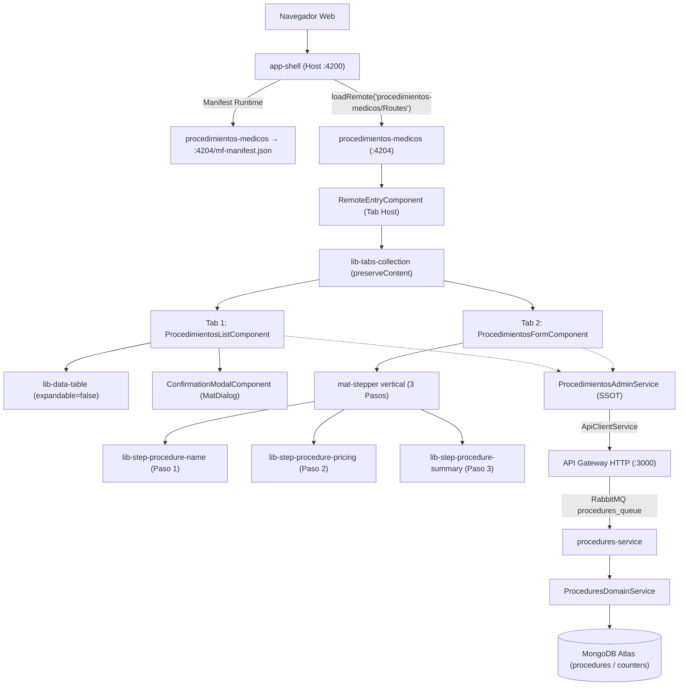

# Procedimientos Médicos (MFE `procedimientos-medicos`)

> **Ficha Técnica del Módulo**  
> * **Ubicación en Monorepo:** `apps/procedimientos-medicos`  
> * **Tipo de Módulo:** MFE Angular 21+ (Remote de Module Federation, Standalone + Zoneless)  
> * **Tags Nx (`project.json`):** `["scope:frontend", "type:app"]`  
> * **Puertos de Desarrollo:** `4204` (`serve`) y `4214` (`serve-static`)  
> * **Host Principal:** `app-shell` (`http://localhost:4200/procedimientos-medicos`)  
> * **Estado:** Activo / Implementado (Fases B1-B5 Backend + F1-F6 Frontend)  

---

## 1. Propósito y Alcance de Negocio

El microfrontend **`procedimientos-medicos`** es el módulo centralizado para la administración de procedimientos médicos, quirúrgicos y estéticos de la clínica. Permite al personal administrativo:

1. **Consultar el catálogo activo** de procedimientos mediante una tabla de datos reactiva con búsqueda en tiempo real, ordenamiento por columnas y formateo estandarizado de precios en moneda colombiana (COP) y duraciones en minutos.
2. **Registrar nuevos procedimientos** guiados a través de un stepper vertical de 3 pasos que valida la sintaxis, unicidad de nombres y captura dinámica de insumos y laboratorios requeridos.
3. **Editar procedimientos existentes** con precarga automática de valores base e insumos.
4. **Auto-recuperar procedimientos inactivos:** si un usuario intenta dar de alta un procedimiento cuyo nombre coincide con uno dado de baja previamente, el sistema detecta la coincidencia, precarga sus valores históricos y permite reactivarlo con actualización de datos.
5. **Eliminar de forma segura (Baja Lógica):** bloquea en la interfaz y en el servidor cualquier intento de eliminación si el procedimiento se encuentra actualmente asignado a profesionales activos (`medicosRelacionados.length > 0`), informando al usuario sin emitir llamadas destructivas innecesarias.

---

## 2. Diagrama de Arquitectura y Flujo de Información



---

## 3. Contratos de Datos e Interfaces

### A. Interfaces Compartidas (`@nx-boilerplate/api-interfaces`)

| Interfaz | Archivo Origen | Propósito |
|---|---|---|
| `IProcedure` | `procedure.interface.ts` | Entidad canónica del procedimiento: `idProcedimiento`, `nombreProcedimiento`, `valorStandar`, `duracionStandar`, `isActive`, `laboratorios`, `medicosRelacionados`. |
| `IProcedureLaboratory` | `procedure.interface.ts` | Detalle de insumo: `nombreLaboratorio`, `precio`, `medidaPorUnidad`. |
| `ICreateProcedureRequest` | `procedure.interface.ts` | Payload de creación para `POST /api/procedures`. |
| `IUpdateProcedureRequest` | `procedure.interface.ts` | Payload de actualización o reactivación para `PATCH /api/procedures/:id`. |
| `IProcedureSoftDeleteResponse` | `procedure.interface.ts` | Respuesta de baja lógica `{ idProcedimiento, isActive: false, message }`. |
| `IGetProceduresQueryRequest` | `procedure.interface.ts` | Parámetros de consulta opcionales (`includeInactive`, `doctorCedula`). |

### B. Modelos de UI y Pasos (`@nx-boilerplate/layouts`)

| Modelo | Archivo Origen | Propósito |
|---|---|---|
| `ProcedureSummaryData` | `models/procedure-steps.models.ts` | Datos consolidados del procedimiento consumidos por `StepProcedureSummaryComponent`. |
| `TableColumnDef<IProcedure>` | `models/data-table.models.ts` | Definición de columnas y formateadores de moneda/tiempo para `lib-data-table`. |
| `TableActionDef<IProcedure>` | `models/data-table.models.ts` | Botones de acción (`edit`, `delete`) por fila. |
| `ConfirmationModalData<boolean>` | `models/confirmation-modal.models.ts` | Configuración tipada del modal de confirmación o alerta de bloqueo. |

---

## 4. Componentes y Capa de Presentación

### A. Componentes Dumb (`libs/shared/layouts/src/lib/forms/ui-procedure-steps/`)

Todos los componentes son Standalone puros, `OnPush`, con inyección moderna y consumo exclusivo de tokens CSS de Material Design 3 (`--sys-color-*`):

1. **`lib-step-procedure-name`:**
   * **Inputs:** `stepForm = input.required<FormGroup>()`.
   * **Outputs:** `nextStep = output<void>()`.
   * **Validaciones:** `required`, `minlength(3)`, `maxlength(100)` y error contextual `duplicateName`.

2. **`lib-step-procedure-pricing`:**
   * **Inputs:** `stepForm = input.required<FormGroup>()`, `laboratoriosArray = input<FormArray<FormGroup>>()`.
   * **Outputs:** `addLaboratory = output<void>()`, `removeLaboratory = output<number>()`, `prevStep = output<void>()`, `nextStep = output<void>()`.
   * **Controles:** `valorStandar`, `duracionStandar`, `mat-slide-toggle` (`tieneLaboratorio`) y tarjetas `.laboratory-card` con botón de eliminación (`close`) y campos alineados con Flexbox.

3. **`lib-step-procedure-summary`:**
   * **Inputs:** `summaryData = input.required<ProcedureSummaryData>()`, `isSaving = input<boolean>()`, `isEditMode = input<boolean>()`, `isRestoringInactive = input<boolean>()`.
   * **Outputs:** `prevStep = output<void>()`, `save = output<void>()`.
   * **Visualización:** Banner informativo de reactivación, métricas consolidadas en formato COP y desglose de insumos.

### B. Vistas Smart (`apps/procedimientos-medicos/src/app/components/`)

1. **`ProcedimientosListComponent`:**
   * Conecta con `procedimientosService.activeProcedimientos()`.
   * Despliega la tabla con búsqueda local sin debounce artificial en escritura.
   * `onDelete`: evalúa `proc.medicosRelacionados.length`. Si es mayor a 0, abre diálogo modal informativo de solo lectura con acción única *Entendido*; si es 0, abre confirmación y delega la baja con Optimistic UI.

2. **`ProcedimientosFormComponent`:**
   * Formulario reactivo tipado (`NonNullableFormBuilder`).
   * `onStep1Next`: normaliza el nombre y consulta al SSOT. Si existe activo $\rightarrow$ error `duplicateName`. Si existe inactivo $\rightarrow$ auto-recupera con `startRestoreInactive()` y precarga insumos.
   * Gestión sincronizada de `tieneLaboratorio`: si se activa con array vacío añade el primer insumo; si se cierran todas las tarjetas apaga el switch automáticamente.

3. **`RemoteEntryComponent` (Tab Host):**
   * Aloja `<lib-tabs-collection [preserveContent]="true">`.
   * Carga el catálogo al inicio mediante `loadProcedimientos()`.
   * Alterna dinámicamente el título e ícono de la segunda pestaña (*Agregar Procedimiento* / *Editar Procedimiento* / *Reactivar Procedimiento*).

---

## 5. Servicio SSOT (`ProcedimientosAdminService`)

Ubicado en `apps/procedimientos-medicos/src/app/services/procedimientos-admin.service.ts`:

* **Estado con Signals Privados (`#`):**
  * `#allProcedimientos`: catálogo total del backend (`includeInactive=true`).
  * `activeProcedimientos`: computed reactivo que filtra `{ isActive !== false }`.
  * `#isLoading`, `#error`, `#isSaving`, `#saveError`.
  * `#activeTab`, `#editingProcedure`, `#isRestoringInactive`, `isEditMode`.
* **Búsqueda Normalizada (`findExistingByName`):**
  * Remueve acentos diacríticos (`normalize('NFD')`), minúsculas y colapsa secuencias de espacios en blanco (`replace(/\s+/g, ' ')`).
* **Optimistic UI:**
  * En `deleteProcedimiento()`, desactiva inmediatamente en memoria (`isActive: false`) y revierte al snapshot si el Gateway retorna error (por ejemplo, 409).
  * En mutaciones con error 409 o reintentos, resincroniza el catálogo para mantener consistencia con otros clientes.

---

## 6. Puntos de Entrada y Configuración Module Federation

* **Manifest del Host (`app-shell/public/module-federation.manifest.json`):**
  ```json
  "procedimientos-medicos": "http://localhost:4204/mf-manifest.json"
  ```
* **Enrutamiento del Host (`app-shell/src/app/app.routes.ts`):**
  ```typescript
  {
    path: 'procedimientos-medicos',
    loadChildren: () =>
      loadRemote<typeof import('procedimientos-medicos/Routes')>(
        'procedimientos-medicos/Routes'
      ).then((m) => m!.remoteRoutes),
  }
  ```
* **Navegación del Host (`app-shell/src/app/app.ts`):**
  ```typescript
  { path: '/procedimientos-medicos', label: 'Procedimientos Médicos', icon: 'medical_services' }
  ```
* **Exposición en el Remote (`module-federation.config.ts`):**
  ```typescript
  exposes: {
    './Routes': 'apps/procedimientos-medicos/src/app/remote-entry/entry.routes.ts'
  }
  ```

---

## 7. Comandos de Verificación (Nx)

```bash
# Servir el MFE en modo standalone (puerto 4204)
npx nx serve procedimientos-medicos

# Compilar el MFE en producción
npx nx build procedimientos-medicos

# Ejecutar las 35 pruebas unitarias del MFE
npx nx test procedimientos-medicos

# Validar reglas de linting y límites arquitectónicos
npx nx lint procedimientos-medicos

# Compilar integración con el Shell
npx nx run-many -t build -p app-shell procedimientos-medicos
```
