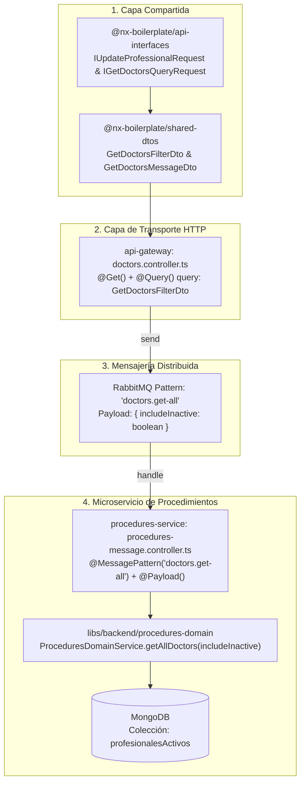

# Bitácora de Ejecución: Soporte Integral para Profesionales Activos e Inactivos (`isActive`)

> **Ficha Técnica de Ejecución**  
> * **Documento:** `docs/ejecucion-isActive.md`  
> * **Fecha de Implementación:** 2026-10-22  
> * **Fases Cubiertas:** Diagnóstico, Fase A (Contratos), Fase B (DTOs), Fase C (API Gateway), Fase D (Microservicio RPC)  
> * **Módulos Modificados:**  
>   * `libs/shared/api-interfaces`  
>   * `libs/shared/dtos`  
>   * `services/api-gateway`  
>   * `services/procedures-service`  
> * **Estado:** Backend y Contratos Finalizados y Verificados (Compilación y Pruebas Unitarias Exitosas)  

---

## 1. Resumen Ejecutivo del Proceso

El objetivo de esta intervención fue habilitar el soporte de extremo a extremo para la consulta y discriminación de profesionales activos e inactivos (`isActive`), así como asegurar el contrato de actualización para la reactivación o baja manual desde el frontend administrativo (`apps/lista-profesionales`).

La implementación abarcó desde los contratos de TypeScript compartidos hasta la orquestación en el API Gateway y el microservicio `procedures-service` sobre RabbitMQ.



---

## 2. Detalle de Cambios Realizados por Fase

### Fase Previa: Auditoría y Planificación
* **Hallazgo 1 (Dominio):** Se comprobó que `ProceduresDomainService.getAllDoctors(includeInactive = false)` y `ProceduresRepository.findAllDoctors(includeInactive)` ya implementaban el filtrado `{ isActive: { $ne: false } }`.
* **Hallazgo 2 (Transporte):** El API Gateway enviaba `{}` vacío y `procedures-service` no extraía `@Payload()`.
* **Hallazgo 3 (Contrato TS):** `IUpdateProfessionalRequest` omitía `isActive` al heredar de `ICreateProfessionalRequest`.
* **Entregable:** Generación del documento de arquitectura [docs/planeacion-isActive.md](file:///Users/usuario/Desktop/nx-boilerplate/docs/planeacion-isActive.md).

---

### Fase A: Actualización de Contratos (`libs/shared/api-interfaces`)
* **Archivo modificado:** [procedure.interface.ts](file:///Users/usuario/Desktop/nx-boilerplate/libs/shared/api-interfaces/src/lib/procedure.interface.ts)
* **Cambios aplicados:**
  1. Se actualizó el type `IUpdateProfessionalRequest` con unión explícita de `isActive?: boolean;`:
     ```typescript
     export type IUpdateProfessionalRequest = Partial<
       Omit<ICreateProfessionalRequest, 'cedula'>
     > & {
       isActive?: boolean;
     };
     ```
  2. Se definió y exportó la interfaz de consulta `IGetDoctorsQueryRequest`:
     ```typescript
     export interface IGetDoctorsQueryRequest {
       includeInactive?: boolean;
     }
     ```
* **Impacto:** Permite al frontend tipar de forma segura peticiones de reactivación (`PATCH /api/doctors/:cedula`) con `{ isActive: true }`.

---

### Fase B: DTOs de Validación Runtime (`libs/shared/dtos`)
* **Archivo modificado:** [professional.dto.ts](file:///Users/usuario/Desktop/nx-boilerplate/libs/shared/dtos/src/lib/professional.dto.ts)
* **Cambios aplicados:**
  1. Se importó `Transform` desde `class-transformer`.
  2. Se creó `GetDoctorsFilterDto` para validar las peticiones HTTP GET en el API Gateway, transformando automáticamente el query param de string `'true'` a booleano nativo:
     ```typescript
     export class GetDoctorsFilterDto {
       @IsOptional()
       @Transform(({ value }) => value === 'true' || value === true)
       @IsBoolean({ message: 'includeInactive debe ser booleano' })
       includeInactive?: boolean;
     }
     ```
  3. Se creó `GetDoctorsMessageDto` para validar el payload tipado en el transporte RabbitMQ:
     ```typescript
     export class GetDoctorsMessageDto {
       @IsOptional()
       @IsBoolean({ message: 'includeInactive debe ser booleano' })
       includeInactive?: boolean;
     }
     ```
  4. Ambos DTOs quedaron expuestos globalmente en el barril [libs/shared/dtos/src/lib/index.ts](file:///Users/usuario/Desktop/nx-boilerplate/libs/shared/dtos/src/lib/index.ts).

---

### Fase C: Integración en API Gateway (`services/api-gateway`)
* **Archivo modificado:** [doctors.controller.ts](file:///Users/usuario/Desktop/nx-boilerplate/services/api-gateway/src/controllers/doctors.controller.ts)
* **Cambios aplicados:**
  * Se inyectó el decorador `@Query()` utilizando `GetDoctorsFilterDto`.
  * Se configuró el envío del objeto `{ includeInactive: query?.includeInactive === true }` al broker:
    ```typescript
    @Get()
    getAllDoctors(
      @Query() query: GetDoctorsFilterDto
    ): Observable<IActiveProfessional[]> {
      return this.proceduresClient
        .send<IActiveProfessional[]>('doctors.get-all', {
          includeInactive: query?.includeInactive === true,
        })
        .pipe(timeout(5000));
    }
    ```

---

### Fase D: Manejo de Mensajería en Microservicio (`services/procedures-service`)
* **Archivos modificados:**
  * [procedures-message.controller.ts](file:///Users/usuario/Desktop/nx-boilerplate/services/procedures-service/src/controllers/procedures-message.controller.ts)
  * [procedures-message.controller.spec.ts](file:///Users/usuario/Desktop/nx-boilerplate/services/procedures-service/src/controllers/procedures-message.controller.spec.ts)
* **Cambios aplicados:**
  1. En el controlador RPC, se decoró el método con `@Payload() payload: GetDoctorsMessageDto` y se reenvió al servicio de dominio:
     ```typescript
     @MessagePattern('doctors.get-all')
     async getAllDoctors(
       @Payload() payload: GetDoctorsMessageDto
     ): Promise<IActiveProfessional[]> {
       return this.proceduresDomainService.getAllDoctors(
         payload?.includeInactive ?? false
       );
     }
     ```
  2. En la suite de pruebas unitarias Vitest, se actualizó el test `'debe atender doctors.get-all delegando al servicio con includeInactive'` para comprobar que `getAllDoctors({ includeInactive: true })` invoca al servicio con `true`.

---

## 3. Matriz de Archivos Modificados

| Componente / Librería | Archivo | Tipo de Cambio |
|---|---|---|
| `@nx-boilerplate/api-interfaces` | `libs/shared/api-interfaces/src/lib/procedure.interface.ts` | Contrato TS (`IUpdateProfessionalRequest`, `IGetDoctorsQueryRequest`) |
| `@nx-boilerplate/shared-dtos` | `libs/shared/dtos/src/lib/professional.dto.ts` | DTOs Runtime (`GetDoctorsFilterDto`, `GetDoctorsMessageDto`) |
| `api-gateway` | `services/api-gateway/src/controllers/doctors.controller.ts` | Controlador HTTP (`@Query()` y forwarding RMQ) |
| `procedures-service` | `services/procedures-service/src/controllers/procedures-message.controller.ts` | Handler RabbitMQ (`@Payload()` y delegación a dominio) |
| `procedures-service` | `services/procedures-service/src/controllers/procedures-message.controller.spec.ts` | Pruebas Unitarias Vitest |
| `docs` | `docs/planeacion-isActive.md` | Especificación de Arquitectura |
| `docs` | `docs/ejecucion-isActive.md` | Bitácora de Ejecución |

---

## 4. Validación y Pruebas Ejecutadas

Se ejecutó la suite de verificación exhaustiva con Nx:

```bash
# 1. Typecheck estricto de DTOs y Contratos
npx tsc -p libs/shared/dtos/tsconfig.lib.json --noEmit
# Resultado: Exitoso (código 0, sin errores de tipado)

npx tsc -p libs/shared/api-interfaces/tsconfig.lib.json --noEmit
# Resultado: Exitoso (código 0, sin errores de tipado)

# 2. Compilación de Microservicios Backend
npx nx build api-gateway && npx nx build procedures-service
# Resultado:
# > nx run api-gateway:build (webpack compiled successfully in 2s)
# > nx run procedures-service:build (webpack compiled successfully in 2s)

# 3. Ejecución de Pruebas Unitarias
npx nx test procedures-service
# Resultado:
# > nx run procedures-service:test
# Test Files  1 passed (1)
# Tests       7 passed (7)
```

---

## 5. Próximos Pasos (Fase E - Frontend MFE)

Con la infraestructura de contratos y backend concluida, el siguiente paso pendiente es la integración en el Microfrontend administrativo:
1. **`profesionales-admin.service.ts`:**
   * Adaptar la carga de profesionales para enviar `GET /api/doctors?includeInactive=true` o implementar selector reactivo.
   * Implementar método `reactivateProfesional(cedula: string)` llamando a `PATCH /api/doctors/:cedula` con `{ isActive: true }`.
2. **`profesionales-list.component.*`:**
   * Habilitar el `MatButtonToggleGroup` eliminando la propiedad `disabled` y el tooltip informativo.
   * Conectar la señal `viewFilter` para conmutar la tabla entre Activos e Inactivos.
   * Agregar acción visual de "Reactivar" en la vista de inactivos.
