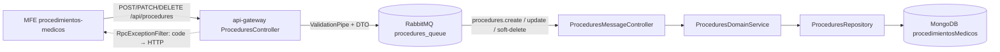

# Plan de Implementación Backend: Procedimientos Médicos (CRUD + Baja Lógica)

> **Ficha Técnica**  
> * **Documento hermano:** [`evaluacion_y_plan_front_procedimientos_medicos.md`](./evaluacion_y_plan_front_procedimientos_medicos.md) · **Índice y evaluación:** [`evaluacion_y_plan_mfe_procedimientos_medicos.md`](./evaluacion_y_plan_mfe_procedimientos_medicos.md)  
> * **Módulos:** `libs/shared/api-interfaces`, `libs/shared/dtos`, `libs/backend/procedures-domain`, `services/procedures-service`, `services/api-gateway`  
> * **Tags Nx esperados:** `scope:shared/type:contracts`, `scope:backend/type:dtos`, `scope:backend/type:domain-lib`, `scope:backend/type:service` (sin cambios, ya existen)  
> * **Skill gobernante:** `nest-microservices`  
> * **Estado:** Propuesta pendiente de confirmación (Fase 2 del protocolo AGENTS.md)

---

## 1. Estado Actual vs. Objetivo

| Capa | Hoy (verificado en repo) | Objetivo |
|---|---|---|
| Gateway `procedures.controller.ts` | Solo `GET /procedures`, `GET /procedures/:id`, `GET /procedures/:id/doctors` | + `POST`, `PATCH /:id`, `DELETE /:id`, `GET ?includeInactive` |
| `procedures-message.controller.ts` | `procedures.get-all`, `find-by-id`, `find-by-doctor`, `get-doctors-by-procedure` | + `procedures.create`, `procedures.update`, `procedures.soft-delete`; `get-all` con payload |
| `ProceduresDomainService` | Solo lectura de procedimientos | + create / update / softDelete con reglas de negocio |
| `ProceduresRepository` | `findAll`, `findById`, `findByDoctor`, `insertMany`, `count` | + create / update / búsqueda por nombre / baja atómica |
| `Procedure` schema | `idProcedimiento`, `nombreProcedimiento`, `valorStandar`, `duracionStandar`, `medicosRelacionados` | + `isActive`, `laboratorios` |
| `procedure.dto.ts` | Solo DTOs de búsqueda | + DTOs de creación/actualización/mensaje |

---

## 2. Decisiones de Diseño (resuelven los hallazgos de la revisión)

| # | Decisión | Motivo |
|---|---|---|
| D1 | **Se conservan** los nombres `idProcedimiento`, `nombreProcedimiento`, `valorStandar`, `duracionStandar`. | Los consumen `agendador-citas`, el seeder y `lista-profesionales`. Renombrar rompería datos y UI. |
| D2 | **`tieneLaboratorio` NO se persiste.** Se deriva de `laboratorios.length > 0`. | Evita dos fuentes de verdad. Es solo un control de formulario en el front. |
| D3 | **Filtro de activos siempre `{ isActive: { $ne: false } }`.** | Los documentos sembrados no tienen `isActive`; el `default: true` no los retro-llena. |
| D4 | **Mensajes RMQ con DTO de payload** (no tipos literales). | Un tipo literal no tiene metatype y el `ValidationPipe` global no valida (viola AGENTS.md §4.B). |
| D5 | **Borrado atómico** con `updateOne` condicionado por `medicosRelacionados: { $size: 0 }`. | Elimina la condición de carrera leer→escribir frente a `addDoctorToProcedures`. |
| D6 | **Unicidad de nombre en backend**, insensible a tildes y mayúsculas (collation `es`, `strength: 1`). | La validación del front es solo UX. |
| D7 | **ID `PROC-EST-NNN` con contador atómico** (`findByIdAndUpdate` + `$inc` + `upsert`) en la colección `counters`, **inicializado con `$max` del mayor ID existente**. | Sin condición de carrera ni reintentos; el `$max` evita colisionar con los IDs sembrados (`PROC-EST-001…`). El índice único de `idProcedimiento` queda como red de seguridad. |
| D8 | **Errores con `RpcException({ status:'error', code, message, timestamp })`.** | `RpcExceptionFilter` del gateway ya mapea `code` → HTTP. |
| D9 | Procedimientos **inactivos no se asignan a médicos**. | `addDoctorToProcedures` pasa a filtrar activos. |

### Catálogo de errores

| HTTP | Origen | Mensaje base |
|---|---|---|
| 400 | `ValidationPipe` (gateway y servicio) | Mensajes de `class-validator` |
| 404 | `update`, `soft-delete` con id inexistente | `Procedimiento médico no encontrado` |
| 409 | Nombre duplicado activo | `Ya existe un procedimiento activo con este nombre` |
| 409 | Crear con homónimo inactivo | `Existe un procedimiento inactivo con este nombre; reactívelo` |
| 409 | Baja con médicos vinculados | `No es posible desactivar: asignado a N profesional(es)` |

---

## 3. Flujo de Información



---

## 4. Fases de Implementación (orden estricto de capas)

### Fase B1 — Contratos (`@nx-boilerplate/api-interfaces`)
**Archivo:** `libs/shared/api-interfaces/src/lib/procedure.interface.ts` (los campos nuevos son **opcionales** → retrocompatible).

```typescript
export interface IProcedureLaboratory {
  nombreLaboratorio: string;
  precio: number;
  medidaPorUnidad: string;
}

export interface IProcedure {
  idProcedimiento: string;
  nombreProcedimiento: string;
  valorStandar: number;
  duracionStandar: number;
  medicosRelacionados: string[];
  isActive?: boolean;
  laboratorios?: IProcedureLaboratory[];
}

/** POST /api/procedures. El backend fija id, isActive y medicosRelacionados. */
export type ICreateProcedureRequest = Omit<
  IProcedure,
  'idProcedimiento' | 'isActive' | 'medicosRelacionados'
>;

/** PATCH /api/procedures/:idProcedimiento. medicosRelacionados no es editable aquí. */
export type IUpdateProcedureRequest = Partial<ICreateProcedureRequest> & {
  isActive?: boolean;
};

export interface IGetProceduresQueryRequest {
  doctorCedula?: string;
  includeInactive?: boolean;
}

export interface IProcedureSoftDeleteResponse {
  success: boolean;
  message: string;
  idProcedimiento: string;
  isActive: boolean;
}
```

**Verificación:** `npx nx build api-interfaces` · compilan `agendador-citas` y `lista-profesionales` sin cambios.

---

### Fase B2 — DTOs (`@nx-boilerplate/shared-dtos`)
**Archivo:** `libs/shared/dtos/src/lib/procedure.dto.ts` (reutilizar el patrón de `professional.dto.ts` para `@Type`/`@ValidateNested` y de `GetDoctorsFilterDto` para el `@Transform` booleano).

| DTO | Reglas |
|---|---|
| `ProcedureLaboratoryDto` | `nombreLaboratorio`: `@IsString @IsNotEmpty @MinLength(2)` · `precio`: `@IsNumber @Min(0)` · `medidaPorUnidad`: `@IsString @IsNotEmpty` |
| `CreateProcedureDto` | `nombreProcedimiento`: `@IsString @IsNotEmpty @MinLength(3) @MaxLength(100)` · `valorStandar`: `@IsNumber @Min(0)` · `duracionStandar`: `@IsNumber @Min(5) @Max(480)` · `laboratorios?`: `@IsOptional @IsArray @ValidateNested({each:true}) @Type(() => ProcedureLaboratoryDto)` |
| `UpdateProcedureDto` | Mismos campos, todos `@IsOptional()` + `isActive?`: `@IsBoolean` |
| `UpdateProcedureMessageDto` | `idProcedimiento`: `@IsString @IsNotEmpty` · `data`: `@ValidateNested @Type(() => UpdateProcedureDto)` (**D4**) |
| `GetProceduresMessageDto` | `includeInactive?`: `@IsOptional @IsBoolean` |
| `FilterProceduresQueryDto` (extender) | + `includeInactive?` con `@IsOptional @Transform(({value}) => value === 'true' \|\| value === true) @IsBoolean` |

`softDelete` reutiliza `FindProcedureByIdDto` (ya existe) como payload.  
Cada clase `implements` la interfaz de contrato correspondiente.  
**Verificación:** `npx nx build shared-dtos`.

---

### Fase B3 — Dominio y Persistencia (`libs/backend/procedures-domain`)

#### 3.1 Schema (`procedure.schema.ts`)
```typescript
@Schema({ _id: false })
export class ProcedureLaboratory implements IProcedureLaboratory {
  @Prop({ required: true }) nombreLaboratorio!: string;
  @Prop({ required: true, min: 0 }) precio!: number;
  @Prop({ required: true }) medidaPorUnidad!: string;
}

// En Procedure:
@Prop({ type: Boolean, default: true, index: true })
isActive?: boolean;

@Prop({ type: [SchemaFactory.createForClass(ProcedureLaboratory)], default: [] })
laboratorios?: ProcedureLaboratory[];
```
> `implements IProcedure` se mantiene porque los campos nuevos son opcionales.  
> Opcional recomendado: índice único con collation `{ locale: 'es', strength: 1 }` sobre `nombreProcedimiento`. **Antes de activarlo**, verificar que el catálogo actual no tenga colisiones.

**Nuevo schema `Counter`** (`schemas/counter.schema.ts`), registrado en `MongooseModule.forFeature` de `procedures-domain.module.ts` y exportado desde `index.ts` si se requiere:
```typescript
@Schema({ collection: 'counters' })
export class Counter {
  @Prop({ type: String, required: true }) _id!: string;          // p. ej. 'procedureId'
  @Prop({ type: Number, required: true, default: 0 }) sequence_value!: number;
}
export const CounterSchema = SchemaFactory.createForClass(Counter);
```
> Al definir `_id` como `String` se usa `findByIdAndUpdate('procedureId', …)` tal como se propuso.

#### 3.2 Repositorio (`procedures.repository.ts`)
| Método | Detalle |
|---|---|
| `findAll(includeInactive = false)` | Filtro `{ isActive: { $ne: false } }` salvo `includeInactive` (**D3**) |
| `findByDoctor(cedula)` | Agregar `isActive: { $ne: false }` |
| `findByNameNormalized(nombre, excludeId?)` | `findOne` con `.collation({ locale:'es', strength:1 })`; incluye inactivos; excluye `excludeId` en renombres |
| `getNextProcedureId()` | Contador atómico (ver bloque siguiente). Reemplaza al antiguo `findAllIds()` |
| `ensureProcedureCounter()` | Inicializa el contador con `$max` del mayor número existente (ver bloque siguiente) |
| `createProcedure(data)` | `create`; propaga `E11000` (nombre duplicado si se activa el índice opcional) |
| `updateProcedure(id, data)` | `findOneAndUpdate({ idProcedimiento }, { $set: data }, { new: true, runValidators: true })` + `select` estándar (sin `_id`/`__v`) |
| `softDeleteIfFree(id)` | `updateOne({ idProcedimiento: id, isActive: { $ne: false }, medicosRelacionados: { $size: 0 } }, { $set: { isActive: false } })` → devuelve `matchedCount` (**D5**) |
| `addDoctorToProcedures` (existente) | Agregar `isActive: { $ne: false }` al filtro (**D9**) |

Todo retorno de lectura mantiene `.select('-_id -__v -createdAt -updatedAt')` y `.lean()`, como el repositorio actual.

**Contador atómico (repositorio, inyectando `@InjectModel(Counter.name) counterModel`):**
```typescript
async getNextProcedureId(): Promise<string> {
  const seq = await this.counterModel.findByIdAndUpdate(
    'procedureId',
    { $inc: { sequence_value: 1 } },
    { new: true, upsert: true }
  );
  return `PROC-EST-${seq.sequence_value.toString().padStart(3, '0')}`;
}

/** Idempotente: alinea el contador con los IDs ya existentes (seeder incluido). */
async ensureProcedureCounter(): Promise<void> {
  const ids = await this.procedureModel.distinct('idProcedimiento');
  const max = ids
    .map((id) => Number(/^PROC-EST-(\d+)$/.exec(id)?.[1] ?? 0))
    .reduce((a, b) => Math.max(a, b), 0);
  await this.counterModel.updateOne(
    { _id: 'procedureId' },
    { $max: { sequence_value: max } },
    { upsert: true }
  );
}
```
**Puntos críticos de este patrón:**
* **Inicialización obligatoria:** sin `ensureProcedureCounter()`, el primer `upsert` crearía el contador en `1` y generaría `PROC-EST-001`, que **ya existe** por el seeder. `$max` solo sube el valor, por lo que es seguro en cada arranque y con varias instancias. Invocarlo en `ProceduresSeeder.onModuleInit` **después** de sembrar.
* **Concurrencia del primer `upsert`:** dos peticiones simultáneas sobre un contador inexistente pueden provocar un `E11000` en una de ellas; al inicializar en el arranque el documento ya existe y el caso desaparece.
* **Huecos en la numeración:** el contador avanza aunque el `create` posterior falle. Es aceptable (no se reutilizan IDs); por eso la validación de nombre duplicado se ejecuta **antes** de pedir el ID.
* **Fuera de transacciones:** el `$inc` es atómico por sí mismo; no se ata a sesiones (un `abortTransaction` no devolvería el número, y no es necesario).

#### 3.3 Servicio de dominio (`procedures-domain.service.ts`)
```typescript
async getAll(includeInactive = false): Promise<IProcedure[]>

async createProcedure(dto: CreateProcedureDto): Promise<IProcedure> {
  // 1. homónimo = findByNameNormalized(dto.nombreProcedimiento)
  //    activo   → RpcException 409 "Ya existe un procedimiento activo..."
  //    inactivo → RpcException 409 "Existe un procedimiento inactivo..."
  // 2. id = await repository.getNextProcedureId()   // contador atómico (D7)
  // 3. create({ ...dto, idProcedimiento: id, isActive: true, medicosRelacionados: [] })
  // 4. ante E11000 sobre nombre (índice opcional) → 409 duplicado
  //    (E11000 sobre idProcedimiento ya no es esperable; si ocurre → 500 con RpcException)
}

async updateProcedure(id: string, dto: UpdateProcedureDto): Promise<IProcedure> {
  // 1. existe? sino 404
  // 2. si dto.nombreProcedimiento → findByNameNormalized(nombre, id) → 409 si hay otro activo
  // 3. updateProcedure(id, dto)  // dto.isActive === true = reactivación
}

async softDeleteProcedure(id: string): Promise<IProcedureSoftDeleteResponse> {
  // matched = softDeleteIfFree(id)
  // matched === 0 → getById(id): inexistente → 404 | inactivo → respuesta idempotente
  //               | con médicos → 409 "asignado a N profesional(es)"
}
```
> Las altas/ediciones son de **un solo documento**: no requieren transacción (a diferencia de `createProfessional`).  
> Todo error de dominio usa `RpcException` (nunca `HttpException`).

**Verificación:** `npx nx test procedures-domain` (specs nuevos: homónimo activo/inactivo, contador atómico (formato `PROC-EST-006`, `padStart`, llamadas concurrentes sin repetidos), `ensureProcedureCounter` con IDs sembrados (no colisiona con `PROC-EST-001…`), renombre, baja bloqueada/permitida/idempotente).

---

### Fase B4 — Transporte RabbitMQ (`services/procedures-service`)
**Archivo:** `src/controllers/procedures-message.controller.ts` — **sin lógica de negocio**, solo delegación.

| Patrón | Payload (DTO) | Respuesta |
|---|---|---|
| `procedures.get-all` | `GetProceduresMessageDto` (opcional) | `IProcedure[]` |
| `procedures.create` | `CreateProcedureDto` | `IProcedure` |
| `procedures.update` | `UpdateProcedureMessageDto` | `IProcedure` |
| `procedures.soft-delete` | `FindProcedureByIdDto` | `IProcedureSoftDeleteResponse` |

`main.ts` ya aplica `ValidationPipe({ whitelist, forbidNonWhitelisted, transform })`: no requiere cambios.  
**Verificación:** ampliar `procedures-message.controller.spec.ts` (ya existe) con los 3 patrones nuevos y `npx nx build procedures-service`.

---

### Fase B5 — API Gateway (`services/api-gateway`)
**Archivo:** `src/controllers/procedures.controller.ts` (mantener `firstValueFrom` + `timeout`, estilo vigente).

| Método y ruta | Entrada | RMQ | Timeout |
|---|---|---|---|
| `GET /procedures?includeInactive&doctorCedula` | `FilterProceduresQueryDto` | `procedures.get-all` / `find-by-doctor` | 5 s |
| `POST /procedures` | `@Body CreateProcedureDto` | `procedures.create` | 5 s |
| `PATCH /procedures/:idProcedimiento` | `@Param FindProcedureParamDto` + `@Body UpdateProcedureDto` | `procedures.update` (`{ idProcedimiento, data }`) | 10 s |
| `DELETE /procedures/:idProcedimiento` | `@Param FindProcedureParamDto` | `procedures.soft-delete` | 5 s |

> **Orden de rutas:** declarar `GET :idProcedimiento/doctors` y las rutas con parámetro de forma que no haya colisiones (hoy no las hay; mantener así).  
> El filtro global `RpcExceptionFilter` y el `ValidationPipe` ya existen en `main.ts`: no se tocan.

**Verificación integral:**
```bash
npx nx test procedures-domain
npx nx test procedures-service
npx nx build procedures-service
npx nx build api-gateway
npx nx run-many -t build -p agendador-citas lista-profesionales   # no-regresión de contratos
```

---

## 5. Matriz de Compatibilidad (no-regresión)

| Consumidor | Cambio que lo afecta | Mitigación |
|---|---|---|
| `agendador-citas` (`GET /procedures`) | Filtro de activos | Por defecto no cambia el resultado (todos son activos/`undefined`) |
| `lista-profesionales` (asignar procedimientos al médico) | `addDoctorToProcedures` filtra activos | Solo se listan activos en el selector |
| Seeder `procedures.seeder.ts` | Nuevos campos opcionales | Sin cambios; `isActive` se resuelve con `$ne:false` |
| Gateway: `GET /procedures/:id` | Devuelve `isActive`/`laboratorios` | Campos opcionales, aditivo |

---

## 6. Tareas Complementarias
* Actualizar [`docs/api-gateway.md`](./api-gateway.md) y la colección en `docs/coleccion-apis/` con los 3 endpoints nuevos.
* Ejecutar `documentar procedures-service` y `documentar procedures-domain` al cerrar la fase.
* Script opcional de migración: `updateMany({ isActive: { $exists: false } }, { $set: { isActive: true, laboratorios: [] } })` (no obligatorio gracias a D3).

## 7. Riesgos y Notas
* **`ApiClientService` aplica `retry(1)` a POST/PATCH/DELETE** (cliente del front). Un timeout en `POST` puede reenviar el alta: la unicidad de nombre (D6) y de id (D7) hacen que el reintento termine en 409 en lugar de duplicar. El front debe tratar ese 409 con cuidado (ver doc front).
* La asignación médico↔procedimiento sigue siendo responsabilidad de `ProceduresDomainService` vía profesionales; el CRUD de procedimientos **nunca** modifica `medicosRelacionados` (el DTO con `whitelist` lo rechaza).
