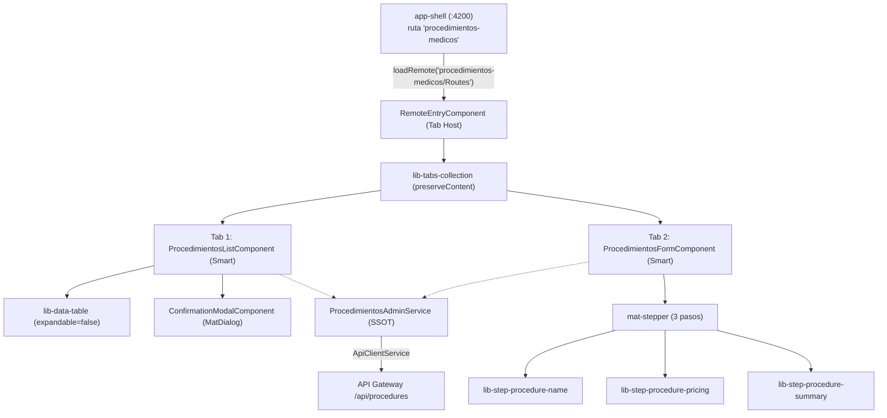

# Plan de Implementación Frontend: MFE `procedimientos-medicos`

> **Ficha Técnica**  
> * **Documento hermano:** [`evaluacion_y_plan_back_procedimientos_medicos.md`](./evaluacion_y_plan_back_procedimientos_medicos.md) · **Índice y evaluación:** [`evaluacion_y_plan_mfe_procedimientos_medicos.md`](./evaluacion_y_plan_mfe_procedimientos_medicos.md)  
> * **Módulos:** `apps/procedimientos-medicos` (nuevo Remote, `:4204` / static `:4214`), `app-shell` (raíz), `libs/shared/layouts`, `libs/shared/api-interfaces`  
> * **Tags Nx:** `["scope:frontend", "type:app"]`  
> * **Skills gobernantes:** `angular-ui-expert`, `angular-data-expert`, `md3-architecture`  
> * **Plantillas de referencia en el repo:** `apps/lista-profesionales` (estructura, `ProfesionalesAdminService`, list/form) y `libs/shared/layouts/.../ui-professional-steps`  
> * **Estado:** Propuesta pendiente de confirmación (Fase 2 del protocolo AGENTS.md)

---

## 1. Dependencia con el Backend

El front **no puede cerrar integración** hasta que existan `POST/PATCH/DELETE /api/procedures` y `GET ?includeInactive` (Fases B1-B5 del plan back). Se puede avanzar en **paralelo** desde F1 hasta F4 contra el contrato `@nx-boilerplate/api-interfaces` (Fase B1) mockeando `ApiClientService` en los specs.

---

## 2. Decisiones de Diseño (correcciones respecto al plan original)

| # | Decisión | Motivo |
|---|---|---|
| D1 | **Contrato con nombres reales:** `idProcedimiento`, `nombreProcedimiento`, `valorStandar`, `duracionStandar`, `laboratorios`, `isActive`, `medicosRelacionados`. Los `FormControl` usan **esos mismos nombres**. | Sin mapper; no rompe `agendador-citas`. Los textos visibles siguen en español natural. |
| D2 | **`tieneLaboratorio` es solo un control del formulario** (no viaja en el payload). Si está apagado → `laboratorios: []`. | Se deriva de `laboratorios.length > 0` en el backend. |
| D3 | **El host es `app-shell/` (raíz del repo), no `apps/app-shell`.** Ruta en `app-shell/src/app/app.routes.ts`, nav en `app-shell/src/app/app.ts`, manifest en `app-shell/public/module-federation.manifest.json`. | Verificado en el repo. |
| D4 | **No se añade `provideHttpClient` en `entry.routes.ts`.** Solo en `app.config.ts` del remote (modo standalone) con `loaderInterceptor`, igual que `lista-profesionales`. Las llamadas van por `ApiClientService`. | Cuando corre dentro del shell se usa el `HttpClient` del host; el único interceptor existente es `loaderInterceptor`. |
| D5 | **Reutilizar `ConfirmationModalComponent`** (`MAT_DIALOG_DATA` = `ConfirmationModalData`). No se crea modal nuevo. | Ya existe en `libs/shared/layouts`. |
| D6 | **La ruta del shell es `procedimientos-medicos`** y el ítem de nav apunta a `/procedimientos-medicos`. | Convención del remote. (Nota: `lista-profesionales` usa `/profesionales` con redirect; no replicar esa asimetría.) |
| D7 | **El front no es la única guardia.** Los 409 del backend (nombre duplicado, médicos vinculados) se muestran con el `message` de `IApiResponse`. | Defensa en profundidad. |
| D8 | **`ApiClientService` reintenta 1 vez en POST/PATCH/DELETE.** El servicio SSOT debe tolerar un 409 tras reintento (recargar lista y mostrar mensaje, sin tratarlo como fallo irrecuperable). | Ver `api-client.service.ts`. |

---

## 3. Arquitectura y Flujo



---

## 4. Reglas de Negocio (sin cambios funcionales respecto al plan original)

1. **Tabla plana de activos** (sin expandible ni switch activos/inactivos), con búsqueda, columnas *Nombre*, *Valor* (COP), *Duración* (`XX min`) y acciones Editar/Borrar. Botón **"Agregar nuevo"** en el slot `[table-header]`.
2. **Borrado protegido:** si `medicosRelacionados.length > 0` → modal de aviso (acción única *Entendido*, **sin HTTP**); si es `0` → modal de confirmación (*Cancelar* / *Eliminar* `warn`) y luego `DELETE` con Optimistic UI.
3. **Auto-recuperación de inactivos en el Paso 1:** al avanzar, buscar el nombre normalizado (sin tildes/mayúsculas) en el catálogo completo (`includeInactive=true`):
   * existe **activo** → error `duplicateName`, no avanza;
   * existe **inactivo** → `startRestoreInactive`, precarga valores/laboratorios, banner informativo, y en el Paso 3 se envía `PATCH { ...payload, isActive: true }`;
   * no existe → alta con `POST`.
4. **`.lunch-group` de laboratorios (Paso 2):** al activar el switch con el `FormArray` vacío se crea el primer grupo; cada card (`30%`, `min-width: 320px`, `100%` en móvil) lleva botón `close`; **si se cierran todos, el switch se apaga**; botón `+ Agregar laboratorio`. Al apagar el switch manualmente se limpia el `FormArray`.

---

## 5. Fases de Implementación

### Fase F1 — Contratos consumidos (sin trabajo propio)
Usar lo definido en la **Fase B1** del plan back (`IProcedure`, `IProcedureLaboratory`, `ICreateProcedureRequest`, `IUpdateProcedureRequest`, `IProcedureSoftDeleteResponse`). **No importar `@nx-boilerplate/shared-dtos`** en el front (viola `enforce-module-boundaries`).

---

### Fase F2 — Pasos Dumb en `libs/shared/layouts`
**Skill:** `angular-ui-expert` · **Ubicación:** `libs/shared/layouts/src/lib/forms/ui-procedure-steps/`  
Estándar: Standalone, `ChangeDetectionStrategy.OnPush`, `input()/output()`, `@if/@for`, tokens MD3, **sin lógica de negocio ni servicios**. Seguir la estructura de `ui-professional-steps`.

| Componente | Inputs | Outputs | Contenido |
|---|---|---|---|
| `lib-step-procedure-name` | `stepForm: FormGroup` (req.) | `nextStep` | `mat-form-field outline` para `nombreProcedimiento`; errores `required`, `minlength`, `maxlength`, `duplicateName` |
| `lib-step-procedure-pricing` | `stepForm`, `laboratoriosArray: FormArray<FormGroup>` | `addLaboratory`, `removeLaboratory(number)`, `prevStep`, `nextStep` | `valorStandar`, `duracionStandar`, `mat-slide-toggle` (`tieneLaboratorio`), grilla `.lunch-group` |
| `lib-step-procedure-summary` | `summaryData`, `isSaving`, `isEditMode`, `isRestoringInactive` | `prevStep`, `save` | Tarjeta de resumen + aviso de reactivación + botón *Guardar/Actualizar* |

Detalle de `.lunch-group`: header con botón `mat-icon-button` `close` (`aria-label="Eliminar laboratorio"`); `nombreLaboratorio` al 100%; fila inferior `display:flex; justify-content:space-between` con `precio` (40%) y `medidaPorUnidad` (40%). Estilos solo con tokens `--sys-color-*`, sin `!important` ni `::ng-deep`.

**Exportación:** añadir los 3 steps en `libs/shared/layouts/src/index.ts` (sección *Procedure Form Steps*, junto a *Professional Form Steps*).  
**Verificación:** `npx nx test layouts` (specs de cada step: errores visibles, emisión de outputs, `removeLaboratory(index)`).

---

### Fase F3 — Scaffolding del Remote e integración en el Shell
**Skill:** `angular-ui-expert` · Usar siempre `--no-interactive`.

1. **Generar el remote** con `@nx/angular:remote` (nombre sin guiones, p. ej. `procedimientosMedicos`, **igual que se hizo con `lista-profesionales`**, ver `docs/documentacion-front/lista-profesionales.md` §2.B) y **renombrar** a `procedimientos-medicos` en: `project.json` (`name`, rutas), `module-federation.config.ts`, alias de `tsconfig.base.json` y manifest del host.
2. **`project.json`:** `"tags": ["scope:frontend","type:app"]`; `serve` en `4204` (`publicHost` `http://localhost:4204`), `serve-static` en `4214`. El build del repo usa **webpack + Module Federation** (`webpack.config.ts`, `webpack.prod.config.ts`) y tests con **Vitest** (`vite.config.mts`, `tsconfig.spec.json`): copiar de `lista-profesionales`.
3. **`module-federation.config.ts`:** exponer `'./Routes': './src/app/remote-entry/entry.routes.ts'`.
4. **`app.config.ts`:** `provideZonelessChangeDetection()`, `provideRouter`, `provideHttpClient(withInterceptors([loaderInterceptor]))` (D4).
5. **`tsconfig.base.json`:** alias `"procedimientos-medicos/Routes": ["./apps/procedimientos-medicos/src/app/remote-entry/entry.routes.ts"]`.
6. **`app-shell/public/module-federation.manifest.json`:** `"procedimientos-medicos": "http://localhost:4204/mf-manifest.json"`.
7. **`app-shell/src/app/app.routes.ts`:**
   ```typescript
   {
     path: 'procedimientos-medicos',
     loadChildren: () =>
       loadRemote<typeof import('procedimientos-medicos/Routes')>(
         'procedimientos-medicos/Routes'
       ).then((m) => m!.remoteRoutes),
   },
   ```
8. **`app-shell/src/app/app.ts`:** añadir al arreglo de navegación (junto a `/profesionales`): `{ path: '/procedimientos-medicos', label: 'Procedimientos Médicos', icon: 'medical_services' }`.
9. Revisar si el shell/serve scripts (`package.json`, orquestación de `serve`) listan remotes a levantar y añadir el nuevo.

**Verificación:** `npx nx build procedimientos-medicos` · `npx nx build app-shell` · navegación al placeholder desde el sidenav.

---

### Fase F4 — Servicio SSOT `ProcedimientosAdminService`
**Skill:** `angular-data-expert` · **Archivo:** `apps/procedimientos-medicos/src/app/services/procedimientos-admin.service.ts`  
Plantilla: `ProfesionalesAdminService` (`providedIn: 'root'`, `inject(ApiClientService)`, signals privados `#` + `asReadonly()`, desempaquetar `response.data`).

**Modelo de navegación** (`models/procedimientos-nav.models.ts`):
```typescript
export const PROCEDIMIENTOS_TABS = { LIST: 1, FORM: 2 } as const;
export type ProcedimientosTabId = (typeof PROCEDIMIENTOS_TABS)[keyof typeof PROCEDIMIENTOS_TABS];
```

**Estado:**
* `#allProcedimientos: signal<IProcedure[]>`; `activeProcedimientos = computed(() => all.filter(p => p.isActive !== false))`
* `#isLoading`, `#error`, `#isSaving`, `#saveError` (separados lista vs guardado)
* `#activeTab`, `#editingProcedure`, `#isRestoringInactive`; `isEditMode = computed(() => editing !== null)`

**Métodos:**
| Método | Comportamiento |
|---|---|
| `loadProcedimientos()` | `GET /api/procedures` con `params: { includeInactive: 'true' }` |
| `findExistingByName(raw)` | Normaliza (`trim`, `toLowerCase`, `normalize('NFD')`, quita diacríticos) y busca en `#allProcedimientos` |
| `goToCreate / goToEdit(proc) / goToList / setActiveTab` | Al volver a `LIST` limpia `#editingProcedure`, `#isRestoringInactive`, `#saveError` |
| `startRestoreInactive(proc)` | `#editingProcedure.set(proc)`, `#isRestoringInactive.set(true)`, tab `FORM` |
| `createProcedimiento(payload)` | `POST /api/procedures` → recarga → `goToList` |
| `updateProcedimiento(id, payload)` | `PATCH /api/procedures/:idProcedimiento` (edición y reactivación con `isActive: true`) → recarga → `goToList` |
| `deleteProcedimiento(id)` | **Optimistic UI:** snapshot → marcar `isActive:false` → `DELETE`; en error restaura snapshot y expone `#error` con el `message` del gateway (p. ej. 409 por médicos vinculados) |

Manejo de errores: leer `HttpErrorResponse.error?.message` (formato `IApiResponse` del `RpcExceptionFilter`); en 409 tras reintento (D8) recargar el catálogo antes de informar.

**Verificación:** `procedimientos-admin.service.spec.ts` — búsqueda activo/inactivo/inexistente, alta, edición, reactivación, borrado optimista con rollback, separación de estados de carga/guardado.

---

### Fase F5 — Vistas Smart

#### 5.1 `ProcedimientosListComponent` (`components/procedimientos-list/`)
* `<lib-data-table>`: `[expandable]="false"`, `[searchable]="true"` (placeholder *"Buscar procedimiento por nombre..."*), datos = `activeProcedimientos()`, acciones `edit`/`delete`. Replicar la forma de columnas/acciones de `profesionales-list` (verificar nombres de props en `data-table.models.ts`; **no modificar `lib-data-table`**).
* Formateadores: `valorStandar` → COP (`$ 150.000`); `duracionStandar` → `"XX min"`.
* `onDelete(row)` con `MatDialog` + `ConfirmationModalComponent`:
  ```typescript
  const linked = row.medicosRelacionados?.length ?? 0;
  const data: ConfirmationModalData<boolean> = linked > 0
    ? { title: 'No es posible eliminar',
        text: `El procedimiento está asignado a ${linked} profesional(es). Desvincúlelo primero desde Profesionales.`,
        actions: [{ label: 'Entendido', color: 'primary', value: false }] }
    : { title: '¿Eliminar procedimiento?',
        text: 'Se desactivará el procedimiento.',
        actions: [{ label: 'Cancelar', color: 'default', value: false },
                  { label: 'Eliminar', color: 'warn', icon: 'delete', value: true }] };
  ```
  Solo si `linked === 0` y el resultado es `true` → `deleteProcedimiento(row.idProcedimiento)`.

#### 5.2 `ProcedimientosFormComponent` (`components/procedimientos-form/`)
* `NonNullableFormBuilder`; grupos `step1 { nombreProcedimiento }`, `step2 { valorStandar, duracionStandar, tieneLaboratorio, laboratorios: FormArray }`. Validadores: nombre `required/minLength(3)/maxLength(100)`; valor `required/min(0)`; duración `required/min(5)/max(480)`; laboratorio `required` + `min(0)` en precio.
* `viewChild(MatStepper)` para avanzar (`stepper()?.next()`).
* `onStep1Next()` aplica la regla 3 (sección 4); si se entró por **Editar** no revalida duplicado contra sí mismo.
* Suscripción `takeUntilDestroyed()` a `tieneLaboratorio.valueChanges`: `true` + array vacío → `onAddLaboratory()`; `false` → `laboratorios.clear()`.
* `onRemoveLaboratory(i)`: `removeAt(i)`; si queda vacío → `tieneLaboratorio.setValue(false)`.
* `onSubmit()`: arma payload (`laboratorios: []` si el switch está apagado); `isEditMode()` → `updateProcedimiento(id, { ...payload, isActive: true })` cuando es reactivación, o sin `isActive` en edición normal; si no → `createProcedimiento(payload)`.
* Al entrar en modo edición, `patchValue` con los datos y reconstrucción del `FormArray`.

**Verificación:** specs de lista (bloqueo sin HTTP vs. confirmación) y formulario (duplicado activo, auto-recuperación con `PATCH isActive:true`, auto-apagado del switch).

---

### Fase F6 — Tab Host y Verificación Integral
* `RemoteEntryComponent` aloja `<lib-tabs-collection [preserveContent]="true">`, con `viewChild` de dos `ng-template` y `tabs = computed<TabItem[]>(...)` (seguir `agendador-citas`/`lista-profesionales`; filtrar `typeof id === 'number'` en `activeTabId`).
* Tab 1 *"Lista de Procedimientos"* (`list_alt`); Tab 2 dinámica *"Agregar/Editar Procedimiento"* (`add_circle` / `edit_note`).
* Cargar el catálogo con `loadProcedimientos()` al iniciar (en el host, no en constructor de las vistas).
* Contenedor/pane con las clases del patrón actual (`.tab-pane-wrapper`), tokens MD3.

**Verificación final:**
```bash
npx nx test layouts
npx nx test procedimientos-medicos
npx nx lint procedimientos-medicos
npx nx run-many -t build -p app-shell agendador-citas lista-profesionales procedimientos-medicos
```
Prueba manual E2E (con backend levantado): alta → edición → intento de baja con médicos vinculados (bloqueo) → baja libre → alta con nombre inactivo (auto-recuperación).

---

## 6. Archivos a Crear / Modificar

```text
libs/shared/layouts/src/lib/forms/ui-procedure-steps/
  ├── step-procedure-name/
  ├── step-procedure-pricing/
  └── step-procedure-summary/
libs/shared/layouts/src/index.ts                     # + 3 exports

apps/procedimientos-medicos/                          # NUEVO (tags, puertos 4204/4214, webpack MF, vitest)
  └── src/app/
      ├── app.config.ts · app.routes.ts
      ├── models/procedimientos-nav.models.ts
      ├── services/procedimientos-admin.service.ts
      ├── components/procedimientos-list/
      ├── components/procedimientos-form/
      └── remote-entry/ (entry.routes.ts, remote-entry.component.*)

app-shell/public/module-federation.manifest.json      # + remote 4204
app-shell/src/app/app.routes.ts                       # + ruta 'procedimientos-medicos'
app-shell/src/app/app.ts                              # + ítem de navegación
tsconfig.base.json                                    # + alias procedimientos-medicos/Routes
```

## 7. Riesgos
* **Orden:** sin B5 el guardado devuelve 404; coordinar con el plan back.
* **Retry de `ApiClientService`** en mutaciones (D8).
* **Nombres de props de `lib-data-table`:** confirmar antes de codificar para no modificar la lib.
* **Documentación:** al cerrar, ejecutar `documentar procedimientos-medicos` (`docs/documentacion-front/procedimientos-medicos.md`).
