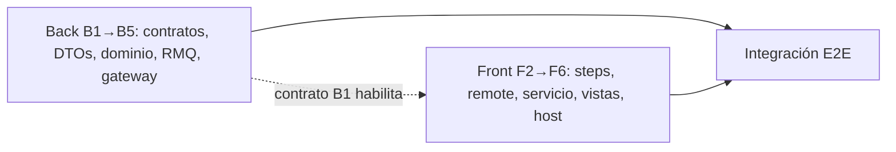

# Evaluación Técnica del MFE `procedimientos-medicos` (Viabilidad, Brechas y Mejoras)

> **Ficha Técnica**  
> * **Documento base evaluado:** [`plan_de_implementaci_n_frontend_mfe_procedimientos_m_dicos.md`](./plan_de_implementaci_n_frontend_mfe_procedimientos_m_dicos.md)  
> * **Planes de ejecución (granulares):**  
>   * Backend → [`evaluacion_y_plan_back_procedimientos_medicos.md`](./evaluacion_y_plan_back_procedimientos_medicos.md)  
>   * Frontend → [`evaluacion_y_plan_front_procedimientos_medicos.md`](./evaluacion_y_plan_front_procedimientos_medicos.md)  
> * **Versión:** 2.0 (corregida tras revisión arquitectónica contra el repositorio)  
> * **Estado:** Evaluación aprobada con correcciones aplicadas; planes pendientes de confirmación (Fase 2 AGENTS.md)

---

## 1. Viabilidad: **Condicionada (factible si el Backend se implementa primero)**

| Dimensión | Evaluación | Justificación |
|---|:---:|---|
| Arquitectura Frontend | Alta | Angular 21 zoneless, Signals, Module Federation dinámico, `lib-tabs-collection`, `lib-data-table`, `ConfirmationModalComponent` ya existen y están en uso. |
| Integración en el Host | Alta | `app-shell/` (raíz) descubre remotes por `module-federation.manifest.json`. |
| Backend actual | **Bloqueante** | `procedures-service` y el gateway son **solo lectura**; no hay `create/update/soft-delete`. |
| Persistencia | Media | `Procedure` no tiene `isActive` ni `laboratorios`. |
| Integridad referencial | Alta | `medicosRelacionados` y `addDoctorToProcedures` ya existen; la baja puede ser atómica con `$size: 0`. |

---

## 2. Activos Existentes

**Frontend:** `TabsCollectionComponent`, `DataTableComponent`, `ConfirmationModalComponent` + `ConfirmationModalData`, `ApiClientService`, `loaderInterceptor`, `@nx-boilerplate/theme`, patrón completo en `apps/lista-profesionales` (servicio SSOT, list/form, steps en `ui-professional-steps`).  
**Backend:** `procedures-service` (RMQ `procedures_queue`, `ValidationPipe` global), `procedures-domain` (schema, repositorio, servicio, seeder), `ProceduresController` del gateway, `RpcExceptionFilter` (mapea `code` → HTTP).

## 3. Componentes y Servicios Faltantes

| Capa | Faltante |
|---|---|
| Contratos | `IProcedureLaboratory`, `ICreateProcedureRequest`, `IUpdateProcedureRequest`, `IProcedureSoftDeleteResponse`, extensión de `IProcedure` |
| DTOs | `CreateProcedureDto`, `UpdateProcedureDto`, `ProcedureLaboratoryDto`, `UpdateProcedureMessageDto`, `GetProceduresMessageDto`, `includeInactive` en query |
| Dominio | Schema (`isActive`, `laboratorios`), repositorio (create/update/nombre/baja atómica), servicio (reglas 404/409, correlativo) |
| Transporte | `procedures.create`, `procedures.update`, `procedures.soft-delete`, `get-all` con payload |
| Gateway | `POST`, `PATCH /:id`, `DELETE /:id`, `GET ?includeInactive` |
| Layouts | 3 steps Dumb de procedimiento |
| MFE | Remote `procedimientos-medicos`, servicio SSOT, vistas list/form, tab host |
| Shell | Manifest, ruta lazy, ítem de navegación, alias `tsconfig.base.json` |

---

## 4. Espacios de Mejora (propuesta original vs. repositorio)

> [!IMPORTANT]
> Estos hallazgos se resolvieron en los dos planes granulares.

| # | Hallazgo | Impacto | Resolución |
|---|---|---|---|
| 1 | **Nombres de campos:** el plan original usa `id`, `nombre`, `valor`, `duracionMinutos`; el repo usa `idProcedimiento`, `nombreProcedimiento`, `valorStandar`, `duracionStandar`. | Rompe seeder, `agendador-citas` y datos. | Se conservan los nombres reales (Back D1 / Front D1). |
| 2 | **Alcance solo Front**, asumiendo endpoints inexistentes. | 404 en guardado/borrado. | Plan Back previo y separado. |
| 3 | **Modal nuevo** en lugar de reutilizar. | Duplicidad. | `ConfirmationModalComponent` (Front D5). |
| 4 | **Guardia de borrado solo en UI.** | Inconsistencia vía HTTP directo / condición de carrera. | Baja atómica `$size: 0` + 409 en backend (Back D5). |
| 5 | **`provideHttpClient` en `entry.routes.ts`.** | Redundante: el remote ya lo provee en `app.config.ts` y dentro del shell usa el `HttpClient` del host. *(Corrección: la justificación anterior sobre interceptores de auth era incorrecta; el único interceptor es `loaderInterceptor`.)* | Seguir el patrón de `lista-profesionales` (Front D4). |
| 6 | **Rutas de `app-shell` incorrectas** (`apps/app-shell`). | Cambios en archivos inexistentes. | El host está en `app-shell/` (Front D3). |
| 7 | **Payloads RMQ tipados como literales** (sin validación). | Incumple AGENTS.md §4.B. | `UpdateProcedureMessageDto` con `@ValidateNested` (Back D4). |
| 8 | **Retry de `ApiClientService` en mutaciones.** | Reenvío de POST ante timeout. | Unicidad de nombre/ID en backend + manejo de 409 en el SSOT (Back D6-D7, Front D8). |
| 9 | **Correlativo `PROC-EST-XXX` sin concurrencia.** | IDs duplicados. | Contador atómico `findByIdAndUpdate` + `$inc`, inicializado con `$max` de los IDs sembrados (Back D7). |
| 10 | **Duplicado de nombre solo en front.** | Altas duplicadas. | Collation `es` `strength:1` en backend (Back D6). |
| 11 | **`tieneLaboratorio` persistido** (doble fuente de verdad). | Inconsistencias. | Se deriva de `laboratorios.length` (Back D2 / Front D2). |
| 12 | **Documentos sin `isActive`** no cubiertos por `default: true`. | Procedimientos "desaparecen". | Filtro `{ $ne: false }` en todas las consultas (Back D3). |
| 13 | **Faltaban tags, alias y puertos** del nuevo remote. | `enforce-module-boundaries`/MF rotos. | Incluidos en Front F3 (`4204` / `4214`, tags, alias, manifest). |

---

## 5. Orden de Ejecución Recomendado

1. **B1** (contratos) desbloquea ambos frentes.
2. **B2→B5** y **F2→F6** pueden avanzar en paralelo; el Front se prueba con `ApiClientService` mockeado hasta tener B5.
3. Integración y prueba E2E manual al final.
4. Documentar con `documentar procedures-service`, `documentar procedures-domain` y `documentar procedimientos-medicos`.

## 6. Veredicto

**Aprobado a nivel arquitectónico**, con los 13 puntos anteriores incorporados en los planes granulares. Aplicabilidad al monorepo actual: **alta**, porque cada pieza nueva sigue un patrón ya presente en el repo (`lista-profesionales`, `ui-professional-steps`, `doctors.*` en RMQ y gateway).
