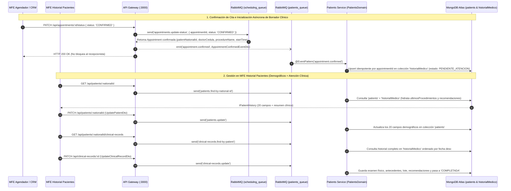

# Análisis Arquitectónico y Planificación por Fases del Backend — MFE Historial Pacientes (Historias Clínicas)

> **Documento de Arquitectura y Planificación Backend**  
> * **Módulos Involucrados:** `libs/shared/api-interfaces`, `libs/shared/dtos`, `libs/backend/patients-domain`, `services/patients-service`, `services/api-gateway`  
> * **Documentos Base Analizados:** `docs/analisis-de-MFE-historias-clinicas.md`, `docs/contrato-historial-medico.ts`, `docs/analisis-version-1-angendadorCitas.md`, `docs/json-pacientes.json`  
> * **Normativa de Referencia:** Resolución 1995 de 1999 (Ministerio de Salud de Colombia)  

---

## 1. Evaluación Honesta y Profunda de la Planificación Inicial

Tras contrastar la propuesta de [`docs/analisis-de-MFE-historias-clinicas.md`](file:///Users/usuario/Desktop/nx-boilerplate/docs/analisis-de-MFE-historias-clinicas.md) y el contrato [`docs/contrato-historial-medico.ts`](file:///Users/usuario/Desktop/nx-boilerplate/docs/contrato-historial-medico.ts) contra el código real del monorepo Nx, a continuación se presenta un diagnóstico técnico directo:

### 1.1 Grandes Aciertos de tu Planificación
1. **No crear registros clínicos durante el agendamiento (`TENTATIVE`):** Es una decisión arquitectónica **100% acertada**. En el flujo actual (`BookingService.bookAppointment`), una cita recién reservada es solo una intención de asistencia. Crear un documento en `historialMedico` en ese punto llenaría la base de datos de registros clínicos vacíos ante cancelaciones o inasistencias, además de contradecir la Resolución 1995 de 1999 (un registro clínico documenta un acto asistencial efectivo).
2. **Inicialización asíncrona al confirmar la cita (`CONFIRMED`):** Utilizar mensajería por eventos (`@EventPattern('appointment.confirmed')`) en RabbitMQ para pre-crear el registro clínico en modo borrador cuando la cita se confirma desacopla la operación de recepción de la operación médica.
3. **Separación de responsabilidades entre Citas (`appointments`) e Historia Clínica (`historialMedico`):** Mantener en `appointments` la gestión del tiempo/Google Calendar y en `historialMedico` los antecedentes, examen físico, lote de insumos y consentimientos informados evita convertir la colección de citas en un documento monolítico inmanejable.

---

### 1.2 Oportunidades de Mejora Detectadas y su Impacto en la Planificación

Al aterrizar la propuesta a la topología real del monorepo (`@nx-boilerplate/source`), existen **6 oportunidades de mejora críticas** que optimizan tiempos de desarrollo, evitan errores de compilación y cubren vacíos funcionales indispensables para el nuevo MFE:

#### Mejora 1: Reutilizar `patients-service` (`patients_queue`) en lugar de crear un 4to microservicio ejecutable (`clinical-service`)
* **Propuesta original:** Crear un nuevo microservicio ejecutable `ClinicalService` desde cero con una nueva cola RabbitMQ.
* **Por qué mejorarla:**
  * En nuestro monorepo, `procedures-service` ya demuestra el patrón de agrupar cohesivamente dos agregados afines (`Procedures` y `Doctors`) bajo una misma cola (`procedures_queue`).
  * Actualmente, `services/patients-service` es un microservicio ultra-delgado que **solo tiene 2 endpoints** (`find-by-national-id` y `create`).
  * El nuevo MFE **Historial Pacientes** gira en torno al paciente: requiere ver/editar su ficha demográfica (los 20 campos de `json-pacientes.json`) y consultar/diligenciar sus historias clínicas (`historialMedico`).
  * Levantar un 4to proceso Node.js independiente añadiría sobrecarga operativa (otro puerto de debug, otra conexión al pool de MongoDB Atlas, otra cola en `.env` y `ClientsModule`) sin beneficio real de escalado en esta etapa.
* **Impacto en la planificación:** Se elimina la sobrecarga de infraestructura de un 4to ejecutable. Toda la lógica de `historialMedico` se integra limpiamente en `libs/backend/patients-domain` y se expone a través de `services/patients-service` (`patients_queue`).

#### Mejora 2: Punto exacto de emisión del evento `appointment.confirmed`
* **Propuesta original:** Menciona emitir el evento desde `AppointmentConfirmationController` y escucharlo en el servicio clínico.
* **Por qué mejorarla:**
  * En nuestra arquitectura, `AppointmentConfirmationController` vive en `services/api-gateway` y se comunica con `scheduling-service` mediante `this.schedulingClient.send('appointments.update-status', ...)`.
  * Cuando `scheduling-service` procesa `updateAppointmentStatus(id, 'CONFIRMED')`, retorna el documento `Appointment` completo actualizado (que ya contiene `appointmentId`, `patientNationalId`, `doctorCedula`, `procedureId`, `procedureName` y `startTime`).
  * Si el `AppointmentConfirmationController` en el API Gateway espera la confirmación exitosa de `scheduling-service` y, acto seguido (solo si `status === 'CONFIRMED'`), emite `this.patientsClient.emit('appointment.confirmed', eventPayload)` hacia `patients_queue`:
    1. Garantizamos que el borrador clínico **solo** se cree si la cita realmente se confirmó en MongoDB y Google Calendar.
    2. Evitamos acoplar `scheduling-service` con `patients_queue` (los microservicios no necesitan inyectar `ClientProxy` de otros microservicios; el API Gateway mantiene la orquestación de transporte).
* **Impacto en la planificación:** Se incluye un paso específico en la Fase 3 para conectar `AppointmentConfirmationController` con `PATIENTS_SERVICE` al confirmar una cita.

#### Mejora 3: Hidratación transparente de `ultimosProcedimientos` y `recomendaciones` en el Paso 2 del Agendador
* **Propuesta original:** Crear un endpoint nuevo `GET /api/patients/:cedula/last-visit` para el Paso 2 del agendador.
* **Por qué mejorarla:**
  * El MFE `agendador-citas` ya hace `GET /api/patients/:nationalId` en el Paso 1 y el componente `StepPersonalInfoComponent` ya está programado para renderizar automáticamente `patient.recomendaciones` y `patient.ultimosProcedimientos` si vienen en el objeto `IPatientHistory`.
  * Si en `PatientsDomainService.findByNationalId()` consultamos al paciente en la colección `patients` y, en paralelo (`Promise.all`), consultamos sus últimos registros en `historialMedico` para poblar al vuelo `ultimosProcedimientos` y `recomendaciones`, **el agendador actual mostrará el historial real sin tocar una sola línea de código en el frontend de `agendador-citas`**.
* **Impacto en la planificación:** No hace falta modificar el frontend del agendador ni crear llamadas HTTP extra en el Paso 2; la enriquecemos directamente en el caso de uso de consulta de paciente.

#### Mejora 4: Idempotencia (`appointmentId`) y Estado del Registro (`estado_registro`) en `ICitaMedica`
* **Propuesta original (`contrato-historial-medico.ts`):** Define `ICitaMedica` con `cedula_paciente`, `medico_tratante`, `registro_clinico` y `soporte_documental`, pero no incluye el identificador de la cita origen ni el estado del documento clínico.
* **Por qué mejorarla:**
  1. **Prevención de duplicados (Idempotencia):** Si por un reintento de red o doble clic se emite dos veces `appointment.confirmed` para la misma cita `APT-123`, sin un campo `appointmentId` indexado en `historialMedico`, se crearían dos historias clínicas en blanco para la misma cita.
  2. **Ciclo de vida del documento clínico:** Cuando el evento crea el borrador, los campos (`examen_fisico`, `enfermedad_actual`, `lote_producto`) están vacíos. El MFE **Historial Pacientes** necesita distinguir entre una **"Atención Pendiente por Diligenciar"** (`'BORRADOR'` / `'PENDIENTE_ATENCION'`) y una **"Historia Clínica Cerrada"** (`'COMPLETADA'`), la cual por la Resolución 1995 no debe ser modificada arbitrariamente una vez cerrada.
* **Impacto en la planificación:** En la Fase 1 se agregan `appointmentId?: string`, `procedimiento_id?: string`, `procedimiento_nombre?: string` y `estado_registro: 'PENDIENTE_ATENCION' | 'COMPLETADA'` al contrato `ICitaMedica`.

#### Mejora 5: Endpoints faltantes para que el MFE "Historial Pacientes" sea 100% funcional
* **Propuesta original:** Solo contempla el evento `appointment.confirmed` y la lectura de la última visita.
* **Por qué mejorarla:**
  * Recordemos que durante el agendamiento rápido (Paso 2), el paciente se crea con solo 5 datos básicos y **15 campos demográficos en `null`** (`fecha_nacimiento`, `edad`, `sexo`, `estado_civil`, `ocupacion`, `direccion_residencia`, `aseguradora`, `tipo_vinculacion`, `acompanante`, `persona_responsable`).
  * El MFE **Historial Pacientes** necesitará:
    1. **Listar/Buscar pacientes (`GET /api/patients`):** Para el directorio general de pacientes.
    2. **Actualizar datos demográficos del paciente (`PATCH /api/patients/:nationalId`):** Para completar o editar los 20 campos de `json-pacientes.json`.
    3. **Consultar todas las historias clínicas de un paciente (`GET /api/patients/:nationalId/clinical-records`):** Para ver su línea de tiempo clínica y atenciones pendientes.
    4. **Crear o diligenciar/cerrar una historia clínica (`POST /api/clinical-records` y `PATCH /api/clinical-records/:id`):** Para que el médico guarde el examen físico, antecedentes, lote de producto, recomendaciones y soporte documental.
* **Impacto en la planificación:** Se estructuran estos endpoints completos dentro de las Fases 2 y 3.

#### Mejora 6: Cumplimiento de Guardrails de TypeScript Estricto y `ValidationPipe`
* **Propuesta original:** En el ejemplo de código de `analisis-de-MFE-historias-clinicas.md`, las propiedades del DTO carecen del operador `!` (`definite assignment assertion`) y se instancia un `new ValidationPipe()` local sin `forbidNonWhitelisted: true`.
* **Por qué mejorarla:** En nuestro monorepo, `tsconfig.base.json` exige inicialización estricta (`!:`) y todos los microservicios ya configuran el `ValidationPipe` global en `main.ts` con `{ whitelist: true, forbidNonWhitelisted: true, transform: true }`.
* **Impacto en la planificación:** Todos los DTOs de la Fase 1 seguirán el estándar exacto de `@nx-boilerplate/shared-dtos`.

---

## 2. Arquitectura Objetivo del Backend para Historial de Pacientes



---

## 3. Planificación de Implementación por Fases (Backend)

Siguiendo el orden estricto de capas definido en `AGENTS.md`:

---

### Fase 1: Contratos Compartidos (`@nx-boilerplate/api-interfaces`) y Guardia de Datos (`@nx-boilerplate/shared-dtos`)

**Objetivo:** Formalizar los contratos TypeScript de la Historia Clínica (Resolución 1995 de 1999) y las interfaces/DTOs de actualización demográfica y clínica.

#### 1.1 Archivos a crear/modificar en `libs/shared/api-interfaces`:
* **`libs/shared/api-interfaces/src/lib/clinical-record.interface.ts` (Nuevo):**
  * Migrar y enriquecer las interfaces de `docs/contrato-historial-medico.ts`:
    * `IMedicoTratante`: `{ cedula_profesional: string; nombre_profesional?: string; fecha_atencion: string | Date }`
    * `IAntecedentesMedicos`: `{ patologicos: string; alergicos: string; farmacologicos: string; procedimientos_previos: string }`
    * `IRegistroClinico`: `{ motivo_consulta: string; enfermedad_actual: string; antecedentes_medicos: IAntecedentesMedicos; examen_fisico: string; ultimosProcedimientos?: string[]; procedimiento_realizado: string; lote_producto: string | null; recomendaciones: string }`
    * `ISoporteDocumental`: `{ consentimiento_informado: boolean; descargable_consentimiento: string }`
    * `ClinicalRecordStatus`: `'PENDIENTE_ATENCION' | 'COMPLETADA'`
    * `ICitaMedica` (alias `IClinicalRecord`):
      * `_id?: string`
      * `appointmentId?: string | null` (clave de idempotencia con la cita agendada)
      * `cedula_paciente: string`
      * `estado_registro: ClinicalRecordStatus`
      * `medico_tratante: IMedicoTratante[]`
      * `registro_clinico: IRegistroClinico`
      * `soporte_documental: ISoporteDocumental`
      * `createdAt?: string | Date | { $date: string }`
      * `updatedAt?: string | Date | { $date: string }`
    * `IAppointmentConfirmedEvent`: `{ appointmentId: string; patientNationalId: string; doctorCedula: string; doctorEmail?: string; procedureId: string; procedureName: string; appointmentDate: string }`
    * `ICreateClinicalRecordRequest` e `IUpdateClinicalRecordRequest`.
* **`libs/shared/api-interfaces/src/lib/patient.interface.ts` (Actualización):**
  * Agregar `IUpdatePatientRequest` (`Partial<Omit<ICreatePatientRequest, 'cedula'>>`) para permitir la actualización de los datos demográficos del paciente en el nuevo MFE.
* **Exportar en `libs/shared/api-interfaces/src/lib/index.ts`.**

#### 1.2 Archivos a crear/modificar en `libs/shared/dtos`:
* **`libs/shared/dtos/src/lib/update-patient.dto.ts` (Nuevo):**
  * `UpdatePatientDto`: Permite actualizar cualquiera de los campos demográficos (`tipo_documento`, `nombre`, `apellidos`, `correo`, `celular`, `fecha_nacimiento`, `edad`, `sexo`, `estado_civil`, `ocupacion`, `direccion_residencia`, `aseguradora`, `tipo_vinculacion`, `es_menor_de_edad`, `acompanante`, `persona_responsable`) con validadores estrictos de `class-validator`.
  * `UpdatePatientMessageDto`: `{ nationalId: string; data: UpdatePatientDto }` para el transporte RabbitMQ.
* **`libs/shared/dtos/src/lib/clinical-record.dto.ts` (Nuevo):**
  * `AppointmentConfirmedEventDto`: Valida el payload del evento asíncrono `'appointment.confirmed'`.
  * `MedicoTratanteDto`, `AntecedentesMedicosDto`, `RegistroClinicoDto`, `SoporteDocumentalDto`.
  * `CreateClinicalRecordDto`: Para crear una atención clínica directa o manual.
  * `UpdateClinicalRecordDto` y `UpdateClinicalRecordMessageDto`: Para que el médico diligencie el borrador creado al confirmar la cita y cambie su `estado_registro` a `'COMPLETADA'`.
* **Exportar en `libs/shared/dtos/src/lib/index.ts`.**

---

### Fase 2: Capa de Dominio y Persistencia MongoDB (`libs/backend/patients-domain`)

**Objetivo:** Implementar el esquema Mongoose de la colección `historialMedico`, su repositorio, y los casos de uso tanto para completar la ficha del paciente como para gestionar sus historias clínicas.

#### 2.1 Esquema Mongoose (`libs/backend/patients-domain/src/lib/schemas/clinical-record.schema.ts`):
* Decorado con `@Schema({ collection: 'historialMedico', timestamps: true })`.
* Índices configurados:
  * `cedula_paciente`: Indexado (`index: true`) para búsquedas rápidas de historial por paciente.
  * `appointmentId`: Índice único parcial/sparse (`{ unique: true, sparse: true }`) para garantizar **idempotencia absoluta**: nunca se crearán dos borradores para el mismo `appointmentId`, pero permite atenciones creadas manualmente sin cita previa (`appointmentId: null`).
* Sub-esquemas (`_id: false`): `MedicoTratanteSchema`, `AntecedentesMedicosSchema`, `RegistroClinicoSchema`, `SoporteDocumentalSchema`.

#### 2.2 Repositorios (`libs/backend/patients-domain/src/lib/repositories/`):
1. **Ampliación de `PatientsRepository` (`patients.repository.ts`):**
   * `findAll()`: Lista todos los pacientes ordenados por fecha de creación o apellido (para la tabla principal del MFE Historial Pacientes).
   * `updateByCedula(cedula: string, data: IUpdatePatientRequest)`: Actualiza los campos demográficos del paciente en la colección `patients` usando `findOneAndUpdate({ cedula }, { $set: data }, { new: true })`.
2. **Nuevo `ClinicalRecordsRepository` (`clinical-records.repository.ts`):**
   * `createDraftFromAppointment(event: IAppointmentConfirmedEvent)`: Usa `findOneAndUpdate({ appointmentId: event.appointmentId }, { $setOnInsert: draftData }, { upsert: true, new: true })`. Garantiza idempotencia atómica en MongoDB.
   * `findByPatientCedula(cedula_paciente: string)`: Retorna todas las atenciones del paciente en `historialMedico` ordenadas de la más reciente a la más antigua (`sort({ createdAt: -1 })`).
   * `findById(id: string)`: Busca una atención clínica específica por `_id` o `appointmentId`.
   * `create(data: ICreateClinicalRecordRequest)`: Crea un nuevo registro clínico.
   * `update(id: string, data: IUpdateClinicalRecordRequest)`: Actualiza el registro clínico (examen físico, antecedentes, lote, soporte documental, `estado_registro: 'COMPLETADA'`).

#### 2.3 Servicios de Dominio (`libs/backend/patients-domain/src/lib/services/`):
1. **Evolución de `PatientsDomainService`:**
   * Agregar `findAllPatients()` y `updatePatient(nationalId, data)`.
   * Enriquecer `findByNationalId(nationalId)`: Consulta en paralelo (`Promise.all`) el documento en `patients` y los registros en `historialMedico`. Si el paciente tiene atenciones previas en `historialMedico`, mapea automáticamente los últimos procedimientos y la última recomendación al contrato `IPatientHistory` para que el Paso 2 del Agendador de Citas los muestre sin cambios adicionales.
2. **Nuevo `ClinicalRecordsDomainService`:**
   * `initializeDraftFromConfirmedAppointment(event: IAppointmentConfirmedEvent)`
   * `getPatientClinicalHistory(cedula: string)`
   * `getClinicalRecordById(id: string)`
   * `createClinicalRecord(data: ICreateClinicalRecordRequest)`
   * `updateClinicalRecord(id: string, data: IUpdateClinicalRecordRequest)` (valida existencia con `RpcException` 404).

---

### Fase 3: Transporte RabbitMQ (`services/patients-service`) y Orquestación en `services/api-gateway`

**Objetivo:** Exponer los patrones de mensajería en `patients_queue`, conectar el disparo del evento `appointment.confirmed` al confirmar una cita y habilitar los endpoints REST en el API Gateway.

#### 3.1 Microservicio `services/patients-service`:
* **Ampliar `PatientsMessageController` (`patients-message.controller.ts`):**
  * `@MessagePattern('patients.find-all')` → `findAllPatients()`
  * `@MessagePattern('patients.find-by-national-id')` → `findByNationalId()` (ahora enriquecido con resumen de `historialMedico`)
  * `@MessagePattern('patients.create')` → `createPatient()`
  * `@MessagePattern('patients.update')` → `updatePatient()`
* **Crear `ClinicalRecordsMessageController` (`clinical-records-message.controller.ts`):**
  * `@EventPattern('appointment.confirmed')` → `handleAppointmentConfirmed(@Payload() payload: AppointmentConfirmedEventDto)`
  * `@MessagePattern('clinical-records.find-by-patient')` → `findByPatient(@Payload() payload: FindPatientByNationalIdDto)`
  * `@MessagePattern('clinical-records.find-by-id')` → `findById(@Payload() payload: { id: string })`
  * `@MessagePattern('clinical-records.create')` → `create(@Payload() payload: CreateClinicalRecordDto)`
  * `@MessagePattern('clinical-records.update')` → `update(@Payload() payload: UpdateClinicalRecordMessageDto)`

#### 3.2 Orquestación y Endpoints HTTP en `services/api-gateway`:
1. **Emisión del Evento en `AppointmentConfirmationController` (`appointment-confirmation.controller.ts`):**
   * Inyectar `@Inject('PATIENTS_SERVICE') private readonly patientsClient: ClientProxy`.
   * En `@Patch(':id/status')`, cuando `status === 'CONFIRMED'` y `scheduling-service` responde con la cita confirmada:
     ```typescript
     if (body.status === 'CONFIRMED' && updatedAppointment) {
       this.patientsClient.emit('appointment.confirmed', {
         appointmentId: updatedAppointment.appointmentId,
         patientNationalId: updatedAppointment.patientNationalId,
         doctorCedula: updatedAppointment.doctorCedula,
         doctorEmail: updatedAppointment.doctorEmail,
         procedureId: updatedAppointment.procedureId,
         procedureName: updatedAppointment.procedureName,
         appointmentDate: new Date(updatedAppointment.startTime).toISOString(),
       });
     }
     ```
2. **Ampliación de `PatientsController` (`/api/patients`):**
   * `GET /api/patients` → Lista todos los pacientes (`patients.find-all`).
   * `GET /api/patients/:nationalId` → Obtiene los 20 campos del paciente + resumen de últimas atenciones (`patients.find-by-national-id`).
   * `POST /api/patients` → Crea paciente (`patients.create`).
   * `PATCH /api/patients/:nationalId` → Actualiza los 20 campos demográficos del paciente (`patients.update`).
   * `GET /api/patients/:nationalId/clinical-records` → Lista todas las historias clínicas (`ICitaMedica[]`) de ese paciente (`clinical-records.find-by-patient`).
3. **Nuevo `ClinicalRecordsController` (`/api/clinical-records`):**
   * `GET /api/clinical-records/:id` → Obtiene el detalle de una atención/historia clínica específica (`clinical-records.find-by-id`).
   * `POST /api/clinical-records` → Crea una historia clínica manualmente (`clinical-records.create`).
   * `PATCH /api/clinical-records/:id` → Diligencia y cierra un borrador clínico o actualiza una atención (`clinical-records.update`).

---

### Fase 4: Pruebas Unitarias, Seeder de Prueba y Verificación Integral

**Objetivo:** Garantizar calidad, cero regresiones y datos iniciales listos para cuando se construya el MFE Historial Pacientes.

1. **Pruebas Unitarias (Vitest):**
   * `clinical-records-domain.service.spec.ts`: Prueba de creación idempotente de borrador por evento, consulta por cédula, actualización de registro clínico y manejo de `RpcException` (404).
   * `patients-domain.service.spec.ts`: Prueba de actualización demográfica (`updatePatient`) y enriquecimiento de `ultimosProcedimientos` / `recomendaciones`.
   * `clinical-records-message.controller.spec.ts`: Prueba de `@EventPattern('appointment.confirmed')` y `@MessagePattern('clinical-records.*')`.
2. **Compilación y Validación de Límites Nx:**
   * Verificación con `tsc --noEmit` en `libs/shared/api-interfaces`, `libs/shared/dtos`, `libs/backend/patients-domain`, `services/patients-service` y `services/api-gateway`.

---

## 4. Resumen de Endpoints que Quedarán Listos para el Frontend

| Método HTTP | Endpoint en API Gateway | Patrón RabbitMQ (`patients_queue`) | Uso en Frontend |
|---|---|---|---|
| `GET` | `/api/patients` | `patients.find-all` | Tabla/Buscador general en MFE **Historial Pacientes** |
| `GET` | `/api/patients/:nationalId` | `patients.find-by-national-id` | Paso 1/2 en **Agendador** y cabecera en **Historial Pacientes** |
| `POST` | `/api/patients` | `patients.create` | Registro rápido (Paso 2 **Agendador**) o creación completa |
| `PATCH` | `/api/patients/:nationalId` | `patients.update` | Formulario de edición de los 20 datos demográficos en **Historial Pacientes** |
| `GET` | `/api/patients/:nationalId/clinical-records` | `clinical-records.find-by-patient` | Línea de tiempo de atenciones e historias clínicas del paciente |
| `GET` | `/api/clinical-records/:id` | `clinical-records.find-by-id` | Ver detalle de una atención médica específica o borrador pendiente |
| `POST` | `/api/clinical-records` | `clinical-records.create` | Crear nueva atención clínica sin cita previa |
| `PATCH` | `/api/clinical-records/:id` | `clinical-records.update` | Diligenciar examen físico, antecedentes, lote y firmar/cerrar atención |
| *(Evento Interno)* | Disparado en `PATCH /api/appointments/:id/status` (`CONFIRMED`) | `@EventPattern('appointment.confirmed')` | Crea automáticamente el borrador en `historialMedico` cuando se confirma la cita |

