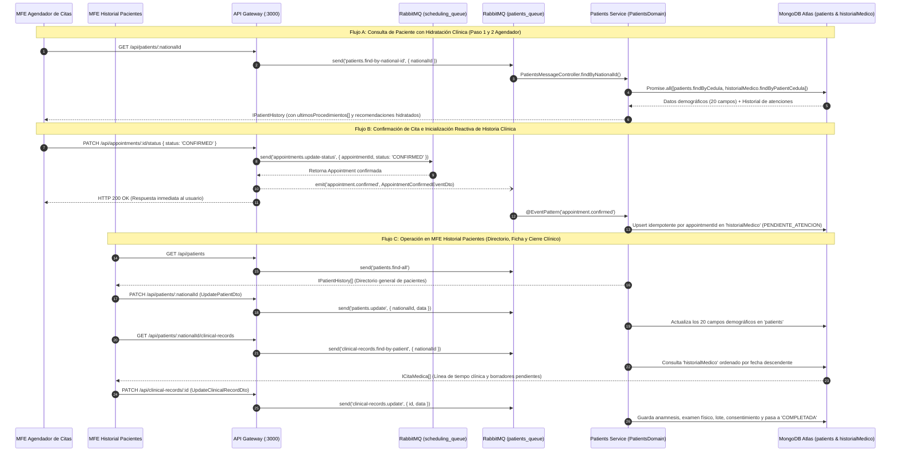

# Ejecución y Arquitectura del Backend — Historias Clínicas y Gestión de Pacientes

> **Ficha Técnica del Documento**  
> * **Ubicación en Monorepo:** `docs/historias-clinicas-back.md`  
> * **Módulos Backend Impactados:** `libs/shared/api-interfaces`, `libs/shared/dtos`, `libs/backend/patients-domain`, `services/patients-service`, `services/api-gateway`  
> * **Normativa Aplicada:** Resolución 1995 de 1999 (Ministerio de Salud de Colombia)  
> * **Propósito:** Documento base de ingeniería sobre el estado actual del backend terminado, diseñado como insumo directo para planificar fase por fase el nuevo **MFE Historial Pacientes** y la actualización del formulario en el **MFE Agendador de Citas**.  
> * **Estado:** Implementado y Verificado (Commit `3cd5c88`)  

---

## 1. Propósito y Resumen Ejecutivo

Este documento detalla la ejecución técnica realizada en el backend del monorepo Nx (`@nx-boilerplate/source`) para soportar el ciclo de vida completo de las **Historias Clínicas Electrónicas (`historialMedico`)** y la **Gestión Demográfica de Pacientes (`patients`)**.

La arquitectura implementada resuelve tres necesidades críticas del negocio médico:
1. **Separación entre Cita Tentativa y Acto Asistencial:** Agendar una cita en estado `TENTATIVE` no ensucia la colección `historialMedico`. El registro clínico nace únicamente como borrador (`PENDIENTE_ATENCION`) de forma reactiva cuando la cita pasa a estado `CONFIRMED`.
2. **Ficha Demográfica Completa (20 Campos) vs. Registro Rápido (5 Campos):** Permite que el agendador cree pacientes rápidamente con 5 datos básicos mientras habilita al nuevo MFE para consultar y completar los 15 campos demográficos restantes exigidos por ley.
3. **Hidratación Automática de Antecedentes:** Cuando se consulta un paciente por su cédula, el backend cruza en paralelo la colección `patients` con `historialMedico` para devolver sus últimos procedimientos y recomendaciones médicas sin requerir llamadas HTTP adicionales.

---

## 2. Diagrama de Arquitectura y Flujo de Datos Implementado



---

## 3. Ejecución Detallada por Fases

La construcción del backend se ejecutó en **4 fases secuenciales**, respetando estrictamente la jerarquía de dependencias del monorepo (`api-interfaces` → `shared-dtos` → `patients-domain` → `patients-service` → `api-gateway`).

---

### Fase 1: Contratos Compartidos (`@nx-boilerplate/api-interfaces`) y Guardia de Datos (`@nx-boilerplate/shared-dtos`)

**Objetivo:** Establecer el tipado estático compartido entre Frontend/Backend y los validadores en tiempo de ejecución (`class-validator`) bajo la política de *Zero-Trust*.

#### 1.1 Contratos Creados y Actualizados en `libs/shared/api-interfaces`:
* **[`clinical-record.interface.ts`](file:///Users/usuario/Desktop/nx-boilerplate/libs/shared/api-interfaces/src/lib/clinical-record.interface.ts) *(Nuevo)*:**
  * `ClinicalRecordStatus`: `'PENDIENTE_ATENCION' | 'COMPLETADA'`.
  * `IMedicoTratante`: `{ cedula_profesional: string; nombre_profesional?: string; fecha_atencion: string | Date }`.
  * `IAntecedentesMedicos`: `{ patologicos: string; alergicos: string; farmacologicos: string; procedimientos_previos: string }`.
  * `IRegistroClinico`: `{ motivo_consulta: string; enfermedad_actual: string; antecedentes_medicos: IAntecedentesMedicos; examen_fisico: string; ultimosProcedimientos?: string[]; procedimiento_realizado: string; lote_producto: string | null; recomendaciones: string }`.
  * `ISoporteDocumental`: `{ consentimiento_informado: boolean; descargable_consentimiento: string }`.
  * `ICitaMedica` (y alias `IClinicalRecord`): Estructura raíz del documento en `historialMedico`, incluyendo `appointmentId?: string | null` y `estado_registro: ClinicalRecordStatus`.
  * `IAppointmentConfirmedEvent`: Payload tipado del evento disparado cuando se confirma una cita.
  * `ICreateClinicalRecordRequest` e `IUpdateClinicalRecordRequest`: Payloads de creación y edición clínica.
* **[`patient.interface.ts`](file:///Users/usuario/Desktop/nx-boilerplate/libs/shared/api-interfaces/src/lib/patient.interface.ts) *(Actualizado)*:**
  * Se añadió `IUpdatePatientRequest` (`Partial<Omit<ICreatePatientRequest, 'cedula'>>`) para permitir la edición parcial o total de los datos demográficos del paciente sin alterar su cédula.

#### 1.2 DTOs Creados en `libs/shared/dtos`:
* **[`update-patient.dto.ts`](file:///Users/usuario/Desktop/nx-boilerplate/libs/shared/dtos/src/lib/update-patient.dto.ts) *(Nuevo)*:**
  * `UpdatePatientDto`: Valida cada uno de los campos demográficos (`tipo_documento`, `nombre`, `apellidos`, `correo`, `celular`, `fecha_nacimiento`, `edad`, `sexo`, `estado_civil`, `ocupacion`, `direccion_residencia`, `aseguradora`, `tipo_vinculacion`, `es_menor_de_edad`, `acompanante`, `persona_responsable`).
  * `UpdatePatientMessageDto`: Sobre `{ nationalId: string; data: UpdatePatientDto }` para transporte RPC en RabbitMQ.
* **[`clinical-record.dto.ts`](file:///Users/usuario/Desktop/nx-boilerplate/libs/shared/dtos/src/lib/clinical-record.dto.ts) *(Nuevo)*:**
  * `AppointmentConfirmedEventDto`: Valida el evento `'appointment.confirmed'`.
  * `MedicoTratanteDto`, `AntecedentesMedicosDto`, `RegistroClinicoDto`, `SoporteDocumentalDto`.
  * `CreateClinicalRecordDto`, `UpdateClinicalRecordDto`, `UpdateClinicalRecordMessageDto` y `FindClinicalRecordByIdDto`.

---

### Fase 2: Capa de Dominio y Persistencia MongoDB (`libs/backend/patients-domain`)

**Objetivo:** Implementar la colección `historialMedico` en MongoDB Atlas y dotar a `patients-domain` de los casos de uso demográficos y clínicos.

#### 2.1 Esquema Mongoose con Idempotencia Nativa:
* **[`clinical-record.schema.ts`](file:///Users/usuario/Desktop/nx-boilerplate/libs/backend/patients-domain/src/lib/schemas/clinical-record.schema.ts) *(Nuevo)*:**
  * Apunta explícitamente a `@Schema({ collection: 'historialMedico', timestamps: true })`.
  * Define índice en `cedula_paciente` (`index: true`) para consultas rápidas de historial.
  * Define índice único *sparse* en `appointmentId` (`{ unique: true, sparse: true }`):
    * **Garantía de Idempotencia:** Si RabbitMQ reintenta el evento `appointment.confirmed` o se confirma dos veces la misma cita `APT-123`, MongoDB garantiza atómicamente que jamás se duplique el borrador clínico.
    * **Flexibilidad:** Al ser `sparse: true`, permite múltiples registros clínicos creados manualmente con `appointmentId: null`.

#### 2.2 Repositorios:
* **[`clinical-records.repository.ts`](file:///Users/usuario/Desktop/nx-boilerplate/libs/backend/patients-domain/src/lib/repositories/clinical-records.repository.ts) *(Nuevo)*:**
  * `createDraftFromAppointment(event)`: Ejecuta un `findOneAndUpdate` con `$setOnInsert` y `upsert: true`. Inicializa la historia clínica en estado `'PENDIENTE_ATENCION'` con los datos de la cita (`patientNationalId`, `doctorCedula`, `procedureName`, `appointmentDate`) y los campos clínicos listos para diligenciar.
  * `findByPatientCedula(cedula)`: Retorna todas las historias clínicas del paciente ordenadas desde la más reciente (`sort({ createdAt: -1 })`).
  * `findById(id)`: Soporta búsqueda inteligente tanto por `_id` de MongoDB (`ObjectId`) como por el código de cita `appointmentId` (`APT-...`).
  * `create(data)` y `update(id, data)`: Creación manual y actualización parcial (`$set`) de secciones anidadas.
* **[`patients.repository.ts`](file:///Users/usuario/Desktop/nx-boilerplate/libs/backend/patients-domain/src/lib/repositories/patients.repository.ts) *(Actualizado)*:**
  * Se agregaron `findAll()` (ordenado por `createdAt: -1`) y `updateByCedula(cedula, data)` (actualización parcial segura de los 20 campos demográficos y sub-documentos `acompanante` / `persona_responsable`).

#### 2.3 Servicios de Dominio:
* **[`clinical-records-domain.service.ts`](file:///Users/usuario/Desktop/nx-boilerplate/libs/backend/patients-domain/src/lib/services/clinical-records-domain.service.ts) *(Nuevo)*:**
  * Orquesta la inicialización de borradores, búsqueda por paciente, búsqueda por ID, creación y cierre/actualización de historias clínicas, lanzando `RpcException` con códigos semánticos (`404`, `500`).
* **[`patients-domain.service.ts`](file:///Users/usuario/Desktop/nx-boilerplate/libs/backend/patients-domain/src/lib/services/patients-domain.service.ts) *(Actualizado)*:**
  * Se agregaron `findAllPatients()` y `updatePatient(nationalId, data)`.
  * **Mejora Clave en `findByNationalId(nationalId)`:** Ahora ejecuta `Promise.all([this.patientsRepository.findByCedula(nationalId), this.clinicalRecordsRepository.findByPatientCedula(nationalId)])`. Si el paciente tiene registros en `historialMedico`, extrae automáticamente los nombres de los procedimientos realizados (`ultimosProcedimientos`) y la recomendación más reciente (`recomendaciones`) y los inyecta en la respuesta `IPatientHistory`.

---

### Fase 3: Transporte RabbitMQ (`services/patients-service`) y Orquestación en `services/api-gateway`

**Objetivo:** Conectar la capa de dominio con la cola `patients_queue` y exponer los endpoints HTTP REST en el API Gateway.

#### 3.1 Actualizaciones en Microservicios Existentes:

| Microservicio / Archivo | Tipo de Cambio | Detalle de lo Implementado |
|---|---|---|
| [`services/patients-service/.../patients-message.controller.ts`](file:///Users/usuario/Desktop/nx-boilerplate/services/patients-service/src/controllers/patients-message.controller.ts) | **Actualizado** | Se añadieron los manejadores `@MessagePattern('patients.find-all')` y `@MessagePattern('patients.update')`. |
| [`services/patients-service/.../clinical-records-message.controller.ts`](file:///Users/usuario/Desktop/nx-boilerplate/services/patients-service/src/controllers/clinical-records-message.controller.ts) | **Nuevo** | Escucha el evento asíncrono `@EventPattern('appointment.confirmed')` y los patrones RPC `clinical-records.find-by-patient`, `clinical-records.find-by-id`, `clinical-records.create` y `clinical-records.update`. |
| [`services/api-gateway/.../appointment-confirmation.controller.ts`](file:///Users/usuario/Desktop/nx-boilerplate/services/api-gateway/src/controllers/appointment-confirmation.controller.ts) | **Actualizado** | Se inyectó `PATIENTS_SERVICE`. Al confirmar una cita (`PATCH /api/appointments/:id/status` con `status === 'CONFIRMED'`), tras recibir la confirmación de `scheduling-service`, emite `this.patientsClient.emit('appointment.confirmed', ...)` hacia `patients_queue`. |
| [`services/api-gateway/.../patients.controller.ts`](file:///Users/usuario/Desktop/nx-boilerplate/services/api-gateway/src/controllers/patients.controller.ts) | **Actualizado** | Se añadieron los endpoints `GET /api/patients`, `PATCH /api/patients/:nationalId` y `GET /api/patients/:nationalId/clinical-records`. |
| [`services/api-gateway/.../clinical-records.controller.ts`](file:///Users/usuario/Desktop/nx-boilerplate/services/api-gateway/src/controllers/clinical-records.controller.ts) | **Nuevo** | Nuevo controlador bajo la ruta `/api/clinical-records` con `GET /:id`, `POST /` y `PATCH /:id`. |

---

### Fase 4: Verificación de Calidad y Pruebas Automatizadas

* **Pruebas Unitarias (Vitest):**
  * [`patients-domain.service.spec.ts`](file:///Users/usuario/Desktop/nx-boilerplate/libs/backend/patients-domain/src/lib/services/patients-domain.service.spec.ts): **8/8 tests pasando** (incluyendo hidratación desde `historialMedico` y actualización demográfica).
  * [`clinical-records-domain.service.spec.ts`](file:///Users/usuario/Desktop/nx-boilerplate/libs/backend/patients-domain/src/lib/services/clinical-records-domain.service.spec.ts): **8/8 tests pasando** (creación de borrador por evento, consultas y manejo de `RpcException` 404).
  * [`patients-message.controller.spec.ts`](file:///Users/usuario/Desktop/nx-boilerplate/services/patients-service/src/controllers/patients-message.controller.spec.ts): **5/5 tests pasando**.
  * [`clinical-records-message.controller.spec.ts`](file:///Users/usuario/Desktop/nx-boilerplate/services/patients-service/src/controllers/clinical-records-message.controller.spec.ts): **6/6 tests pasando**.
* **Chequeo Estricto de Tipos (`tsc --noEmit`):** `0` errores en las 5 librerías/servicios modificados.

---

## 4. Catálogo Completo de Endpoints Disponibles para el Frontend

Todos los endpoints están bajo el prefijo global `http://localhost:3000/api` y devuelven respuestas envueltas automáticamente por el `TransformInterceptor` en el contrato estándar `IApiResponse<T>`:

```typescript
interface IApiResponse<T> {
  success: boolean;
  statusCode: number;
  message: string;
  data: T;
  timestamp: string;
}
```

### 4.1 Endpoints de Pacientes (`/api/patients`)

#### 1. `GET /api/patients` — Listar todos los pacientes
* **Patrón RMQ:** `patients.find-all` (`patients_queue`)
* **Respuesta (`data`):** `IPatientHistory[]` (Lista de pacientes con sus 20 campos demográficos, ordenados por fecha de creación descendente).
* **Uso en Frontend:** Tabla principal / Directorio de pacientes en el **MFE Historial Pacientes**.

#### 2. `GET /api/patients/:nationalId` — Consultar paciente por cédula (Enriquecido)
* **Parámetro URL:** `:nationalId` (alfanumérico, 5 a 20 caracteres, validado por `FindPatientByNationalIdDto`).
* **Patrón RMQ:** `patients.find-by-national-id` (`patients_queue`)
* **Respuesta (`data`):** `IPatientHistory`
  * Contiene los **20 campos demográficos** de la colección `patients`.
  * Contiene `ultimosProcedimientos: string[]` y `recomendaciones: string` **hidratados en tiempo real** desde la colección `historialMedico`.
* **Uso en Frontend:**
  1. **MFE Agendador de Citas (Paso 1 y Paso 2):** Valida si el paciente existe, precarga sus datos básicos y muestra su historial de procedimientos y recomendaciones.
  2. **MFE Historial Pacientes:** Carga la cabecera y el formulario de datos demográficos del paciente.

#### 3. `POST /api/patients` — Crear nuevo paciente
* **Body (`CreatePatientDto`):**
  * **Obligatorios (5 campos):** `cedula`, `nombre`, `apellidos`, `correo`, `celular`.
  * **Opcionales (15 campos demográficos):** `tipo_documento`, `fecha_nacimiento`, `edad`, `sexo`, `estado_civil`, `ocupacion`, `direccion_residencia`, `aseguradora`, `tipo_vinculacion`, `es_menor_de_edad`, `acompanante`, `persona_responsable`.
* **Patrón RMQ:** `patients.create` (`patients_queue`)
* **Respuesta (`data`):** `IPatientHistory` (`201 Created`, o `409 Conflict` si la cédula ya existe).
* **Uso en Frontend:** Creación rápida en el Paso 2 del **MFE Agendador de Citas** o creación completa desde el **MFE Historial Pacientes**.

#### 4. `PATCH /api/patients/:nationalId` — Actualizar ficha demográfica del paciente
* **Parámetro URL:** `:nationalId` (Cédula del paciente).
* **Body (`UpdatePatientDto` / `IUpdatePatientRequest`):** Cualquier subconjunto de los campos demográficos (`tipo_documento`, `nombre`, `apellidos`, `correo`, `celular`, `fecha_nacimiento`, `edad`, `sexo`, `estado_civil`, `ocupacion`, `direccion_residencia`, `aseguradora`, `tipo_vinculacion`, `es_menor_de_edad`, `acompanante`, `persona_responsable`).
* **Patrón RMQ:** `patients.update` (`patients_queue`)
* **Respuesta (`data`):** `IPatientHistory` actualizado (`200 OK`, o `404 Not Found` si no existe).
* **Uso en Frontend:** Permite completar los 15 campos que quedaron en `null` durante el agendamiento rápido o editar datos de contacto, tanto en el **MFE Historial Pacientes** como en una eventual actualización desde el **MFE Agendador de Citas**.

#### 5. `GET /api/patients/:nationalId/clinical-records` — Consultar historial clínico completo de un paciente
* **Parámetro URL:** `:nationalId` (Cédula del paciente).
* **Patrón RMQ:** `clinical-records.find-by-patient` (`patients_queue`)
* **Respuesta (`data`):** `ICitaMedica[]` (Array de registros clínicos ordenados del más reciente al más antiguo, incluyendo tanto los que están en estado `'PENDIENTE_ATENCION'` como los `'COMPLETADA'`).
* **Uso en Frontend:** Línea de tiempo de atenciones médicas y bandeja de historias pendientes por diligenciar del paciente en el **MFE Historial Pacientes**.

---

### 4.2 Endpoints de Historias Clínicas (`/api/clinical-records`)

#### 6. `GET /api/clinical-records/:id` — Obtener detalle de una historia clínica
* **Parámetro URL:** `:id` (Acepta tanto el `_id` de MongoDB como el `appointmentId` de la cita, ej. `APT-1760540000`).
* **Patrón RMQ:** `clinical-records.find-by-id` (`patients_queue`)
* **Respuesta (`data`):** `ICitaMedica` (`200 OK` o `404 Not Found`).
* **Uso en Frontend:** Abrir el visor o formulario de atención médica en el **MFE Historial Pacientes**.

#### 7. `POST /api/clinical-records` — Crear historia clínica manual
* **Body (`CreateClinicalRecordDto` / `ICreateClinicalRecordRequest`):**
  ```json
  {
    "cedula_paciente": "1017187698",
    "appointmentId": null,
    "estado_registro": "PENDIENTE_ATENCION",
    "medico_tratante": [
      {
        "cedula_profesional": "71789456",
        "nombre_profesional": "Dr. Camilo Morales",
        "fecha_atencion": "2026-11-03T15:00:00.000Z"
      }
    ],
    "registro_clinico": {
      "motivo_consulta": "Control post-operatorio",
      "enfermedad_actual": "Evolución favorable",
      "antecedentes_medicos": {
        "patologicos": "Ninguno",
        "alergicos": "Ninguno",
        "farmacologicos": "Ninguno",
        "procedimientos_previos": "Rinoplastia"
      },
      "examen_fisico": "Mucosas hidratadas, sin signos de infección",
      "ultimosProcedimientos": ["Rinoplastia"],
      "procedimiento_realizado": "Valoración de control",
      "lote_producto": null,
      "recomendaciones": "Continuar lavados nasales por 7 días"
    },
    "soporte_documental": {
      "consentimiento_informado": true,
      "descargable_consentimiento": "https://storage.clinica.com/consentimientos/1017187698.pdf"
    }
  }
  ```
* **Patrón RMQ:** `clinical-records.create` (`patients_queue`)
* **Respuesta (`data`):** `ICitaMedica` creado (`201 Created`).
* **Uso en Frontend:** Crear una atención médica directa o de urgencia cuando el paciente no pasó por el flujo previo de confirmación de cita.

#### 8. `PATCH /api/clinical-records/:id` — Diligenciar y cerrar historia clínica
* **Parámetro URL:** `:id` (`_id` de MongoDB o `appointmentId` `APT-...`).
* **Body (`UpdateClinicalRecordDto` / `IUpdateClinicalRecordRequest`):** Permite enviar parcial o totalmente `estado_registro`, `medico_tratante`, `registro_clinico` y `soporte_documental`.
* **Patrón RMQ:** `clinical-records.update` (`patients_queue`)
* **Respuesta (`data`):** `ICitaMedica` actualizado (`200 OK`).
* **Uso en Frontend:** Cuando el profesional médico abre un borrador `'PENDIENTE_ATENCION'` (creado automáticamente al confirmar la cita), llena la anamnesis, antecedentes, examen físico, lote del producto y firma/cierra el registro pasando `estado_registro: 'COMPLETADA'`.

---

### 4.3 Flujo Reactivo en Confirmación de Citas (`/api/appointments`)

#### 9. `PATCH /api/appointments/:id/status` — Confirmar cita y disparar borrador clínico
* **Body:** `{ "status": "CONFIRMED" }`
* **Flujo Interno:**
  1. Actualiza la cita a `'CONFIRMED'` en `scheduling-service` (MongoDB `appointments` + Google Calendar en color verde).
  2. El API Gateway emite automáticamente el evento `appointment.confirmed` hacia `patients_queue`.
  3. `patients-service` crea de manera idempotente el borrador en la colección `historialMedico` con:
     * `appointmentId`: ID de la cita (`APT-...`)
     * `cedula_paciente`: Cédula del paciente
     * `estado_registro`: `'PENDIENTE_ATENCION'`
     * `medico_tratante`: `[{ cedula_profesional, fecha_atencion }]`
     * `registro_clinico.procedimiento_realizado`: Nombre del procedimiento agendado.

---

## 5. Planteamiento Base para la Planificación del Frontend

Con este backend terminado y verificado, tenemos el terreno preparado para abordar los dos frentes de Frontend:

### A. Impacto y Actualización en el Formulario del MFE `agendador-citas`
1. **Lo que ya funciona de forma transparente:**
   * En el **Paso 1**, cuando se consulta `GET /api/patients/:nationalId`, el backend ya devuelve `ultimosProcedimientos` y `recomendaciones` hidratados desde `historialMedico`. El componente `StepPersonalInfoComponent` en el **Paso 2** ya recibe esta información sin necesidad de crear un endpoint adicional.
2. **Oportunidades de actualización en el formulario de `agendador-citas`:**
   * **Sincronización con el contrato de 20 campos (`IPatientHistory`):** Revisar si en el Paso 2 del agendador se desea permitir editar o capturar algún dato adicional (ej. `tipo_documento` o actualizar el teléfono/correo si el paciente existente cambió de número usando `PATCH /api/patients/:nationalId`).
   * **Visualización enriquecida del resumen clínico:** Ajustar la tarjeta de "Última Visita / Recomendaciones" en `StepPersonalInfoComponent` si se requiere mostrar el estado de sus atenciones o mejorar la presentación de `ultimosProcedimientos`.

### B. Hoja de Ruta Sugerida para Planificar el Nuevo MFE `historial-pacientes`
El nuevo Microfrontend (`apps/historial-pacientes`) contará con todos los contratos listos en `@nx-boilerplate/api-interfaces` (`IPatientHistory`, `ICitaMedica`, `IUpdatePatientRequest`, `IUpdateClinicalRecordRequest`) y podrá dividirse en las siguientes fases de Frontend:

1. **Fase 1 (Scaffolding MFE & Capa de Datos Angular):**
   * Generación del remote MFE `apps/historial-pacientes` y registro en `app-shell`.
   * Creación del servicio HTTP (`PatientsClinicalApiService`) usando `HttpClient` y Signals/`rxResource` conectado a los 8 endpoints documentados arriba.
2. **Fase 2 (Directorio y Buscador de Pacientes):**
   * Vista principal conectada a `GET /api/patients` y búsqueda rápida por cédula (`GET /api/patients/:nationalId`), mostrando indicadores de fichas demográficas incompletas o atenciones `PENDIENTE_ATENCION`.
3. **Fase 3 (Expediente del Paciente — Ficha Demográfica de 20 Campos):**
   * Formulario reactivo dividido por secciones (Identificación, Demográficos, Aseguramiento, Acompañante y Responsable) conectado a `PATCH /api/patients/:nationalId`.
4. **Fase 4 (Línea de Tiempo Clínica y Formulario de Atención Médica - Resolución 1995):**
   * Historial cronológico (`GET /api/patients/:nationalId/clinical-records`).
   * Apertura y diligenciamiento de borradores pendientes (`PENDIENTE_ATENCION` → `COMPLETADA`) mediante `PATCH /api/clinical-records/:id` y creación de atenciones manuales (`POST /api/clinical-records`).

