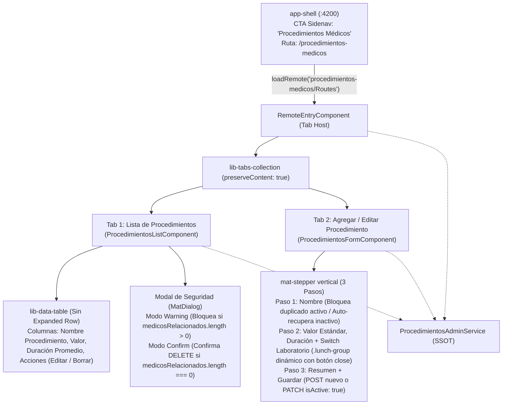

# Plan de Implementación Frontend: MFE `procedimientos-medicos`

> **Módulos Involucrados:** `apps/app-shell`, `apps/procedimientos-medicos` (nuevo Remote MFE en puerto `4204`), `libs/shared/api-interfaces`, `libs/shared/layouts`
> **Patrón Arquitectónico:** Angular 21+ Standalone + Zoneless + Signals SSOT + Homologación de Navegación (`lib-tabs-collection` + `lib-data-table` + `MatStepper`)
> **Skills Gobernantes:** `angular-data-expert`, `angular-ui-expert`, `md3-architecture`

---

## 1. Arquitectura de Componentes y Flujo de Navegación



---

## 2. Reglas de Negocio Clave y Comportamientos Afinados

### A. Tabla Principal Sencilla y Borrado Protegido por Integridad Referencial
1. **Tabla Plana (`[expandable]="false"`):** `ProcedimientosListComponent` consume `<lib-data-table>` mostrando **únicamente** los procedimientos activos (`activeProcedimientos()`), sin fila expandible ni switch de Activos/Inactivos.
2. **Cabecera de Tabla (`[table-header]`):** Conserva el botón primario **"Agregar nuevo"** alineado a la derecha, que invoca `procedimientosService.goToCreate()` para ir a la Pestaña 2.
3. **Definición de Columnas:**
   * `Nombre Procedimiento` (`nombre`)
   * `Valor` (`valor` formateado en moneda COP, ej. `$ 150.000`)
   * `Duración Promedio` (`duracionMinutos` formateado como `"XX min"`)
   * `Acciones`: Botones de icono **Editar** (`edit`) y **Borrar** (`delete`).
4. **Guardia de Seguridad al Borrar (`medicosRelacionados`):**
   * Cuando el usuario presiona **Borrar**, el componente evalúa `(row.medicosRelacionados?.length ?? 0) > 0`:
     * **Caso Bloqueado (`> 0`):** Abre un modal de advertencia (`MatDialog` tipo `warning`) informando: *"No es posible eliminar este procedimiento porque está asignado a $N$ profesional(es) activo(s). Desvincúlelo primero desde la Lista de Profesionales."* No se dispara ninguna petición HTTP.
     * **Caso Permitido (`0`):** Abre confirmación (o ejecuta directamente `deleteProcedimiento(id)`) realizando baja lógica (`DELETE /api/procedures/:id`) con **Optimistic UI**, removiendo el procedimiento inmediatamente de la tabla de activos.

---

### B. Flujo de "Auto-Recuperación" de Procedimientos Inactivos en el Paso 1
1. **Catálogo Completo en Memoria:** `ProcedimientosAdminService.loadProcedimientos()` consulta `GET /api/procedures?includeInactive=true` y guarda todos los registros en el signal privado `#allProcedimientos`.
   * La tabla consume `readonly activeProcedimientos = computed(() => this.#allProcedimientos().filter(p => p.isActive !== false))`.
2. **Evaluación Inteligente al Avanzar del Paso 1 (`onStep1Next()`):**
   * Al presionar **"Siguiente"** en el Paso 1 (cuando no se entró desde el botón Editar de la tabla), se busca el nombre normalizado (`trim().toLowerCase().normalize('NFD').replace(/[\u0300-\u036f]/g, '')`) dentro de `#allProcedimientos()`:
     * **Escenario 1 — Existe y está ACTIVO (`isActive !== false`):** Se inyecta el error `{ duplicateName: true }` en el control `nombre` y se bloquea el avance al Paso 2.
     * **Escenario 2 — Existe y está INACTIVO (`isActive === false`):**
       * Se activa automáticamente el modo de **Reactivación/Actualización** (`procedimientosService.startRestoreInactive(existingProc)`).
       * Se precargan (`patchValue`) los datos antiguos del procedimiento (su `valor`, `duracionMinutos` y sus tarjetas `.lunch-group` de `laboratorios` si las tenía) para que el usuario pueda revisarlos y actualizarlos en el Paso 2.
       * Se muestra un banner informativo indicando que el procedimiento existía como inactivo y sus datos previos fueron recuperados para reactivación.
       * Al llegar al Paso 3 y presionar **Guardar Procedimiento**, se ejecuta un **`PATCH /api/procedures/:id`** enviando `{ ...payload, isActive: true }`.
     * **Escenario 3 — No existe en absoluto:** Avanza normalmente al Paso 2 en modo Creación y en el Paso 3 ejecuta **`POST /api/procedures`**.

---

### C. Patrón `.lunch-group` Mejorado para Precios por Laboratorio (Paso 2)
1. Debajo de los campos `Valor Estándar` y `Duración Promedio`, se ubica el control `<mat-slide-toggle formControlName="tieneLaboratorio">Habilitar precio por Laboratorio</mat-slide-toggle>`.
2. **Comportamiento al Activar el Switch (`tieneLaboratorio === true`):**
   * Si el `FormArray` `laboratorios` está vacío (`length === 0`), se inserta automáticamente un primer `FormGroup` (`.lunch-group`).
   * Cada bloque `.lunch-group` se maqueta como un card (`width: 30%; min-width: 320px;` en desktop, `100%` en mobile) con la siguiente distribución interna:
     * **Cabecera del `.lunch-group`:** Título ligero o número de marca a la izquierda y botón de cerrar `<button mat-icon-button type="button" (click)="removeLaboratory.emit($index)"><span class="material-symbols-outlined">close</span></button>` en la esquina superior derecha.
     * **Fila Superior (`width: 100%`):** Input `Nombre Laboratorio` (`nombreLaboratorio`, requerido).
     * **Fila Inferior (Flexbox `justify-content: space-between`):**
       * Input `Precio` (`precio`, `width: 40%`, numérico requerido `min(0)`).
       * Input `Medida por unidad` (`medidaPorUnidad`, `width: 40%`, texto requerido, ej. `"UI"`, `"ml"`, `"Vial"`).
   * Debajo de los cards `.lunch-group` se incluye un botón secundario `+ Agregar laboratorio` para añadir más registros de marca si el procedimiento maneja múltiples laboratorios.
3. **Regla de Auto-Apagado al Eliminar Todos los `.lunch-group`:**
   * Cuando el usuario presiona el botón `close` (`X`) de un `.lunch-group`, se elimina ese índice del `FormArray` (`removeAt(index)`).
   * Si tras eliminar ese registro el `FormArray` queda vacío (`laboratorios.length === 0`), el componente cambia automáticamente `tieneLaboratorio.setValue(false)`, apagando el switch y cerrando la sección de laboratorios.

---

## 3. Arquitectura del Formulario Reactivo (Stepper de 3 Pasos)

### 3.1 Jerarquía de Controles y Tipado Estricto (`NonNullableFormBuilder`)

```typescript
import { FormArray, FormControl, FormGroup } from '@angular/forms';

export interface LaboratorioItemForm {
  nombreLaboratorio: FormControl<string>;
  precio: FormControl<number>;
  medidaPorUnidad: FormControl<string>;
}

export interface Step1ProcedureForm {
  nombre: FormControl<string>;
}

export interface Step2ProcedureForm {
  valorEstandar: FormControl<number>;
  duracionMinutos: FormControl<number>;
  tieneLaboratorio: FormControl<boolean>;
  laboratorios: FormArray<FormGroup<LaboratorioItemForm>>;
}

export interface ProcedureStepperForm {
  step1: FormGroup<Step1ProcedureForm>;
  step2: FormGroup<Step2ProcedureForm>;
}
```

### 3.2 Detalle por Paso del `<mat-stepper>`

| Paso | Sub-grupo | Controles y Validadores | Responsabilidad UI y Eventos |
|---|---|---|---|
| **Paso 1: Nombre del Procedimiento** | `step1` | `nombre`: `required`, `minLength(3)`, `maxLength(100)`. | Input al 100% de ancho. Al pulsar *"Siguiente"* emite `(nextStep)` hacia el Smart Component, el cual valida contra `#allProcedimientos()` (bloquea con `duplicateName` si está activo, o precarga datos y pasa a modo `PATCH + isActive: true` si está inactivo). |
| **Paso 2: Valor, Duración y Laboratorio** | `step2` | `valorEstandar`: `required`, `min(0)`.<br>`duracionMinutos`: `required`, `min(5)`, `max(480)`.<br>`tieneLaboratorio`: `boolean` (`false`).<br>`laboratorios`: `FormArray<FormGroup<LaboratorioItemForm>>`. | Inputs de Valor Estándar y Duración Promedio + `mat-slide-toggle`. Cuando `tieneLaboratorio` es `true`, renderiza la grilla de tarjetas `.lunch-group` (`30%` width, botón `close`, input `100%` arriba y dos inputs `40%` abajo). Si se cierran todos los `.lunch-group`, apaga `tieneLaboratorio`. |
| **Paso 3: Resumen y Confirmación** | *(Lectura de `step1` y `step2`)* | Sin controles adicionales; evalúa `form.valid`. | Muestra tarjeta de resumen de solo lectura (Nombre, Valor Estándar, Duración Promedio y listado de Laboratorios configurados). Botón final **"Guardar Procedimiento"** (o **"Actualizar Procedimiento"**). |

---

## 4. Plan de Implementación Detallado por Fases

### Fase 0: Scaffolding del MFE `procedimientos-medicos` e Integración en `app-shell`
**Skill:** `angular-ui-expert`
**Objetivo:** Crear la aplicación remota independiente en el puerto `4204` y conectarla al menú lateral del Host con Lazy Loading.

1. **Generación y Configuración del Remote:**
   * Generar el remote `procedimientos-medicos` con puerto `4204`, Standalone, Zoneless y SCSS.
   * Configurar `apps/procedimientos-medicos/module-federation.config.ts` exponiendo `./Routes` (`./src/app/remote-entry/entry.routes.ts`).
   * En `entry.routes.ts`, proveer `provideHttpClient(withInterceptors([loaderInterceptor]))` para garantizar autonomía del MFE al cargarse dentro de `app-shell`.
   * Configurar Vitest (`vite.config.mts`, `src/test-setup.ts`, `tsconfig.spec.json`) para pruebas unitarias.
2. **Conexión en `app-shell`:**
   * Registrar `"procedimientos-medicos": "http://localhost:4204/mf-manifest.json"` en `apps/app-shell/public/module-federation.manifest.json`.
   * Agregar la ruta lazy `path: 'procedimientos-medicos'` en `apps/app-shell/src/app/app.routes.ts` usando `loadRemote('procedimientos-medicos/Routes')`.
   * Agregar el ítem de navegación en el Sidenav de `app-shell` con `label: 'Procedimientos Médicos'`, `path: '/procedimientos-medicos'` e ícono `medical_services` (o `healing`).
   * Registrar el alias `procedimientos-medicos/Routes` en `tsconfig.base.json`.
* **Puerta de Verificación Fase 0:** `npx nx build procedimientos-medicos` y `npx nx build app-shell` en verde.

---

### Fase 1: Contratos en `@nx-boilerplate/api-interfaces` y Modelos de Navegación
**Skill:** `angular-data-expert`
**Objetivo:** Definir los contratos de datos estrictos para procedimientos y laboratorios sin acoplar el frontend a `shared-dtos`.

1. **Actualización de `libs/shared/api-interfaces/src/lib/procedure.interface.ts`:**
   * Definir la interfaz de laboratorio por procedimiento:
     ```typescript
     export interface IProcedureLaboratory {
       nombreLaboratorio: string;
       precio: number;
       medidaPorUnidad: string;
     }
     ```
   * Asegurar que `IProcedure` contenga todas las propiedades requeridas por la tabla, la validación de borrado y la reactivación:
     ```typescript
     export interface IProcedure {
       id: string; // o codigo según el identificador canónico del backend
       nombre: string;
       valor: number;
       duracionMinutos: number;
       tieneLaboratorio?: boolean;
       laboratorios?: IProcedureLaboratory[];
       medicosRelacionados?: string[]; // Cédulas de profesionales asignados
       isActive?: boolean;
     }
     ```
   * Exportar los tipos de mutación HTTP:
     ```typescript
     export type ICreateProcedureRequest = Omit<
       IProcedure,
       'id' | 'isActive' | 'medicosRelacionados'
     >;

     export type IUpdateProcedureRequest = Partial<ICreateProcedureRequest> & {
       isActive?: boolean;
     };
     ```
2. **Modelos de Navegación del MFE (`apps/procedimientos-medicos/src/app/models/procedimientos-nav.models.ts`):**
   ```typescript
   export const PROCEDIMIENTOS_TABS = {
     LIST: 1,
     FORM: 2,
   } as const;

   export type ProcedimientosTabId =
     (typeof PROCEDIMIENTOS_TABS)[keyof typeof PROCEDIMIENTOS_TABS];
   ```
* **Puerta de Verificación Fase 1:** Compilación limpia de `@nx-boilerplate/api-interfaces` y `procedimientos-medicos`.

---

### Fase 2: Servicio SSOT (`ProcedimientosAdminService`)
**Skill:** `angular-data-expert`
**Objetivo:** Implementar el estado reactivo basado en Signals para gestionar la lista de activos, la detección de inactivos por nombre y las mutaciones HTTP (`POST`, `PATCH`, `DELETE` optimista).

1. **Archivo:** `apps/procedimientos-medicos/src/app/services/procedimientos-admin.service.ts`
2. **Signals de Estado:**
   * `readonly #allProcedimientos = signal<IProcedure[]>([]);`
   * `readonly activeProcedimientos = computed(() => this.#allProcedimientos().filter((p) => p.isActive !== false));`
   * `readonly #isLoading = signal<boolean>(false);`
   * `readonly #error = signal<string | null>(null);`
   * `readonly #activeTab = signal<ProcedimientosTabId>(PROCEDIMIENTOS_TABS.LIST);`
   * `readonly #editingProcedure = signal<IProcedure | null>(null);`
   * `readonly #isRestoringInactive = signal<boolean>(false);`
   * `readonly #isSaving = signal<boolean>(false);`
   * `readonly #saveError = signal<string | null>(null);`
   * Computed: `readonly isEditMode = computed(() => this.#editingProcedure() !== null);`
3. **Métodos de Búsqueda y Navegación:**
   * `loadProcedimientos(): void`: consume `GET /api/procedures?includeInactive=true` y actualiza `#allProcedimientos`.
   * `findExistingByName(rawName: string): IProcedure | undefined`: normaliza `rawName` (sin tildes, minúsculas, `trim()`) y busca coincidencia exacta en `#allProcedimientos()`.
   * `goToCreate()`, `goToEdit(proc: IProcedure)`, `goToList()`, `setActiveTab(id: ProcedimientosTabId)`: gestionan la transición entre pestañas limpiando `#editingProcedure`, `#isRestoringInactive` y `#saveError` al volver a `LIST`.
   * `startRestoreInactive(proc: IProcedure): void`: asigna `#editingProcedure.set(proc)` y `#isRestoringInactive.set(true)` manteniendo al usuario en `PROCEDIMIENTOS_TABS.FORM`.
4. **Métodos de Mutación HTTP:**
   * `createProcedimiento(payload: ICreateProcedureRequest)`: `POST /api/procedures` $\rightarrow$ recarga lista y navega a `LIST`.
   * `updateProcedimiento(id: string, payload: IUpdateProcedureRequest)`: `PATCH /api/procedures/:id` (usado tanto para edición normal como para reactivar un procedimiento inactivo enviando `isActive: true`) $\rightarrow$ recarga lista y navega a `LIST`.
   * `deleteProcedimiento(id: string)`: **Optimistic UI** marcando `isActive: false` en `#allProcedimientos` (desaparece inmediatamente de `activeProcedimientos()`), dispara `DELETE /api/procedures/:id` y revierte al snapshot previo en `catchError`.
* **Puerta de Verificación Fase 2:** Suite unitaria `procedimientos-admin.service.spec.ts` en verde (100% de cobertura sobre búsqueda por nombre activo/inactivo, restauración, alta, edición y rollback de borrado).

---

### Fase 3: Componente de Lista y Guardia de Borrado (`ProcedimientosListComponent`)
**Skill:** `angular-ui-expert`
**Objetivo:** Renderizar la tabla sencilla de procedimientos activos y bloquear la eliminación cuando existan médicos vinculados en `medicosRelacionados`.

1. **Archivos:** `apps/procedimientos-medicos/src/app/components/procedimientos-list/procedimientos-list.component.{ts,html,scss,spec.ts}`
2. **Configuración de `<lib-data-table>`:**
   * `[dataTable]="procedimientosService.activeProcedimientos()"`
   * `[dataColumn]="columns"` (`Nombre Procedimiento`, `Valor` con `formatter` de moneda, `Duración Promedio` con `formatter` `"XX min"`)
   * `[actions]="tableActions"` (Botones `edit` y `delete`)
   * `[expandable]="false"`
   * `[searchable]="true"` con `searchPlaceholder="Buscar procedimiento por nombre..."`
   * Slot `<div table-header>` con el botón **"Agregar nuevo"** (`(click)="onAddNew()"`).
3. **Lógica de Seguridad en `onDelete(proc: IProcedure)`:**
   * Evalúa `const linkedCount = proc.medicosRelacionados?.length ?? 0;`.
   * **Si `linkedCount > 0`:** Abre `MatDialog` con el componente de alerta/confirmación en modo **Warning/Bloqueo** explicando que el procedimiento tiene `linkedCount` médico(s) relacionado(s) y no puede eliminarse.
   * **Si `linkedCount === 0`:** Abre `MatDialog` en modo **Confirmación** (*"¿Está seguro de eliminar el procedimiento?"*) y, al confirmar, invoca `this.procedimientosService.deleteProcedimiento(proc.id).subscribe()`.
* **Puerta de Verificación Fase 3:** `procedimientos-list.component.spec.ts` en verde probando que `onDelete` bloquea la llamada HTTP cuando `medicosRelacionados` tiene elementos y la permite cuando está vacío.

---

### Fase 4: Componentes Presentacionales de los Pasos (Dumb Steps en `libs/shared/layouts`)
**Skill:** `angular-ui-expert`
**Objetivo:** Construir los 3 pasos presentacionales reutilizables en `libs/shared/layouts/src/lib/forms/ui-procedure-steps/` siguiendo estrictamente las reglas de Angular 20+ y tokens MD3.

1. **Paso 1 — `StepProcedureNameComponent` (`lib-step-procedure-name`):**
   * **Inputs / Outputs:** `stepForm = input.required<FormGroup>()`, `nextStep = output<void>()`.
   * **Template:** `<mat-form-field appearance="outline">` para `nombre` con validaciones `@if` para `required`, `minlength` y el error personalizado `duplicateName` (*"Ya existe un procedimiento activo con este nombre."*). Botón *"Siguiente"*.
2. **Paso 2 — `StepProcedurePricingComponent` (`lib-step-procedure-pricing`):**
   * **Inputs:**
     * `stepForm = input.required<FormGroup>()`
     * `laboratoriosArray = input.required<FormArray<FormGroup>>()`
   * **Outputs:**
     * `addLaboratory = output<void>()`
     * `removeLaboratory = output<number>()`
     * `prevStep = output<void>()`
     * `nextStep = output<void>()`
   * **Template y Estilos (`.lunch-group` mejorado):**
     * Fila superior con `valorEstandar` y `duracionMinutos`.
     * Control `<mat-slide-toggle formControlName="tieneLaboratorio">Habilitar precio por Laboratorio</mat-slide-toggle>`.
     * Bloque condicional `@if (stepForm().get('tieneLaboratorio')?.value)`:
       * Contenedor flex/grid de tarjetas `.lunch-group`.
       * Iteración `@for (labGroup of laboratoriosArray().controls; track $index)`:
         * Cada `.lunch-group` tiene `width: 30%; min-width: 320px;` (y `100%` en pantallas pequeñas).
         * Cabecera interna con botón `<button mat-icon-button type="button" class="lunch-group__close" aria-label="Eliminar laboratorio" (click)="removeLaboratory.emit($index)"><span class="material-symbols-outlined">close</span></button>`.
         * Input `nombreLaboratorio` al `100%` del ancho del `.lunch-group`.
         * Fila inferior `.lunch-group__bottom-row` (`display: flex; justify-content: space-between;`) con Input `precio` (`width: 40%`) e Input `medidaPorUnidad` (`width: 40%`).
       * Botón secundario `+ Agregar laboratorio` (`(click)="addLaboratory.emit()"`).
3. **Paso 3 — `StepProcedureSummaryComponent` (`lib-step-procedure-summary`):**
   * **Inputs:** `summaryData`, `isSaving`, `isEditMode`, `isRestoringInactive`.
   * **Outputs:** `prevStep = output<void>()`, `save = output<void>()`.
   * **Template:** Tarjeta de resumen mostrando Nombre, Valor Estándar, Duración Promedio y la lista de laboratorios (si `tieneLaboratorio` está activo). Si `isRestoringInactive()` es `true`, muestra un chip/aviso indicando que se reactivará el registro histórico al guardar. Botón final **"Guardar Procedimiento"** / **"Actualizar Procedimiento"**.
4. **Exportación en Barril:** Exportar los 3 componentes en `libs/shared/layouts/src/index.ts`.
* **Puerta de Verificación Fase 4:** `npx nx test layouts` con pruebas unitarias de los 3 nuevos steps en verde.

---

### Fase 5: Smart Component del Stepper (`ProcedimientosFormComponent`)
**Skill:** `angular-ui-expert`
**Objetivo:** Orquestar el `<mat-stepper>`, la auto-recuperación de inactivos en el Paso 1, la sincronización del switch con los bloques `.lunch-group` en el Paso 2 y el envío limpio de `POST` o `PATCH`.

1. **Archivos:** `apps/procedimientos-medicos/src/app/components/procedimientos-form/procedimientos-form.component.{ts,html,scss,spec.ts}`
2. **Orquestación del Paso 1 (`onStep1Next()`):**
   * Valida `form.controls.step1`.
   * Si no está editando un procedimiento activo previamente seleccionado desde la tabla:
     * Busca `const existing = this.procedimientosService.findExistingByName(nombre)`.
     * **Si `existing && existing.isActive !== false`:** Marca `step1.controls.nombre.setErrors({ duplicateName: true })` y detiene el avance.
     * **Si `existing && existing.isActive === false`:**
       * Invoca `this.procedimientosService.startRestoreInactive(existing)`.
       * Carga en `step2` los valores antiguos (`valorEstandar`, `duracionMinutos`, `tieneLaboratorio` y reconstruye el `FormArray` `laboratorios` con cada marca que tenía guardada).
       * Avanza al Paso 2 (`this.stepper()?.next()`).
     * **Si `!existing`:** Avanza normalmente al Paso 2 (`this.stepper()?.next()`).
3. **Orquestación de `.lunch-group` y Switch en Paso 2:**
   * Suscripción con `takeUntilDestroyed()` a `step2.controls.tieneLaboratorio.valueChanges`:
     * Cuando pasa a `true` y `laboratorios.length === 0`, llama a `onAddLaboratory()` para crear el primer `.lunch-group`.
     * Cuando pasa a `false`, limpia el `FormArray` (`laboratorios.clear()`).
   * Método `onRemoveLaboratory(index: number)`:
     * Ejecuta `this.laboratoriosArray.removeAt(index)`.
     * **Regla de Auto-Apagado:** Si `this.laboratoriosArray.length === 0`, ejecuta `this.form.controls.step2.controls.tieneLaboratorio.setValue(false)` para deshabilitar/apagar automáticamente el switch.
4. **Guardado Final (`onSubmit()`):**
   * Construye el payload limpio (`ICreateProcedureRequest` / `IUpdateProcedureRequest`). Si `tieneLaboratorio` es `false`, envía `laboratorios: []`.
   * **Si `procedimientosService.isEditMode()` es `true`** (ya sea porque vino del botón Editar de la tabla o porque se auto-recuperó un inactivo en el Paso 1):
     * Llama a `procedimientosService.updateProcedimiento(editingProc.id, { ...payload, isActive: true })`.
   * **Si es un registro nuevo:**
     * Llama a `procedimientosService.createProcedimiento(payload)`.
* **Puerta de Verificación Fase 5:** `procedimientos-form.component.spec.ts` en verde probando: bloqueo por duplicado activo, auto-recuperación de inactivo con `patchValue` y `PATCH { isActive: true }`, y auto-apagado del switch `tieneLaboratorio` al eliminar todos los `.lunch-group`.

---

### Fase 6: Tab Host en `RemoteEntryComponent` y Verificación Integral
**Skill:** `angular-ui-expert`
**Objetivo:** Conectar `<lib-tabs-collection [preserveContent]="true">` en `RemoteEntryComponent` y validar la integración completa en el monorepo.

1. **Archivos:** `apps/procedimientos-medicos/src/app/remote-entry/remote-entry.component.{ts,html,scss,spec.ts}`
2. **Implementación:**
   * En el `constructor`, invocar `this.procedimientosService.loadProcedimientos()`.
   * Configurar `tabs = computed<TabItem[]>(...)` con:
     * Tab 1 (`PROCEDIMIENTOS_TABS.LIST`): `'Lista de Procedimientos'`, ícono `'list_alt'`.
     * Tab 2 (`PROCEDIMIENTOS_TABS.FORM`): label dinámico (`isEditMode() ? 'Editar Procedimiento' : 'Agregar Procedimiento'`), ícono `'add_circle'` / `'edit_note'`.
* **Puerta de Verificación Fase 6:**
  * `npx nx test layouts`
  * `npx nx test procedimientos-medicos`
  * `npx nx lint procedimientos-medicos`
  * `npx nx run-many -t build -p app-shell agendador-citas lista-profesionales procedimientos-medicos`

---

## 5. Estructura Final de Archivos a Crear / Modificar

```text
libs/shared/api-interfaces/src/lib/procedure.interface.ts        # + IProcedureLaboratory, ICreateProcedureRequest, IUpdateProcedureRequest
libs/shared/layouts/src/lib/forms/ui-procedure-steps/
  ├── step-procedure-name/                                       # Paso 1 (nombre + error duplicateName)
  ├── step-procedure-pricing/                                    # Paso 2 (valor, duración, switch + .lunch-group 30% con botón close)
  └── step-procedure-summary/                                    # Paso 3 (resumen + aviso de reactivación + botón guardar)
libs/shared/layouts/src/index.ts                                 # + exports de los 3 nuevos steps

apps/app-shell/
  ├── public/module-federation.manifest.json                     # + "procedimientos-medicos": "http://localhost:4204/mf-manifest.json"
  ├── src/app/app.routes.ts                                      # + ruta lazy 'procedimientos-medicos'
  └── src/app/app.ts                                             # + CTA Sidenav 'Procedimientos Médicos'

apps/procedimientos-medicos/src/app/
  ├── models/procedimientos-nav.models.ts                        # PROCEDIMIENTOS_TABS, ProcedimientosTabId
  ├── services/procedimientos-admin.service.ts                   # SSOT (activeProcedimientos, findExistingByName, startRestoreInactive, CRUD)
  ├── components/procedimientos-list/                            # Tabla plana + guardia de borrado por medicosRelacionados
  ├── components/procedimientos-form/                            # Stepper Smart + auto-apagado de switch al cerrar todos los .lunch-group
  └── remote-entry/                                              # Tab Host con lib-tabs-collection
```