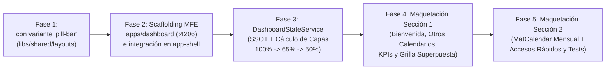

# Plan de Implementación Frontend: Dashboard Clínico ("Centro de Comando")

> **Ficha Técnica del Módulo**  
> * **Ubicación en Monorepo:** `apps/dashboard` (Nuevo Remote MFE en puerto `4206` / static `4216`) + `libs/shared/layouts` (Nuevo componente `<lib-carousel>`)  
> * **Ruta en Host (`app-shell`):** `http://localhost:4200/dashboard` (y redirección por defecto desde `''`)  
> * **Foco de esta Etapa (Parte 1):** Arquitectura visual, componentes reutilizables (`Carousel` con variante `pill-bar`), Bento Grid `70% / 30%` y motor de superposición horaria estilo Google Calendar ($100\% \rightarrow 65\% \rightarrow 50\% \rightarrow 35\%$). *(Sin acciones de mutación ni ajustes responsive profundos aún).*  
> * **Skills Gobernantes:** `angular-ui-expert`, `angular-data-expert`, `md3-architecture`

---

## 1. Especificaciones de Diseño y Reglas Visuales Aprobadas

### 1.1 Componente Compartido `<lib-carousel>` con Variante `pill-bar` (`libs/shared/layouts`)
* Se creará un componente presentacional genérico en `libs/shared/layouts/src/lib/carousel/` que permita desplazar colecciones horizontalmente mediante CSS Scroll Snap (`scroll-behavior: smooth`) y botones laterales (`chevron_left` / `chevron_right`).
* **Variante `'pill-bar'`:** Diseñada específicamente para selectores de entidades con avatar (como los profesionales médicos):
  * Muestra **Avatar circular con iniciales** (ej. `CB`), **Nombre del Profesional**, **Especialidad** y un **indicador cromático** del color asignado a su calendario.
  * El ítem activo resalta con borde y contenedor `--sys-color-primary-container`.

### 1.2 Layout Asimétrico Desktop: Proporción `70% / 30%` (Grid 8 + 4 Columnas)
* **Sección 1 — Lienzo Operativo Izquierdo (`~70%` / 8 columnas):**
  1. **Header de Bienvenida:** `"Bienvenido(a) {{ activeDoctor().nombres }} {{ activeDoctor().apellidos }} a tu agenda semanal"` + Botón primario `"Agendar Nueva Cita"`.
  2. **Card "Otros calendarios" (`width: 100%`):** Lista horizontal de `MatCheckbox` con todos los profesionales **distintos** al profesional principal seleccionado, cada uno con un punto del color distintivo de su capa de calendario.
  3. **Fila de 2 KPIs Semanales (50% / 50% alineados horizontalmente):**
     * **Card 1:** `<span class="kpi-label">Citas de la Semana Confirmadas</span>` + Número grande `'NN'` en tono éxito (`--app-color-success`).
     * **Card 2:** `<span class="kpi-label">Citas de la Semana Agendadas</span>` + Número grande `'NN'` en tono advertencia (`--app-color-warning`).
  4. **Card 3 "Calendario fecha actual" (`width: 100%`):** Cuadrícula horaria de intervalos de 30 minutos (`08:00`, `08:30`, `09:00`...) con línea indicadora de hora actual y **superposición en cascada estilo Google Calendar**.
* **Sección 2 — Aside Derecho (`~30%` / 4 columnas):**
  1. **Card 1 "Agenda de la semana":** Calendario mensual (`<mat-calendar>`) con días pasados deshabilitados (`[minDate]="today"`), día actual marcado como primario y días futuros clickeables para inspeccionar ese día en la cuadrícula de la Sección 1.
  2. **Card 2 "Accesos Rápidos":** Enlaces directos a las operaciones frecuentes de la clínica (Confirmar Citas CRM, Historias Clínicas Pendientes, Buscar Expediente, Catálogo de Procedimientos).

### 1.3 Motor de Superposición en Cascada ("Google Calendar Overlay Algorithm")
Cuando el usuario marque $1, 2, \dots, k$ profesionales en **"Otros calendarios"**, los slots de todos los calendarios activos se renderizan **en una única columna/cuadrícula horaria**, superponiéndose encima de los slots del médico principal para evidenciar colisiones o huecos libres conjuntos:

$$\text{Width}(i) = \begin{cases} 100\% & \text{si } i = 0 \text{ (Médico Principal)} \\ 65\% & \text{si } i = 1 \text{ (1er Adicional: } -35\% \text{)} \\ \max\left(20\%, 65\% - (i - 1) \times 15\%\right) & \text{si } i \ge 2 \text{ (Siguientes: } -15\% \text{ c/u)} \end{cases}$$

| Nivel de Capa ($i$) | Rol del Calendario | Ancho (`width`) | Desplazamiento Izquierdo (`left`) | `z-index` | Efecto Visual (Google Calendar) |
|---|---|:---:|:---:|:---:|---|
| **$i = 0$** | **Médico Principal** (Seleccionado en el Pill-Bar) | **`100%`** | `0%` | `10` | Ocupa todo el fondo de la fila horaria; su título y estado se leen a la izquierda. |
| **$i = 1$** | **1er Checkbox Adicional** ($-35\%$) | **`65%`** | `35%` (alineado a la derecha) | `20` | Se sobrepone dejando visible el $35\%$ izquierdo del médico principal; proyecta sombra izquierda. |
| **$i = 2$** | **2do Checkbox Adicional** ($-15\%$ adicional) | **`50%`** | `50%` (alineado a la derecha) | `30` | Se sobrepone dejando visible el $35\%$ del principal y un escalón del $15\%$ del 1er adicional. |
| **$i = 3$** | **3er Checkbox Adicional** ($-15\%$ adicional) | **`35%`** | `65%` (alineado a la derecha) | `40` | Tercer escalón superpuesto a la derecha con su chip/borde de identidad. |

---

## 2. Mapa Visual Definitivo del Layout (Wireframe Arquitectónico)

```text
+-------------------------------------------------------------------------------------------------------+
| CARRUSEL SUPERIOR (<lib-carousel variant="pill-bar">):                                                |
| [<]  [ (CB) Dra. Camila Botero ● Activa ]   [ (AM) Dr. Andrés Mejía ]   [ (LP) Dra. Laura Pérez ] [>] |
+-------------------------------------------------------------------------------------------------------+
| SECCIÓN 1: LIENZO OPERATIVO (70% - 8 Cols)              | SECCIÓN 2: ASIDE DERECHO (30% - 4 Cols)     |
|                                                         |                                             |
| +-----------------------------------------------------+ | +-----------------------------------------+ |
| | 👋 Bienvenida, Dra. Camila Botero a tu agenda semanal| | | 📅 Agenda de la semana                  | |
| |                               [+ Agendar Nueva Cita]| | |                                         | |
| +-----------------------------------------------------+ | |          < Noviembre 2026 >             | |
|                                                         | |      Lu  Ma  Mi  Ju  Vi  Sá  Do         | |
| +-----------------------------------------------------+ | |       2   3   4  [5]  6   7   8         | |
| | 👥 Otros calendarios                                | | |   (Pasados disabled | Hoy #5 Primary    | |
| | [x] ● Dr. Andrés Mejía   [x] ● Dra. Laura Pérez     | | |    Futuros clickeables)                 | |
| +-----------------------------------------------------+ | +-----------------------------------------+ |
|                                                         |                                             |
| +-------------------------+ +-------------------------+ | +-----------------------------------------+ |
| | Citas de la Semana      | | Citas de la Semana      | | | ⚡ Accesos Rápidos                      | |
| | Confirmadas             | | Agendadas               | | |                                         | |
| |           18            | |           06            | | | • [📋 Confirmación de Citas (CRM)]      | |
| +-------------------------+ +-------------------------+ | | • [📝 Historias Pendientes de Cierre]   | |
|                                                         | | • [👤 Directorio de Pacientes]          | |
| +-----------------------------------------------------+ | | • [💉 Procedimientos Médicos]           | |
| | 🕒 Calendario fecha actual: Jueves, 5 de Noviembre  | | +-----------------------------------------+ |
| |-----------------------------------------------------| |                                             |
| | HORA  | CUADRÍCULA CON SUPERPOSICIÓN EN CASCADA     | |                                             |
| |-------|---------------------------------------------| |                                             |
| | 08:00 | [ (100% Principal) Disponible             ] | |                                             |
| |       |                 [ (65% Dr. Mejía) Confirm ] | |                                             |
| |-------|---------------------------------------------| |                                             |
| | 08:30 | [ (100% Principal) CONFIRMADA: María G.   ] | |                                             |
| |       |                 [ (65% Dr. Mejía) Libre   ] | |                                             |
| |       |                         [ (50% Dra. Pérez)] | |                                             |
| |-------|---------------------------------------------| |                                             |
| | 09:00 | [ (100% Principal) AGENDADA: Juan Pérez   ] | |                                             |
| +-----------------------------------------------------+ |                                             |
+-------------------------------------------------------------------------------------------------------+
```

---

## 3. Plan de Implementación por Fases (Secuencia Segura)

> **Principio de Ejecución:** Nos enfocaremos primero en el componente reutilizable de librería, luego el scaffolding del MFE con estado reactivo, y finalmente la maquetación de las secciones y el motor de superposición horaria. Todas las acciones de navegación profunda o modales quedarán preparadas como *placeholders* limpios para la Parte 2.



---

### Fase 1: Creación del Componente Reutilizable `<lib-carousel>` en `libs/shared/layouts`
**Skill:** `angular-ui-expert` + `md3-architecture`

1. **Modelos (`libs/shared/layouts/src/lib/models/carousel.models.ts`):**
   * `CarouselVariant = 'default' | 'pill-bar'`.
   * `CarouselPillItem`:
     ```typescript
     export interface CarouselPillItem {
       id: string;
       title: string;        // Ej: "Dra. Camila Botero"
       subtitle?: string;    // Ej: "Cirujana Plástica"
       initials: string;     // Ej: "CB"
       accentColor?: string; // Token o variable CSS para identificar su calendario
       badgeText?: string;
     }
     ```
2. **Componente `CarouselComponent` (`libs/shared/layouts/src/lib/carousel/`):**
   * `selector: 'lib-carousel'`, `standalone: true`, `ChangeDetectionStrategy.OnPush`.
   * **Inputs / Outputs con Signals:**
     * `variant = input<CarouselVariant>('default')`
     * `items = input<CarouselPillItem[]>([])`
     * `selectedId = model<string | null>(null)`
     * `showArrows = input<boolean>(true)`
     * `itemSelected = output<CarouselPillItem>()`
   * Soporta además proyección `<ng-content>` o `itemTemplate` cuando `variant === 'default'`, y renderiza automáticamente las tarjetas tipo píldora con Avatar cuando `variant === 'pill-bar'`.
   * Botones de desplazamiento lateral (`scrollLeft()` / `scrollRight()`) operando sobre el `ElementRef` de la pista con `scrollBy({ left: 280, behavior: 'smooth' })`.
3. **Exportación y Pruebas:**
   * Exportar en `libs/shared/layouts/src/index.ts`.
   * Crear `carousel.component.spec.ts` probando selección de píldora, cambio de `selectedId` y emisión de `itemSelected`.
* **Puerta de Verificación:** `npx nx test layouts` en verde.

---

### Fase 2: Scaffolding del MFE `apps/dashboard` e Integración en `app-shell`
**Skill:** `angular-ui-expert`

1. Generar el remote `@nx/angular:remote` para `dashboard` en el puerto **`4206`** (`serve-static`: **`4216`**) con tags `["scope:frontend", "type:app"]` y configuración de Vitest (`vite.config.mts`).
2. Registrar en `tsconfig.base.json` el alias `"dashboard/Routes": ["./apps/dashboard/src/app/remote-entry/entry.routes.ts"]`.
3. Registrar en `app-shell/public/module-federation.manifest.json`:
   ```json
   "dashboard": "http://localhost:4206/mf-manifest.json"
   ```
4. En `app-shell/src/app/app.routes.ts`:
   * Cambiar el redirect raíz `''` para que apunte a `'dashboard'`.
   * Configurar la ruta `'dashboard'` con `loadRemote('dashboard/Routes')`.
5. En `app-shell/src/app/app.ts`:
   * Añadir como primer ítem de `mfeRoutes`: `{ path: '/dashboard', label: 'Dashboard', icon: 'space_dashboard' }`.
* **Puerta de Verificación:** `npx nx build dashboard` y `npx nx build app-shell` en verde.

---

### Fase 3: Capa de Estado y Algoritmo de Superposición (`DashboardStateService`)
**Skill:** `angular-data-expert`

1. **Modelos del Dashboard (`apps/dashboard/src/app/models/dashboard.models.ts`):**
   * `IOverlayCalendarLayer`:
     ```typescript
     export interface IOverlayCalendarLayer {
       doctor: IActiveProfessional;
       layerIndex: number;   // 0 = Principal, 1 = 1er adicional, 2 = 2do adicional...
       widthPercent: number; // 100, 65, 50, 35...
       leftPercent: number;  // 0, 35, 50, 65...
       zIndex: number;       // 10, 20, 30, 40...
       accentColor: string;  // Color de identificación visual
       slots: Map<string, IDashboardSlotItem>; // Key: "08:00", "08:30", etc.
     }
     ```
   * Función pura exportada `calculateOverlayGeometry(layerIndex: number): { widthPercent: number; leftPercent: number; zIndex: number }`:
     * Si `layerIndex === 0` $\rightarrow$ `{ widthPercent: 100, leftPercent: 0, zIndex: 10 }`.
     * Si `layerIndex === 1` $\rightarrow$ `{ widthPercent: 65, leftPercent: 35, zIndex: 20 }`.
     * Si `layerIndex >= 2` $\rightarrow$ `width = Math.max(20, 65 - (layerIndex - 1) * 15)`, `left = 100 - width`, `zIndex = (layerIndex + 1) * 10`.
2. **Servicio SSOT (`apps/dashboard/src/app/services/dashboard-state.service.ts`):**
   * Consume `GET /api/doctors` para poblar la lista de profesionales activos (con fallback/mock enriquecido de slots de media hora `08:00` a `17:30` en esta fase visual para poder apreciar inmediatamente el solapamiento de citas confirmadas, agendadas, disponibles y almuerzo).
   * **Signals:**
     * `doctors`: lista de profesionales activos.
     * `selectedDoctorCedula`: cédula del profesional principal (por defecto el primero de la lista).
     * `comparedDoctorCedulas = signal<string[]>([])`: arreglo ordenado de cédulas marcadas en los checkboxes de *"Otros calendarios"*.
     * `selectedDate = signal<Date>(new Date())`: fecha activa sincronizada con el calendario mensual de la Sección 2.
   * **Computed Signals:**
     * `activeDoctor`: profesional principal seleccionado.
     * `otherDoctors`: todos los profesionales cuya cédula $\ne$ `selectedDoctorCedula()` (para pintar los checkboxes horizontales).
     * `weeklyConfirmedCount` y `weeklyScheduledCount`: contadores `'NN'` de la semana para las 2 cards KPI.
     * `timeGridRows`: genera las filas de media hora (`08:00`, `08:30`, `09:00`... hasta `17:30`) cruzando las capas superpuestas (`IOverlayCalendarLayer[]`) según el orden de selección.
   * **Regla de Limpieza Automática:** Cuando el usuario cambia el profesional principal en el `pill-bar`, si ese profesional estaba marcado en `comparedDoctorCedulas`, se retira automáticamente de los checkboxes secundarios.
* **Puerta de Verificación:** `npx nx test dashboard` probando el cálculo matemático `100% -> 65% -> 50% -> 35%` y el filtrado de `otherDoctors`.

---

### Fase 4: Maquetación de la Sección 1 (Lienzo Operativo + Cuadrícula Superpuesta)
**Skill:** `angular-ui-expert`

1. **Cabecera con `<lib-carousel variant="pill-bar">`:**
   * En la parte superior de la vista, renderiza el carrusel de profesionales activos.
2. **Contenedor de Sección 1 (`.dashboard-main-column` — 70% Desktop):**
   * **Bloque de Bienvenida:** Título dinámico `"Bienvenido(a) {{ activeDoctor()?.nombres }} {{ activeDoctor()?.apellidos }} a tu agenda semanal"` y botón primario `mat-flat-button` con ícono `calendar_add_on` y label `"Agendar Nueva Cita"`.
   * **Card "Otros calendarios" (`width: 100%`):**
     * Título `'Otros calendarios'`.
     * Contenedor Flexbox horizontal (`flex-wrap: wrap; gap: 1rem`) con `<mat-checkbox>` por cada médico en `otherDoctors()`, mostrando su indicador de color y activando/desactivando su capa superpuesta.
   * **Fila de KPIs Semanales (2 Cards alineadas horizontalmente `1fr 1fr`):**
     * **Card 1:** `<span class="kpi-card__label">Citas de la Semana Confirmadas</span>` y `<strong class="kpi-card__value">{{ weeklyConfirmedCount() }}</strong>`.
     * **Card 2:** `<span class="kpi-card__label">Citas de la Semana Agendadas</span>` y `<strong class="kpi-card__value">{{ weeklyScheduledCount() }}</strong>`.
   * **Card 3 "Calendario fecha actual" (`width: 100%`):**
     * Cabecera con `<span class="card-subtitle">Calendario fecha actual</span>`, la fecha seleccionada formateada y leyenda semántica (*Disponible*, *Agendada*, *Confirmada*, *Almuerzo*).
     * **Cuadrícula por Hora y Media Hora (`08:00`, `08:30`, `09:00`...):**
       * Columna izquierda fija (`72px`) con la etiqueta de hora (`08:00`, `08:30`...).
       * Pista derecha con `position: relative; min-height: 52px;` donde se iteran las capas activas (`@for (layer of row.layers; track layer.doctor.cedula)`).
       * Cada slot aplica `[style.width.%]="layer.widthPercent"`, `[style.left.%]="layer.leftPercent"`, `[style.z-index]="layer.zIndex"` y las clases semánticas de color del agendador (`slot--available`, `slot--tentative`, `slot--confirmed`, `slot--blocked`).

---

### Fase 5: Maquetación de la Sección 2 (Calendario Mensual + Accesos Rápidos) y Verificación
**Skill:** `angular-ui-expert`

1. **Contenedor de Sección 2 (`.dashboard-aside-column` — 30% Desktop):**
   * **Card 1 — Título `'Agenda de la semana'` + Calendario del Mes (`<mat-calendar>`):**
     * Configura `<mat-calendar [selected]="selectedDate()" [minDate]="todayDate" (selectedChange)="onDateSelected($event)">`.
     * Con `[minDate]="todayDate"`, todos los **días pasados quedan automáticamente deshabilitados** (`mat-calendar-body-disabled`).
     * El **día actual** queda resaltado con token primario (`--sys-color-primary`), y los **días siguientes son clickeables** actualizando instantáneamente la cuadrícula de media hora de la Sección 1.
   * **Card 2 — `'Accesos Rápidos'`:**
     * Lista de enlaces de acción rápida estilizados como tarjetas interactivas MD3 (Agendar Cita, Confirmar Citas del Día, Historial de Pacientes, Catálogo de Procedimientos).
2. **Estilos Globales MD3 y Pruebas Unitarias:**
   * Uso exclusivo de tokens `--sys-color-*` y `--app-color-*` (cero colores hexadecimales hardcodeados, cero `::ng-deep`, cero `!important`).
   * Pruebas unitarias del componente principal verificando el renderizado del `<lib-carousel>`, los checkboxes de *"Otros calendarios"*, los 2 KPIs, la superposición de capas (`65%`, `50%`) y el `<mat-calendar>`.
* **Puerta de Verificación Final:**
  ```bash
  npx nx test layouts
  npx nx test dashboard
  npx nx lint dashboard
  npx nx run-many -t build -p app-shell dashboard agendador-citas lista-profesionales procedimientos-medicos historial-pacientes
  ```