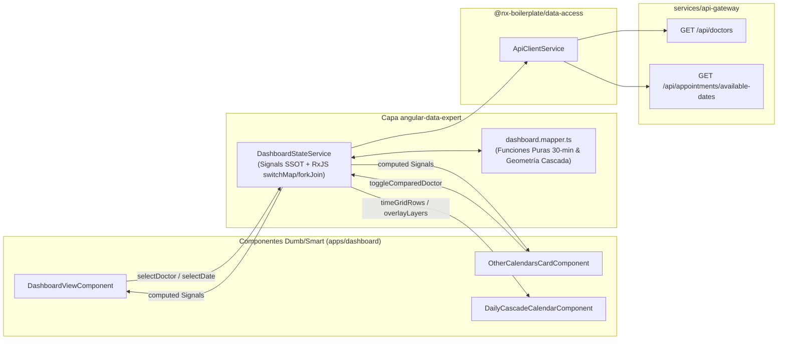

# Planeación de Capa de Datos y Servicios Frontend — MFE `apps/dashboard` (`angular-data-expert`)

> **Fecha de Análisis:** Noviembre 2026  
> **Skill Gobernante:** [`angular-data-expert`](../.agents/skills/angular-data-expert/SKILL.md)  
> **Documento Base Analizado:** [`docs/planeacion-front-dashboard.md`](./planeacion-front-dashboard.md)  
> **Documentación Backend Cotejada:** [`00-api-gateway.md`](./documentacion-back/00-api-gateway.md), [`02-scheduling-service.md`](./documentacion-back/02-scheduling-service.md), [`03-procedures-doctors-service.md`](./documentacion-back/03-procedures-doctors-service.md)

---

## 1. Dictamen de Auditoría Backend: ¿Tenemos todos los endpoints necesarios?

**Veredicto: SÍ (100% de cobertura en Backend para la Etapa 1 Visual y de Lectura).**  
No es necesario crear `docs/planeacion-back-dashboard.md` ni desarrollar nuevos controladores en `services/api-gateway` o `services/scheduling-service`, ya que la infraestructura actual de microservicios expone todos los datos requeridos por los 4 módulos visuales del nuevo MFE `apps/dashboard`.

### 1.1 Matriz de Cotejo (Widgets del Dashboard vs. Endpoints Reales en `api-gateway`)

| Módulo / Widget en `apps/dashboard` | Endpoint HTTP (`api-gateway`) | Patrón RMQ Interno | Contrato de Retorno (`@nx-boilerplate/api-interfaces`) | Estado Backend |
| :--- | :--- | :--- | :--- | :---: |
| **1. Selector Superior `<lib-carousel variant="pill-bar">`** + **Header de Bienvenida** (`Dr(a). Nombre — Especialidad`) | `GET /api/doctors` | `doctors.get-all` (`procedures-doctors-service`) | `IActiveProfessional[]` (`cedula`, `nombres`, `apellidos`, `email`, `profesion`, `horarioTrabajo`, `horariosExcepcionales`, `isActive`) | **Listo** |
| **2. Card "Otros calendarios"** (Checklist de profesionales con indicador cromático) | `GET /api/doctors` (Filtrado reactivo excluyendo al médico activo) | `doctors.get-all` | `IActiveProfessional[]` | **Listo** |
| **3. Fila de 2 KPIs Semanales** (*"Citas de la Semana Confirmadas"* y *"Citas de la Semana Agendadas"*) | `GET /api/appointments/available-dates?doctorEmail=...&doctorCedula=...&startDate=YYYY-MM-DD&endDate=YYYY-MM-DD` | `appointments.get-available-dates` (`scheduling-service`) | `IDayAvailability[]` (7 días de la semana seleccionada; cada día contiene `slots: ISlotDisplay[]` con `status: 'CONFIRMED' \| 'TENTATIVE' \| 'AVAILABLE' \| 'BLOCKED_PERSONAL'`) | **Listo** |
| **4. Card 3 "Calendario fecha actual"** (Grilla horaria `08:00` – `17:30` con Superposición en Cascada hasta 4 médicos) | `GET /api/appointments/available-dates` (en paralelo vía `forkJoin` + caché por médico) y/o `GET /api/appointments/daily?date=YYYY-MM-DD&doctorEmail=...` | `appointments.get-available-dates` / `appointments.get-daily-dashboard` | `IDayAvailability[]` + `IActiveProfessional.horarioTrabajo` (incluye `recesoAlmuerzo` e intervalos ISO `startTime` / `endTime`) | **Listo** |

### 1.2 Hallazgo Técnico Clave entre Backend y Frontend (Adaptador de Intervalos `45 min` $\rightarrow$ `30 min`)

Al inspeccionar el código fuente de [`services/scheduling-service/src/controllers/availability.controller.ts`](../services/scheduling-service/src/controllers/availability.controller.ts) (línea 27), se identificó un detalle técnico fundamental que la capa `angular-data-expert` debe resolver de forma transparente:

1. **Comportamiento actual del Backend:** `AvailabilityController.getAvailableDates()` invoca `AvailabilityService.getAvailableSlotsForRange()` con `durationMinutes = 45` (bloques de 45 minutos: `08:00 - 08:45`, `08:45 - 09:30`, etc.), devolviendo en cada `ISlotDisplay` las marcas exactas `startTime` y `endTime` en formato ISO, además del estado (`AVAILABLE`, `TENTATIVE`, `CONFIRMED`, `BLOCKED_PERSONAL`), `title` (procedimiento) y `patient` (`IBookingPatient`).
2. **Requerimiento Visual del Dashboard:** El documento `planeacion-front-dashboard.md` exige una grilla visual estandarizada en **intervalos de 30 minutos** (`08:00`, `08:30`, `09:00` ... `17:30`) para poder superponer en cascada (`100%` $\rightarrow$ `65%` $\rightarrow$ `50%` $\rightarrow$ `35%`) las agendas de hasta 4 médicos cuyos horarios o bloques pueden variar.
3. **Solución en la Capa de Datos (`angular-data-expert`):** En lugar de acoplar la vista al paso de 45 min del endpoint, el servicio `DashboardStateService` proyectará matemáticamente cualquier rango `[startTime, endTime]` (y el `recesoAlmuerzo` de `IActiveProfessional.horarioTrabajo`) sobre los **20 bloques canónicos de 30 minutos** (`08:00` a `17:30`) mediante una función pura de intersección temporal (`slotStart < rowEnd && slotEnd > rowStart`).

---

## 2. Arquitectura de la Capa de Datos (`angular-data-expert`)

Siguiendo estrictamente las directrices de [`.agents/skills/angular-data-expert/SKILL.md`](../.agents/skills/angular-data-expert/SKILL.md):
- **Single Source of Truth (SSOT):** Un único servicio con estado privado basado en Signals (`#doctors`, `#selectedDoctorCedula`, `#comparedDoctorCedulas`, `#selectedDate`, `#weeklyAvailabilityCache`, `#loading`, `#error`).
- **Consumo HTTP Desacoplado:** Uso exclusivo de `ApiClientService` (`@nx-boilerplate/data-access`), nunca `HttpClient` directo.
- **Concurrencia Multi-Médico Eficiente (`forkJoin` + Caché en Memoria):** Cuando el usuario activa un checkbox en *"Otros calendarios"*, el servicio consulta únicamente los médicos que aún no estén en el mapa de caché para la semana activa (`${cedula}_${startDate}_${endDate}`), evitando peticiones redundantes al cambiar de día dentro de la misma semana.
- **Resiliencia Offline / Fallback Determinista:** Si el entorno local se levanta en modo solo-frontend (sin RabbitMQ/Postgres activos) o un médico no tiene citas semilla en esa fecha, el servicio provee un normalizador de agenda base a partir de `horarioTrabajo` para que la superposición visual en cascada pueda validarse en todo momento.



---

## 3. Contratos y Modelos de Dominio Local (`apps/dashboard/src/app/models/dashboard.models.ts`)

Se definirán modelos inmutables tipados estrictamente sobre `@nx-boilerplate/api-interfaces`:

```typescript
import { IActiveProfessional, IDayAvailability } from '@nx-boilerplate/api-interfaces';

/** Estados semánticos de un bloque horario en la grilla de 30 minutos */
export type DashboardSlotStatus =
  | 'CONFIRMED'
  | 'SCHEDULED'
  | 'BLOCKED'
  | 'LUNCH'
  | 'AVAILABLE'
  | 'OUT_OF_HOURS';

/** Paleta categórica determinista para diferenciar médicos en "Otros calendarios" y en la cascada */
export interface IDoctorColorTheme {
  readonly id: string;
  readonly cssVar: string;          // Ej: 'var(--chart-1, var(--sys-color-primary))'
  readonly containerCssVar: string; // Ej: 'var(--sys-color-primary-container)'
  readonly onContainerCssVar: string;
}

/** Profesional enriquecido con metadatos visuales para el Dashboard */
export interface IDashboardDoctor extends IActiveProfessional {
  readonly fullName: string;
  readonly initials: string;
  readonly colorTheme: IDoctorColorTheme;
}

/** Geometría calculada para la superposición en cascada (Stacking Context) */
export interface IOverlayGeometry {
  readonly layerIndex: number;   // 0 (Principal) | 1 | 2 | 3
  readonly totalLayers: number;  // 1..4
  readonly widthPercent: number; // 100 | 65 | 50 | 35
  readonly leftPercent: number;  // 0 | 35 | 50 | 65
  readonly zIndex: number;       // 10, 20, 30, 40
}

/** Celda proyectada de un médico específico dentro de una fila de 30 minutos */
export interface IDashboardDoctorCell {
  readonly doctorCedula: string;
  readonly doctorName: string;
  readonly doctorInitials: string;
  readonly specialty: string;
  readonly colorCssVar: string;
  readonly isPrimary: boolean;
  readonly status: DashboardSlotStatus;
  readonly statusLabel: string;
  readonly procedureTitle?: string;
  readonly patientName?: string;
  readonly geometry: IOverlayGeometry;
}

/** Fila canónica de 30 minutos (08:00 a 17:30) con las capas apiladas */
export interface IDashboardTimeRow {
  readonly timeLabel: string; // '08:00', '08:30', ..., '17:30'
  readonly startMinutes: number;
  readonly endMinutes: number;
  readonly layers: readonly IDashboardDoctorCell[];
}

/** Resumen de KPIs semanales para la fila de 2 tarjetas superiores */
export interface IDashboardWeeklyKpis {
  readonly confirmedCount: number;
  readonly scheduledCount: number;
  readonly weekRangeLabel: string;
}
```

---

## 4. Funciones Puras de Transformación (`apps/dashboard/src/app/utils/dashboard-calendar.mapper.ts`)

Para cumplir con el principio de testabilidad al 100% de `angular-data-expert`, toda la matemática de superposición y proyección de intervalos se aísla en funciones puras sin efectos secundarios:

### 4.1 Algoritmo de Geometría de Superposición en Cascada (`calculateOverlayGeometry`)

Resuelve la regla visual de `docs/planeacion-front-dashboard.md` (Sección 4.1) donde cada capa adicional se posiciona a la derecha permitiendo ver la pestaña izquierda de las capas inferiores:

```typescript
const CASCADE_WIDTHS: readonly number[] = [100, 65, 50, 35];

export function calculateOverlayGeometry(
  layerIndex: number,
  totalLayers: number
): IOverlayGeometry {
  const safeIndex = Math.max(0, Math.min(layerIndex, CASCADE_WIDTHS.length - 1));
  const widthPercent = CASCADE_WIDTHS[safeIndex];
  const leftPercent = 100 - widthPercent;

  return {
    layerIndex: safeIndex,
    totalLayers: Math.min(totalLayers, CASCADE_WIDTHS.length),
    widthPercent,
    leftPercent,
    zIndex: (safeIndex + 1) * 10,
  };
}
```

### 4.2 Proyección de `IDayAvailability` (45 min) + `horarioTrabajo` a Grilla de 30 min (`buildTimeGridRows`)

1. Genera los **20 intervalos canónicos de 30 minutos** desde `08:00` (`480 min`) hasta `17:30` (`1050 min`).
2. Para cada médico activo en las capas (`[activeDoctor, ...comparedDoctors].slice(0, 4)`):
   - Evalúa si la franja de 30 min cae dentro del `recesoAlmuerzo` del médico (`inicio` - `fin` en `horarioTrabajo`) $\rightarrow$ estado `'LUNCH'` (*"Almuerzo"*).
   - Evalúa si existe un `ISlotDisplay` en `IDayAvailability.slots` para la fecha seleccionada cuyo intervalo `[slotStart, slotEnd]` intersecte la fila `[rowStart, rowEnd]`:
     - `CONFIRMED` $\rightarrow$ `'CONFIRMED'` (muestra procedimiento y paciente).
     - `TENTATIVE` $\rightarrow$ `'SCHEDULED'` (Cita agendada pendiente de confirmar).
     - `BLOCKED_PERSONAL` $\rightarrow$ `'BLOCKED'` (*"Bloqueado"*).
     - `AVAILABLE` $\rightarrow$ `'AVAILABLE'` (*"Disponible"*).
   - Si está fuera del `horarioTrabajo` (`horaInicio` - `horaFin`) o el día no es laborable $\rightarrow$ `'OUT_OF_HOURS'`.

---

## 5. Diseño de `DashboardStateService` (`apps/dashboard/src/app/services/dashboard-state.service.ts`)

### 5.1 Estado Privado (Signals de Escritura Interna)

```typescript
@Injectable()
export class DashboardStateService {
  readonly #api = inject(ApiClientService);

  // Estado privado mutable únicamente por métodos de acción
  readonly #doctors = signal<IDashboardDoctor[]>([]);
  readonly #selectedDoctorCedula = signal<string | null>(null);
  readonly #comparedDoctorCedulas = signal<readonly string[]>([]);
  readonly #selectedDate = signal<Date>(getColombiaToday());
  readonly #weeklyAvailabilityCache = signal<Record<string, IDayAvailability[]>>({});
  readonly #loadingDoctors = signal<boolean>(false);
  readonly #loadingSchedule = signal<boolean>(false);
  readonly #error = signal<string | null>(null);
```

### 5.2 Selectores Reactivos Públicos (`computed` & `linkedSignal`)

| Signal Público | Tipo | Responsabilidad |
| :--- | :--- | :--- |
| `doctors` | `Signal<readonly IDashboardDoctor[]>` | Lista de profesionales activos con tema de color asignado (`--chart-1` a `--chart-5`). |
| `doctorPillItems` | `Signal<CarouselItem[]>` | Mapeo directo para `<lib-carousel variant="pill-bar" [items]="doctorPillItems()" />`. |
| `activeDoctor` | `Signal<IDashboardDoctor \| null>` | Profesional seleccionado actualmente en la barra superior (por defecto el primero de la lista). |
| `otherDoctors` | `Signal<readonly IDashboardDoctor[]>` | Todos los médicos excepto `activeDoctor()`, usados para poblar la Card 1 *"Otros calendarios"*. |
| `comparedDoctorCedulas` | `Signal<readonly string[]>` | Cédulas marcadas en *"Otros calendarios"* (máximo 3 adicionales = 4 capas totales). Se limpia automáticamente la cédula si el usuario la elige como médico principal mediante `linkedSignal`. |
| `selectedDate` | `Signal<Date>` | Fecha activa controlada por el `<mat-calendar>` de la Card 2. |
| `weeklyKpis` | `Signal<IDashboardWeeklyKpis>` | Calcula en tiempo real `confirmedCount` (`status === 'CONFIRMED'`) y `scheduledCount` (`status === 'TENTATIVE'`) sumando todos los días de la semana activa del `activeDoctor`. |
| `activeOverlayDoctors` | `Signal<readonly IDashboardDoctor[]>` | Arreglo ordenado `[activeDoctor, ...comparedDoctors]` (máx. 4) con su geometría de cascada. |
| `timeGridRows` | `Signal<readonly IDashboardTimeRow[]>` | Las 20 filas de 30 minutos (`08:00` – `17:30`) con las celdas apiladas listas para renderizar en el template con `@for`. |

### 5.3 Flujo Asíncrono RxJS (`loadInitialData` y `ensureDoctorsWeekLoaded`)

1. **Carga de Profesionales (`loadDoctors()`):**
   - Consume `this.#api.get<IActiveProfessional[]>('/doctors')`.
   - Filtra `isActive !== false`, enriquece con `fullName`, `initials` y `colorTheme`, selecciona por defecto el primer profesional y dispara la carga de disponibilidad semanal.
2. **Carga Concurrente de Disponibilidad Semanal (`loadWeekForActiveLayers()`):**
   - Calcula el lunes (`startDate`) y domingo (`endDate`) de la semana de `selectedDate()` usando utilidades de `@nx-boilerplate/utils` (`formatDateYMD`).
   - Identifica qué médicos dentro de `[activeDoctor, ...comparedDoctors]` aún no tienen entrada en `#weeklyAvailabilityCache()` para la llave `${cedula}_${startDate}_${endDate}`.
   - Ejecuta `forkJoin` sobre `this.#api.get<IDayAvailability[]>('/appointments/available-dates', { params: { doctorEmail, doctorCedula, startDate, endDate } })` únicamente para los médicos faltantes.
   - Usa `catchError` por cada stream individual para devolver una agenda determinista basada en `horarioTrabajo` si el backend no está levantado, garantizando cero caídas en UI.

---

## 6. Plan de Pruebas Unitarias de la Capa de Datos (Vitest)

Siguiendo el estándar del monorepo (`apps/historial-pacientes` con 45 tests en verde):
1. **`dashboard-calendar.mapper.spec.ts`:**
   - Verifica `calculateOverlayGeometry()` para 1, 2, 3 y 4 capas (`100%`, `65%`, `50%`, `35%` y `leftPercent` `0%`, `35%`, `50%`, `65%`).
   - Verifica la proyección de slots de 45 minutos (`08:00 - 08:45`) sobre los bloques de 30 minutos (`08:00` y `08:30`).
   - Verifica la marcación automática de `recesoAlmuerzo` (`12:00 - 13:00`) como estado `'LUNCH'`.
   - Verifica el conteo semanal de KPIs (`confirmedCount` y `scheduledCount`).
2. **`dashboard-state.service.spec.ts`:**
   - Verifica carga inicial de `/doctors` y selección automática del médico principal.
   - Verifica que al cambiar de médico principal se remueva automáticamente de `comparedDoctorCedulas` si estaba seleccionado como secundario.
   - Verifica el límite máximo de 3 médicos comparados en *"Otros calendarios"* (4 capas en total).
   - Verifica el uso de caché semanal para no repetir llamadas HTTP al cambiar de día dentro de la misma semana.

