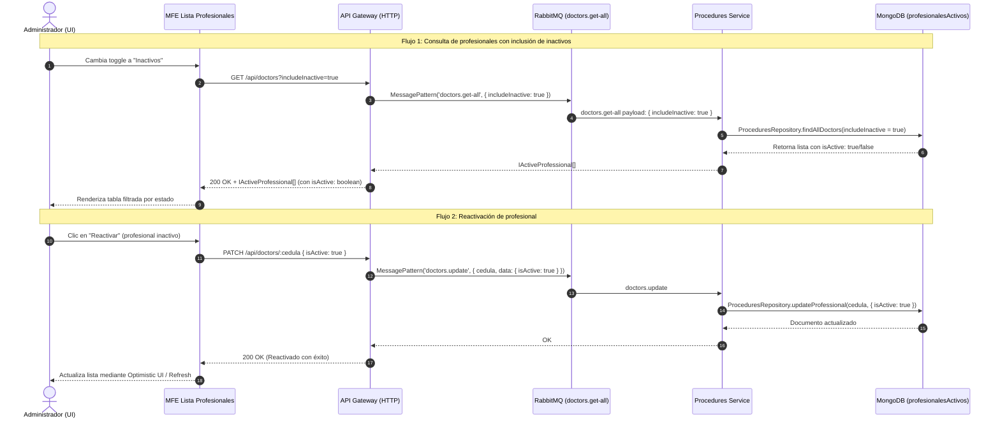

# Propuesta Técnica: Activación de Soporte para Profesionales Activos e Inactivos (`isActive`)

> **Ficha Técnica de la Propuesta**  
> * **Documento:** `docs/planeacion-isActive.md`  
> * **Módulos Involucrados:** `libs/shared/api-interfaces`, `libs/shared/dtos`, `services/api-gateway`, `services/procedures-service`, `libs/backend/procedures-domain`, `apps/lista-profesionales`  
> * **Tipo de Módulo:** Full-Stack (Contratos Compartidos, Microservicios NestJS, MFE Angular Standalone)  
> * **Estado:** Propuesta Técnica / Planificación  

---

## 1. Resumen Ejecutivo y Diagnóstico

### Contexto del Problema
En el Microfrontend administrativo [`apps/lista-profesionales`](file:///Users/usuario/Desktop/nx-boilerplate/apps/lista-profesionales), la interfaz de usuario cuenta con un selector de vista (`MatButtonToggleGroup`) para alternar entre profesionales **Activos** e **Inactivos** (dados de baja lógica mediante `DELETE /api/doctors/:cedula`). Actualmente, este control se encuentra deshabilitado con el tooltip *"Disponible próximamente"*.

### Diagnóstico de la Auditoría
1. **Capa de Dominio (`libs/backend/procedures-domain`):**
   * ✅ **Soportado:** [`ProceduresDomainService.getAllDoctors(includeInactive = false)`](file:///Users/usuario/Desktop/nx-boilerplate/libs/backend/procedures-domain/src/lib/services/procedures-domain.service.ts#L75) y [`ProceduresRepository.findAllDoctors(includeInactive)`](file:///Users/usuario/Desktop/nx-boilerplate/libs/backend/procedures-domain/src/lib/repositories/procedures.repository.ts#L61) ya implementan la discriminación por `{ isActive: { $ne: false } }`.
2. **Capa de Transporte (Cuello de Botella):**
   * ❌ **API Gateway:** [`DoctorsController.getAllDoctors()`](file:///Users/usuario/Desktop/nx-boilerplate/services/api-gateway/src/controllers/doctors.controller.ts#L27) en `services/api-gateway` no recibe `@Query()` y despacha `{}` vacío a RabbitMQ bajo el patrón `'doctors.get-all'`.
   * ❌ **Procedures Service:** [`ProceduresMessageController.getAllDoctors()`](file:///Users/usuario/Desktop/nx-boilerplate/services/procedures-service/src/controllers/procedures-message.controller.ts#L47) en `services/procedures-service` no extrae `@Payload()` y llama a `getAllDoctors()` sin argumentos, forzando `includeInactive = false`.
3. **Contratos e Interfaces:**
   * ✅ `IActiveProfessional` en [`procedure.interface.ts`](file:///Users/usuario/Desktop/nx-boilerplate/libs/shared/api-interfaces/src/lib/procedure.interface.ts#L28) sí incluye `isActive: boolean`.
   * ✅ `UpdateProfessionalDto` en [`professional.dto.ts`](file:///Users/usuario/Desktop/nx-boilerplate/libs/shared/dtos/src/lib/professional.dto.ts#L166) sí valida `@IsBoolean() isActive?: boolean`.
   * ❌ **Discrepancia en contrato TS:** `IUpdateProfessionalRequest` deriva de `ICreateProfessionalRequest` (que omite `isActive`), lo que impide en TypeScript frontend enviar `{ isActive: true }` sin errores de compilación estricta.

---

## 2. Diagrama de Arquitectura y Flujo End-to-End



---

## 3. Matriz de Cambios por Capa y Archivo

| Capa | Archivo | Acción Requerida |
|---|---|---|
| **Contratos TS** | `libs/shared/api-interfaces/src/lib/procedure.interface.ts` | 1. Extender `IUpdateProfessionalRequest` para permitir `isActive?: boolean;`.<br>2. Definir interfaz para query/payload: `IGetDoctorsQueryRequest`. |
| **DTOs Backend** | `libs/shared/dtos/src/lib/professional.dto.ts` | 1. Crear `GetDoctorsFilterDto` para validar query params en Gateway.<br>2. Crear `GetDoctorsMessageDto` para validar payload RabbitMQ. |
| **API Gateway** | `services/api-gateway/src/controllers/doctors.controller.ts` | Extraer `@Query() query: GetDoctorsFilterDto` y remitir `{ includeInactive: query.includeInactive === true }` al broker. |
| **Microservicio** | `services/procedures-service/src/controllers/procedures-message.controller.ts` | Recibir `@Payload() payload: GetDoctorsMessageDto` y delegar a `getAllDoctors(payload?.includeInactive)`. |
| **MFE Service** | `apps/lista-profesionales/src/app/services/profesionales-admin.service.ts` | 1. Modificar `loadProfesionales(includeInactive?: boolean)`.<br>2. Agregar método `reactivateProfesional(cedula: string)`. |
| **MFE UI** | `apps/lista-profesionales/src/app/components/profesionales-list/profesionales-list.component.*` | 1. Habilitar `MatButtonToggleGroup` (quitar `disabled` y tooltip).<br>2. Conectar filtrado reactivo mediante Signals (`computed`).<br>3. Agregar acción visual "Reactivar" en profesionales inactivos. |

---

## 4. Especificación Detallada de Cambios (Código Propuesto)

### Fase A — Contratos Compartidos (`@nx-boilerplate/api-interfaces`)

````typescript:libs/shared/api-interfaces/src/lib/procedure.interface.ts
// Modificación a la interfaz de actualización existente
export type IUpdateProfessionalRequest = Partial<
  Omit<ICreateProfessionalRequest, 'cedula'>
> & {
  isActive?: boolean;
};

// Nueva interfaz para parámetros de consulta
export interface IGetDoctorsQueryRequest {
  includeInactive?: boolean;
}
````

---

### Fase B — DTOs de Validación Runtime (`@nx-boilerplate/shared-dtos`)

````typescript:libs/shared/dtos/src/lib/professional.dto.ts
import { Transform } from 'class-transformer';

export class GetDoctorsFilterDto {
  @IsOptional()
  @Transform(({ value }) => value === 'true' || value === true)
  @IsBoolean({ message: 'includeInactive debe ser un booleano' })
  includeInactive?: boolean;
}

export class GetDoctorsMessageDto {
  @IsOptional()
  @IsBoolean({ message: 'includeInactive debe ser un booleano' })
  includeInactive?: boolean;
}
````

Exportar en el barril `libs/shared/dtos/src/lib/index.ts`.

---

### Fase C — API Gateway (`services/api-gateway`)

````typescript:services/api-gateway/src/controllers/doctors.controller.ts
  @Get()
  getAllDoctors(
    @Query() query: GetDoctorsFilterDto
  ): Observable<IActiveProfessional[]> {
    return this.proceduresClient
      .send<IActiveProfessional[]>('doctors.get-all', {
        includeInactive: query?.includeInactive === true,
      })
      .pipe(timeout(5000));
  }
````

---

### Fase D — Procedures Service (`services/procedures-service`)

````typescript:services/procedures-service/src/controllers/procedures-message.controller.ts
  @MessagePattern('doctors.get-all')
  async getAllDoctors(
    @Payload() payload: GetDoctorsMessageDto
  ): Promise<IActiveProfessional[]> {
    return this.proceduresDomainService.getAllDoctors(payload?.includeInactive ?? false);
  }
````

---

### Fase E — Frontend MFE (`apps/lista-profesionales`)

#### 1. Servicio Administrador (`profesionales-admin.service.ts`)
* Cambiar la carga de profesionales para solicitar siempre el listado completo (`includeInactive=true`) o según demanda.
* Al tener el catálogo completo en cliente con `isActive: boolean`, el filtrado entre Activos e Inactivos se realiza de manera instantánea mediante Signals reactivas sin penalizar la red, o alternativamente mediante recarga con parámetro.
* Agregar método de reactivación:
  ```typescript
  reactivateProfesional(cedula: string): Observable<unknown> {
    return this.updateProfesional(cedula, { isActive: true });
  }
  ```

#### 2. Componente de Lista (`profesionales-list.component.ts` y `.html`)
* Habilitar el grupo de botones de alternancia:
  ```html
  <mat-button-toggle-group
    aria-label="Filtrar profesionales por estado"
    [value]="viewFilter()"
    (change)="viewFilter.set($event.value)"
  >
    <mat-button-toggle value="activos">Activos</mat-button-toggle>
    <mat-button-toggle value="inactivos">Inactivos</mat-button-toggle>
  </mat-button-toggle-group>
  ```
* Definir señal computada para los datos de la tabla:
  ```typescript
  readonly displayedProfesionales = computed(() => {
    const list = this.profesionalesService.profesionalesList();
    const filter = this.viewFilter();
    return list.filter((p) => filter === 'activos' ? p.isActive !== false : p.isActive === false);
  });
  ```
* En el detalle de la fila (`#detailTpl`), mostrar botón condicional:
  * Si `profesional.isActive !== false`: Botón para dar de baja (eliminar lógicamente).
  * Si `profesional.isActive === false`: Botón para reactivar (`onReactivate(profesional)`).

---

## 5. Plan de Ejecución Paso a Paso

1. **Paso 1: Capa de Contratos y DTOs (`libs/shared/*`)**
   * Editar `libs/shared/api-interfaces/src/lib/procedure.interface.ts`.
   * Editar `libs/shared/dtos/src/lib/professional.dto.ts`.
   * Verificar con `npx nx build shared-dtos`.
2. **Paso 2: Capa de Transporte Backend (`services/*`)**
   * Modificar `services/procedures-service/src/controllers/procedures-message.controller.ts`.
   * Modificar `services/api-gateway/src/controllers/doctors.controller.ts`.
   * Verificar con `npx nx build procedures-service` y `npx nx build api-gateway`.
3. **Paso 3: Frontend MFE (`apps/lista-profesionales`)**
   * Actualizar `profesionales-admin.service.ts` y sus pruebas unitarias `.spec.ts`.
   * Actualizar `profesionales-list.component.ts`, `.html` y `.scss`.
   * Verificar con `npx nx build lista-profesionales` y `npx nx test lista-profesionales`.
4. **Paso 4: Verificación Integral del Monorepo**
   * Ejecutar linters y pruebas afectadas con Nx.

---

## 6. Comandos de Verificación con Nx

```bash
# Compilar contratos y DTOs
npx nx build shared-dtos

# Compilar microservicios de backend
npx nx build procedures-service
npx nx build api-gateway

# Compilar y probar frontend
npx nx test lista-profesionales --no-watch
npx nx build lista-profesionales
```
