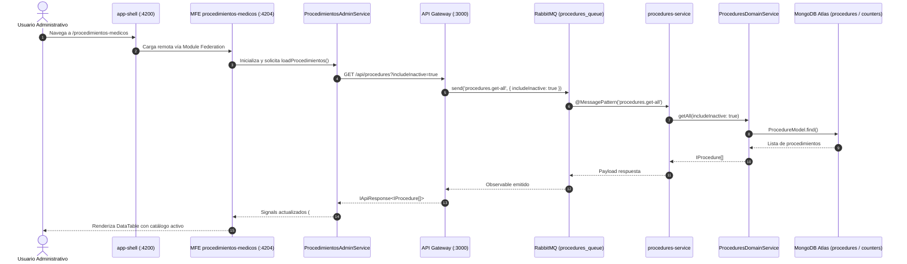

# Módulo de Procedimientos Médicos (End-to-End)

> **Ficha Técnica del Módulo**  
> * **Ubicación en Monorepo:**  
>   * Frontend Remote MFE: [`apps/procedimientos-medicos`](file:///Users/usuario/Desktop/nx-boilerplate/apps/procedimientos-medicos) (`:4204`)  
>   * Host Shell: [`app-shell`](file:///Users/usuario/Desktop/nx-boilerplate/app-shell) (`:4200/procedimientos-medicos`)  
>   * API Gateway HTTP: [`services/api-gateway`](file:///Users/usuario/Desktop/nx-boilerplate/services/api-gateway) (`:3000/api/procedures`)  
>   * Microservicio RabbitMQ: [`services/procedures-service`](file:///Users/usuario/Desktop/nx-boilerplate/services/procedures-service) (cola: `procedures_queue`)  
>   * Dominio y Persistencia: [`libs/backend/procedures-domain`](file:///Users/usuario/Desktop/nx-boilerplate/libs/backend/procedures-domain)  
>   * Contratos & DTOs: [`libs/shared/api-interfaces`](file:///Users/usuario/Desktop/nx-boilerplate/libs/shared/api-interfaces) y [`libs/shared/dtos`](file:///Users/usuario/Desktop/nx-boilerplate/libs/shared/dtos)  
>   * Componentes UI Formulario: [`libs/shared/layouts`](file:///Users/usuario/Desktop/nx-boilerplate/libs/shared/layouts)  
> * **Tipo de Módulo:** Full-Stack Feature (MFE Angular 21+ Zoneless + Microservicio NestJS 11+ DDD)  
> * **Tags Nx:** `["scope:frontend", "type:app"]` / `["scope:backend", "type:service"]` / `["scope:backend", "type:domain-lib"]`  
> * **Estado:** Activo / Producción  

---

## 1. Propósito y Alcance de Negocio

El módulo de **Procedimientos Médicos** proporciona la infraestructura integral para la administración, tarificación y consulta de procedimientos quirúrgicos, estéticos y de consulta externa en la clínica.

Sus responsabilidades esenciales son:
1. **Identificación Unívoca y Atómica:** Generación de identificadores canónicos mediante contadores atómicos en MongoDB (`PROC-EST-001`, `PROC-EST-002`, ...), sincronizados con los procedimientos iniciales sembrados.
2. **Ciclo de Vida CRUD Completo:** Creación, lectura, actualización y baja lógica segura (`isActive: false`).
3. **Integridad Referencial Estricta:** Un procedimiento no puede ser eliminado si está vinculado a profesionales médicos en estado activo (`medicosRelacionados.length > 0`). El servidor arroja una excepción de conflicto (409) y el frontend bloquea la operación antes de emitir tráfico HTTP.
4. **Auto-recuperación de Inactivos:** Si se intenta registrar un procedimiento con el nombre de uno inactivo, el sistema evita duplicidades en base de datos ofreciendo la reactivación y actualización inmediata.
5. **Gestión de Insumos y Laboratorios:** Captura dinámica de listas de insumos (`IProcedureLaboratory`) asociados a cada procedimiento.

---

## 2. Diagrama de Arquitectura End-to-End



---

## 3. Contratos de Datos, Interfaces y DTOs

### A. Interfaces Compartidas (`@nx-boilerplate/api-interfaces`)

```typescript
export interface IProcedureLaboratory {
  nombreLaboratorio: string;
  precio: number;
  medidaPorUnidad: string;
}

export interface IProcedure {
  idProcedimiento: string;
  nombreProcedimiento: string;
  valorStandar: number;
  duracionStandar: number;
  medicosRelacionados?: string[];
  laboratorios?: IProcedureLaboratory[];
  isActive?: boolean;
}

export interface ICreateProcedureRequest {
  nombreProcedimiento: string;
  valorStandar: number;
  duracionStandar: number;
  laboratorios?: IProcedureLaboratory[];
}

export interface IUpdateProcedureRequest {
  nombreProcedimiento?: string;
  valorStandar?: number;
  duracionStandar?: number;
  laboratorios?: IProcedureLaboratory[];
  isActive?: boolean;
}

export interface IProcedureSoftDeleteResponse {
  idProcedimiento: string;
  isActive: boolean;
  message: string;
}
```

### B. DTOs de Validación Runtime (`@nx-boilerplate/shared-dtos`)

Decorados con `class-validator` y transformados en el perímetro del Gateway y del microservicio:
* **`CreateProcedureDto`:** valida `nombreProcedimiento` (`@MinLength(3)`, `@MaxLength(100)`), `valorStandar` (`@Min(0)`), `duracionStandar` (`@Min(5)`, `@Max(480)`), y `@ValidateNested()` para `ProcedureLaboratoryDto`.
* **`UpdateProcedureDto`:** campos opcionales decorados con `@IsOptional()`.
* **`FilterProceduresQueryDto`:** `@Transform` booleano para `includeInactive` y `@IsOptional()` para `doctorCedula`.
* **`FindProcedureParamDto`:** valida que `idProcedimiento` sea no vacío.

---

## 4. Puntos de Entrada y Transporte

### A. REST API (API Gateway `:3000`)

| Método | Ruta | DTO Entrada | Evento RabbitMQ | Timeout |
|---|---|---|---|:---:|
| `GET` | `/api/procedures` | `FilterProceduresQueryDto` | `procedures.get-all` / `procedures.find-by-doctor` | 5s |
| `GET` | `/api/procedures/:idProcedimiento` | `FindProcedureParamDto` | `procedures.find-by-id` | 5s |
| `GET` | `/api/procedures/:idProcedimiento/doctors` | `FindProcedureParamDto` | `procedures.get-doctors-by-procedure` | 5s |
| `POST` | `/api/procedures` | `CreateProcedureDto` | `procedures.create` | 5s |
| `PATCH` | `/api/procedures/:idProcedimiento` | `UpdateProcedureDto` | `procedures.update` | 10s |
| `DELETE` | `/api/procedures/:idProcedimiento` | `FindProcedureParamDto` | `procedures.soft-delete` | 5s |

### B. Mensajería RabbitMQ (`procedures_queue`)

* **`procedures.get-all`:** consulta con opción `{ includeInactive?: boolean }`.
* **`procedures.create`:** verifica unicidad de nombre mediante collation en español (`strength: 1`), genera el correlativo atómico en `counters` y persiste en MongoDB.
* **`procedures.update`:** verifica existencia (404), valida ausencia de homónimos (409) y actualiza datos.
* **`procedures.soft-delete`:** operación atómica que comprueba que `medicosRelacionados` tenga tamaño 0 (`{ medicosRelacionados: { $size: 0 } }`). Si tiene médicos vinculados, lanza `RpcException(409)`.

---

## 5. Frontend MFE (`apps/procedimientos-medicos`)

* **Remote Entry / Tab Host:**
  * `<lib-tabs-collection>` gestiona dos vistas: Lista y Formulario Stepper.
  * Sincronización bidireccional de estados a través de `ProcedimientosAdminService`.
* **Vistas Smart:**
  * **`ProcedimientosListComponent`:** `<lib-data-table>` con columnas formateadas en COP, acciones contextuales de edición y borrado protegido con `<lib-confirmation-modal>`.
  * **`ProcedimientosFormComponent`:** stepper vertical de 3 pasos conectando con componentes presentacionales puros (`lib-step-procedure-name`, `lib-step-procedure-pricing`, `lib-step-procedure-summary`).
* **Optimistic UI:**
  * En bajas lógicas, el elemento se desactiva de inmediato en la vista. Si el backend rechaza la baja (ej. 409 por médicos vinculados), el SSOT revierte al snapshot y expone el mensaje de alerta.

---

## 6. Comandos de Verificación (Nx)

```bash
# Compilar todo el ecosistema relacionado
npx nx run-many -t build -p api-gateway procedures-service procedimientos-medicos app-shell

# Ejecutar pruebas unitarias de backend
npx nx run-many -t test -p procedures-domain procedures-service

# Ejecutar pruebas unitarias de frontend
npx nx run-many -t test -p layouts procedimientos-medicos

# Validar linting de todo el workspace
npx nx run-many -t lint -p api-gateway procedures-service procedimientos-medicos layouts
```
